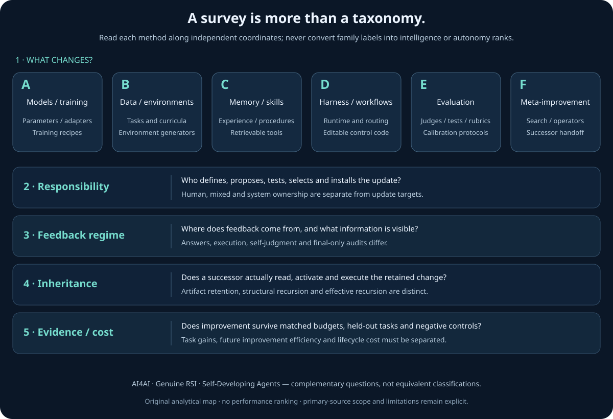
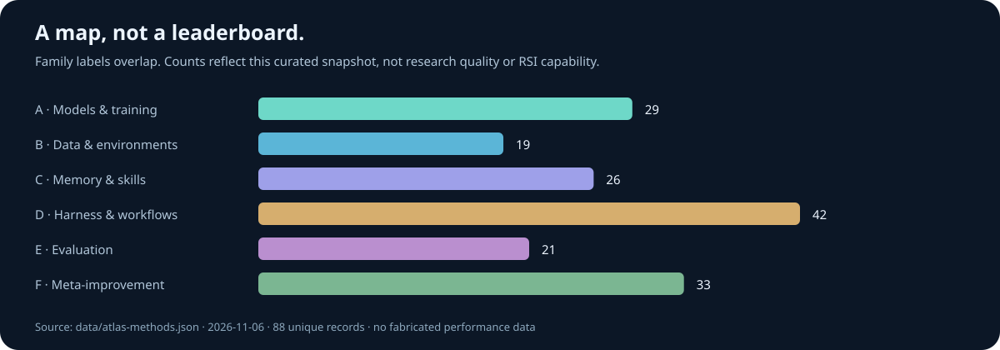

<p align="center"><a href="README.md"><strong>English</strong></a> · <a href="README.zh-CN.md">简体中文 →</a></p>

<a href="https://hyfine.github.io/rsi-atlas/"></a>

# RSI Atlas

**One source of truth for recursive self-improvement: mechanisms, institutions, timelines and inspectable implementations.**

[Explore the live atlas](https://hyfine.github.io/rsi-atlas/) · [Family timeline](https://hyfine.github.io/rsi-atlas/#timeline) · [Institutions](https://hyfine.github.io/rsi-atlas/#institutions) · [中文切换](README.zh-CN.md)

## Start with a real research synthesis

[Read the cross-survey synthesis · Chinese](docs/zh/12_RSI_Research_Synthesis.md) · [Explore the survey portal](https://hyfine.github.io/rsi-atlas/#survey)

A problem-driven synthesis of AI4AI, Genuine RSI and Self-Developing Agents: definitions, ten algorithm templates, 29 comparative methods, feedback assumptions, frozen layers, negative results, lifecycle cost and open research questions. The A–F object families are not autonomy rankings.



## See the whole field grow

[Grow the RSI development tree](https://hyfine.github.io/rsi-atlas/#panorama) · [Unfold the method-family fan](https://hyfine.github.io/rsi-atlas/#survey) · [Survey fulltext review](docs/zh/14_RSI_Survey_Fulltext_Update.md)

Pan, zoom and replay an organic tree of theoretical roots, family routes and dated method leaves. The horizontal timeline distinguishes first-public evidence from its explicitly compressed early-history segment. The six-sector fan opens to180° and compares classics with recent methods. Branches express analytical membership, not verified technical ancestry; animation is explanatory, not experimental traffic.



## Start with the questions that matter

What changes? What persists? Does the successor actually participate in the next improvement? Who independently checks the result?

The site opens in **English**, with a visible **中文 / English** switch. Browse chronological, **family-lane** and **institution-lane** timelines; choose an inclusive start/end interval, a last-12-month window, a family, an institution and an organization type. Revisions never move a paper's first-submission node. Missing affiliations and ambiguous release dates stay visible.

| Public snapshot | Coverage |
|---|---:|
| Curated research and related release records | 88 |
| Records dated within 2025-11-06—2026-11-06 | 58 |
| Records with primary affiliation/publisher attribution | 88 |
| Operational improvement families | 6 |
| Playable mechanism scenarios | 10 |
| Source-pinned open implementation case studies | 6 |
| Snapshot cutoff | 2026-11-06 |

These are evidence and collection counts, **not counts of replicated algorithms**. Institutions reflect the cited author block or release publisher, not ownership, endorsement, current employment or capability rankings. Assignment is non-exclusive; unverified records remain labelled.

## Focus: four ways to improve a harness — or its improver

- **[Harness²](https://arxiv.org/abs/2610.14224)** — Task-level recursion performs contrastive Propose–Probe–Compose over executable harness edits. Invariant and domain-specific candidates are executed on the current task; their behavioral contrasts guide selective composition. After the task, an improvement library retains the adopted executable harness and supported lessons. Subsequent tasks restart from the common execution harness but use the updated library to guide refinement. Model weights, stage instructions and decision rules remain fixed.
- **[Evo²](https://arxiv.org/abs/2610.13025)** — A shared-parameter policy acts as both Proposer and Reflector. Harness tree search produces autonomous edits, feedback-directed revisions and cross-branch strategy transfers. Evaluated modifications supply training experience for EvoTIDE: trajectory recovery through edit extraction and prefix continuation, an SFT warm start, then interleaved GRPO for both roles. Updated evolver weights guide subsequent search, while the task executor remains fixed.
- **[RRSI](https://arxiv.org/abs/2609.24972)** — RRSI leaves the harness edit space open while regularizing proposal and selection. It anneals the number of independent edits, conditions proposals on an evidence ledger and redirects stalled search toward untried components. A pre-evaluation critic screens leakage; admissibility combines a best-ever noise-adjusted floor, gain-dependent token-cost control, a separate within-noise-band rule and domain guards. Unproductive components become pruning targets.
- **[OO-Harness](https://arxiv.org/abs/2610.28380)** — OO-Harness evolves a hierarchy of executable harness classes on discovery tasks. An evolution agent clusters execution needs, selects a parent and creates subclasses through inheritance, overrides and new methods. Cluster-local evaluations determine acceptance and supply design/routing lessons. Deployment freezes the hierarchy and lessons. A router uses the task and observable base execution to choose one complete specialized class or reuse the base result; ancestor classes are not separately executed agents.

[Detailed focus review, flow diagrams and evidence limits](docs/zh/10_Harness_Focus.md) · [All supplied updates and institutional sources](docs/zh/11_Institutions_and_Updates.md)

Evo² here is **weight–harness co-evolution of an evolver**, not the genomic Evo 2 model and not CoEvo-RSI. New code availability is not assumed where no official implementation was verified.

## Explore the landscape



| Improvement object | Category architecture | Representative flow |
|---|---|---|
| A. Models & training | [Open architecture](pics/family-a-architecture.html) | [Play flow](pics/family-a-flow.html) |
| B. Data & environments | [Open architecture](pics/family-b-architecture.html) | [Play flow](pics/family-b-flow.html) |
| C. Memory & skills | [Open architecture](pics/family-c-architecture.html) | [Play flow](pics/family-c-flow.html) |
| D. Harness & workflows | [Open architecture](pics/family-d-architecture.html) | [Play flow](pics/family-d-flow.html) |
| E. Evaluation | [Open architecture](pics/family-e-architecture.html) | [Play flow](pics/family-e-flow.html) |
| F. Meta-improvement | [Open architecture](pics/family-f-architecture.html) | [Play flow](pics/family-f-flow.html) |

Family diagrams are **project-authored conceptual architectures**, not universal algorithms or copied paper figures. [Six family explanations](docs/zh/08_Family_Architectures.md) and [six explicitly licensed paper figures/details](docs/zh/09_Paper_Figures.md) are kept separate.

## Engineering navigation from the workbook

[Explore 147 engineering projects](https://hyfine.github.io/rsi-atlas/#implementations) · [Full comparison guide](docs/zh/13_Open_Source_Engineering.md)

10 purpose categories, 44 retained exclusion decisions, bilingual summaries and search/filter controls. This 2026-11-06 workbook snapshot is separate from the six source-pinned reviews; counts, popularity and completeness claims are not new code audits or replications.

## From papers to code

[Six implementation deep dives](docs/repo_deepdive/README.md) · [Interactive source walkthroughs](docs/repo_deepdive/implementation-atlas.html)

GenericAgent · GEPA · SoL-Pi · HyperAgents · RRSI · OpenRSI. Fixed commits, 72 module mappings, architecture and branching workflows, setup requirements, limitations and practical comparisons. Source-available/non-commercial licenses are distinguished from permissive open source. These reviews did not execute paid research experiments.

## Read deeper

The interface and summaries are bilingual; the comprehensive technical chapters remain in Chinese and link to original papers.

| Topic | Guide |
|---|---|
| Landscape and chronology | [Panorama](docs/zh/01_RSI_Technical_Panorama.md) · [Method map](docs/zh/03_Method_Map_and_Timeline.md) |
| Theory, mechanisms and implementation choices | [Algorithm handbook](docs/zh/04_Algorithm_Handbook.md) |
| Training and task/environment evolution | [Training and environments](docs/zh/chapters/02_Training_Environments_and_AI_Research.md) |
| Memory, skills and harnesses | [Agent systems](docs/zh/chapters/03_Agent_Skills_and_Harness.md) |
| Meta-improvement, evaluation and safety | [Evidence and evaluation](docs/zh/chapters/04_Meta_RSI_Evaluation_and_Safety.md) |
| Industry and surveys | [Sources and frontiers](docs/zh/chapters/05_Surveys_Industry_and_Frontiers.md) |
| Original source inventory | [Full catalog](catalog/index.md) · [Classic reading list](catalog/classics.md) |
| Maintenance and consolidation | [Contributing](CONTRIBUTING.md) · [Consolidation](docs/maintenance/CONSOLIDATION.md) |

## Rebuild locally — no runtime dependencies

```sh
node scripts/build-atlas.mjs
node scripts/validate-delivery.mjs
npm --prefix scripts ci --ignore-scripts
node --test --test-concurrency=2 scripts/*.test.mjs
```

Node.js 22+; Chrome/Chromium enables real-browser checks. Builds use local source data: no CDN, telemetry, translation requests, model calls or paper downloads. The standalone HTML views can be opened offline. Skipped browser checks are never called a visual pass.

**Only this repository is maintained.** Former external notebooks were moved into a verified, local-only immutable archive; richer public prose was integrated here. Raw PDFs, private engineering cases, original logs and old acquisition tools remain ignored under local storage and are not published. See [the consolidation protocol](docs/maintenance/CONSOLIDATION.md).

## Evidence, reuse and limits

- First submissions, revisions, corporate display dates and collection dates are distinct. The official Flint page has an explicitly retained date conflict; a supplied OpenReview reference and WeChat article remain access-challenged rather than substituted or invented.
- Better output, persistent adaptation, recursive reuse and a more effective improver are different claims. An upward score curve is not proof of open-ended acceleration.
- [Third-party notices](THIRD_PARTY_NOTICES.md) preserve runtime/icon terms and six CC BY 4.0 figure attributions. Paper links do not grant redistribution rights.
- All method-level reading scopes, source URLs and caveats are inspectable in [the public dataset](data/atlas-methods.json).

The offline build has no package dependencies; test-only Markdown/TeX tools validate all published formulas.
