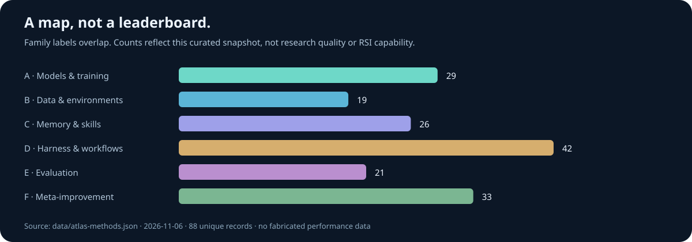

<p align="center"><a href="README.md">English ←</a> · <strong>简体中文</strong></p>

<a href="https://hyfine.github.io/rsi-atlas/"></a>

# RSI Atlas：只维护一份权威内容

**从更好的答案，到持久能力，再到更会改进的改进器。**

[在线图谱](https://hyfine.github.io/rsi-atlas/) · [family 时间轴](https://hyfine.github.io/rsi-atlas/#timeline) · [机构时间轴](https://hyfine.github.io/rsi-atlas/#institutions) · [English](README.md)

首页默认英文，可在旁边切换中文。时间轴支持日期起止、近12个月、算法家族、机构与类型筛选，以及年代/family/机构三种布局。首发、修订、公司网页显示日期分开；未知归属与日期冲突不被隐藏。

## 当前覆盖

截至 **2026-11-06**，88 条精选研究与相关发布，58 条日期位于 2025-11-06—2026-11-06，88 条具备一手机构/发布者依据。分类不互斥，也不表示算法已复现或机构能力排名。

## 重点方法

- **[Harness²](https://arxiv.org/abs/2610.14224)**：任务内采用 Propose–Probe–Compose：从参考执行分别提出跨域通用和领域专用修改，在相同任务与匹配配置下实际执行候选，再根据轨迹和交付物的行为对照选择性组合修改。任务后保存被采用的可执行 harness 及有证据支持的经验，供后续改进会话按需检索。下一任务仍从共同基线 H0 开始，而非直接继承上一任务的特化 harness。所谓第二层递归实际通过经验库改变后续改进的上下文，不是训练模型或任意重写整个改进算法。
- **[Evo²](https://arxiv.org/abs/2610.13025)**：一个共享参数策略通过不同角色提示同时担任 Proposer 和 Reflector。Proposer 自主编辑或执行 Reflector 的定向修改；Reflector 根据源码、差异、性能变化和执行轨迹选择修订、跨分支策略移植或保留。搜索树积累 harness 和策略库。EvoTIDE 将这些过程转成训练轨迹，通过编辑提取和前缀续写回收有效编辑，先 SFT，再交错进行双角色 GRPO。被训练的是 evolver；任务 executor 在共同演化期间冻结。
- **[RRSI](https://arxiv.org/abs/2609.24972)**：保持可编辑空间开放，只正则化搜索路径：提案侧用余弦退火预算限制单候选独立修改数，记录完整假设与得失，并在停滞时探索未试组件；选择侧先以 critic 筛除泄漏，再用历史最优减噪声容差作为性能底线，按得分增益限制 token 成本增长，并把近期无正收益组件交给 proposer 删除。噪声带内候选有单独的成本/结构新颖性规则，并非一律拒绝。
- **[OO-Harness](https://arxiv.org/abs/2610.28380)**：先从基线在 discovery tasks 上的执行记录聚类共享需求，再由 evolution agent 选择任务簇和父类，生成继承基线或既有特化类的子类，通过覆盖或新增方法实现修改。只在目标簇评估，满足提升和领域检查后保留；成功与失败记录可提炼为设计和路由经验。测试前冻结类层级与经验。新任务先执行基线，路由器依据任务、可观察基线轨迹和冻结经验选择一个完整 harness 类，或直接复用基线结果。

[四篇重点方法详解与流程](docs/zh/10_Harness_Focus.md) · [机构分类与全部增补来源](docs/zh/11_Institutions_and_Updates.md)。Evo² 是改进器权重—Harness 共演化，不是基因组 Evo 2，也不等同于 CoEvo-RSI。



## 阅读入口

- [技术全景](docs/zh/01_RSI_Technical_Panorama.md)与[算法手册](docs/zh/04_Algorithm_Handbook.md)。
- [六家族整体架构](docs/zh/08_Family_Architectures.md)与[原论文图、版本和许可](docs/zh/09_Paper_Figures.md)。
- [训练与环境](docs/zh/chapters/02_Training_Environments_and_AI_Research.md)、[Agent技能与Harness](docs/zh/chapters/03_Agent_Skills_and_Harness.md)、[Meta-RSI与评测](docs/zh/chapters/04_Meta_RSI_Evaluation_and_Safety.md)、[产业与综述](docs/zh/chapters/05_Surveys_Industry_and_Frontiers.md)。
- [六个公开实现的源码深读](docs/repo_deepdive/README.md)与[动态源码路径](docs/repo_deepdive/implementation-atlas.html)。
- [方法数据](data/atlas-methods.json)、[全量目录](catalog/index.md)、[维护规则](CONTRIBUTING.md)。

## 一处维护，一套构建

```sh
node scripts/build-atlas.mjs
node scripts/validate-delivery.mjs
node --test scripts/*.test.mjs
```

只维护当前仓库，不再同步外部笔记目录。旧笔记完整移动到本地忽略的不可变归档，公开正文已经融合；PDF、内部工程案例、原始日志和旧采集工具不进入公开 Git。[迁移与验证说明](docs/maintenance/CONSOLIDATION.md)。

微信正文及指定OpenReview来源访问验证受限，未绕过或替换引用。Flint显示日期/站点发布注释存在口径差异，已明确标记。架构动画是机制示意，作者结果不是本项目复现；[第三方署名与复用许可](THIRD_PARTY_NOTICES.md)单列。
