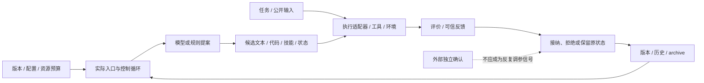

# 架构读法：入口、可变面与信任边界

[返回索引](README.md) · [交互模块图](implementation-atlas.html)

## 1. 通用职责模型，不是假装六个项目共用代码

此图是分析框架，**不是新的运行系统，也不代表每个项目都具备每个模块**。真实模块必须看各章节的固定源码图与表：

- [GenericAgent](cases/genericagent.md#3-运行架构与核心模块)
- [GEPA](cases/gepa.md#3-运行架构与核心模块)
- [SoL-Pi](cases/sol-pi.md#3-运行架构与核心模块)
- [HyperAgents](cases/hyperagents.md#3-运行架构与核心模块)
- [RRSI](cases/rrsi.md#3-运行架构与核心模块)
- [OpenRSI](cases/openrsi.md#3-运行架构与核心模块)

## 2. 需要核对的核心边界

| 边界 | 典型误读 | 源码核对方向 |
|---|---|---|
| 配置→真实实现 | 注册过的模块都被调用 | 实际入口、flags、默认值与实现选择 |
| 提案→执行 | 模型说完成就是真完成 | 工具/容器/sandbox 的真实结果 |
| 执行→评价 | 所有任务都有独立真值 | scorer 来源、自评分、测试生成、规格范围 |
| 评价→选择 | 分数最高就一定晋级 | floor、费用、guards、失败与无结果语义 |
| 状态→下一轮 | 文件保存即证明继承 | 后续读取/实际使用路径 |
| 候选→改进器 | 改了程序就改了改进器 | 修改接口是否位于下一轮提案/选择路径 |
| 开发→最终确认 | validation 永远未见 | 适应性重复访问与冻结后测试 |

## 3. 核心层与辅助层分开看

- `BaseSession`、`GEPAAdapter` 等可能是接口，不是最终 provider。
- 配置默认关闭的 extension 不等于没有实现，也不等于正在生效。
- compatibility launcher、另一个 benchmark、另一套 API 不应硬串到主路径。
- 时间统计、网络设置、guidance 结果结构是实现支撑，不是优化算法本体。
- 模型、sandbox、Docker、真实浏览器和外部 benchmark 的运维权可能不在仓库中。

交互图同时展示模块与有向关联边；完整 Mermaid 图保留在每篇章节，并紧邻源码引用表，避免“漂亮图没有代码落点”。
