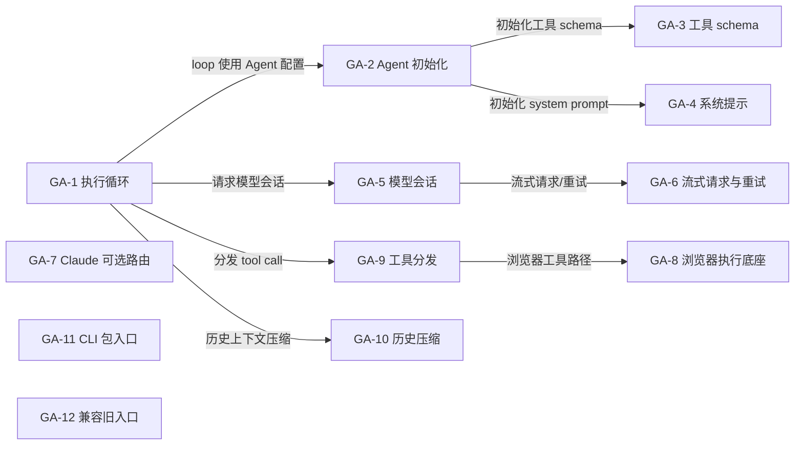
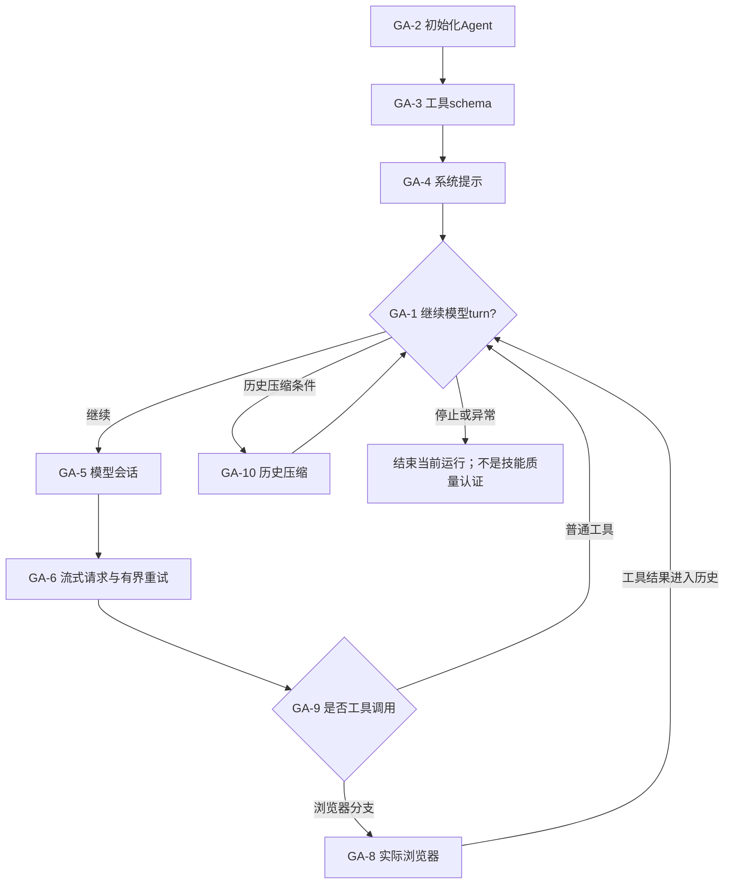

# GenericAgent：把重复推理沉淀成技能与执行路径

[返回索引](../README.md) · [交互架构与动态路径](../implementation-atlas.html?repo=genericagent) · [横向比较](../overview.md)

> 快照：2026-11-05；14,395 stars；最近 push 2026-11-04。源码固定为 [73f71a49874700f85e9d92126cb8d9531abde54a](https://github.com/lsdefine/GenericAgent/tree/73f71a49874700f85e9d92126cb8d9531abde54a)。star 不是质量或复现认证；“最近活跃”不等于项目最近首发。
>
> 本文是固定源码静态阅读与可执行路径说明。没有安装该研究仓库、运行其模型/生成代码或复现论文 benchmark。

## 1. 目标与适用问题

以小型 Agent Loop 和通用原子工具完成跨网页、文件、终端等真实任务，并把可复用经验保留到后续任务。

**准确定位：**真实电脑操作与经验资产的运行底座；不是已证明改进器自改写的严格 RSI 算法。

**公开与许可边界：**MIT。这里只链接和解释代码，不在本仓库复制模型、任务数据或研究源码。特别是非商业/相同方式共享许可不能笼统称为 OSI 认可的软件开源许可。

### 1.1 为什么收录

最适合观察技能如何减少下一次搜索和重复工具调用。先在无破坏性的测试目录/浏览器会话实验；不要把具有终端权限的运行底座等同于隔离沙箱。

该项目同时具有较高关注度和与本图谱相关的实际可读实现；选择不是全 GitHub 的穷尽排名。

## 2. 理论与方法论

将能力分布的变化分成参数学习和外部状态学习。固定模型也能通过检索、SOP、程序化技能改变后续行为；但记忆存在、可执行、正确、迁移有效是四个独立条件。

### 2.1 用状态而不是名字判断自改进

M_t = 消息历史 + memory/SOP/Skill；执行是 Run(模型,工具,M_t,任务)。任务后文件更新不等于一个已验证的自动学习事务。

文件化记忆与压缩后的会话历史不是同一种资产。README 的 Skill 结晶声明不意味着这里已经找到统一的学习—评分—晋级事务；没有证据的学习能力保持未确认。


### 2.2 实际更新与冻结对象

**可变状态：**

- 运行时消息历史
- 文件化 memory/SOP/Skill 内容
- 本地会话历史
- 可由 Agent 操作的外部文件和环境

**固定/外部拥有：**

- 模型权重
- agent_loop.py 核心逻辑
- 工具实现
- TMWebDriver 实现
- 第三方浏览器/ADB/外部应用

README 的 self-evolving 定位不能替代代码中的统一 Skill 学习、评分、版本化或回滚证据。


## 3. 运行架构与核心模块

真实入口：[module entrypoint (no top-level def/class symbol matched)](https://github.com/lsdefine/GenericAgent/blob/73f71a49874700f85e9d92126cb8d9531abde54a/frontends/tui_v3.py#L1)。以下连线来自本次固定源码审计；未连入主图的兼容入口、接口对象或辅助模块仍列在源码表，不能推断它们是每次必经路径。



### 3.1 图节点—源码映射

| 节点 | 模块 / 代码符号 | 职责 | 固定源码 |
|---|---|---|---|
| GA-1 | 执行循环 / `agent_runner_loop` | 主循环、LLM turn、工具调用与继续/停止判定 | [agent_loop.py:43](https://github.com/lsdefine/GenericAgent/blob/73f71a49874700f85e9d92126cb8d9531abde54a/agent_loop.py#L43) |
| GA-2 | Agent 初始化 / `GenericAgent` | Agent 对象与系统提示/工具初始化 | [agentmain.py:45](https://github.com/lsdefine/GenericAgent/blob/73f71a49874700f85e9d92126cb8d9531abde54a/agentmain.py#L45) |
| GA-3 | 工具 schema / `load_tool_schema` | 加载工具 schema | [agentmain.py:18](https://github.com/lsdefine/GenericAgent/blob/73f71a49874700f85e9d92126cb8d9531abde54a/agentmain.py#L18) |
| GA-4 | 系统提示 / `get_system_prompt` | 构造系统提示 | [agentmain.py:35](https://github.com/lsdefine/GenericAgent/blob/73f71a49874700f85e9d92126cb8d9531abde54a/agentmain.py#L35) |
| GA-5 | 模型会话 / `BaseSession` | 模型会话抽象 | [llmcore.py:668](https://github.com/lsdefine/GenericAgent/blob/73f71a49874700f85e9d92126cb8d9531abde54a/llmcore.py#L668) |
| GA-6 | 流式请求与重试 / `_stream_with_retry` | 流式请求与重试 | [llmcore.py:475](https://github.com/lsdefine/GenericAgent/blob/73f71a49874700f85e9d92126cb8d9531abde54a/llmcore.py#L475) |
| GA-7 | Claude 可选路由 / `NativeClaudeSession` | Claude 会话实现；可选模型路由 | [llmcore.py:799](https://github.com/lsdefine/GenericAgent/blob/73f71a49874700f85e9d92126cb8d9531abde54a/llmcore.py#L799) |
| GA-8 | 浏览器执行底座 / `TMWebDriver` | 真实浏览器控制与本地桥接 | [TMWebDriver.py:40](https://github.com/lsdefine/GenericAgent/blob/73f71a49874700f85e9d92126cb8d9531abde54a/TMWebDriver.py#L40) |
| GA-9 | 工具分发 / `BaseHandler` | 工具名映射、执行和结果回传 | [agent_loop.py:16](https://github.com/lsdefine/GenericAgent/blob/73f71a49874700f85e9d92126cb8d9531abde54a/agent_loop.py#L16) |
| GA-10 | 历史压缩 / `compress_history_tags` | 历史上下文压缩 | [llmcore.py:77](https://github.com/lsdefine/GenericAgent/blob/73f71a49874700f85e9d92126cb8d9531abde54a/llmcore.py#L77) |
| GA-11 | CLI 包入口 / `module package initializer` | CLI 包；不是默认 TUI 入口 | [ga_cli/__init__.py:1](https://github.com/lsdefine/GenericAgent/blob/73f71a49874700f85e9d92126cb8d9531abde54a/ga_cli/__init__.py#L1) |
| GA-12 | 兼容旧入口 / `module legacy launcher` | 兼容/旧入口，非默认运行路径 | [ga.py:1](https://github.com/lsdefine/GenericAgent/blob/73f71a49874700f85e9d92126cb8d9531abde54a/ga.py#L1) |

目录是组织单位，不是可执行函数；第 1 行的 module 锚点只表示文件入口，不伪装成函数起始行。

## 4. 主路径与条件分支

任务输入与上下文组装 → 模型决策 → 原子工具分发 → 真实外部结果 → 继续/停止 → 可复用资产保留。没有统一的候选 Pareto 选择或可证明单调晋级。

下面图是阅读一条代表路径的机制示意，**不是统一覆盖所有 flags 的真实运行 trace**。尤其 GEPA 的另一套通用文本 API、SoL-Pi 的四机制分支、可选 browser/selection/benchmark 不能被视为全部串行必经步骤。



图中模块 ID 对应 §3.1 的固定源码表；STOP/RAW/RECEIPT/NOTE 是相邻源码条件与输出语义的阅读说明，不是新发明的类。具体分支以 §4.2 定位表为准；动态图逐步顺序是代表性阅读路径，而非声明每个分支都发生在同一运行中。

### 4.1 分步解释

### 1. 初始化上下文与工具

Agent 对象与系统提示/工具初始化。定位模块：`GA-2`。[固定源码](https://github.com/lsdefine/GenericAgent/blob/73f71a49874700f85e9d92126cb8d9531abde54a/agentmain.py#L45)。

输入必须先固定版本、配置和评价预算；下面说明的是源码路径，不是本次实际模型运行记录。

### 2. 进入模型—工具循环

主循环、LLM turn、工具调用与继续/停止判定。定位模块：`GA-1`。[固定源码](https://github.com/lsdefine/GenericAgent/blob/73f71a49874700f85e9d92126cb8d9531abde54a/agent_loop.py#L43)。

观察真实输出、条件分支和失败，而不是仅依据调用是否返回。具体分支见后面的源码定位表。

### 3. 请求实际模型会话

模型会话抽象。定位模块：`GA-5`。[固定源码](https://github.com/lsdefine/GenericAgent/blob/73f71a49874700f85e9d92126cb8d9531abde54a/llmcore.py#L668)。

观察真实输出、条件分支和失败，而不是仅依据调用是否返回。具体分支见后面的源码定位表。

### 4. 条件分支：分发工具调用

工具名映射、执行和结果回传。定位模块：`GA-9`。[固定源码](https://github.com/lsdefine/GenericAgent/blob/73f71a49874700f85e9d92126cb8d9531abde54a/agent_loop.py#L16)。

观察真实输出、条件分支和失败，而不是仅依据调用是否返回。具体分支见后面的源码定位表。

### 5. 可选浏览器执行并返回观察

真实浏览器控制与本地桥接。定位模块：`GA-8`。[固定源码](https://github.com/lsdefine/GenericAgent/blob/73f71a49874700f85e9d92126cb8d9531abde54a/TMWebDriver.py#L40)。

观察真实输出、条件分支和失败，而不是仅依据调用是否返回。具体分支见后面的源码定位表。

### 6. 条件分支：压缩历史，再继续或停止

历史上下文压缩。定位模块：`GA-10`。[固定源码](https://github.com/lsdefine/GenericAgent/blob/73f71a49874700f85e9d92126cb8d9531abde54a/llmcore.py#L77)。

输出与持久状态应与原始执行条件一起保留；过程结束不等于获得泛化或部署收益。

### 4.2 分支与实现定位表

| 阅读定位 | 实际步骤 / 条件与边界 | 源码 |
|---|---|---|
| F1 | TUI 模块作为脚本启动，读取交互输入；源码未匹配到命名 main 函数。 | [frontends/tui_v3.py:1](https://github.com/lsdefine/GenericAgent/blob/73f71a49874700f85e9d92126cb8d9531abde54a/frontends/tui_v3.py#L1) |
| F2 | GenericAgent 构造运行时 Agent。 | [agentmain.py:45](https://github.com/lsdefine/GenericAgent/blob/73f71a49874700f85e9d92126cb8d9531abde54a/agentmain.py#L45) |
| F3 | 加载工具 schema。 | [agentmain.py:18](https://github.com/lsdefine/GenericAgent/blob/73f71a49874700f85e9d92126cb8d9531abde54a/agentmain.py#L18) |
| F4 | 构造系统提示。 | [agentmain.py:35](https://github.com/lsdefine/GenericAgent/blob/73f71a49874700f85e9d92126cb8d9531abde54a/agentmain.py#L35) |
| F5 | 进入 agent_runner_loop，循环发起模型 turn。 | [agent_loop.py:43](https://github.com/lsdefine/GenericAgent/blob/73f71a49874700f85e9d92126cb8d9531abde54a/agent_loop.py#L43) |
| F6 | BaseHandler 根据工具名分发调用并返回结果。 | [agent_loop.py:16](https://github.com/lsdefine/GenericAgent/blob/73f71a49874700f85e9d92126cb8d9531abde54a/agent_loop.py#L16) |
| F7 | Bash/PowerShell 等请求进入工具执行；浏览器路径可到 TMWebDriver。 | [TMWebDriver.py:40](https://github.com/lsdefine/GenericAgent/blob/73f71a49874700f85e9d92126cb8d9531abde54a/TMWebDriver.py#L40) |
| F8 | 模型流式请求使用 retry 路径；重试失败后返回错误/停止。 | [llmcore.py:475](https://github.com/lsdefine/GenericAgent/blob/73f71a49874700f85e9d92126cb8d9531abde54a/llmcore.py#L475) |
| F9 | 历史过长时执行标签压缩，后续 turn 继承压缩后的消息。 | [llmcore.py:77](https://github.com/lsdefine/GenericAgent/blob/73f71a49874700f85e9d92126cb8d9531abde54a/llmcore.py#L77) |

### 4.3 失败、停止与恢复怎么读

- 没有评价结果、无有效候选、API/容器失败和真实任务低分是不同事件。
- 代码允许失败处理，不等于已经证明每种环境都能恢复。
- archive/state/result/checkpoint 的语义随项目变化，不把文件存在当作恢复成功。
- 更新后的产物是否被后续任务或后续改进真正读取，需要使用路径或运行证据，不能只看目录里多了文件。
- 以上四点是复用时的审计要求，不声称每个项目都已经实现完整保障。

## 5. 实践：版本、依赖与最小起步

Python >=3.10,<3.14；按需安装 UI extra；模型 API、浏览器会话、ADB/IM 等依任务另行配置。终端和真实应用有外部副作用，不默认隔离。

### 5.1 首先固定源码

```sh
git clone https://github.com/lsdefine/GenericAgent.git
cd GenericAgent
git checkout 73f71a49874700f85e9d92126cb8d9531abde54a
```

这三步只固定研究对象；后面的命令仍可能安装依赖、调用模型、执行生成代码或产生费用。应先理解代码与许可，再在隔离环境执行。

### 5.2 仓库文档里的命令入口

```sh
uv venv
```

[该命令的原始说明](https://github.com/lsdefine/GenericAgent/blob/73f71a49874700f85e9d92126cb8d9531abde54a/README.md#L124)。

```sh
cp mykey_template_en.py mykey.py
```

[该命令的原始说明](https://github.com/lsdefine/GenericAgent/blob/73f71a49874700f85e9d92126cb8d9531abde54a/README.md#L125)。

```sh
python frontends/tui_v3.py
```

[该命令的原始说明](https://github.com/lsdefine/GenericAgent/blob/73f71a49874700f85e9d92126cb8d9531abde54a/README.md#L129)。

```sh
python launch.pyw
```

[该命令的原始说明](https://github.com/lsdefine/GenericAgent/blob/73f71a49874700f85e9d92126cb8d9531abde54a/README.md#L130)。

```sh
uv pip install --editable ".[ui]"
```

[该命令的原始说明](https://github.com/lsdefine/GenericAgent/blob/73f71a49874700f85e9d92126cb8d9531abde54a/README.md#L138)。


命令是文档化入口，不是本次已执行的记录。凭据只配置在本地受控环境，不能提交到 Git；工具名称、环境变量名和 API key 的实际值必须分开。

### 5.3 首次实验的建议约束

1. 最小任务集合、单一模型/配置和有限候选/轮次。
2. 固定任务、输入、模型版本、评价器、随机性与资源上限。
3. 不给生成代码不必要的主机文件/网络/凭据权限。
4. 完整保存失败、拒绝、超时、API 开销和未评分分母。
5. 冻结产物后测独立任务，不用最终测试集反复选候选。
6. 先复核功能与副作用，再讨论成本下降。

这是本图谱建议的实践协议，不冒充仓库自带的完整安全或评测实现。

## 6. 怎样设计一个有判别力的对照

固定模型、任务和重试预算，比较无记忆/只读旧记忆/更新后记忆；冻结技能再测未见任务。记录错误技能的删除、适用条件与副作用，不能只比较成功案例的 token。

推荐报告至少包含：原版本、候选版本、任务/样本分母、成功与退化、完整成本、失败原因、选择规则、独立确认范围和未解决项。不同基准、计费规则或模型下的数字不直接拼成统一 RSI 排名。

## 7. 声称、实现、运行验证分开

| 层级 | 本文能确认 | 不能自动推断 |
|---|---|---|
| 定位与论文 | 作者公开目标、研究方向与原文入口 | 通用或无限递归已实现 |
| 固定源码 | 上述入口、模块、调用关系与数据结构 | 所有 flags 都能运行、实验一定复现 |
| 本次检查 | commit 与源码锚点/文档/离线图构建 | 模型、容器或付费 benchmark 实验 |
| 未来实跑 | 需按 §5—6 保存完整证据 | 有一个成功案例就获得泛化 |

- 更正此前表述：frontends/tui_v3.py 是文档默认启动脚本，但本次静态符号检索未发现明确的命名 main 函数，不能把它描述为已验证的函数级入口。
- 更正此前表述：源码支持文件化记忆、SOP 和工具执行，但未发现统一、可审计的自动 Skill 学习/评分/版本回滚管线；README 的 self-evolving 是产品声明。
- 未执行代码、未验证真实 LLM、浏览器、ADB、IM 或支付任务。

## 8. 具体优化建议

1. 给技能添加来源、适用条件、版本、验证结果和删除策略。
2. 为有副作用的工具定义幂等键与权限边界。
3. 把工具执行失败、业务失败和记忆生成失败分开保存。
4. 测跨任务负迁移，而不是以 memory 目录变大作为学习指标。

## 9. 复核清单

- [ ] 用相同 commit 而非浮动 main 复核源码。
- [ ] 确认实际选择的 API、feature flags 和外部 runner。
- [ ] 检查可变面没有不当地包含最终 evaluator 或答案。
- [ ] 记录全部候选、失败与资源账单。
- [ ] 区分任务收益、持久产物收益与后继改进效率。
- [ ] 对最外层仍固定的部分保持准确描述。

这些是读者的后续执行清单，不是本项目已经运行该仓库的证明。

[返回开源实现索引](../README.md) · [比较六种机制](../overview.md) · [交互图](../implementation-atlas.html?repo=genericagent)
