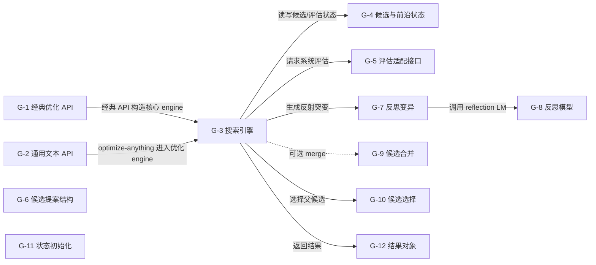
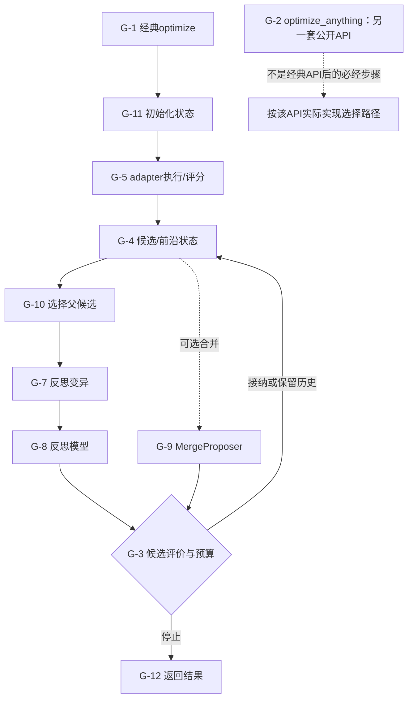

# GEPA：执行反馈驱动的反思与互补候选选择

[返回索引](../README.md) · [交互架构与动态路径](../implementation-atlas.html?repo=gepa) · [横向比较](../overview.md)

> 快照：2026-11-05；7,288 stars；最近 push 2026-11-04。源码固定为 [3d34469165f0d604df3b48f1d5c776e9080f3da0](https://github.com/gepa-ai/gepa/tree/3d34469165f0d604df3b48f1d5c776e9080f3da0)。star 不是质量或复现认证；“最近活跃”不等于项目最近首发。
>
> 本文是固定源码静态阅读与可执行路径说明。没有安装该研究仓库、运行其模型/生成代码或复现论文 benchmark。

## 1. 目标与适用问题

利用轨迹、错误和可操作旁信息改进 prompt/文本组件，保留不同样本上各有所长的候选，并在评估预算内搜索。

**准确定位：**文本/程序组件优化算法与适配框架；常见配置固定外层优化器，不自动属于 L3。

**公开与许可边界：**MIT。这里只链接和解释代码，不在本仓库复制模型、任务数据或研究源码。特别是非商业/相同方式共享许可不能笼统称为 OSI 认可的软件开源许可。

### 1.1 为什么收录

先实现一个边界明确的 evaluator/adapter，返回分数及真正有用的失败信息。再设总 metric 调用预算，并把最终独立测试留在优化器之外。

该项目同时具有较高关注度和与本图谱相关的实际可读实现；选择不是全 GitHub 的穷尽排名。

## 2. 理论与方法论

离散文本空间不能直接套用模型权重梯度。反思模型将执行反馈转成编辑方向；样本级候选前沿保护互补性，避免平均分过早淘汰局部强项。

### 2.1 用状态而不是名字判断自改进

候选 c 的向量是各验证实例上的分数 (s_1(c),...,s_n(c))。这是样本表现前沿，不应未经核验改写成质量—费用二维 Pareto 前沿。

不要把样本级前沿自动解释成性能—成本前沿。不同候选在不同任务上占优，可以同时留在搜索状态；这是一种搜索多样性机制，不提供未见任务不退化的保证。


### 2.2 实际更新与冻结对象

**可变状态：**

- seed candidate 的文本组件
- 候选池、评分、Pareto 前沿和祖先关系
- 可选实验追踪状态

**固定/外部拥有：**

- task/evaluator 语义
- task LM 与 reflection LM 权重
- adapter 实现
- 搜索预算和配置
- 外部系统本身

优化 prompt 不等于更新底层 LLM；用户提供的 evaluator 决定了优化目标和投机空间。

## 3. 运行架构与核心模块

真实入口：[optimize](https://github.com/gepa-ai/gepa/blob/3d34469165f0d604df3b48f1d5c776e9080f3da0/src/gepa/api.py#L53)。以下连线来自本次固定源码审计；未连入主图的兼容入口、接口对象或辅助模块仍列在源码表，不能推断它们是每次必经路径。



### 3.1 图节点—源码映射

| 节点 | 模块 / 代码符号 | 职责 | 固定源码 |
|---|---|---|---|
| G-1 | 经典优化 API / `optimize` | 经典 prompt/component 优化入口 | [src/gepa/api.py:53](https://github.com/gepa-ai/gepa/blob/3d34469165f0d604df3b48f1d5c776e9080f3da0/src/gepa/api.py#L53) |
| G-2 | 通用文本 API / `optimize_anything` | 任意文本工件优化入口；不是 oa/engine.py 的直接入口 | [src/gepa/optimize_anything.py:95](https://github.com/gepa-ai/gepa/blob/3d34469165f0d604df3b48f1d5c776e9080f3da0/src/gepa/optimize_anything.py#L95) |
| G-3 | 搜索引擎 / `GEPAEngine` | 搜索、评估、接受/拒绝与预算循环 | [src/gepa/core/engine.py:113](https://github.com/gepa-ai/gepa/blob/3d34469165f0d604df3b48f1d5c776e9080f3da0/src/gepa/core/engine.py#L113) |
| G-4 | 候选与前沿状态 / `GEPAState` | 候选、评估缓存、历史和 Pareto 状态 | [src/gepa/core/state.py:217](https://github.com/gepa-ai/gepa/blob/3d34469165f0d604df3b48f1d5c776e9080f3da0/src/gepa/core/state.py#L217) |
| G-5 | 评估适配接口 / `GEPAAdapter` | 评估与 reflective dataset 接口 | [src/gepa/core/adapter.py:101](https://github.com/gepa-ai/gepa/blob/3d34469165f0d604df3b48f1d5c776e9080f3da0/src/gepa/core/adapter.py#L101) |
| G-6 | 候选提案结构 / `CandidateProposal` | 候选提案数据结构 | [src/gepa/proposer/base.py:31](https://github.com/gepa-ai/gepa/blob/3d34469165f0d604df3b48f1d5c776e9080f3da0/src/gepa/proposer/base.py#L31) |
| G-7 | 反思变异 / `ReflectiveMutationProposer` | 基于轨迹/反思生成新候选 | [src/gepa/proposer/reflective_mutation/reflective_mutation.py:45](https://github.com/gepa-ai/gepa/blob/3d34469165f0d604df3b48f1d5c776e9080f3da0/src/gepa/proposer/reflective_mutation/reflective_mutation.py#L45) |
| G-8 | 反思模型 / `StatelessReflectionLM` | 反思模型适配 | [src/gepa/proposer/reflective_mutation/reflection_lm.py:96](https://github.com/gepa-ai/gepa/blob/3d34469165f0d604df3b48f1d5c776e9080f3da0/src/gepa/proposer/reflective_mutation/reflection_lm.py#L96) |
| G-9 | 候选合并 / `MergeProposer` | 合并 Pareto 候选 | [src/gepa/proposer/merge.py:217](https://github.com/gepa-ai/gepa/blob/3d34469165f0d604df3b48f1d5c776e9080f3da0/src/gepa/proposer/merge.py#L217) |
| G-10 | 候选选择 / `module candidate selector (class/function definitions not exposed by bounded match)` | 候选/Pareto 选择策略 | [src/gepa/strategies/candidate_selector.py:1](https://github.com/gepa-ai/gepa/blob/3d34469165f0d604df3b48f1d5c776e9080f3da0/src/gepa/strategies/candidate_selector.py#L1) |
| G-11 | 状态初始化 / `initialize_gepa_state` | 初始化优化状态 | [src/gepa/core/state.py:1115](https://github.com/gepa-ai/gepa/blob/3d34469165f0d604df3b48f1d5c776e9080f3da0/src/gepa/core/state.py#L1115) |
| G-12 | 结果对象 / `GEPAResult` | 返回最佳候选与实验结果 | [src/gepa/core/result.py:16](https://github.com/gepa-ai/gepa/blob/3d34469165f0d604df3b48f1d5c776e9080f3da0/src/gepa/core/result.py#L16) |

目录是组织单位，不是可执行函数；第 1 行的 module 锚点只表示文件入口，不伪装成函数起始行。

## 4. 主路径与条件分支

评估种子 → 从候选/前沿选父代 → 选择组件与反思样本 → 生成编辑或合并 → 小批/验证评估 → 更新状态与谱系 → 满足停止条件返回结果。

下面图是阅读一条代表路径的机制示意，**不是统一覆盖所有 flags 的真实运行 trace**。尤其 GEPA 的另一套通用文本 API、SoL-Pi 的四机制分支、可选 browser/selection/benchmark 不能被视为全部串行必经步骤。



图中模块 ID 对应 §3.1 的固定源码表；STOP/RAW/RECEIPT/NOTE 是相邻源码条件与输出语义的阅读说明，不是新发明的类。具体分支以 §4.2 定位表为准；动态图逐步顺序是代表性阅读路径，而非声明每个分支都发生在同一运行中。

### 4.1 分步解释

### 1. 经典 API 接收种子与预算

经典 prompt/component 优化入口。定位模块：`G-1`。[固定源码](https://github.com/gepa-ai/gepa/blob/3d34469165f0d604df3b48f1d5c776e9080f3da0/src/gepa/api.py#L53)。

输入必须先固定版本、配置和评价预算；下面说明的是源码路径，不是本次实际模型运行记录。

### 2. 初始化候选与状态

初始化优化状态。定位模块：`G-11`。[固定源码](https://github.com/gepa-ai/gepa/blob/3d34469165f0d604df3b48f1d5c776e9080f3da0/src/gepa/core/state.py#L1115)。

观察真实输出、条件分支和失败，而不是仅依据调用是否返回。具体分支见后面的源码定位表。

### 3. 适配器执行与评分

评估与 reflective dataset 接口。定位模块：`G-5`。[固定源码](https://github.com/gepa-ai/gepa/blob/3d34469165f0d604df3b48f1d5c776e9080f3da0/src/gepa/core/adapter.py#L101)。

观察真实输出、条件分支和失败，而不是仅依据调用是否返回。具体分支见后面的源码定位表。

### 4. 从候选/前沿选择父代

候选/Pareto 选择策略。定位模块：`G-10`。[固定源码](https://github.com/gepa-ai/gepa/blob/3d34469165f0d604df3b48f1d5c776e9080f3da0/src/gepa/strategies/candidate_selector.py#L1)。

观察真实输出、条件分支和失败，而不是仅依据调用是否返回。具体分支见后面的源码定位表。

### 5. 反思失败并生成文本变异

基于轨迹/反思生成新候选。定位模块：`G-7`。[固定源码](https://github.com/gepa-ai/gepa/blob/3d34469165f0d604df3b48f1d5c776e9080f3da0/src/gepa/proposer/reflective_mutation/reflective_mutation.py#L45)。

观察真实输出、条件分支和失败，而不是仅依据调用是否返回。具体分支见后面的源码定位表。

### 6. 评估新候选，接纳或拒绝

搜索、评估、接受/拒绝与预算循环。定位模块：`G-3`。[固定源码](https://github.com/gepa-ai/gepa/blob/3d34469165f0d604df3b48f1d5c776e9080f3da0/src/gepa/core/engine.py#L113)。

观察真实输出、条件分支和失败，而不是仅依据调用是否返回。具体分支见后面的源码定位表。

### 7. 保留分数、历史与互补优势

候选、评估缓存、历史和 Pareto 状态。定位模块：`G-4`。[固定源码](https://github.com/gepa-ai/gepa/blob/3d34469165f0d604df3b48f1d5c776e9080f3da0/src/gepa/core/state.py#L217)。

观察真实输出、条件分支和失败，而不是仅依据调用是否返回。具体分支见后面的源码定位表。

### 8. 预算停止并返回结果

返回最佳候选与实验结果。定位模块：`G-12`。[固定源码](https://github.com/gepa-ai/gepa/blob/3d34469165f0d604df3b48f1d5c776e9080f3da0/src/gepa/core/result.py#L16)。

输出与持久状态应与原始执行条件一起保留；过程结束不等于获得泛化或部署收益。

### 4.2 分支与实现定位表

| 阅读定位 | 实际步骤 / 条件与边界 | 源码 |
|---|---|---|
| F1 | 经典入口接收 seed_candidate、数据集、task LM、reflection LM 与预算。 | [src/gepa/api.py:53](https://github.com/gepa-ai/gepa/blob/3d34469165f0d604df3b48f1d5c776e9080f3da0/src/gepa/api.py#L53) |
| F2 | 任意文本入口由 optimize_anything 启动，显式接收 candidate evaluator 与 objective。 | [src/gepa/optimize_anything.py:95](https://github.com/gepa-ai/gepa/blob/3d34469165f0d604df3b48f1d5c776e9080f3da0/src/gepa/optimize_anything.py#L95) |
| F3 | 初始化 GEPAState，包括候选、缓存和 Pareto 相关状态。 | [src/gepa/core/state.py:1115](https://github.com/gepa-ai/gepa/blob/3d34469165f0d604df3b48f1d5c776e9080f3da0/src/gepa/core/state.py#L1115) |
| F4 | GEPAEngine 执行迭代、评估、候选接受/拒绝和预算控制。 | [src/gepa/core/engine.py:113](https://github.com/gepa-ai/gepa/blob/3d34469165f0d604df3b48f1d5c776e9080f3da0/src/gepa/core/engine.py#L113) |
| F5 | 通过 GEPAAdapter 对 batch 执行并产生轨迹、输出和分数。 | [src/gepa/core/adapter.py:101](https://github.com/gepa-ai/gepa/blob/3d34469165f0d604df3b48f1d5c776e9080f3da0/src/gepa/core/adapter.py#L101) |
| F6 | ReflectiveMutationProposer 读取 reflective dataset 并提出新候选。 | [src/gepa/proposer/reflective_mutation/reflective_mutation.py:45](https://github.com/gepa-ai/gepa/blob/3d34469165f0d604df3b48f1d5c776e9080f3da0/src/gepa/proposer/reflective_mutation/reflective_mutation.py#L45) |
| F7 | StatelessReflectionLM 调用反思模型产生诊断/修改提案。 | [src/gepa/proposer/reflective_mutation/reflection_lm.py:96](https://github.com/gepa-ai/gepa/blob/3d34469165f0d604df3b48f1d5c776e9080f3da0/src/gepa/proposer/reflective_mutation/reflection_lm.py#L96) |
| F8 | 候选选择策略从候选池/Pareto 信息中选父候选；无效或不改进候选可被拒绝。 | [src/gepa/strategies/candidate_selector.py:1](https://github.com/gepa-ai/gepa/blob/3d34469165f0d604df3b48f1d5c776e9080f3da0/src/gepa/strategies/candidate_selector.py#L1) |
| F9 | MergeProposer 可选地合并不同优势候选。 | [src/gepa/proposer/merge.py:217](https://github.com/gepa-ai/gepa/blob/3d34469165f0d604df3b48f1d5c776e9080f3da0/src/gepa/proposer/merge.py#L217) |
| F10 | 最终以 GEPAResult 返回结果。 | [src/gepa/core/result.py:16](https://github.com/gepa-ai/gepa/blob/3d34469165f0d604df3b48f1d5c776e9080f3da0/src/gepa/core/result.py#L16) |

### 4.3 失败、停止与恢复怎么读

- 没有评价结果、无有效候选、API/容器失败和真实任务低分是不同事件。
- 代码允许失败处理，不等于已经证明每种环境都能恢复。
- archive/state/result/checkpoint 的语义随项目变化，不把文件存在当作恢复成功。
- 更新后的产物是否被后续任务或后续改进真正读取，需要使用路径或运行证据，不能只看目录里多了文件。
- 以上四点是复用时的审计要求，不声称每个项目都已经实现完整保障。

## 5. 实践：版本、依赖与最小起步

基础包依赖与 full/dev extras 分开。真实优化仍需 evaluator、数据、task/reflection LM 和调用预算；DSPy、Docker 等适配不是所有路径的硬依赖。

### 5.1 首先固定源码

```sh
git clone https://github.com/gepa-ai/gepa.git
cd gepa
git checkout 3d34469165f0d604df3b48f1d5c776e9080f3da0
```

这三步只固定研究对象；后面的命令仍可能安装依赖、调用模型、执行生成代码或产生费用。应先理解代码与许可，再在隔离环境执行。

### 5.2 仓库文档里的命令入口

```sh
pip install gepa
```

[该命令的原始说明](https://github.com/gepa-ai/gepa/blob/3d34469165f0d604df3b48f1d5c776e9080f3da0/README.md#L70)。

```sh
pip install git+https://github.com/gepa-ai/gepa.git
```

[该命令的原始说明](https://github.com/gepa-ai/gepa/blob/3d34469165f0d604df3b48f1d5c776e9080f3da0/README.md#L76)。

```sh
uv sync --extra dev
```

[该命令的原始说明](https://github.com/gepa-ai/gepa/blob/3d34469165f0d604df3b48f1d5c776e9080f3da0/AGENTS.md#L14)。

```sh
uv run pytest
```

[该命令的原始说明](https://github.com/gepa-ai/gepa/blob/3d34469165f0d604df3b48f1d5c776e9080f3da0/AGENTS.md#L24)。


命令是文档化入口，不是本次已执行的记录。凭据只配置在本地受控环境，不能提交到 Git；工具名称、环境变量名和 API key 的实际值必须分开。

### 5.3 首次实验的建议约束

1. 最小任务集合、单一模型/配置和有限候选/轮次。
2. 固定任务、输入、模型版本、评价器、随机性与资源上限。
3. 不给生成代码不必要的主机文件/网络/凭据权限。
4. 完整保存失败、拒绝、超时、API 开销和未评分分母。
5. 冻结产物后测独立任务，不用最终测试集反复选候选。
6. 先复核功能与副作用，再讨论成本下降。

这是本图谱建议的实践协议，不冒充仓库自带的完整安全或评测实现。

## 6. 怎样设计一个有判别力的对照

同 evaluator、同任务、同模型和同 metric 预算比较随机编辑、仅反思、加互补候选保留、加合并。报告优化器与部署两类费用，不把论文数字当作本次复现。

推荐报告至少包含：原版本、候选版本、任务/样本分母、成功与退化、完整成本、失败原因、选择规则、独立确认范围和未解决项。不同基准、计费规则或模型下的数字不直接拼成统一 RSI 排名。

## 7. 声称、实现、运行验证分开

| 层级 | 本文能确认 | 不能自动推断 |
|---|---|---|
| 定位与论文 | 作者公开目标、研究方向与原文入口 | 通用或无限递归已实现 |
| 固定源码 | 上述入口、模块、调用关系与数据结构 | 所有 flags 都能运行、实验一定复现 |
| 本次检查 | commit 与源码锚点/文档/离线图构建 | 模型、容器或付费 benchmark 实验 |
| 未来实跑 | 需按 §5—6 保存完整证据 | 有一个成功案例就获得泛化 |

- 更正此前表述：optimize_anything 的实际公开函数位于 src/gepa/optimize_anything.py:95；oa/engine.py 是内部/相关 engine 层，不应替代公开入口。
- candidate_selector.py 的本次 bounded symbol 检索未得到稳定的类/函数定义行，因此只保留真实文件与模块起始行，不声称具体类名。
- 未执行测试、benchmark 或 live LM；README/论文的提升比例和成本数字均未在本审计中验证。

## 8. 具体优化建议

1. 将评估数据、adapter 与候选版本写入不可变 manifest。
2. 限制轨迹旁信息中的敏感内容和标准答案泄漏。
3. 观察前沿大小、缓存命中与反思调用成本。
4. 对冻结最佳候选进行跨划分和跨模型确认。

## 9. 复核清单

- [ ] 用相同 commit 而非浮动 main 复核源码。
- [ ] 确认实际选择的 API、feature flags 和外部 runner。
- [ ] 检查可变面没有不当地包含最终 evaluator 或答案。
- [ ] 记录全部候选、失败与资源账单。
- [ ] 区分任务收益、持久产物收益与后继改进效率。
- [ ] 对最外层仍固定的部分保持准确描述。

这些是读者的后续执行清单，不是本项目已经运行该仓库的证明。

[返回开源实现索引](../README.md) · [比较六种机制](../overview.md) · [交互图](../implementation-atlas.html?repo=gepa)
