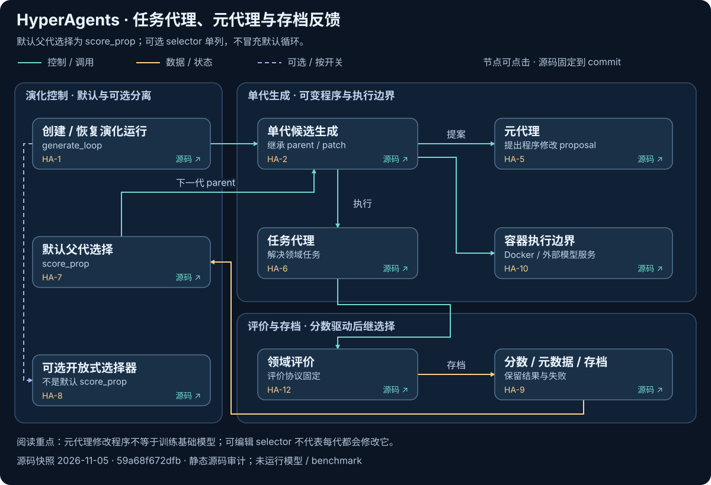
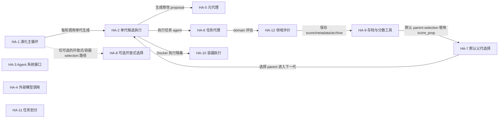
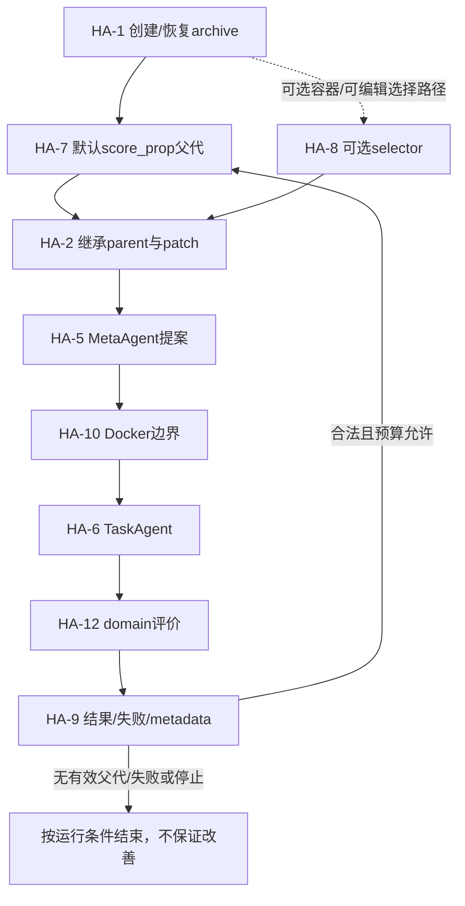

# HyperAgents：将任务代理与元代理纳入同一可编辑系统

[返回索引](../README.md) · [交互架构与动态路径](../implementation-atlas.html?repo=hyperagents) · [横向比较](../overview.md)

> 快照：2026-11-05；2,867 stars；最近 push 2026-07-31。源码固定为 [59a68f672dfb92c74aeb7e61535d776fb36e172d](https://github.com/facebookresearch/HyperAgents/tree/59a68f672dfb92c74aeb7e61535d776fb36e172d)。star 不是质量或复现认证；“最近活跃”不等于项目最近首发。
>
> 本文是固定源码静态阅读与可执行路径说明。没有安装该研究仓库、运行其模型/生成代码或复现论文 benchmark。

## 1. 目标与适用问题

从候选存档继承并修改 task/meta agent，使任务能力与产生后续改进的程序有机会共同演化。

**准确定位：**开放式代码/改进过程演化的研究实现；非商业许可，不能无条件称为 OSI 开源软件。

**公开与许可边界：**CC-BY-NC-SA-4.0; source-available research license。这里只链接和解释代码，不在本仓库复制模型、任务数据或研究源码。特别是非商业/相同方式共享许可不能笼统称为 OSI 认可的软件开源许可。

### 1.1 为什么收录

先读允许修改的边界与 Docker 配置，以最小 domain 和严格预算试验。模型生成代码不可信；不要把 Docker 的存在当作完整安全证明。

该项目同时具有较高关注度和与本图谱相关的实际可读实现；选择不是全 GitHub 的穷尽排名。

## 2. 理论与方法论

任务求解和修改程序的能力并不总是自然对齐。显式可编辑 meta-agent 让改进过程成为对象，但可编辑能力不等于实际元改进收益。

### 2.1 用状态而不是名字判断自改进

候选程序、parent patch、domain 结果、metadata 与 archive 构成状态。基础 LLM 权重不变，评价与容器边界仍由外部运行系统提供。

特别纠偏：默认 parent-selection 参数为 `score_prop`。可选 `select_next_parent.py` 中的 `random.choice` 不是默认循环行为；同样，可编辑选择器的配置路径不等于每代都会修改它。


### 2.2 实际更新与冻结对象

**可变状态：**

- agent/meta-agent/task-agent 源码、可允许修改的 harness、generation patch/diff、metadata、scores、archive 和 ensemble 输出。默认循环使用 score_prop；select_next_parent.py 的随机选择是独立的可选路径，不应泛化为默认行为。

**固定/外部拥有：**

- 基础模型权重、外部模型服务、domain evaluator 协议、Docker runtime 和已写入 archive 节点不由循环更新。项目许可证为 CC BY-NC-SA 4.0，具有非商业、署名、相同方式共享约束，见 LICENSE.md#L1-L3。README 的目标和论文结果不等于当前提交已验证能力。

默认循环是 score_prop；select_next_parent.py 中最终 random.choice 的路径是可选实现，不能推断整个默认系统随机选父代。


## 3. 运行架构与核心模块

真实入口：[__main__](https://github.com/facebookresearch/HyperAgents/blob/59a68f672dfb92c74aeb7e61535d776fb36e172d/generate_loop.py#L1025)。以下连线来自本次固定源码审计；未连入主图的兼容入口、接口对象或辅助模块仍列在源码表，不能推断它们是每次必经路径。



[交互架构：点击节点查看模块与源码](../implementation-atlas.html?repo=hyperagents) · [下载原生 SVG](../../../pics/implementations/hyperagents-architecture.svg)。青色为控制/调用，金色为数据/状态，紫色虚线为可选路径；这是固定源码快照，不是模型实跑轨迹。全部 12 个模块仍列在下方表中。



### 3.1 图节点—源码映射

| 节点 | 模块 / 代码符号 | 职责 | 固定源码 |
|---|---|---|---|
| HA-1 | 演化主循环 / `generate_loop` | 初始化 Docker、archive、parent-selection 并驱动 generation | [generate_loop.py:719](https://github.com/facebookresearch/HyperAgents/blob/59a68f672dfb92c74aeb7e61535d776fb36e172d/generate_loop.py#L719) |
| HA-2 | 单代候选执行 / `generate` | 复制 parent、应用 patch、运行 agent 和 domain evaluation | [generate_loop.py:427](https://github.com/facebookresearch/HyperAgents/blob/59a68f672dfb92c74aeb7e61535d776fb36e172d/generate_loop.py#L427) |
| HA-3 | Agent 系统接口 / `AgentSystem` | 定义 agent system 接口 | [agent/base_agent.py:6](https://github.com/facebookresearch/HyperAgents/blob/59a68f672dfb92c74aeb7e61535d776fb36e172d/agent/base_agent.py#L6) |
| HA-4 | 外部模型调用 / `get_response_from_llm` | 调用外部 foundation model | [agent/llm.py:36](https://github.com/facebookresearch/HyperAgents/blob/59a68f672dfb92c74aeb7e61535d776fb36e172d/agent/llm.py#L36) |
| HA-5 | 元代理 / `MetaAgent` | 生成 agent/harness 修改建议 | [meta_agent.py:6](https://github.com/facebookresearch/HyperAgents/blob/59a68f672dfb92c74aeb7e61535d776fb36e172d/meta_agent.py#L6) |
| HA-6 | 任务代理 / `TaskAgent` | 执行任务代理逻辑 | [task_agent.py:5](https://github.com/facebookresearch/HyperAgents/blob/59a68f672dfb92c74aeb7e61535d776fb36e172d/task_agent.py#L5) |
| HA-7 | 默认父代选择 / `generate_loop(parent_selection="score_prop")` | 默认使用 score_prop；不是 select_next_parent.py 中的随机 optional path | [generate_loop.py:719](https://github.com/facebookresearch/HyperAgents/blob/59a68f672dfb92c74aeb7e61535d776fb36e172d/generate_loop.py#L719) |
| HA-8 | 可选开放式选择 / `select_next_parent` | 可选选择器；过滤有效节点后随机选择候选 | [select_next_parent.py:14](https://github.com/facebookresearch/HyperAgents/blob/59a68f672dfb92c74aeb7e61535d776fb36e172d/select_next_parent.py#L14) |
| HA-9 | 存档与分数工具 / `is_starting_node` | 判断节点类型、读取分数、parent、patch 和 metadata | [utils/gl_utils.py:27](https://github.com/facebookresearch/HyperAgents/blob/59a68f672dfb92c74aeb7e61535d776fb36e172d/utils/gl_utils.py#L27) |
| HA-10 | 容器执行 / `build_container` | 构建和管理执行容器 | [utils/docker_utils.py:102](https://github.com/facebookresearch/HyperAgents/blob/59a68f672dfb92c74aeb7e61535d776fb36e172d/utils/docker_utils.py#L102) |
| HA-11 | 任务划分 / `get_domain_splits` | 确定 train/val/test 评估切分 | [utils/domain_utils.py:19](https://github.com/facebookresearch/HyperAgents/blob/59a68f672dfb92c74aeb7e61535d776fb36e172d/utils/domain_utils.py#L19) |
| HA-12 | 领域评价 / `run_eval` | 执行 domain 评估 | [domains/run_eval.py:20](https://github.com/facebookresearch/HyperAgents/blob/59a68f672dfb92c74aeb7e61535d776fb36e172d/domains/run_eval.py#L20) |

目录是组织单位，不是可执行函数；第 1 行的 module 锚点只表示文件入口，不伪装成函数起始行。

## 4. 主路径与条件分支

初始化/恢复 archive → 默认 score_prop parent-selection → 继承父版本 → meta-agent 生成补丁 → 隔离执行 task-agent/domain → 保存结果与失败 → 扩展 archive。

下面图是阅读一条代表路径的机制示意，**不是统一覆盖所有 flags 的真实运行 trace**。尤其 GEPA 的另一套通用文本 API、SoL-Pi 的四机制分支、可选 browser/selection/benchmark 不能被视为全部串行必经步骤。



图中模块 ID 对应 §3.1 的固定源码表；STOP/RAW/RECEIPT/NOTE 是相邻源码条件与输出语义的阅读说明，不是新发明的类。具体分支以 §4.2 定位表为准；动态图逐步顺序是代表性阅读路径，而非声明每个分支都发生在同一运行中。

### 4.1 分步解释

### 1. 初始化或恢复演化运行

初始化 Docker、archive、parent-selection 并驱动 generation。定位模块：`HA-1`。[固定源码](https://github.com/facebookresearch/HyperAgents/blob/59a68f672dfb92c74aeb7e61535d776fb36e172d/generate_loop.py#L719)。

输入必须先固定版本、配置和评价预算；下面说明的是源码路径，不是本次实际模型运行记录。

### 2. 默认 score_prop 选择父代

默认使用 score_prop；不是 select_next_parent.py 中的随机 optional path。定位模块：`HA-7`。[固定源码](https://github.com/facebookresearch/HyperAgents/blob/59a68f672dfb92c74aeb7e61535d776fb36e172d/generate_loop.py#L719)。

观察真实输出、条件分支和失败，而不是仅依据调用是否返回。具体分支见后面的源码定位表。

### 3. 继承父版本与已有 patch

复制 parent、应用 patch、运行 agent 和 domain evaluation。定位模块：`HA-2`。[固定源码](https://github.com/facebookresearch/HyperAgents/blob/59a68f672dfb92c74aeb7e61535d776fb36e172d/generate_loop.py#L427)。

观察真实输出、条件分支和失败，而不是仅依据调用是否返回。具体分支见后面的源码定位表。

### 4. Meta agent 提出程序修改

生成 agent/harness 修改建议。定位模块：`HA-5`。[固定源码](https://github.com/facebookresearch/HyperAgents/blob/59a68f672dfb92c74aeb7e61535d776fb36e172d/meta_agent.py#L6)。

观察真实输出、条件分支和失败，而不是仅依据调用是否返回。具体分支见后面的源码定位表。

### 5. 在配置的容器边界内执行

构建和管理执行容器。定位模块：`HA-10`。[固定源码](https://github.com/facebookresearch/HyperAgents/blob/59a68f672dfb92c74aeb7e61535d776fb36e172d/utils/docker_utils.py#L102)。

观察真实输出、条件分支和失败，而不是仅依据调用是否返回。具体分支见后面的源码定位表。

### 6. Task agent 解决领域任务

执行任务代理逻辑。定位模块：`HA-6`。[固定源码](https://github.com/facebookresearch/HyperAgents/blob/59a68f672dfb92c74aeb7e61535d776fb36e172d/task_agent.py#L5)。

观察真实输出、条件分支和失败，而不是仅依据调用是否返回。具体分支见后面的源码定位表。

### 7. 执行领域评价

执行 domain 评估。定位模块：`HA-12`。[固定源码](https://github.com/facebookresearch/HyperAgents/blob/59a68f672dfb92c74aeb7e61535d776fb36e172d/domains/run_eval.py#L20)。

观察真实输出、条件分支和失败，而不是仅依据调用是否返回。具体分支见后面的源码定位表。

### 8. 保存结果、失败与存档，再继续

判断节点类型、读取分数、parent、patch 和 metadata。定位模块：`HA-9`。[固定源码](https://github.com/facebookresearch/HyperAgents/blob/59a68f672dfb92c74aeb7e61535d776fb36e172d/utils/gl_utils.py#L27)。

输出与持久状态应与原始执行条件一起保留；过程结束不等于获得泛化或部署收益。

### 4.2 分支与实现定位表

| 阅读定位 | 实际步骤 / 条件与边界 | 源码 |
|---|---|---|
| F1 | 读取 CLI；默认 parent-selection 参数为 score_prop，另有 baseline 和 archive 参数。 | [generate_loop.py:719](https://github.com/facebookresearch/HyperAgents/blob/59a68f672dfb92c74aeb7e61535d776fb36e172d/generate_loop.py#L719) |
| F2 | 创建 Docker client，读取或初始化 output archive。 | [generate_loop.py:741](https://github.com/facebookresearch/HyperAgents/blob/59a68f672dfb92c74aeb7e61535d776fb36e172d/generate_loop.py#L741) |
| F3 | 无 archive 时建立 initial node 并执行 generation 0。 | [generate_loop.py:789](https://github.com/facebookresearch/HyperAgents/blob/59a68f672dfb92c74aeb7e61535d776fb36e172d/generate_loop.py#L789) |
| F4 | 后续 generation 使用默认 score_prop；可配置容器内 parent-selection。 | [generate_loop.py:891](https://github.com/facebookresearch/HyperAgents/blob/59a68f672dfb92c74aeb7e61535d776fb36e172d/generate_loop.py#L891) |
| F5 | 复制 parent 输出，应用 meta patch；后续 generation 继承 parent patch。 | [generate_loop.py:495](https://github.com/facebookresearch/HyperAgents/blob/59a68f672dfb92c74aeb7e61535d776fb36e172d/generate_loop.py#L495) |
| F6 | 运行 domain worker，对候选 agent 执行评估并保存结果。 | [generate_loop.py:624](https://github.com/facebookresearch/HyperAgents/blob/59a68f672dfb92c74aeb7e61535d776fb36e172d/generate_loop.py#L624) |
| F7 | 更新 archive；失败 parent 标记 valid_parent=false。 | [generate_loop.py:924](https://github.com/facebookresearch/HyperAgents/blob/59a68f672dfb92c74aeb7e61535d776fb36e172d/generate_loop.py#L924) |
| F8 | 可运行 archive ensemble evaluation，然后继续选择 parent；异常路径停止或抛出。 | [generate_loop.py:944](https://github.com/facebookresearch/HyperAgents/blob/59a68f672dfb92c74aeb7e61535d776fb36e172d/generate_loop.py#L944) |
| F9 | 可选 select_next_parent 实现按各 domain 分数建立 candidates，但最终 random.choice；它不是默认实现。 | [select_next_parent.py:14](https://github.com/facebookresearch/HyperAgents/blob/59a68f672dfb92c74aeb7e61535d776fb36e172d/select_next_parent.py#L14) |

### 4.3 失败、停止与恢复怎么读

- 没有评价结果、无有效候选、API/容器失败和真实任务低分是不同事件。
- 代码允许失败处理，不等于已经证明每种环境都能恢复。
- archive/state/result/checkpoint 的语义随项目变化，不把文件存在当作恢复成功。
- 更新后的产物是否被后续任务或后续改进真正读取，需要使用路径或运行证据，不能只看目录里多了文件。
- 以上四点是复用时的审计要求，不声称每个项目都已经实现完整保障。

## 5. 实践：版本、依赖与最小起步

文档使用 Python 3.12、requirements/requirements_dev、Docker 镜像和 domain 初始配置。外部模型 API 与任务计算资源另行准备，先审查生成代码权限。

### 5.1 首先固定源码

```sh
git clone https://github.com/facebookresearch/HyperAgents.git
cd HyperAgents
git checkout 59a68f672dfb92c74aeb7e61535d776fb36e172d
```

这三步只固定研究对象；后面的命令仍可能安装依赖、调用模型、执行生成代码或产生费用。应先理解代码与许可，再在隔离环境执行。

### 5.2 仓库文档里的命令入口

```sh
python3.12 -m venv venv_nat
```

[该命令的原始说明](https://github.com/facebookresearch/HyperAgents/blob/59a68f672dfb92c74aeb7e61535d776fb36e172d/README.md#L31)。

```sh
source venv_nat/bin/activate
```

[该命令的原始说明](https://github.com/facebookresearch/HyperAgents/blob/59a68f672dfb92c74aeb7e61535d776fb36e172d/README.md#L32)。

```sh
pip install -r requirements.txt
```

[该命令的原始说明](https://github.com/facebookresearch/HyperAgents/blob/59a68f672dfb92c74aeb7e61535d776fb36e172d/README.md#L33)。

```sh
docker build --network=host -t hyperagents .
```

[该命令的原始说明](https://github.com/facebookresearch/HyperAgents/blob/59a68f672dfb92c74aeb7e61535d776fb36e172d/README.md#L37)。

```sh
bash ./setup_initial.sh
```

[该命令的原始说明](https://github.com/facebookresearch/HyperAgents/blob/59a68f672dfb92c74aeb7e61535d776fb36e172d/README.md#L48)。

```sh
python generate_loop.py --domains <domain>
```

[该命令的原始说明](https://github.com/facebookresearch/HyperAgents/blob/59a68f672dfb92c74aeb7e61535d776fb36e172d/README.md#L54)。


命令是文档化入口，不是本次已执行的记录。凭据只配置在本地受控环境，不能提交到 Git；工具名称、环境变量名和 API key 的实际值必须分开。

### 5.3 首次实验的建议约束

1. 最小任务集合、单一模型/配置和有限候选/轮次。
2. 固定任务、输入、模型版本、评价器、随机性与资源上限。
3. 不给生成代码不必要的主机文件/网络/凭据权限。
4. 完整保存失败、拒绝、超时、API 开销和未评分分母。
5. 冻结产物后测独立任务，不用最终测试集反复选候选。
6. 先复核功能与副作用，再讨论成本下降。

这是本图谱建议的实践协议，不冒充仓库自带的完整安全或评测实现。

## 6. 怎样设计一个有判别力的对照

从同一 archive 和同起点分叉，比较固定 meta-agent 与更新后 meta-agent 的继续收益；分清单 agent、ensemble、默认 selection 与可选可编辑 selection。

推荐报告至少包含：原版本、候选版本、任务/样本分母、成功与退化、完整成本、失败原因、选择规则、独立确认范围和未解决项。不同基准、计费规则或模型下的数字不直接拼成统一 RSI 排名。

## 7. 声称、实现、运行验证分开

| 层级 | 本文能确认 | 不能自动推断 |
|---|---|---|
| 定位与论文 | 作者公开目标、研究方向与原文入口 | 通用或无限递归已实现 |
| 固定源码 | 上述入口、模块、调用关系与数据结构 | 所有 flags 都能运行、实验一定复现 |
| 本次检查 | commit 与源码锚点/文档/离线图构建 | 模型、容器或付费 benchmark 实验 |
| 未来实跑 | 需按 §5—6 保存完整证据 | 有一个成功案例就获得泛化 |

- 生成代码不可信且 README 明确警告破坏风险；需要 Docker、外部 API 和 domain 计算资源；无完整 domain 评估时 parent 不可用；失败 generation 可能被标记 invalid；“任意可计算任务”和稳定递归提升是论文/项目 aspiration，未由本次审计执行验证。

## 8. 具体优化建议

1. 为每个候选保存完整运行条件、修改边界与资源账单。
2. 对可编辑 selection 与 evaluator 保护范围做明确隔离。
3. 增加同起点、同预算的元改进继续实验。
4. 区分父代无效、生成失败、基础设施失败与真实低分。

## 9. 复核清单

- [ ] 用相同 commit 而非浮动 main 复核源码。
- [ ] 确认实际选择的 API、feature flags 和外部 runner。
- [ ] 检查可变面没有不当地包含最终 evaluator 或答案。
- [ ] 记录全部候选、失败与资源账单。
- [ ] 区分任务收益、持久产物收益与后继改进效率。
- [ ] 对最外层仍固定的部分保持准确描述。

这些是读者的后续执行清单，不是本项目已经运行该仓库的证明。

[返回开源实现索引](../README.md) · [比较六种机制](../overview.md) · [交互图](../implementation-atlas.html?repo=hyperagents)
