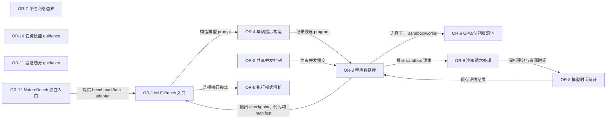
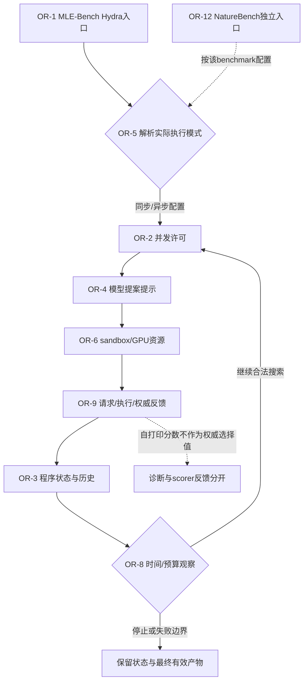

# OpenRSI：工程任务、算子学习与长时搜索的分层实现

[返回索引](../README.md) · [交互架构与动态路径](../implementation-atlas.html?repo=openrsi) · [横向比较](../overview.md)

> 快照：2026-11-05；872 stars；最近 push 2026-09-17。源码固定为 [71ae803a035d5e3b78c19fa49ed9f67d0550cbaa](https://github.com/FrontisAI/OpenRSI/tree/71ae803a035d5e3b78c19fa49ed9f67d0550cbaa)。star 不是质量或复现认证；“最近活跃”不等于项目最近首发。
>
> 本文是固定源码静态阅读与可执行路径说明。没有安装该研究仓库、运行其模型/生成代码或复现论文 benchmark。

## 1. 目标与适用问题

以可执行机器学习工程任务为载体，组织 Gym、算子训练 release 和测试时 Evo 搜索，明确模型能力与框架贡献。

**准确定位：**按训练相关性补选，不宣称它是同组最高 star；原始代码非商业许可，各子组件保留上游条款。

**公开与许可边界：**CC-BY-NC-4.0 for original code; mixed third-party notices。这里只链接和解释代码，不在本仓库复制模型、任务数据或研究源码。特别是非商业/相同方式共享许可不能笼统称为 OSI 认可的软件开源许可。

### 1.1 为什么收录

先只做配置与 scheduler 的 CPU 验证，再准备模型服务、sandbox、任务包与明确资源预算。目录公开不表示数据、容器和模型服务已经随仓库提供。

本项目按模型工程/训练关联性补选，star 低于同组其他案例；不把它冒充全站最高 star 项目。

## 2. 理论与方法论

Draft/Improve/Debug/Crossover 等算子提供训练与搜索的共同接口。学习算子能力、增加搜索预算、改进搜索器是不同变量，必须交叉冻结归因。

### 2.1 用状态而不是名字判断自改进

Evo 持久状态是解代码、父节点/经验、Journal、SolutionsDatabase 和 checkpoint；Evo 路径本身不等于 ERL 权重更新。

本文执行深读主要覆盖 Evo 的 launcher、模式/并发、sandbox、程序状态与指导接口；不是 ERL 全部训练模块的逐行复审。公开 Gym/ERL/Evo 目录、论文中的算子训练结果和本次实际执行是三个不同范围。


### 2.2 实际更新与冻结对象

**可变状态：**

- generated solution/code、program database、operator trajectory、Journal、experience memory、parent metadata、score/delta/novelty、checkpoints 和最终 submission artifacts。Evo 不在该 runtime 中更新基础模型权重。

**固定/外部拥有：**

- OpenMLE-Evo 的基础模型、model server、任务包、数据集、sandbox service、容器、GPU/CPU 路由和 scorer 是外部对象。原始 OpenMLE 为 CC BY-NC 4.0；AIRA-Dojo、SLIME、OpenMLE-Gym、数据集和第三方包保留 NOTICE 中各自许可证，见 LICENSE#L1-L15 和 NOTICE#L1-L19。Gym、RL/ERL 和 Evo 是不同公开实现边界：Gym 提供任务/数据适配，ERL/SFT/RL 涉及训练 runtime，Evo 是 test-time search；不能把 Evo 的搜索实现当作论文训练实现。

本次源码深读重点是 Evo；Gym/ERL 按实际 release 与许可证边界说明，不把论文整栈训练结果写成本次已经复现。


## 3. 运行架构与核心模块

真实入口：[main](https://github.com/FrontisAI/OpenRSI/blob/71ae803a035d5e3b78c19fa49ed9f67d0550cbaa/OpenMLE-Evo/scripts/evaluate_airaevo.py#L295)。以下连线来自本次固定源码审计；未连入主图的兼容入口、接口对象或辅助模块仍列在源码表，不能推断它们是每次必经路径。



### 3.1 图节点—源码映射

| 节点 | 模块 / 代码符号 | 职责 | 固定源码 |
|---|---|---|---|
| OR-1 | MLE-Bench 入口 / `main` | 创建 Hydra 输出、任务目录和 runner config | [OpenMLE-Evo/scripts/evaluate_airaevo.py:295](https://github.com/FrontisAI/OpenRSI/blob/71ae803a035d5e3b78c19fa49ed9f67d0550cbaa/OpenMLE-Evo/scripts/evaluate_airaevo.py#L295) |
| OR-2 | 共享并发控制 / `SharedConcurrencyServer` | 管理共享 LLM/sandbox 并发限制 | [OpenMLE-Evo/tts_search/airaevo_concurrency.py:66](https://github.com/FrontisAI/OpenRSI/blob/71ae803a035d5e3b78c19fa49ed9f67d0550cbaa/OpenMLE-Evo/tts_search/airaevo_concurrency.py#L66) |
| OR-3 | 程序数据库 / `ProgramDatabase` | 持久化 program/solution 生命周期和记录 | [OpenMLE-Evo/tts_search/program_database.py:99](https://github.com/FrontisAI/OpenRSI/blob/71ae803a035d5e3b78c19fa49ed9f67d0550cbaa/OpenMLE-Evo/tts_search/program_database.py#L99) |
| OR-4 | 草稿提示构造 / `build_draft_system_prompt` | 构造 draft/improve/debug prompt | [OpenMLE-Evo/tts_search/prompt_builder.py:61](https://github.com/FrontisAI/OpenRSI/blob/71ae803a035d5e3b78c19fa49ed9f67d0550cbaa/OpenMLE-Evo/tts_search/prompt_builder.py#L61) |
| OR-5 | 执行模式解析 / `resolve_execution_mode` | 解析标准或异步执行模式 | [OpenMLE-Evo/tts_search/airaevo_async_resources.py:12](https://github.com/FrontisAI/OpenRSI/blob/71ae803a035d5e3b78c19fa49ed9f67d0550cbaa/OpenMLE-Evo/tts_search/airaevo_async_resources.py#L12) |
| OR-6 | GPU/沙箱资源池 / `RoundRobinSandboxPool` | 选择 sandbox endpoint | [OpenMLE-Evo/tts_search/airaevo_async_resources.py:74](https://github.com/FrontisAI/OpenRSI/blob/71ae803a035d5e3b78c19fa49ed9f67d0550cbaa/OpenMLE-Evo/tts_search/airaevo_async_resources.py#L74) |
| OR-7 | 评估网络边界 / `disable_proxy_env` | 处理评估网络环境 | [OpenMLE-Evo/tts_search/eval_network.py:15](https://github.com/FrontisAI/OpenRSI/blob/71ae803a035d5e3b78c19fa49ed9f67d0550cbaa/OpenMLE-Evo/tts_search/eval_network.py#L15) |
| OR-8 | 模型时间统计 / `get_total_model_time` | 读取模型、sandbox 和总成本时间 | [OpenMLE-Evo/tts_search/eval_utils.py:133](https://github.com/FrontisAI/OpenRSI/blob/71ae803a035d5e3b78c19fa49ed9f67d0550cbaa/OpenMLE-Evo/tts_search/eval_utils.py#L133) |
| OR-9 | 沙箱请求处理 / `_build_retryable_sandbox_payload` | 构造 sandbox 请求、重试和响应解析 | [OpenMLE-Evo/tts_search/reward_func_utils.py:34](https://github.com/FrontisAI/OpenRSI/blob/71ae803a035d5e3b78c19fa49ed9f67d0550cbaa/OpenMLE-Evo/tts_search/reward_func_utils.py#L34) |
| OR-10 | 任务技能 guidance / `TaskSkillGuidanceResult` | 把任务技能/经验注入搜索提示 | [OpenMLE-Evo/tts_search/task_skill_guidance.py:15](https://github.com/FrontisAI/OpenRSI/blob/71ae803a035d5e3b78c19fa49ed9f67d0550cbaa/OpenMLE-Evo/tts_search/task_skill_guidance.py#L15) |
| OR-11 | 验证划分 guidance / `GuidancePatchStats` | 提供 validation split 约束 | [OpenMLE-Evo/tts_search/validation_split_guidance.py:15](https://github.com/FrontisAI/OpenRSI/blob/71ae803a035d5e3b78c19fa49ed9f67d0550cbaa/OpenMLE-Evo/tts_search/validation_split_guidance.py#L15) |
| OR-12 | NatureBench 独立入口 / `main` | NatureBench Lite-v2 独立 adapter 入口 | [OpenMLE-Evo/scripts/evaluate_naturebench.py:226](https://github.com/FrontisAI/OpenRSI/blob/71ae803a035d5e3b78c19fa49ed9f67d0550cbaa/OpenMLE-Evo/scripts/evaluate_naturebench.py#L226) |

目录是组织单位，不是可执行函数；第 1 行的 module 锚点只表示文件入口，不伪装成函数起始行。

## 4. 主路径与条件分支

Hydra/任务配置 → 候选/算子提案 → 外部 sandbox 执行 → 权威 scorer → Journal/数据库/checkpoint 单写入提交 → 父代与经验回用 → 预算停止/恢复/最终 submission。

下面图是阅读一条代表路径的机制示意，**不是统一覆盖所有 flags 的真实运行 trace**。尤其 GEPA 的另一套通用文本 API、SoL-Pi 的四机制分支、可选 browser/selection/benchmark 不能被视为全部串行必经步骤。



图中模块 ID 对应 §3.1 的固定源码表；STOP/RAW/RECEIPT/NOTE 是相邻源码条件与输出语义的阅读说明，不是新发明的类。具体分支以 §4.2 定位表为准；动态图逐步顺序是代表性阅读路径，而非声明每个分支都发生在同一运行中。

### 4.1 分步解释

### 1. Hydra 启动指定 benchmark

创建 Hydra 输出、任务目录和 runner config。定位模块：`OR-1`。[固定源码](https://github.com/FrontisAI/OpenRSI/blob/71ae803a035d5e3b78c19fa49ed9f67d0550cbaa/OpenMLE-Evo/scripts/evaluate_airaevo.py#L295)。

输入必须先固定版本、配置和评价预算；下面说明的是源码路径，不是本次实际模型运行记录。

### 2. 解析实际执行模式

解析标准或异步执行模式。定位模块：`OR-5`。[固定源码](https://github.com/FrontisAI/OpenRSI/blob/71ae803a035d5e3b78c19fa49ed9f67d0550cbaa/OpenMLE-Evo/tts_search/airaevo_async_resources.py#L12)。

观察真实输出、条件分支和失败，而不是仅依据调用是否返回。具体分支见后面的源码定位表。

### 3. 按配置限制并发候选

管理共享 LLM/sandbox 并发限制。定位模块：`OR-2`。[固定源码](https://github.com/FrontisAI/OpenRSI/blob/71ae803a035d5e3b78c19fa49ed9f67d0550cbaa/OpenMLE-Evo/tts_search/airaevo_concurrency.py#L66)。

观察真实输出、条件分支和失败，而不是仅依据调用是否返回。具体分支见后面的源码定位表。

### 4. 构造算子/草稿提案提示

构造 draft/improve/debug prompt。定位模块：`OR-4`。[固定源码](https://github.com/FrontisAI/OpenRSI/blob/71ae803a035d5e3b78c19fa49ed9f67d0550cbaa/OpenMLE-Evo/tts_search/prompt_builder.py#L61)。

观察真实输出、条件分支和失败，而不是仅依据调用是否返回。具体分支见后面的源码定位表。

### 5. 分配 sandbox/计算资源

选择 sandbox endpoint。定位模块：`OR-6`。[固定源码](https://github.com/FrontisAI/OpenRSI/blob/71ae803a035d5e3b78c19fa49ed9f67d0550cbaa/OpenMLE-Evo/tts_search/airaevo_async_resources.py#L74)。

观察真实输出、条件分支和失败，而不是仅依据调用是否返回。具体分支见后面的源码定位表。

### 6. 提交执行请求并读取权威结果

构造 sandbox 请求、重试和响应解析。定位模块：`OR-9`。[固定源码](https://github.com/FrontisAI/OpenRSI/blob/71ae803a035d5e3b78c19fa49ed9f67d0550cbaa/OpenMLE-Evo/tts_search/reward_func_utils.py#L34)。

观察真实输出、条件分支和失败，而不是仅依据调用是否返回。具体分支见后面的源码定位表。

### 7. 保存程序状态与经验引用

持久化 program/solution 生命周期和记录。定位模块：`OR-3`。[固定源码](https://github.com/FrontisAI/OpenRSI/blob/71ae803a035d5e3b78c19fa49ed9f67d0550cbaa/OpenMLE-Evo/tts_search/program_database.py#L99)。

观察真实输出、条件分支和失败，而不是仅依据调用是否返回。具体分支见后面的源码定位表。

### 8. 记录预算/时间并决定继续或停止

读取模型、sandbox 和总成本时间。定位模块：`OR-8`。[固定源码](https://github.com/FrontisAI/OpenRSI/blob/71ae803a035d5e3b78c19fa49ed9f67d0550cbaa/OpenMLE-Evo/tts_search/eval_utils.py#L133)。

输出与持久状态应与原始执行条件一起保留；过程结束不等于获得泛化或部署收益。

### 4.2 分支与实现定位表

| 阅读定位 | 实际步骤 / 条件与边界 | 源码 |
|---|---|---|
| F1 | 标准入口读取 Hydra 配置、环境变量并创建 output/.hydra/airaevo_tasks。 | [OpenMLE-Evo/scripts/evaluate_airaevo.py:295](https://github.com/FrontisAI/OpenRSI/blob/71ae803a035d5e3b78c19fa49ed9f67d0550cbaa/OpenMLE-Evo/scripts/evaluate_airaevo.py#L295) |
| F2 | 准备 task metadata、prepare config 和 runner config。 | [OpenMLE-Evo/scripts/evaluate_airaevo.py:301](https://github.com/FrontisAI/OpenRSI/blob/71ae803a035d5e3b78c19fa49ed9f67d0550cbaa/OpenMLE-Evo/scripts/evaluate_airaevo.py#L301) |
| F3 | candidates_per_step 控制每步候选数；多候选时写入 individuals_per_generation。 | [OpenMLE-Evo/scripts/evaluate_airaevo.py:319](https://github.com/FrontisAI/OpenRSI/blob/71ae803a035d5e3b78c19fa49ed9f67d0550cbaa/OpenMLE-Evo/scripts/evaluate_airaevo.py#L319) |
| F4 | prompt builder 生成 draft、improve 或 debug 候选提示。 | [OpenMLE-Evo/tts_search/prompt_builder.py:61](https://github.com/FrontisAI/OpenRSI/blob/71ae803a035d5e3b78c19fa49ed9f67d0550cbaa/OpenMLE-Evo/tts_search/prompt_builder.py#L61) |
| F5 | 候选代码提交到 sandbox；sandbox/scorer 的 validation score 是权威分数。 | [OpenMLE-Evo/tts_search/reward_func_utils.py:34](https://github.com/FrontisAI/OpenRSI/blob/71ae803a035d5e3b78c19fa49ed9f67d0550cbaa/OpenMLE-Evo/tts_search/reward_func_utils.py#L34) |
| F6 | ProgramDatabase、Journal、checkpoint 和 output artifacts 持久化节点。 | [OpenMLE-Evo/tts_search/program_database.py:99](https://github.com/FrontisAI/OpenRSI/blob/71ae803a035d5e3b78c19fa49ed9f67d0550cbaa/OpenMLE-Evo/tts_search/program_database.py#L99) |
| F7 | worker 使用共享 concurrency/server pool；异步完成后通过单写入 commit path 更新状态。 | [OpenMLE-Evo/docs/usage.md:120](https://github.com/FrontisAI/OpenRSI/blob/71ae803a035d5e3b78c19fa49ed9f67d0550cbaa/OpenMLE-Evo/docs/usage.md#L120) |
| F8 | parent selection 使用 validation/score、delta、novelty、experience memory 和 sibling ranking，而非模型自报分数。 | [OpenMLE-Evo/docs/overview.md:93](https://github.com/FrontisAI/OpenRSI/blob/71ae803a035d5e3b78c19fa49ed9f67d0550cbaa/OpenMLE-Evo/docs/overview.md#L93) |
| F9 | 完成任务后输出 stat.json、valid_code_final.py、submit_code.py、summary.csv 和 runner_manifest.json。 | [OpenMLE-Evo/docs/overview.md:76](https://github.com/FrontisAI/OpenRSI/blob/71ae803a035d5e3b78c19fa49ed9f67d0550cbaa/OpenMLE-Evo/docs/overview.md#L76) |
| F10 | 使用同一 output_dir resume；资源/服务失败与最终提交状态分开处理。 | [OpenMLE-Evo/scripts/evaluate_naturebench.py:226](https://github.com/FrontisAI/OpenRSI/blob/71ae803a035d5e3b78c19fa49ed9f67d0550cbaa/OpenMLE-Evo/scripts/evaluate_naturebench.py#L226) |

### 4.3 失败、停止与恢复怎么读

- 没有评价结果、无有效候选、API/容器失败和真实任务低分是不同事件。
- 代码允许失败处理，不等于已经证明每种环境都能恢复。
- archive/state/result/checkpoint 的语义随项目变化，不把文件存在当作恢复成功。
- 更新后的产物是否被后续任务或后续改进真正读取，需要使用路径或运行证据，不能只看目录里多了文件。
- 以上四点是复用时的审计要求，不声称每个项目都已经实现完整保障。

## 5. 实践：版本、依赖与最小起步

Evo 使用 Python >=3.11,<3.13、Hydra/OmegaConf/LiteLLM 等。模型服务、sandbox、task package、容器和数据另行准备；ERL 与 Evo 是不同运行路径。

### 5.1 首先固定源码

```sh
git clone https://github.com/FrontisAI/OpenRSI.git
cd OpenRSI
git checkout 71ae803a035d5e3b78c19fa49ed9f67d0550cbaa
```

这三步只固定研究对象；后面的命令仍可能安装依赖、调用模型、执行生成代码或产生费用。应先理解代码与许可，再在隔离环境执行。

### 5.2 仓库文档里的命令入口

```sh
cd OpenMLE-Evo
```

[该命令的原始说明](https://github.com/FrontisAI/OpenRSI/blob/71ae803a035d5e3b78c19fa49ed9f67d0550cbaa/OpenMLE-Evo/README.md#L27)。

```sh
python3.12 -m venv .venv
```

[该命令的原始说明](https://github.com/FrontisAI/OpenRSI/blob/71ae803a035d5e3b78c19fa49ed9f67d0550cbaa/OpenMLE-Evo/README.md#L28)。

```sh
source .venv/bin/activate
```

[该命令的原始说明](https://github.com/FrontisAI/OpenRSI/blob/71ae803a035d5e3b78c19fa49ed9f67d0550cbaa/OpenMLE-Evo/README.md#L29)。

```sh
python -m pip install -r requirements.txt
```

[该命令的原始说明](https://github.com/FrontisAI/OpenRSI/blob/71ae803a035d5e3b78c19fa49ed9f67d0550cbaa/OpenMLE-Evo/README.md#L30)。

```sh
cp .env.example .env
```

[该命令的原始说明](https://github.com/FrontisAI/OpenRSI/blob/71ae803a035d5e3b78c19fa49ed9f67d0550cbaa/OpenMLE-Evo/README.md#L31)。

```sh
./scripts/run_standard.sh
```

[该命令的原始说明](https://github.com/FrontisAI/OpenRSI/blob/71ae803a035d5e3b78c19fa49ed9f67d0550cbaa/OpenMLE-Evo/README.md#L34)。

```sh
python scripts/evaluate_airaevo.py
```

[该命令的原始说明](https://github.com/FrontisAI/OpenRSI/blob/71ae803a035d5e3b78c19fa49ed9f67d0550cbaa/OpenMLE-Evo/scripts/evaluate_airaevo.py#L301)。

```sh
python scripts/run_naturebench_local.py
```

[该命令的原始说明](https://github.com/FrontisAI/OpenRSI/blob/71ae803a035d5e3b78c19fa49ed9f67d0550cbaa/OpenMLE-Evo/README.md#L16)。


命令是文档化入口，不是本次已执行的记录。凭据只配置在本地受控环境，不能提交到 Git；工具名称、环境变量名和 API key 的实际值必须分开。

### 5.3 首次实验的建议约束

1. 最小任务集合、单一模型/配置和有限候选/轮次。
2. 固定任务、输入、模型版本、评价器、随机性与资源上限。
3. 不给生成代码不必要的主机文件/网络/凭据权限。
4. 完整保存失败、拒绝、超时、API 开销和未评分分母。
5. 冻结产物后测独立任务，不用最终测试集反复选候选。
6. 先复核功能与副作用，再讨论成本下降。

这是本图谱建议的实践协议，不冒充仓库自带的完整安全或评测实现。

## 6. 怎样设计一个有判别力的对照

固定 Evo 换模型、固定模型换 Evo，再匹配搜索预算；同步/异步对照需包含失败和排队费用。模型自己打印的 self-validation 分数不能替代权威 scorer。

推荐报告至少包含：原版本、候选版本、任务/样本分母、成功与退化、完整成本、失败原因、选择规则、独立确认范围和未解决项。不同基准、计费规则或模型下的数字不直接拼成统一 RSI 排名。

## 7. 声称、实现、运行验证分开

| 层级 | 本文能确认 | 不能自动推断 |
|---|---|---|
| 定位与论文 | 作者公开目标、研究方向与原文入口 | 通用或无限递归已实现 |
| 固定源码 | 上述入口、模块、调用关系与数据结构 | 所有 flags 都能运行、实验一定复现 |
| 本次检查 | commit 与源码锚点/文档/离线图构建 | 模型、容器或付费 benchmark 实验 |
| 未来实跑 | 需按 §5—6 保存完整证据 | 有一个成功案例就获得泛化 |

- 真实运行依赖外部模型服务、sandbox API、任务包、评估服务、容器/Conda、CPU/GPU 和费用；README 的 standard/NatureBench 命令是发布操作路径，不代表本次验证；论文结果、训练效果、异步扩展性、experience-memory 泛化和 benchmark 完成率均未由本次审计执行确认。

## 8. 具体优化建议

1. 为候选封存模型版本、sandbox image、输入与运行清单。
2. 统一 score、成本、失败和算子谱系字段。
3. 对异步单写入提交与恢复增加确定性回放。
4. 对经验库做污染/消融测试，避免把 benchmark 特定提示当通用研究能力。

## 9. 复核清单

- [ ] 用相同 commit 而非浮动 main 复核源码。
- [ ] 确认实际选择的 API、feature flags 和外部 runner。
- [ ] 检查可变面没有不当地包含最终 evaluator 或答案。
- [ ] 记录全部候选、失败与资源账单。
- [ ] 区分任务收益、持久产物收益与后继改进效率。
- [ ] 对最外层仍固定的部分保持准确描述。

这些是读者的后续执行清单，不是本项目已经运行该仓库的证明。

[返回开源实现索引](../README.md) · [比较六种机制](../overview.md) · [交互图](../implementation-atlas.html?repo=openrsi)
