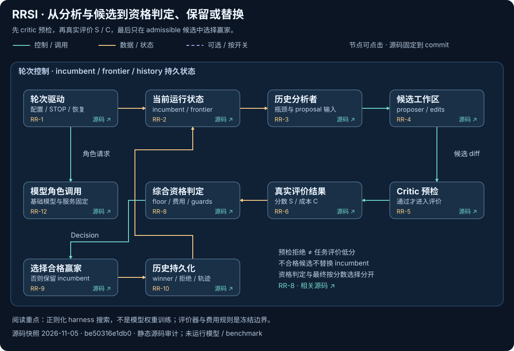
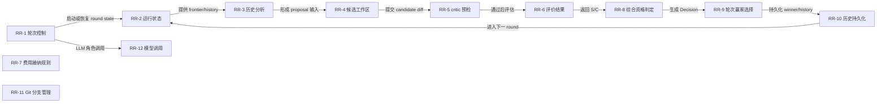
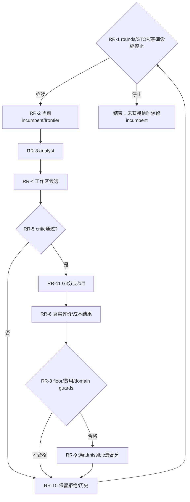

# RRSI：以正则化约束 Harness 演化与选择偏差

[返回索引](../README.md) · [交互架构与动态路径](../implementation-atlas.html?repo=rrsi) · [横向比较](../overview.md)

> 快照：2026-11-05；1,725 stars；最近 push 2026-09-23。源码固定为 [be50316e1db05914068a973f322770ef08ed7ba1](https://github.com/google-research/rrsi/tree/be50316e1db05914068a973f322770ef08ed7ba1)。star 不是质量或复现认证；“最近活跃”不等于项目最近首发。
>
> 本文是固定源码静态阅读与可执行路径说明。没有安装该研究仓库、运行其模型/生成代码或复现论文 benchmark。

## 1. 目标与适用问题

让自动提出的 Harness 修改更可复用，抑制 benchmark 特化、微小噪声编辑和费用膨胀。

**准确定位：**有显式接纳规则、历史与代码版本的 Harness 搜索；不训练基础模型权重。

**公开与许可边界：**Apache-2.0。这里只链接和解释代码，不在本仓库复制模型、任务数据或研究源码。特别是非商业/相同方式共享许可不能笼统称为 OSI 认可的软件开源许可。

### 1.1 为什么收录

先固定 benchmark runner、外部 agent Python 和模型服务；给出有限 rounds、每候选预算与连续基础设施失败停止条件，再试一个 domain。

该项目同时具有较高关注度和与本图谱相关的实际可读实现；选择不是全 GitHub 的穷尽排名。

## 2. 理论与方法论

搜索会适应开发基准，不能只凭分数上升接纳候选。将历史性能 floor、成本与 novelty 等约束放进提案/选择，有助于限制错误搜索方向；不是泛化保证。

### 2.1 用状态而不是名字判断自改进

H_t、S_t、C_t、历史最高 S*、候选 diff/commit、组件新颖性、journal/history。候选先过资格，再在 admissible 集合中选分数最高者。

选择规则的解释性记号： $`\Delta S=S'-S_t`$， $`\Delta C=(C'-C_t)/C_t`$。显著改进时费用约束使用 $`\beta_0+\beta_1\Delta S`$；小改进还考虑分数、成本与 novelty，并保护 $`S'\ge S^*-\delta`$。最终仍在 admissible 候选中选分数最高者。精确条件以 `cost_rule/judge/select_round` 固定源码为准。


### 2.2 实际更新与冻结对象

**可变状态：**

- harness 源码、candidate edits、Git branch/commit、frontier、history、EvalResult、incumbent 和历史最高分 S_star。实际目标是正则化的 harness 搜索，而非模型权重训练。

**固定/外部拥有：**

- 基础模型、Vertex/Anthropic 服务、benchmark harness、evaluator、成本配置和外部 agent runner 不由 selection.py 更新。项目为 Apache License 2.0，见 LICENSE#L1-L13。

成本门槛和 novelty 是选择规则，不是自学习出来的评价真值；benchmark 与 scorer 仍应保护在可变面之外。


## 3. 运行架构与核心模块

真实入口：[drive](https://github.com/google-research/rrsi/blob/be50316e1db05914068a973f322770ef08ed7ba1/rrsi/driver.py#L54)。以下连线来自本次固定源码审计；未连入主图的兼容入口、接口对象或辅助模块仍列在源码表，不能推断它们是每次必经路径。



[交互架构：点击节点查看模块与源码](../implementation-atlas.html?repo=rrsi) · [下载原生 SVG](../../../pics/implementations/rrsi-architecture.svg)。青色为控制/调用，金色为数据/状态，紫色虚线为可选路径；这是固定源码快照，不是模型实跑轨迹。全部 12 个模块仍列在下方表中。



### 3.1 图节点—源码映射

| 节点 | 模块 / 代码符号 | 职责 | 固定源码 |
|---|---|---|---|
| RR-1 | 轮次控制 / `drive` | 驱动轮次、STOP 文件和连续基础设施失败停止 | [rrsi/driver.py:54](https://github.com/google-research/rrsi/blob/be50316e1db05914068a973f322770ef08ed7ba1/rrsi/driver.py#L54) |
| RR-2 | 运行状态 / `Run` | 维护 frontier、incumbent、评估路径和运行目录 | [rrsi/loop.py:75](https://github.com/google-research/rrsi/blob/be50316e1db05914068a973f322770ef08ed7ba1/rrsi/loop.py#L75) |
| RR-3 | 历史分析 / `analyze` | 读取历史和任务轨迹并生成分析 | [rrsi/analyst.py:121](https://github.com/google-research/rrsi/blob/be50316e1db05914068a973f322770ef08ed7ba1/rrsi/analyst.py#L121) |
| RR-4 | 候选工作区 / `Workspace` | 安全读取、修改和写入 harness 文件 | [rrsi/propose.py:140](https://github.com/google-research/rrsi/blob/be50316e1db05914068a973f322770ef08ed7ba1/rrsi/propose.py#L140) |
| RR-5 | critic 预检 / `precheck` | 在评估前检查 diff 和 domain pattern | [rrsi/critic.py:105](https://github.com/google-research/rrsi/blob/be50316e1db05914068a973f322770ef08ed7ba1/rrsi/critic.py#L105) |
| RR-6 | 评价结果 / `EvalResult` | 保存任务分数、成本和评估结果 | [rrsi/evaluate.py:72](https://github.com/google-research/rrsi/blob/be50316e1db05914068a973f322770ef08ed7ba1/rrsi/evaluate.py#L72) |
| RR-7 | 费用接纳规则 / `cost_rule` | 按 delta_S、delta_C、novelty 和配置计算接纳条件 | [rrsi/selection.py:81](https://github.com/google-research/rrsi/blob/be50316e1db05914068a973f322770ef08ed7ba1/rrsi/selection.py#L81) |
| RR-8 | 综合资格判定 / `judge` | 执行 floor、成本和 domain guard gate | [rrsi/selection.py:97](https://github.com/google-research/rrsi/blob/be50316e1db05914068a973f322770ef08ed7ba1/rrsi/selection.py#L97) |
| RR-9 | 轮次赢家选择 / `select_round` | 从 admissible candidates 中选择最高分者 | [rrsi/selection.py:124](https://github.com/google-research/rrsi/blob/be50316e1db05914068a973f322770ef08ed7ba1/rrsi/selection.py#L124) |
| RR-10 | 历史持久化 / `History` | 记录 candidate、测量值和轮次历史 | [rrsi/history.py:55](https://github.com/google-research/rrsi/blob/be50316e1db05914068a973f322770ef08ed7ba1/rrsi/history.py#L55) |
| RR-11 | Git 分支管理 / `ensure_branch` | 创建 branch/worktree 并记录代码演化 | [rrsi/gitops.py:75](https://github.com/google-research/rrsi/blob/be50316e1db05914068a973f322770ef08ed7ba1/rrsi/gitops.py#L75) |
| RR-12 | 模型调用 / `generate` | 调用 proposer/analyst/critic 所用 LLM | [rrsi/llm.py:92](https://github.com/google-research/rrsi/blob/be50316e1db05914068a973f322770ef08ed7ba1/rrsi/llm.py#L92) |

目录是组织单位，不是可执行函数；第 1 行的 module 锚点只表示文件入口，不伪装成函数起始行。

## 4. 主路径与条件分支

driver/STOP → 历史分析 → 工作区候选 edits → critic → 代码分支与执行 → 分数/费用 → floor + cost + domain guards → 接纳赢家或保留 incumbent。

下面图是阅读一条代表路径的机制示意，**不是统一覆盖所有 flags 的真实运行 trace**。尤其 GEPA 的另一套通用文本 API、SoL-Pi 的四机制分支、可选 browser/selection/benchmark 不能被视为全部串行必经步骤。



图中模块 ID 对应 §3.1 的固定源码表；STOP/RAW/RECEIPT/NOTE 是相邻源码条件与输出语义的阅读说明，不是新发明的类。具体分支以 §4.2 定位表为准；动态图逐步顺序是代表性阅读路径，而非声明每个分支都发生在同一运行中。

### 4.1 分步解释

### 1. 读取运行配置与 STOP

驱动轮次、STOP 文件和连续基础设施失败停止。定位模块：`RR-1`。[固定源码](https://github.com/google-research/rrsi/blob/be50316e1db05914068a973f322770ef08ed7ba1/rrsi/driver.py#L54)。

输入必须先固定版本、配置和评价预算；下面说明的是源码路径，不是本次实际模型运行记录。

### 2. 载入 incumbent 与 frontier

维护 frontier、incumbent、评估路径和运行目录。定位模块：`RR-2`。[固定源码](https://github.com/google-research/rrsi/blob/be50316e1db05914068a973f322770ef08ed7ba1/rrsi/loop.py#L75)。

观察真实输出、条件分支和失败，而不是仅依据调用是否返回。具体分支见后面的源码定位表。

### 3. 分析已有轨迹与瓶颈

读取历史和任务轨迹并生成分析。定位模块：`RR-3`。[固定源码](https://github.com/google-research/rrsi/blob/be50316e1db05914068a973f322770ef08ed7ba1/rrsi/analyst.py#L121)。

观察真实输出、条件分支和失败，而不是仅依据调用是否返回。具体分支见后面的源码定位表。

### 4. 生成候选 edits 与 hypothesis

安全读取、修改和写入 harness 文件。定位模块：`RR-4`。[固定源码](https://github.com/google-research/rrsi/blob/be50316e1db05914068a973f322770ef08ed7ba1/rrsi/propose.py#L140)。

观察真实输出、条件分支和失败，而不是仅依据调用是否返回。具体分支见后面的源码定位表。

### 5. critic 预检，拒绝或继续

在评估前检查 diff 和 domain pattern。定位模块：`RR-5`。[固定源码](https://github.com/google-research/rrsi/blob/be50316e1db05914068a973f322770ef08ed7ba1/rrsi/critic.py#L105)。

观察真实输出、条件分支和失败，而不是仅依据调用是否返回。具体分支见后面的源码定位表。

### 6. 执行任务并得到评价/费用

保存任务分数、成本和评估结果。定位模块：`RR-6`。[固定源码](https://github.com/google-research/rrsi/blob/be50316e1db05914068a973f322770ef08ed7ba1/rrsi/evaluate.py#L72)。

观察真实输出、条件分支和失败，而不是仅依据调用是否返回。具体分支见后面的源码定位表。

### 7. 检查 floor、成本与 domain guards

执行 floor、成本和 domain guard gate。定位模块：`RR-8`。[固定源码](https://github.com/google-research/rrsi/blob/be50316e1db05914068a973f322770ef08ed7ba1/rrsi/selection.py#L97)。

观察真实输出、条件分支和失败，而不是仅依据调用是否返回。具体分支见后面的源码定位表。

### 8. 选 admissible 赢家或保留原版本

从 admissible candidates 中选择最高分者。定位模块：`RR-9`。[固定源码](https://github.com/google-research/rrsi/blob/be50316e1db05914068a973f322770ef08ed7ba1/rrsi/selection.py#L124)。

输出与持久状态应与原始执行条件一起保留；过程结束不等于获得泛化或部署收益。

### 4.2 分支与实现定位表

| 阅读定位 | 实际步骤 / 条件与边界 | 源码 |
|---|---|---|
| F1 | driver 创建或恢复 run，读取轮次数和外部 STOP 文件。 | [rrsi/driver.py:54](https://github.com/google-research/rrsi/blob/be50316e1db05914068a973f322770ef08ed7ba1/rrsi/driver.py#L54) |
| F2 | Run 读取 frontier、incumbent 和既有评估结果。 | [rrsi/loop.py:75](https://github.com/google-research/rrsi/blob/be50316e1db05914068a973f322770ef08ed7ba1/rrsi/loop.py#L75) |
| F3 | analyst 根据历史和任务结果准备改进方向。 | [rrsi/analyst.py:121](https://github.com/google-research/rrsi/blob/be50316e1db05914068a973f322770ef08ed7ba1/rrsi/analyst.py#L121) |
| F4 | proposer 在 Workspace 中生成带 component/hypothesis 的候选 edits。 | [rrsi/propose.py:140](https://github.com/google-research/rrsi/blob/be50316e1db05914068a973f322770ef08ed7ba1/rrsi/propose.py#L140) |
| F5 | critic precheck/review 筛掉不符合 domain pattern 的 diff。 | [rrsi/critic.py:105](https://github.com/google-research/rrsi/blob/be50316e1db05914068a973f322770ef08ed7ba1/rrsi/critic.py#L105) |
| F6 | 候选通过 git branch/worktree 应用并形成 diff/commit。 | [rrsi/gitops.py:75](https://github.com/google-research/rrsi/blob/be50316e1db05914068a973f322770ef08ed7ba1/rrsi/gitops.py#L75) |
| F7 | evaluator 产生 EvalResult；没有结果的 candidate 直接不可接纳。 | [rrsi/evaluate.py:72](https://github.com/google-research/rrsi/blob/be50316e1db05914068a973f322770ef08ed7ba1/rrsi/evaluate.py#L72) |
| F8 | selection 计算性能增益、相对成本、novelty、floor 和 guards。 | [rrsi/selection.py:81](https://github.com/google-research/rrsi/blob/be50316e1db05914068a973f322770ef08ed7ba1/rrsi/selection.py#L81) |
| F9 | select_round 选择 admissible 中 S 最大者；无 admissible 则保持 incumbent。 | [rrsi/selection.py:124](https://github.com/google-research/rrsi/blob/be50316e1db05914068a973f322770ef08ed7ba1/rrsi/selection.py#L124) |
| F10 | History 写入候选和结果，driver 继续、遇 STOP 或连续失败后停止。 | [rrsi/history.py:55](https://github.com/google-research/rrsi/blob/be50316e1db05914068a973f322770ef08ed7ba1/rrsi/history.py#L55) |

### 4.3 失败、停止与恢复怎么读

- 没有评价结果、无有效候选、API/容器失败和真实任务低分是不同事件。
- 代码允许失败处理，不等于已经证明每种环境都能恢复。
- archive/state/result/checkpoint 的语义随项目变化，不把文件存在当作恢复成功。
- 更新后的产物是否被后续任务或后续改进真正读取，需要使用路径或运行证据，不能只看目录里多了文件。
- 以上四点是复用时的审计要求，不声称每个项目都已经实现完整保障。

## 5. 实践：版本、依赖与最小起步

Python >=3.10、anthropic[vertex]；agentic/coding 为可选依赖。外部 agent Python、benchmark runner、Vertex 认证与费用不是仓库自动提供。

### 5.1 首先固定源码

```sh
git clone https://github.com/google-research/rrsi.git
cd rrsi
git checkout be50316e1db05914068a973f322770ef08ed7ba1
```

这三步只固定研究对象；后面的命令仍可能安装依赖、调用模型、执行生成代码或产生费用。应先理解代码与许可，再在隔离环境执行。

### 5.2 仓库文档里的命令入口

```sh
python -m pip install -e .
```

[该命令的原始说明](https://github.com/google-research/rrsi/blob/be50316e1db05914068a973f322770ef08ed7ba1/pyproject.toml#L15)。

```sh
python -m pip install -e '.[agentic]'
```

[该命令的原始说明](https://github.com/google-research/rrsi/blob/be50316e1db05914068a973f322770ef08ed7ba1/pyproject.toml#L27)。

```sh
python -m pip install -e '.[coding]'
```

[该命令的原始说明](https://github.com/google-research/rrsi/blob/be50316e1db05914068a973f322770ef08ed7ba1/pyproject.toml#L43)。

```sh
touch runs/<domain>/STOP
```

[该命令的原始说明](https://github.com/google-research/rrsi/blob/be50316e1db05914068a973f322770ef08ed7ba1/rrsi/driver.py#L31)。


命令是文档化入口，不是本次已执行的记录。凭据只配置在本地受控环境，不能提交到 Git；工具名称、环境变量名和 API key 的实际值必须分开。

### 5.3 首次实验的建议约束

1. 最小任务集合、单一模型/配置和有限候选/轮次。
2. 固定任务、输入、模型版本、评价器、随机性与资源上限。
3. 不给生成代码不必要的主机文件/网络/凭据权限。
4. 完整保存失败、拒绝、超时、API 开销和未评分分母。
5. 冻结产物后测独立任务，不用最终测试集反复选候选。
6. 先复核功能与副作用，再讨论成本下降。

这是本图谱建议的实践协议，不冒充仓库自带的完整安全或评测实现。

## 6. 怎样设计一个有判别力的对照

同预算对比不加正则、只限制编辑、加 critic/pruner 与完整选择。对被 critic 拒绝的候选抽样复核，最终在冻结的未见任务上测试。

推荐报告至少包含：原版本、候选版本、任务/样本分母、成功与退化、完整成本、失败原因、选择规则、独立确认范围和未解决项。不同基准、计费规则或模型下的数字不直接拼成统一 RSI 排名。

## 7. 声称、实现、运行验证分开

| 层级 | 本文能确认 | 不能自动推断 |
|---|---|---|
| 定位与论文 | 作者公开目标、研究方向与原文入口 | 通用或无限递归已实现 |
| 固定源码 | 上述入口、模块、调用关系与数据结构 | 所有 flags 都能运行、实验一定复现 |
| 本次检查 | commit 与源码锚点/文档/离线图构建 | 模型、容器或付费 benchmark 实验 |
| 未来实跑 | 需按 §5—6 保存完整证据 | 有一个成功案例就获得泛化 |

- 需要 Vertex/Anthropic API 和外部 benchmark runner；成本单次测量可能有噪声；critic、domain guard 和 evaluator 未由本次运行验证；论文结果不是本次复现；连续基础设施失败会停止，候选可因 critic、smoke、invalid eval、floor、成本或 guard 被拒绝。

## 8. 具体优化建议

1. 将 evaluator、成本口径、随机种子和输入 hash 写入运行清单。
2. 对费用和分数噪声增加重复测量，不只用一次点估计。
3. 将 critic reject、执行失败与真实低分分开。
4. 保存被拒绝 diff 与完整分母，便于审计选择偏差。

## 9. 复核清单

- [ ] 用相同 commit 而非浮动 main 复核源码。
- [ ] 确认实际选择的 API、feature flags 和外部 runner。
- [ ] 检查可变面没有不当地包含最终 evaluator 或答案。
- [ ] 记录全部候选、失败与资源账单。
- [ ] 区分任务收益、持久产物收益与后继改进效率。
- [ ] 对最外层仍固定的部分保持准确描述。

这些是读者的后续执行清单，不是本项目已经运行该仓库的证明。

[返回开源实现索引](../README.md) · [比较六种机制](../overview.md) · [交互图](../implementation-atlas.html?repo=rrsi)
