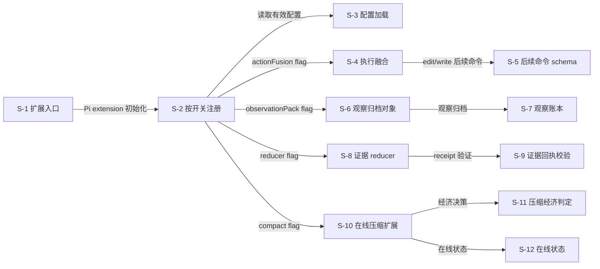
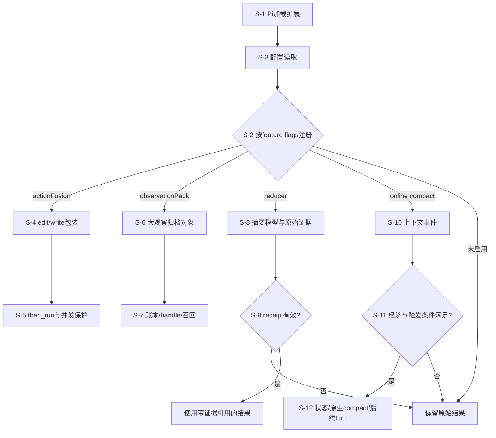

# SoL-Pi：把自动研究成果固化成可恢复的 Harness 扩展

[返回索引](../README.md) · [交互架构与动态路径](../implementation-atlas.html?repo=sol-pi) · [横向比较](../overview.md)

> 快照：2026-11-05；3,639 stars；最近 push 2026-11-05。源码固定为 [219568034fa54ed121ede80961655e33dfb9d0e3](https://github.com/NVlabs/SoL-Pi/tree/219568034fa54ed121ede80961655e33dfb9d0e3)。star 不是质量或复现认证；“最近活跃”不等于项目最近首发。
>
> 本文是固定源码静态阅读与可执行路径说明。没有安装该研究仓库、运行其模型/生成代码或复现论文 benchmark。

## 1. 目标与适用问题

减少多余模型回合、重复上下文和大观察开销，同时保留原始证据的可恢复性，避免改动 Pi 核心。

**准确定位：**Pi 的 opt-in 效率扩展包；发布 runtime 不等于发布了全部 auto-research 搜索循环。

**公开与许可边界：**MIT。这里只链接和解释代码，不在本仓库复制模型、任务数据或研究源码。特别是非商业/相同方式共享许可不能笼统称为 OSI 认可的软件开源许可。

### 1.1 为什么收录

先固定 Pi 兼容版本，只启用不需要额外摘要模型的本地机制，再分别测 reducer 和 compact；默认关闭不是 bug，也不能把四组件默认为全部启用。

该项目同时具有较高关注度和与本图谱相关的实际可读实现；选择不是全 GitHub 的穷尽排名。

## 2. 理论与方法论

优化单位是执行与信息流，而非权重。短观察需要可还原证据；压缩只有在未来节省超过即时压缩成本且行为风险可接受时才有价值。

### 2.1 用状态而不是名字判断自改进

状态包括工具组合、session archive、稳定 handle、receipt、计划投影与压缩状态；不是模型参数或自主改变的 feature flags。

四个机制是分支，不是每次工具调用依次经过四级处理。Reducer 失败保留原始结果属于明确的证据保全语义；不要在自己的复用中把错误吞成“摘要成功”。


### 2.2 实际更新与冻结对象

**可变状态：**

- sol-pi.json feature flags
- action fusion tool-call 形态
- observation archive/handles
- reducer receipts/journal
- online compact state

**固定/外部拥有：**

- Pi 源码
- Pi 主模型和认证/provider 路由
- Pi 公共 extension API
- 未启用机制的默认运行行为

项目配置优先且不与用户配置合并；扩展不自主改写 Pi 的模型、认证、provider 或主循环。


## 3. 运行架构与核心模块

真实入口：[solPiExtension](https://github.com/NVlabs/SoL-Pi/blob/219568034fa54ed121ede80961655e33dfb9d0e3/src/sol-pi/index.ts#L49)。以下连线来自本次固定源码审计；未连入主图的兼容入口、接口对象或辅助模块仍列在源码表，不能推断它们是每次必经路径。



### 3.1 图节点—源码映射

| 节点 | 模块 / 代码符号 | 职责 | 固定源码 |
|---|---|---|---|
| S-1 | 扩展入口 / `solPiExtension` | Pi 加载的默认扩展入口 | [src/sol-pi/index.ts:49](https://github.com/NVlabs/SoL-Pi/blob/219568034fa54ed121ede80961655e33dfb9d0e3/src/sol-pi/index.ts#L49) |
| S-2 | 按开关注册 / `registerConfiguredFeatures` | 按配置注册四类机制 | [src/sol-pi/index.ts:14](https://github.com/NVlabs/SoL-Pi/blob/219568034fa54ed121ede80961655e33dfb9d0e3/src/sol-pi/index.ts#L14) |
| S-3 | 配置加载 / `loadSolPiConfig` | 加载项目/用户配置和默认值 | [src/sol-pi/config.ts:61](https://github.com/NVlabs/SoL-Pi/blob/219568034fa54ed121ede80961655e33dfb9d0e3/src/sol-pi/config.ts#L61) |
| S-4 | 执行融合 / `createActionFusionExtension` | 包装 edit/write 并支持 then_run | [src/sol-pi/extensions/action-fusion/index.ts:85](https://github.com/NVlabs/SoL-Pi/blob/219568034fa54ed121ede80961655e33dfb9d0e3/src/sol-pi/extensions/action-fusion/index.ts#L85) |
| S-5 | 后续命令 schema / `createThenRunSchema` | follow-up 命令 schema 与状态 | [src/sol-pi/extensions/action-fusion/then-run.ts:33](https://github.com/NVlabs/SoL-Pi/blob/219568034fa54ed121ede80961655e33dfb9d0e3/src/sol-pi/extensions/action-fusion/then-run.ts#L33) |
| S-6 | 观察归档对象 / `createObservation` | 大文本 tool result 归档/handle 化 | [src/sol-pi/extensions/observation-pack/observation.ts:98](https://github.com/NVlabs/SoL-Pi/blob/219568034fa54ed121ede80961655e33dfb9d0e3/src/sol-pi/extensions/observation-pack/observation.ts#L98) |
| S-7 | 观察账本 / `createLedger` | 观察归档 ledger | [src/sol-pi/extensions/observation-pack/ledger.ts:15](https://github.com/NVlabs/SoL-Pi/blob/219568034fa54ed121ede80961655e33dfb9d0e3/src/sol-pi/extensions/observation-pack/ledger.ts#L15) |
| S-8 | 证据 reducer / `createEvidencePreservingReducerExtension` | 证据保留 reducer 生命周期 | [src/sol-pi/extensions/evidence-preserving-reducer/index.ts:202](https://github.com/NVlabs/SoL-Pi/blob/219568034fa54ed121ede80961655e33dfb9d0e3/src/sol-pi/extensions/evidence-preserving-reducer/index.ts#L202) |
| S-9 | 证据回执校验 / `validateReceipt` | 验证引用与归档证据一致性 | [src/sol-pi/extensions/evidence-preserving-reducer/receipt.ts:82](https://github.com/NVlabs/SoL-Pi/blob/219568034fa54ed121ede80961655e33dfb9d0e3/src/sol-pi/extensions/evidence-preserving-reducer/receipt.ts#L82) |
| S-10 | 在线压缩扩展 / `createOnlineContextCompactExtension` | 在线上下文压缩和新 turn continuation | [src/sol-pi/extensions/online-context-compact/extension.ts:152](https://github.com/NVlabs/SoL-Pi/blob/219568034fa54ed121ede80961655e33dfb9d0e3/src/sol-pi/extensions/online-context-compact/extension.ts#L152) |
| S-11 | 压缩经济判定 / `decideCompaction` | 压缩收益/成本与触发条件 | [src/sol-pi/extensions/online-context-compact/economics.ts:129](https://github.com/NVlabs/SoL-Pi/blob/219568034fa54ed121ede80961655e33dfb9d0e3/src/sol-pi/extensions/online-context-compact/economics.ts#L129) |
| S-12 | 在线状态 / `initialOnlineState` | 压缩/边界/计划状态 | [src/sol-pi/extensions/online-context-compact/state.ts:37](https://github.com/NVlabs/SoL-Pi/blob/219568034fa54ed121ede80961655e33dfb9d0e3/src/sol-pi/extensions/online-context-compact/state.ts#L37) |

目录是组织单位，不是可执行函数；第 1 行的 module 锚点只表示文件入口，不伪装成函数起始行。

## 4. 主路径与条件分支

Pi 加载公共 extension → 读取项目/用户配置 → 按开关注册四机制 → 执行融合/观察归档/证据 reducer/上下文 compact → 校验失败保留原文 → 下一 turn 继续。

下面图是阅读一条代表路径的机制示意，**不是统一覆盖所有 flags 的真实运行 trace**。尤其 GEPA 的另一套通用文本 API、SoL-Pi 的四机制分支、可选 browser/selection/benchmark 不能被视为全部串行必经步骤。



图中模块 ID 对应 §3.1 的固定源码表；STOP/RAW/RECEIPT/NOTE 是相邻源码条件与输出语义的阅读说明，不是新发明的类。具体分支以 §4.2 定位表为准；动态图逐步顺序是代表性阅读路径，而非声明每个分支都发生在同一运行中。

### 4.1 分步解释

### 1. Pi 加载公共扩展入口

Pi 加载的默认扩展入口。定位模块：`S-1`。[固定源码](https://github.com/NVlabs/SoL-Pi/blob/219568034fa54ed121ede80961655e33dfb9d0e3/src/sol-pi/index.ts#L49)。

输入必须先固定版本、配置和评价预算；下面说明的是源码路径，不是本次实际模型运行记录。

### 2. 读取项目/用户配置

加载项目/用户配置和默认值。定位模块：`S-3`。[固定源码](https://github.com/NVlabs/SoL-Pi/blob/219568034fa54ed121ede80961655e33dfb9d0e3/src/sol-pi/config.ts#L61)。

观察真实输出、条件分支和失败，而不是仅依据调用是否返回。具体分支见后面的源码定位表。

### 3. 按 opt-in flags 注册机制

按配置注册四类机制。定位模块：`S-2`。[固定源码](https://github.com/NVlabs/SoL-Pi/blob/219568034fa54ed121ede80961655e33dfb9d0e3/src/sol-pi/index.ts#L14)。

观察真实输出、条件分支和失败，而不是仅依据调用是否返回。具体分支见后面的源码定位表。

### 4. 分支A：编辑与后续验证融合

包装 edit/write 并支持 then_run。定位模块：`S-4`。[固定源码](https://github.com/NVlabs/SoL-Pi/blob/219568034fa54ed121ede80961655e33dfb9d0e3/src/sol-pi/extensions/action-fusion/index.ts#L85)。

观察真实输出、条件分支和失败，而不是仅依据调用是否返回。具体分支见后面的源码定位表。

### 5. 分支B：观察归档与可召回 handle

大文本 tool result 归档/handle 化。定位模块：`S-6`。[固定源码](https://github.com/NVlabs/SoL-Pi/blob/219568034fa54ed121ede80961655e33dfb9d0e3/src/sol-pi/extensions/observation-pack/observation.ts#L98)。

观察真实输出、条件分支和失败，而不是仅依据调用是否返回。具体分支见后面的源码定位表。

### 6. 分支C：验证摘要证据回执

验证引用与归档证据一致性。定位模块：`S-9`。[固定源码](https://github.com/NVlabs/SoL-Pi/blob/219568034fa54ed121ede80961655e33dfb9d0e3/src/sol-pi/extensions/evidence-preserving-reducer/receipt.ts#L82)。

观察真实输出、条件分支和失败，而不是仅依据调用是否返回。具体分支见后面的源码定位表。

### 7. 分支D：判定 compact 经济性

压缩收益/成本与触发条件。定位模块：`S-11`。[固定源码](https://github.com/NVlabs/SoL-Pi/blob/219568034fa54ed121ede80961655e33dfb9d0e3/src/sol-pi/extensions/online-context-compact/economics.ts#L129)。

观察真实输出、条件分支和失败，而不是仅依据调用是否返回。具体分支见后面的源码定位表。

### 8. 保存状态，继续或保持原行为

压缩/边界/计划状态。定位模块：`S-12`。[固定源码](https://github.com/NVlabs/SoL-Pi/blob/219568034fa54ed121ede80961655e33dfb9d0e3/src/sol-pi/extensions/online-context-compact/state.ts#L37)。

输出与持久状态应与原始执行条件一起保留；过程结束不等于获得泛化或部署收益。

### 4.2 分支与实现定位表

| 阅读定位 | 实际步骤 / 条件与边界 | 源码 |
|---|---|---|
| F1 | Pi 通过 package manifest 加载 solPiExtension。 | [src/sol-pi/index.ts:49](https://github.com/NVlabs/SoL-Pi/blob/219568034fa54ed121ede80961655e33dfb9d0e3/src/sol-pi/index.ts#L49) |
| F2 | 入口读取 Sol-Pi 配置并建立默认配置。 | [src/sol-pi/config.ts:61](https://github.com/NVlabs/SoL-Pi/blob/219568034fa54ed121ede80961655e33dfb9d0e3/src/sol-pi/config.ts#L61) |
| F3 | registerConfiguredFeatures 按 flags 注册机制；默认配置可全部关闭。 | [src/sol-pi/index.ts:14](https://github.com/NVlabs/SoL-Pi/blob/219568034fa54ed121ede80961655e33dfb9d0e3/src/sol-pi/index.ts#L14) |
| F4 | 启用 Action Fusion 时创建 edit/write 扩展。 | [src/sol-pi/extensions/action-fusion/index.ts:85](https://github.com/NVlabs/SoL-Pi/blob/219568034fa54ed121ede80961655e33dfb9d0e3/src/sol-pi/extensions/action-fusion/index.ts#L85) |
| F5 | then_run schema 定义后续验证命令；目标内容变化时抛出失败。 | [src/sol-pi/extensions/action-fusion/then-run.ts:33](https://github.com/NVlabs/SoL-Pi/blob/219568034fa54ed121ede80961655e33dfb9d0e3/src/sol-pi/extensions/action-fusion/then-run.ts#L33) |
| F6 | 大文本观察通过 createObservation 判断、hash 并生成可归档对象。 | [src/sol-pi/extensions/observation-pack/observation.ts:98](https://github.com/NVlabs/SoL-Pi/blob/219568034fa54ed121ede80961655e33dfb9d0e3/src/sol-pi/extensions/observation-pack/observation.ts#L98) |
| F7 | 观察 ledger 持久化到 session runtime 路径。 | [src/sol-pi/extensions/observation-pack/ledger.ts:15](https://github.com/NVlabs/SoL-Pi/blob/219568034fa54ed121ede80961655e33dfb9d0e3/src/sol-pi/extensions/observation-pack/ledger.ts#L15) |
| F8 | Reducer 生成 receipt，并由 validateReceipt 校验证据；失败时保留原结果。 | [src/sol-pi/extensions/evidence-preserving-reducer/receipt.ts:82](https://github.com/NVlabs/SoL-Pi/blob/219568034fa54ed121ede80961655e33dfb9d0e3/src/sol-pi/extensions/evidence-preserving-reducer/receipt.ts#L82) |
| F9 | Online Context Compact 根据状态和窗口压力建立压缩扩展。 | [src/sol-pi/extensions/online-context-compact/extension.ts:152](https://github.com/NVlabs/SoL-Pi/blob/219568034fa54ed121ede80961655e33dfb9d0e3/src/sol-pi/extensions/online-context-compact/extension.ts#L152) |
| F10 | 经济决策函数判断是否值得触发 Pi 原生 compact。 | [src/sol-pi/extensions/online-context-compact/economics.ts:129](https://github.com/NVlabs/SoL-Pi/blob/219568034fa54ed121ede80961655e33dfb9d0e3/src/sol-pi/extensions/online-context-compact/economics.ts#L129) |
| F11 | 成功/跳过/失败边界写入在线状态并影响后续 turn。 | [src/sol-pi/extensions/online-context-compact/state.ts:37](https://github.com/NVlabs/SoL-Pi/blob/219568034fa54ed121ede80961655e33dfb9d0e3/src/sol-pi/extensions/online-context-compact/state.ts#L37) |

### 4.3 失败、停止与恢复怎么读

- 没有评价结果、无有效候选、API/容器失败和真实任务低分是不同事件。
- 代码允许失败处理，不等于已经证明每种环境都能恢复。
- archive/state/result/checkpoint 的语义随项目变化，不把文件存在当作恢复成功。
- 更新后的产物是否被后续任务或后续改进真正读取，需要使用路径或运行证据，不能只看目录里多了文件。
- 以上四点是复用时的审计要求，不声称每个项目都已经实现完整保障。

## 5. 实践：版本、依赖与最小起步

Node >=22.19.0；Pi peer >=0.84.2，仓库开发验证固定 Pi 1.3.0。四机制 opt-in；项目级配置优先，不与用户级配置合并。

### 5.1 首先固定源码

```sh
git clone https://github.com/NVlabs/SoL-Pi.git
cd SoL-Pi
git checkout 219568034fa54ed121ede80961655e33dfb9d0e3
```

这三步只固定研究对象；后面的命令仍可能安装依赖、调用模型、执行生成代码或产生费用。应先理解代码与许可，再在隔离环境执行。

### 5.2 仓库文档里的命令入口

```sh
npm install --global @earendil-works/pi-coding-agent@1.3.0
```

[该命令的原始说明](https://github.com/NVlabs/SoL-Pi/blob/219568034fa54ed121ede80961655e33dfb9d0e3/README.md#L91)。

```sh
pi install git:github.com/NVlabs/SoL-Pi
```

[该命令的原始说明](https://github.com/NVlabs/SoL-Pi/blob/219568034fa54ed121ede80961655e33dfb9d0e3/README.md#L95)。

```sh
npm ci --ignore-scripts
```

[该命令的原始说明](https://github.com/NVlabs/SoL-Pi/blob/219568034fa54ed121ede80961655e33dfb9d0e3/README.md#L136)。

```sh
node scripts/check-pi-compat.mjs --pi-root "$(npm root -g)/@earendil-works/pi-coding-agent"
```

[该命令的原始说明](https://github.com/NVlabs/SoL-Pi/blob/219568034fa54ed121ede80961655e33dfb9d0e3/README.md#L137)。

```sh
npm run typecheck
```

[该命令的原始说明](https://github.com/NVlabs/SoL-Pi/blob/219568034fa54ed121ede80961655e33dfb9d0e3/package.json#L20)。

```sh
npm test
```

[该命令的原始说明](https://github.com/NVlabs/SoL-Pi/blob/219568034fa54ed121ede80961655e33dfb9d0e3/package.json#L20)。


命令是文档化入口，不是本次已执行的记录。凭据只配置在本地受控环境，不能提交到 Git；工具名称、环境变量名和 API key 的实际值必须分开。

### 5.3 首次实验的建议约束

1. 最小任务集合、单一模型/配置和有限候选/轮次。
2. 固定任务、输入、模型版本、评价器、随机性与资源上限。
3. 不给生成代码不必要的主机文件/网络/凭据权限。
4. 完整保存失败、拒绝、超时、API 开销和未评分分母。
5. 冻结产物后测独立任务，不用最终测试集反复选候选。
6. 先复核功能与副作用，再讨论成本下降。

这是本图谱建议的实践协议，不冒充仓库自带的完整安全或评测实现。

## 6. 怎样设计一个有判别力的对照

四个机制逐项消融，固定任务和模型，分别测 API 费用、token traffic、工具调用、墙钟、成功率与压缩前后恢复能力。搜索成本与部署节省分账。

推荐报告至少包含：原版本、候选版本、任务/样本分母、成功与退化、完整成本、失败原因、选择规则、独立确认范围和未解决项。不同基准、计费规则或模型下的数字不直接拼成统一 RSI 排名。

## 7. 声称、实现、运行验证分开

| 层级 | 本文能确认 | 不能自动推断 |
|---|---|---|
| 定位与论文 | 作者公开目标、研究方向与原文入口 | 通用或无限递归已实现 |
| 固定源码 | 上述入口、模块、调用关系与数据结构 | 所有 flags 都能运行、实验一定复现 |
| 本次检查 | commit 与源码锚点/文档/离线图构建 | 模型、容器或付费 benchmark 实验 |
| 未来实跑 | 需按 §5—6 保存完整证据 | 有一个成功案例就获得泛化 |

- 更正此前表述：默认实际加载入口是 src/sol-pi/index.ts:49 的 solPiExtension；各 create*Extension 是按配置选择的可选路径，不是同时默认执行。
- README 给出的安装/测试命令未在本审计中执行；Pi 兼容性、成本下降和任务质量均未验证。
- Reducer 的 provider/model 配置和额外模型调用是可选路径；SoL-Pi 本身没有通用 RSI 候选搜索或模型权重更新。

## 8. 具体优化建议

1. 用锁定 Pi 版本的回放基准测试 API 漂移。
2. 对压缩前后任务行为、文件结果与证据可召回性做配对检查。
3. 为 session archive 设置磁盘配额与保留期。
4. 将 reducer 外发日志的隐私和额外模型成本显式化。

## 9. 复核清单

- [ ] 用相同 commit 而非浮动 main 复核源码。
- [ ] 确认实际选择的 API、feature flags 和外部 runner。
- [ ] 检查可变面没有不当地包含最终 evaluator 或答案。
- [ ] 记录全部候选、失败与资源账单。
- [ ] 区分任务收益、持久产物收益与后继改进效率。
- [ ] 对最外层仍固定的部分保持准确描述。

这些是读者的后续执行清单，不是本项目已经运行该仓库的证明。

[返回开源实现索引](../README.md) · [比较六种机制](../overview.md) · [交互图](../implementation-atlas.html?repo=sol-pi)
