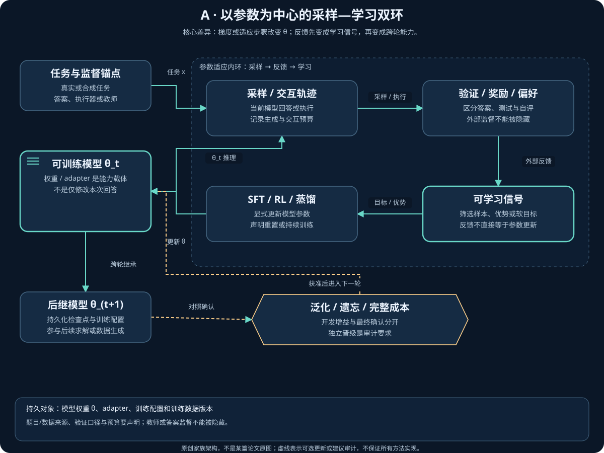
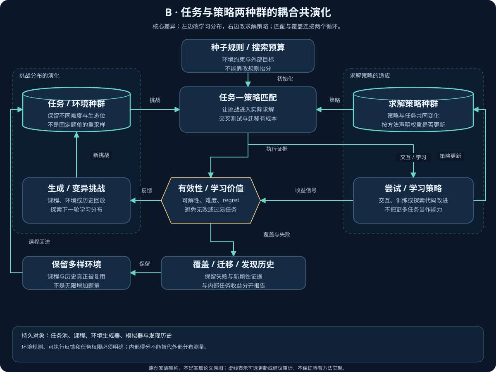
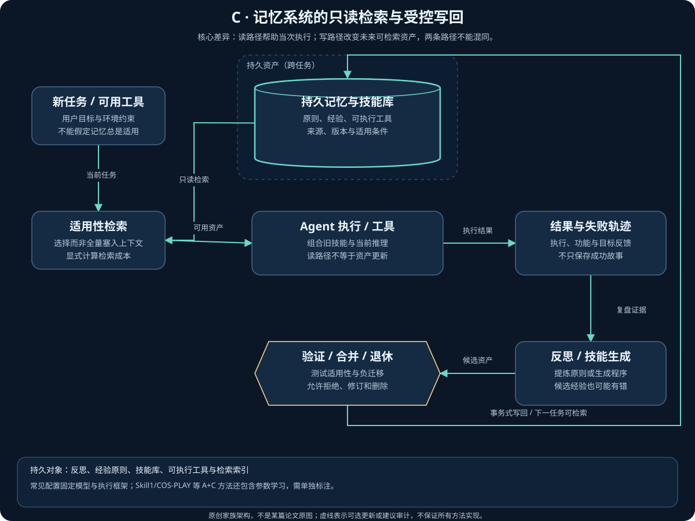
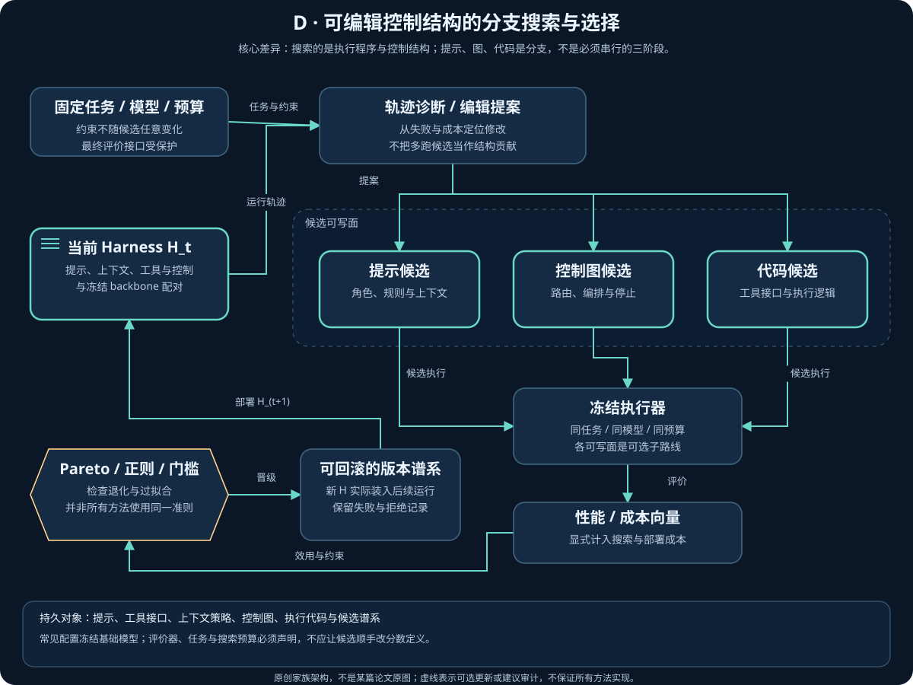
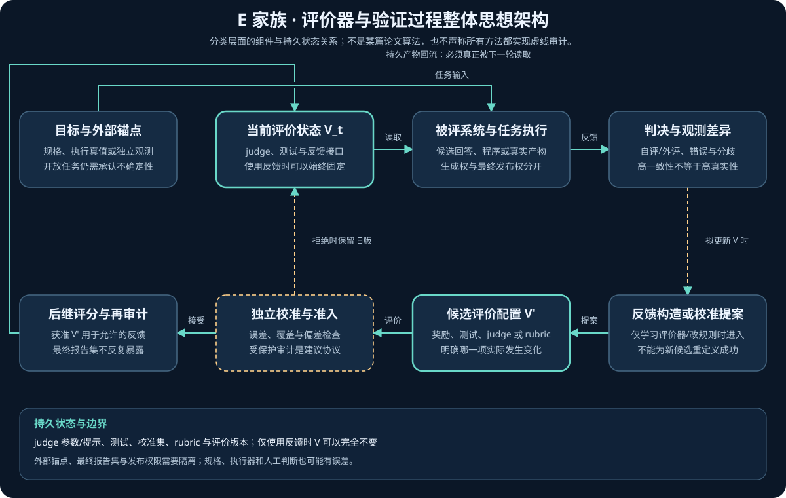
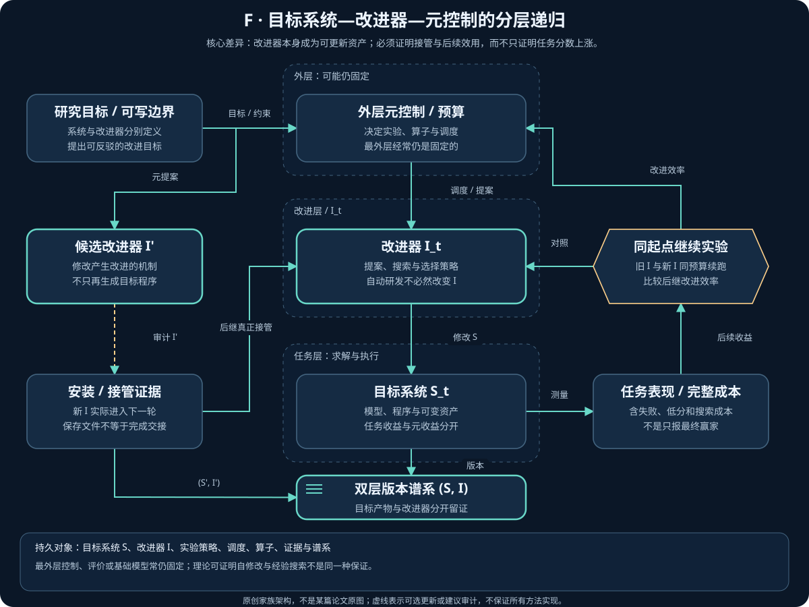

# A–F 家族整体思想架构

本页的六张图是本图谱原创的**家族级架构**：说明改进对象、执行组件、反馈、更新、版本管理和下一轮使用，不用 STaR、HarnessPro 等某个代表方法代替整个家族。

家族架构、代表方法流程和论文原图是三种层次。虚线审计表示应检查的边界，不声称每篇论文已经实现；[论文原图与许可](09_Paper_Figures.md)单列。

## A. 模型与训练

把可用反馈转成跨轮保留的模型能力；关键是参数或训练配方真的变化，而不是本次答案被修改。

[交互架构](../../pics/family-a-architecture.html) · [代表流程](../../pics/family-a-flow.html)

- **持久对象：**模型权重 θ、adapter、训练配置和训练数据版本。
- **方法边界：**自训练、自博弈、RL、蒸馏和测试时适应是不同子路线；每轮初始化与参数继承方式按具体论文核验。
- **验证重点：**检查真实更新、数据回流、固定任务评价与遗忘；参数变化不自动证明泛化收益。
- **固定与外部依赖：**题目/数据来源、验证口径与预算要声明；教师或答案监督不能被隐藏。

原始来源：[STaR](https://arxiv.org/abs/2203.14465) · [ReST-EM](https://arxiv.org/abs/2312.06585) · [SEAL](https://arxiv.org/abs/2506.10943)。

## B. 数据、任务与环境

让下一轮的学习分布也成为可改进对象；同时维持可解性、覆盖与反馈可靠性，而非只把题目变难。

[交互架构](../../pics/family-b-architecture.html) · [代表流程](../../pics/family-b-flow.html)

- **持久对象：**任务池、课程、环境生成器、模拟器与发现历史。
- **方法边界：**环境生成、任务自博弈和历史回放不同；Dream-RSI 的历史世界不等于训练一个神经世界模型。
- **验证重点：**检查覆盖、可解性、难度、分布塌缩及迁移；题量增加不是能力增长。
- **固定与外部依赖：**环境规则、可执行反馈和任务权限必须明确；内部得分不能替代外部分布测量。

原始来源：[POET](https://arxiv.org/abs/1901.01753) · [Absolute Zero](https://arxiv.org/abs/2505.03335) · [Dream-RSI](https://arxiv.org/abs/2609.14858)。

## C. Agent 记忆与技能

把一次执行的经验转成以后可检索、可组合、可验证的资产，减少重复探索；记忆变多并不等于记忆正确。

[交互架构](../../pics/family-c-architecture.html) · [代表流程](../../pics/family-c-flow.html)

- **持久对象：**反思、经验原则、技能库、可执行工具与检索索引。
- **方法边界：**反思文本、抽象原则和可执行技能不是同一更新；本次上下文修订不自动成为跨任务记忆。
- **验证重点：**检查技能适用条件、版本、语义正确性、负迁移和检索成本；能运行不等于业务正确。
- **固定与外部依赖：**常见配置固定模型与执行框架；Skill1/COS-PLAY 等 A+C 方法还包含参数学习，需单独标注。

原始来源：[Reflexion](https://arxiv.org/abs/2303.11366) · [Voyager](https://arxiv.org/abs/2305.16291) · [COS-PLAY](https://arxiv.org/abs/2604.20987)。

## D. Harness 与工作流

优化模型外的执行结构：提示、工具、路由、上下文与控制代码；把轨迹诊断转成可评价的系统版本。

[交互架构](../../pics/family-d-architecture.html) · [代表流程](../../pics/family-d-flow.html)

- **持久对象：**提示、工具接口、上下文策略、控制图、执行代码与候选谱系。
- **方法边界：**提示编辑、图结构搜索、源代码自修改和生产扩展不同；固定外层优化器不自动是元递归。
- **验证重点：**检查组件贡献、等预算搜索、跨模型迁移与部署成本；多跑候选不是结构本身变强的证明。
- **固定与外部依赖：**常见配置冻结基础模型；评价器、任务与搜索预算必须声明，不应让候选顺手改分数定义。

原始来源：[AFlow](https://arxiv.org/abs/2410.10762) · [GEPA](https://arxiv.org/abs/2507.19457) · [HarnessPro](https://arxiv.org/abs/2610.26770)。

## E. 评价器与验证过程

研究反馈从哪里来、是否更接近任务目标，以及评价过程能否被改进；不能把自评分上涨当成真值改善。

[交互架构](../../pics/family-e-architecture.html) · [代表流程](../../pics/family-e-flow.html)

- **持久对象：**judge 参数/提示、测试、校准集、rubric 与评价版本；仅使用反馈时 V 可以完全不变。
- **方法边界：**使用反馈、学习评价器、修改评价规则是三种行为，不是必然依次升级。只使用 V 的方法不走图中的评价器更新支路。
- **验证重点：**检查误差、覆盖、校准、分歧及后继效用；同模型一致不等于独立正确，规则变更需重新标定。
- **固定与外部依赖：**外部锚点、最终报告集与发布权限需要隔离；规格、执行器和人工判断也可能有误差。

原始来源：[Constitutional AI](https://arxiv.org/abs/2212.08073) · [Self-Rewarding LMs](https://arxiv.org/abs/2401.10020) · [S3Gym](https://arxiv.org/abs/2608.31100)。

## F. AI 研发与元改进

把研究、搜索、提案、选择或预算机制也当作候选对象；关键证据是新改进器实际接管下一轮，而非只多生成一份程序。

[交互架构](../../pics/family-f-architecture.html) · [代表流程](../../pics/family-f-flow.html)

- **持久对象：**目标系统 S、改进器 I、实验策略、调度、算子、证据与谱系。
- **方法边界：**自动研发、系统递归、改进器递归分开；若 I 不变，可以有系统反馈，但不能称 I 已自我演化。
- **验证重点：**从同起点、同后续预算比较旧新改进器，计入发现成本；任务分数不替代改进效率。
- **固定与外部依赖：**最外层控制、评价或基础模型常仍固定；理论可证明自修改与经验搜索不是同一种保证。

原始来源：[STOP](https://arxiv.org/abs/2310.02304) · [Hyperagents](https://arxiv.org/abs/2603.19461) · [MetaRSI](https://arxiv.org/abs/2609.06396)。
