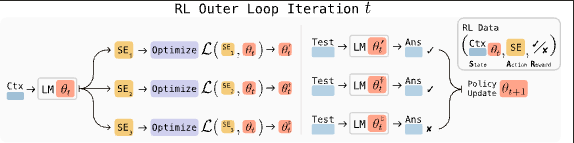
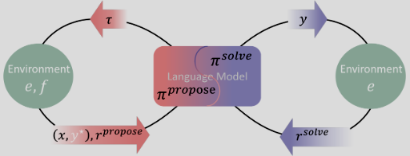
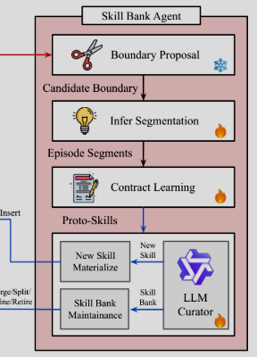
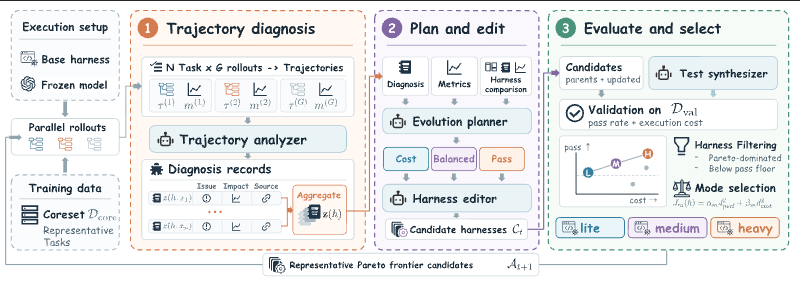
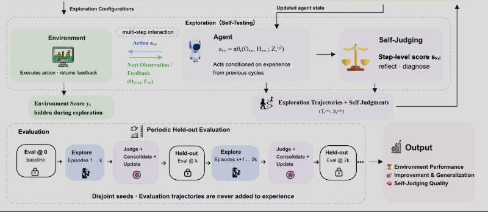
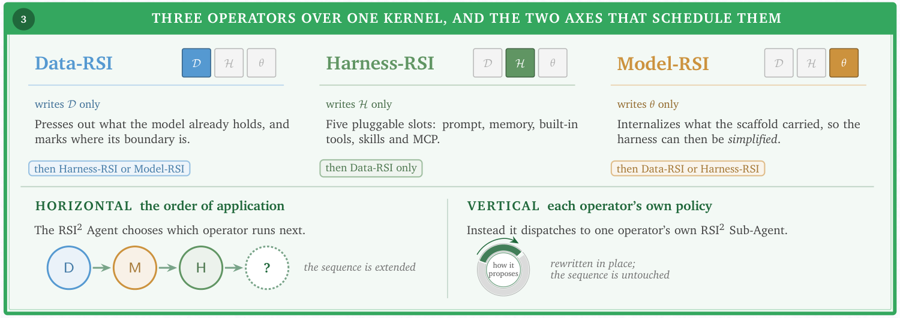

# 论文原图：来源、版本与复用许可

与家族原创架构分开：下列为明确 CC BY 4.0 的原论文 HTML/PDF 图形区域截图，不是本文重绘，也不是全领域共享的算法。局部裁图明确标记，仅转换显示/裁取区域，未改动图内内容；完整图与图注通过原文访问。作者结论不等于本文复现。

目前嵌入 6 幅已核验图或明确标记的局部，其余条目保留原文与明确的图像状态；不声称所有论文已经配图，也不为未知图号制造“Figure 1”。arXiv 非独占分发许可不自动授予本项目再分发权。

## SEAL

**原图：**Figure 1，v1。[原论文图位置](https://arxiv.org/html/2506.10943v1#S1.F1) · [许可：CC BY 4.0](https://creativecommons.org/licenses/by/4.0/)。

**作者署名：**Zweiger, Adam；Pari, Jyothish；Guo, Han；Akyürek, Ekin；Kim, Yoon；Agrawal, Pulkit。

**如何读图：**自编辑生成、内层参数适应和下游评价连接成外层学习环；不把每种模型训练方法都等同于 SEAL。

**版本与变更：**裁取原论文 HTML 图形区域并转换为 PNG，未重绘或改写图内内容；完整图注另见原文。图内原有标签保留英文，不将其伪装为中文原创家族图。文件 SHA-256：`f78d02c9f2bb2797c7284efd61773b5011761900137392580ed14ff5fb2d3d6f`。

## Absolute Zero

**原图：**Figure 3，v2。[原论文图位置](https://arxiv.org/html/2505.03335v2#S2.F3) · [许可：CC BY 4.0](https://creativecommons.org/licenses/by/4.0/)。

**作者署名：**Zhao, Andrew；Wu, Yiran；Yue, Yang；Wu, Tong；Xu, Quentin；Yue, Yang；Lin, Matthieu；Wang, Shenzhi；Wu, Qingyun；Zheng, Zilong；Huang, Gao。

**如何读图：**任务提案经环境校验后产生可求解问题，提案与求解两种角色共同学习；它是任务自博弈的具体实现，不代表全部环境生成方法。

**版本与变更：**裁取原论文 HTML 图形区域并转换为 PNG，未重绘或改写图内内容；完整图注另见原文。图内原有标签保留英文，不将其伪装为中文原创家族图。文件 SHA-256：`82b1f0a54988d85df82f907650d9eea9af7dd0698a77c4cad531b6daed2465b5`。

## COS-PLAY

**原图：**Figure 1（右侧技能库 Agent 局部），v1。[原论文图位置](https://arxiv.org/html/2604.20987v1#S3.F1) · [许可：CC BY 4.0](https://creativecommons.org/licenses/by/4.0/)。

**作者署名：**Wu, Xiyang；Li, Zongxia；Shi, Guangyao；Duffy, Alexander；Marques, Tyler；Olson, Matthew Lyle；Zhou, Tianyi；Manocha, Dinesh。

**如何读图：**此处只展示技能库 Agent 的边界提案、轨迹分段、技能契约学习与维护；完整的决策 Agent/技能库/技能库 Agent 架构见原图。该方法还含参数训练，不应把 C 家族一概解释为固定权重。

**版本与变更：**原图右侧 x=512..800、y=0..400 像素局部，避开游戏美术示例；未改写局部图内内容。图内原有标签保留英文，不将其伪装为中文原创家族图。文件 SHA-256：`bef8376175a4fc4e927deca1230f0d8be5515bcc4a0f8ab1423f7255cda67074`。

## HarnessPro

**原图：**Figure 1，v2。[原论文图位置](https://arxiv.org/html/2610.26770v2#S4.F1) · [许可：CC BY 4.0](https://creativecommons.org/licenses/by/4.0/)。

**作者署名：**Pan, Zhuoshi；Feng, ZhiYuan；Cen, Yukuo；Lin, Honglin；Lu, Junru；Chen, Zhongxia；Yang, Shuo；Zhao, H. Vicky；Tang, Jie。

**如何读图：**轨迹分析、候选 Harness 生成和性能—成本选择；生成测试与最终官方评价仍需区分。

**版本与变更：**裁取原论文 HTML 图形区域并转换为 PNG，未重绘或改写图内内容；完整图注另见原文。图内原有标签保留英文，不将其伪装为中文原创家族图。文件 SHA-256：`ca5c2bd1a7886ccf2f156662715bf1565d34edf5bbbaf86b9549b112ba5a6879`。

## S3Gym

**原图：**Figure 2（自测、自评与评估局部），v1。[原论文图位置](https://arxiv.org/html/2608.31100v1#S4.F2) · [许可：CC BY 4.0](https://creativecommons.org/licenses/by/4.0/)。

**作者署名：**Shi, Jiajun；Tao, Siyuan；Wu, Yuhao；Wang, Zexuan；Zhang, Jingyuan；Liu, Jiaheng；Lei, Xinping；Zhang, Xinrong；Fang, Siyuan；Tan, Zhewen；Cai, Tianle；Fang, Junhao；Huang, Jiameng；Wang, Yueyang；Liu, Jinkai；Zhang, Yuxuan；Yang, Jian；Li, Zhoujun；Yan, Shen；Huang, Wenhao；Zhang, Ge。

**如何读图：**此处展示自测、自评与周期性独立评价，省略上方游戏示例和经验吸收选项；完整框架见原文。它用于诊断自改进能力，不意味着所有评价器都在自动改变。

**版本与变更：**原图 y=145..494 像素下方局部，省略游戏美术示例；未改写局部图内内容。图内原有标签保留英文，不将其伪装为中文原创家族图。文件 SHA-256：`22d6bf3560f02a8e143172fb32615f696a4c37c8c79e7606ca5a8ec7dbf64fd2`。

## MetaRSI

**原图：**Figure 2（下方三算子与双轴局部），v2。[原论文图位置](https://arxiv.org/pdf/2609.06396v2#page=2) · [许可：CC BY 4.0](https://creativecommons.org/licenses/by/4.0/)。

**作者署名：**Tan, Zihan；Sun, Leixin；Shi, Zitong；Liu, Yitao；Wu, Jiajun；Brooks, Nathaniel；Qian, Jiaru；Shang, Xiaoran；Huang, Suyuan；Ding, Yi；Liao, Yangxu；Li, Mukai；Sun, Qiushi；Liu, Shudong；Rong, Xuankun；Yu, Xiaohang；Chen, Zhuo；Geng, Hejia；Li, Chenxin；Wang, Aozhou；Tu, Zengji；Tang, Robert；Zhan, Yuxin；Jiang, Eric；Wu, Yuxin；Zhang, Jianqing；Liang, Xiao；Wu, Fang；Zhang, Haochi；Marlow, Alexander；Wan, Guancheng。

**如何读图：**此处展示 Data/Harness/Model 三算子及水平顺序、垂直提案策略优化；不是完整 Figure 2，也不等同于 A–F 分类或无限层递归。

**版本与变更：**从 PDF 第2页截取坐标(56,317)-(556,494)点的图2下方架构，3倍渲染；省略摄影背景、页眉与图注，未改写图内内容。图内原有标签保留英文，不将其伪装为中文原创家族图。文件 SHA-256：`224797e1f1a2e3e4defbbd12b0bf88a07a10fd9661ccef7f4e477f4f7b07e9ef`。

## 全部精选论文的图像状态

| 论文 | 状态 | 来源 |
|---|---|---|
| Goedel Machine | 尚未逐图核验，仅链接 | [原文](https://arxiv.org/abs/cs/0309048) |
| AlphaZero | 尚未逐图核验，仅链接 | [原文](https://arxiv.org/abs/1712.01815) |
| POET | 所查版本未提供再分发许可，仅链接 | [原文](https://arxiv.org/abs/1901.01753) · [所查许可](https://arxiv.org/licenses/nonexclusive-distrib/1.0/) |
| DreamCoder | 尚未逐图核验，仅链接 | [原文](https://arxiv.org/abs/2006.08381) |
| PAIRED | 尚未逐图核验，仅链接 | [原文](https://arxiv.org/abs/2012.02096) |
| STaR | 所查版本未提供再分发许可，仅链接 | [原文](https://arxiv.org/abs/2203.14465) · [所查许可](https://arxiv.org/licenses/nonexclusive-distrib/1.0/) |
| Constitutional AI | 尚未逐图核验，仅链接 | [原文](https://arxiv.org/abs/2212.08073) |
| Self-Instruct | 尚未逐图核验，仅链接 | [原文](https://arxiv.org/abs/2212.10560) |
| Reflexion | 尚未逐图核验，仅链接 | [原文](https://arxiv.org/abs/2303.11366) |
| Self-Refine | 尚未逐图核验，仅链接 | [原文](https://arxiv.org/abs/2303.17651) |
| Voyager | 所查版本未提供再分发许可，仅链接 | [原文](https://arxiv.org/abs/2305.16291) · [所查许可](https://arxiv.org/licenses/nonexclusive-distrib/1.0/) |
| ReST | 尚未逐图核验，仅链接 | [原文](https://arxiv.org/abs/2308.08998) |
| Promptbreeder | 尚未逐图核验，仅链接 | [原文](https://arxiv.org/abs/2309.16797) |
| Self-Taught Optimizer (STOP) | 尚未逐图核验，仅链接 | [原文](https://arxiv.org/abs/2310.02304) |
| DSPy | 尚未逐图核验，仅链接 | [原文](https://arxiv.org/abs/2310.03714) |
| ReST-EM | 尚未逐图核验，仅链接 | [原文](https://arxiv.org/abs/2312.06585) |
| SPIN | 尚未逐图核验，仅链接 | [原文](https://arxiv.org/abs/2401.01335) |
| Self-Rewarding Language Models | 所查版本未提供再分发许可，仅链接 | [原文](https://arxiv.org/abs/2401.10020) · [所查许可](https://arxiv.org/licenses/nonexclusive-distrib/1.0/) |
| TextGrad | 尚未逐图核验，仅链接 | [原文](https://arxiv.org/abs/2406.07496) |
| ADAS / Meta Agent Search | 尚未逐图核验，仅链接 | [原文](https://arxiv.org/abs/2408.08435) |
| AFlow | 尚未逐图核验，仅链接 | [原文](https://arxiv.org/abs/2410.10762) |
| Recurrent Depth | 尚未逐图核验，仅链接 | [原文](https://arxiv.org/abs/2502.05171) |
| SICA | 尚未逐图核验，仅链接 | [原文](https://arxiv.org/abs/2504.15228) |
| TTRL | 尚未逐图核验，仅链接 | [原文](https://arxiv.org/abs/2504.16084) |
| Absolute Zero | 已嵌入授权原图/明确局部 | [原文](https://arxiv.org/abs/2505.03335) · [所查许可](https://creativecommons.org/licenses/by/4.0/) |
| DGM | 尚未逐图核验，仅链接 | [原文](https://arxiv.org/abs/2505.22954) |
| SEAL | 已嵌入授权原图/明确局部 | [原文](https://arxiv.org/abs/2506.10943) · [所查许可](https://creativecommons.org/licenses/by/4.0/) |
| AlphaEvolve | 尚未逐图核验，仅链接 | [原文](https://arxiv.org/abs/2506.13131) |
| GEPA | 所查版本未提供再分发许可，仅链接 | [原文](https://arxiv.org/abs/2507.19457) · [所查许可](https://arxiv.org/licenses/nonexclusive-distrib/1.0/) |
| TRM | 尚未逐图核验，仅链接 | [原文](https://arxiv.org/abs/2510.04871) |
| AgentEvolver | 尚未逐图核验，仅链接 | [原文](https://arxiv.org/abs/2511.10395) |
| Live-SWE-agent | 尚未逐图核验，仅链接 | [原文](https://arxiv.org/abs/2511.13646) |
| Agent0 | 尚未逐图核验，仅链接 | [原文](https://arxiv.org/abs/2511.16043) |
| Self-Improving VLM Judges | 尚未逐图核验，仅链接 | [原文](https://arxiv.org/abs/2512.05145) |
| SAGE | 尚未逐图核验，仅链接 | [原文](https://arxiv.org/abs/2512.17102) |
| MemRL | 尚未逐图核验，仅链接 | [原文](https://arxiv.org/abs/2601.03192) |
| Yunjue Agent | 尚未逐图核验，仅链接 | [原文](https://arxiv.org/abs/2601.18226) |
| MemSkill | 尚未逐图核验，仅链接 | [原文](https://arxiv.org/abs/2602.02474) |
| SAHOO | 尚未逐图核验，仅链接 | [原文](https://arxiv.org/abs/2603.06333) |
| PostTrainBench | 尚未逐图核验，仅链接 | [原文](https://arxiv.org/abs/2603.08640) |
| Hyperagents / DGM-H | 尚未逐图核验，仅链接 | [原文](https://arxiv.org/abs/2603.19461) |
| Meta-TTL | 尚未逐图核验，仅链接 | [原文](https://arxiv.org/abs/2604.00830) |
| SkillMOO | 尚未逐图核验，仅链接 | [原文](https://arxiv.org/abs/2604.09297) |
| GenericAgent | 尚未逐图核验，仅链接 | [原文](https://arxiv.org/abs/2604.17091) |
| COS-PLAY | 已嵌入授权原图/明确局部 | [原文](https://arxiv.org/abs/2604.20987) · [所查许可](https://creativecommons.org/licenses/by/4.0/) |
| Agentic Harness Engineering (AHE) | 尚未逐图核验，仅链接 | [原文](https://arxiv.org/abs/2604.25850) |
| Skill1 | 所查版本未提供再分发许可，仅链接 | [原文](https://arxiv.org/abs/2605.06130) · [所查许可](https://arxiv.org/licenses/nonexclusive-distrib/1.0/) |
| RewardHarness | 尚未逐图核验，仅链接 | [原文](https://arxiv.org/abs/2605.08703) |
| Adaptive Auto-Harness | 尚未逐图核验，仅链接 | [原文](https://arxiv.org/abs/2606.01770) |
| Retrospective Harness Optimization (RHO) | 尚未逐图核验，仅链接 | [原文](https://arxiv.org/abs/2606.05922) |
| Bounded Refinement to Research Loops (survey) | 尚未逐图核验，仅链接 | [原文](https://arxiv.org/abs/2607.07663) |
| RSIBench-Data | 尚未逐图核验，仅链接 | [原文](https://arxiv.org/abs/2607.25886) |
| Frontis-MA1 | 尚未逐图核验，仅链接 | [原文](https://arxiv.org/abs/2607.28568) |
| Aspire | 尚未逐图核验，仅链接 | [原文](https://arxiv.org/abs/2608.31111) |
| S3Gym | 已嵌入授权原图/明确局部 | [原文](https://arxiv.org/abs/2608.31100) · [所查许可](https://creativecommons.org/licenses/by/4.0/) |
| HarnessDev | 尚未逐图核验，仅链接 | [原文](https://arxiv.org/abs/2609.01437) |
| EvoHarnessBench | 尚未逐图核验，仅链接 | [原文](https://arxiv.org/abs/2609.04280) |
| MetaRSI / RSI2 | 已嵌入授权原图/明确局部 | [原文](https://arxiv.org/abs/2609.06396) · [所查许可](https://creativecommons.org/licenses/by/4.0/) |
| The Last AI Built by Humans | 尚未逐图核验，仅链接 | [原文](https://arxiv.org/abs/2609.11873) |
| Dream-RSI | 尚未逐图核验，仅链接 | [原文](https://arxiv.org/abs/2609.14858) |
| RSIAgent | 尚未逐图核验，仅链接 | [原文](https://arxiv.org/abs/2609.15364) |
| SoL-Pi | 尚未逐图核验，仅链接 | [原文](https://arxiv.org/abs/2609.20519) |
| Designer-RSI | 尚未逐图核验，仅链接 | [原文](https://arxiv.org/abs/2609.22086) |
| RRSI | 所查版本未提供再分发许可，仅链接 | [原文](https://arxiv.org/abs/2609.24972) · [所查许可](https://arxiv.org/licenses/nonexclusive-distrib/1.0/) |
| AIDE² (AIDE2) | 尚未逐图核验，仅链接 | [原文](https://arxiv.org/abs/2609.26457) |
| On-Policy Distillation RSI (DCE + SRCL) | 尚未逐图核验，仅链接 | [原文](https://arxiv.org/abs/2609.30652) |
| REUSE: Risk-controlled Evaluation Under Sequential Evolution | 尚未逐图核验，仅链接 | [原文](https://arxiv.org/abs/2609.33180) |
| TraceDance | 尚未逐图核验，仅链接 | [原文](https://arxiv.org/abs/2609.33295) |
| Intelligence-explosion scenario analysis | 尚未逐图核验，仅链接 | [原文](https://arxiv.org/abs/2609.36054) |
| RSI-Master | 尚未逐图核验，仅链接 | [原文](https://arxiv.org/abs/2609.35561) |
| Multi-Agent Self-Supervision (MASS) | 尚未逐图核验，仅链接 | [原文](https://arxiv.org/abs/2610.12176) |
| Evo² | 尚未逐图核验，仅链接 | [原文](https://arxiv.org/abs/2610.13025) |
| Harness² | 尚未逐图核验，仅链接 | [原文](https://arxiv.org/abs/2610.14224) |
| AReaL-RSI | 尚未逐图核验，仅链接 | [原文](https://arxiv.org/abs/2610.18083) |
| SwarmRSI | 尚未逐图核验，仅链接 | [原文](https://arxiv.org/abs/2610.20431) |
| R²Orch (R2Orch) | 尚未逐图核验，仅链接 | [原文](https://arxiv.org/abs/2610.22740) |
| CoEvo-RSI | 尚未逐图核验，仅链接 | [原文](https://arxiv.org/abs/2610.25078) |
| Recursive Flint | 尚未逐图核验，仅链接 | [原文](https://recursive.com/updates/introducing-recursive-flint) |
| HarnessPro | 已嵌入授权原图/明确局部 | [原文](https://arxiv.org/abs/2610.26770) · [所查许可](https://creativecommons.org/licenses/by/4.0/) |
| OO-Harness | 尚未逐图核验，仅链接 | [原文](https://arxiv.org/abs/2610.28380) |
| RSI-Opt | 尚未逐图核验，仅链接 | [原文](https://arxiv.org/abs/2610.32026) |
| RSIHub | 尚未逐图核验，仅链接 | [原文](https://arxiv.org/abs/2610.32253) |
| ParetoRSI-Gym | 尚未逐图核验，仅链接 | [原文](https://arxiv.org/abs/2610.34386) |
| Trustworthy RSI | 尚未逐图核验，仅链接 | [原文](https://arxiv.org/abs/2610.35193) |
| RSI-Dojo / RSI-Craft | 尚未逐图核验，仅链接 | [原文](https://arxiv.org/abs/2611.03698) |
| CogRSI | 尚未逐图核验，仅链接 | [原文](https://arxiv.org/abs/2611.01113) |
| CoworkOS | 尚未逐图核验，仅链接 | [原文](https://arxiv.org/abs/2611.03178) |
| SelfImprove-Bench | 尚未逐图核验，仅链接 | [原文](https://arxiv.org/abs/2611.02797) |
