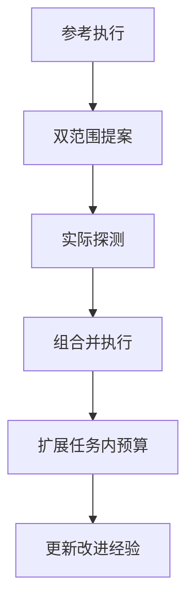
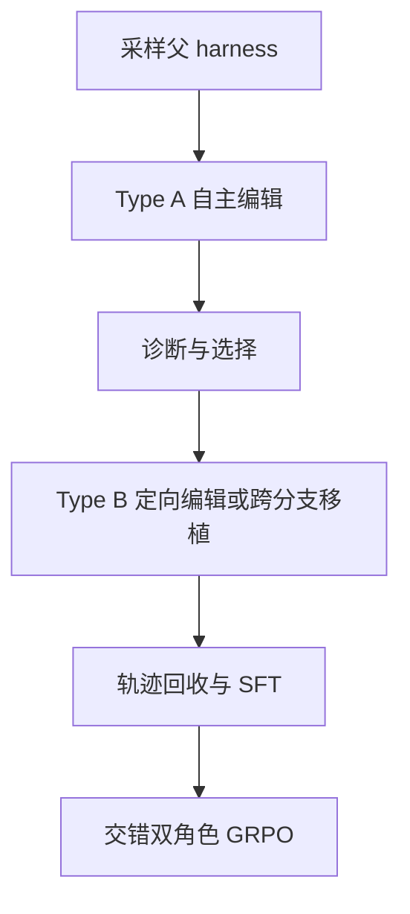
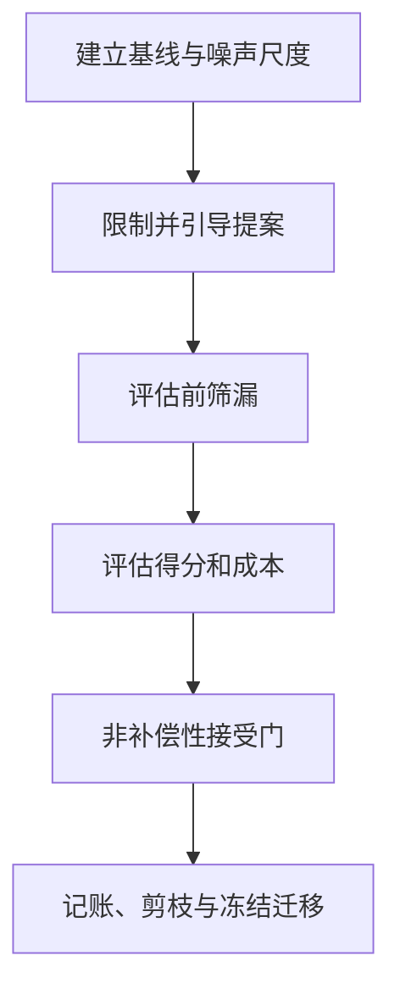
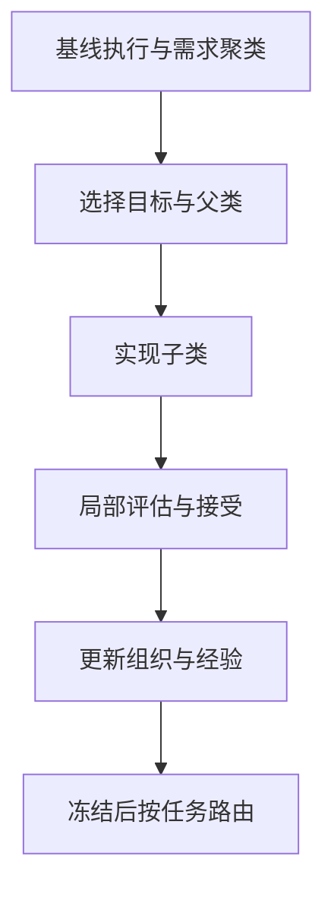

# Harness 重点精读：Harness²、Evo²、RRSI 与 OO-Harness

[返回首页](../../README.md) · [机构与更新](11_Institutions_and_Updates.md) · [交互时间轴](../../index.html#timeline)

核验截点：2026-11-06。微信入口访问时返回验证页，未绕过、未取得正文，也不把其中可能存在的解读冒充已读；本章回到四篇已定位的一手论文、官方页面和可找到的公开实现。

**证据范围：**所列方法章节与主要实验的版本化阅读，不是独立复现实验。未定位到官方代码的作品保持 unknown，不用相近名称仓库替代。Evo² 是权重—Harness 共同演化的改进器研究，不是基因组 Evo 2，也不是 CoEvo-RSI。

## Harness²

**Harness^2: Recursive Agent Harnessing for an Open World**。[原论文](https://arxiv.org/abs/2610.14224)；首发 2026-10-09；所读版本 v1，版本日期 2026-10-09。

### 目标与核心机制

在没有任务标准答案或在线验证器的开放任务流中，既改进当前任务的执行 harness，又积累能够改进后续 harness 修改过程的经验。

任务内采用 Propose–Probe–Compose：从参考执行分别提出跨域通用和领域专用修改，在相同任务与匹配配置下实际执行候选，再根据轨迹和交付物的行为对照选择性组合修改。任务后保存被采用的可执行 harness 及有证据支持的经验，供后续改进会话按需检索。下一任务仍从共同基线 H0 开始，而非直接继承上一任务的特化 harness。所谓第二层递归实际通过经验库改变后续改进的上下文，不是训练模型或任意重写整个改进算法。

### 改变什么，什么保持固定

**持久更新：**

**within_task：** - 当前任务的执行 harness 文件与组件。
- 候选轨迹、修改差异、组合决策和任务内证据历史。

**across_tasks：** - 持久化 harness improvement library。
- 每条记录中的可执行 harness、EXPERIENCE.md 和检索索引。

**not_claimed：** 没有证据表明其训练了改进器权重，或让系统任意重写固定的阶段指令和决策规则。

[原文定位](https://arxiv.org/html/2610.14224v1#S2)

**冻结与执行边界：**

**items：** - 执行模型和编辑模型的权重。
- 任务内递归期间的 improvement harness/library。
- 阶段指令和决策规则。
- 共同执行基线 H0；每个新任务重新从该基线启动。

**feedback_boundary：** 任务内编辑和选择不能读取评分器结果、rubric 或标准答案；论文实验评分与在线改进证据分离。

[原文定位](https://arxiv.org/html/2610.14224v1#A4.SS2)

### 方法流程与原文映射

这是本文根据所读方法绘制的阅读图，不是论文原图或实跑 trace；循环与子过程按下方具体来源解释。

| 图节点 | 步骤与边界 | 一手来源 |
|---|---|---|
| P0 | 用当前执行 harness 运行任务，获得轨迹和交付物；它们说明系统如何行动，不证明结果正确。 | [原文](https://arxiv.org/html/2610.14224v1#S2.SS2.SSS1) |
| P1 | 分别提出 invariant 修改和 domain-specific 修改；可重用经验库组件，但当前任务事实仍须由当前证据支持。 | [原文](https://arxiv.org/html/2610.14224v1#S2.SS2.SSS1) |
| P2 | 在同一任务、匹配模型和环境配置下运行候选，用行为差异观察目标问题是否缓解以及是否引入回退。 | [原文](https://arxiv.org/html/2610.14224v1#S2.SS2.SSS1) |
| P3 | 结合参考执行、候选差异和全部任务内证据，合并、修订、采用单一候选或保留原 harness；随后实际运行组合结果。 | [原文](https://arxiv.org/html/2610.14224v1#S2.SS2.SSS1) |
| P4 | 并行形式生成每个范围 k 个候选和 k 个独立组合结果，是一次群体更新的宽度扩展；顺序形式串联 k 个修改步骤。k>1 时另用匿名交付物选择器返回现有结果，不生成新内容，也不再编辑 harness。 | [原文](https://arxiv.org/html/2610.14224v1#S2.SS2.SSS2) |
| P5 | 交付后反思完整改进记录，保存采用的 harness 与有执行对照支持的经验；证据不足可不新增条目。下一任务从 H0 开始，但读取更新后的库。 | [原文](https://arxiv.org/html/2610.14224v1#S2.SS3) |

### 模块 / 算子与两种循环

- **name：** 八类可编辑组件

  **detail：** system prompt、guardrails、memory、skills、tool guidance、scripts、subagents、middleware plugin。

  [原文定位](https://arxiv.org/html/2610.14224v1#S2.SS1)
- **name：** Propose–Probe–Compose

  **detail：** 候选不是仅靠文字自评排序；必须执行探测，组合阶段可保留原 harness。

  [原文定位](https://arxiv.org/html/2610.14224v1#S2.SS2.SSS1)
- **name：** 并行递归实现

  **detail：** 代码分别构造 INV/DOM 候选，执行候选，再把完整候选池交给多个独立组合会话并执行组合结果。

  **citation：** google-research/harness2:harness2/core/recursion.py:354-460

  [原文定位](https://github.com/google-research/harness2/blob/main/harness2/core/recursion.py#L354-L460)
- **name：** 证据支持的经验保留

  **detail：** 无有效经验时不建条目；保存前检查评分信息；条目保存实际组件树、修改说明、适用线索、经验、证据与置信信息。

  **citation：** google-research/harness2:harness2/core/library.py:106-152

  [原文定位](https://github.com/google-research/harness2/blob/main/harness2/core/library.py#L106-L152)
- **name：** 任务流证据隔离测试

  **detail：** 静态阅读的测试检查参考答案不进入工作证据、下一任务仅看到前缀经验，以及改进会话状态隔离；本次没有运行这些测试。

  **citation：** google-research/harness2:tests/test_workflow.py:108-146

  [原文定位](https://github.com/google-research/harness2/blob/main/tests/test_workflow.py#L108-L146)

### 作者报告结果与解释边界

以下是作者报告，不是本机测量；主实验、专有模型子集、消融、迁移与不同成本分母不能混合。

**status：** author_reported_not_independently_reproduced

**setup：** 三个专业任务基准；Gemini 3.5 Flash 和 GLM-5 分别搭配 OpenCode、Codex，共四种执行配置。默认编辑器为 Claude Opus 4.8。主表为三个任务顺序打乱运行的均值及标准差。

**findings：** - **metric：** WorkBuddy-Bench macro-average

  **configuration：** GLM-5 / OpenCode，k=1

  **base：** 64.2

  **method：** 75.7

  **absolute_gain_points：** 11.5

  [原文定位](https://arxiv.org/html/2610.14224v1#S3.T1)
- **metric：** JobBench Score

  **configuration：** Gemini 3.5 Flash / OpenCode，k=1

  **base：** 31.5

  **method：** 36

  **absolute_gain_points：** 4.5

  [原文定位](https://arxiv.org/html/2610.14224v1#S3.T2)
- **metric：** LAB criterion-level Partial pass rate

  **configuration：** GLM-5 / OpenCode，k=1

  **base：** 59.6

  **method：** 71.4

  **absolute_gain_percentage_points：** 11.8

  [原文定位](https://arxiv.org/html/2610.14224v1#S3.T2)
- **metric：** 进一步增加并行预算至 k=5

  **detail：** 相对于单步结果，WorkBuddy 平均分再提高 2.9–3.9 点，JobBench 再提高 3.0–4.2 点，LAB Partial 再提高 2.6–6.7 个百分点。

  [原文定位](https://arxiv.org/html/2610.14224v1#S3.SS2)
- **metric：** 经验库消融

  **detail：** Gemini/OpenCode、k=1 时，去掉经验库使 WorkBuddy 从 77.5 降至 74.4，JobBench 从 36.0 降至 34.2。

  [原文定位](https://arxiv.org/html/2610.14224v1#S4.T3)

**artifact_boundary：** 公开代码是研究参考实现；上述数字来自论文实验，不代表本次验证的生产部署收益。

**ranking_caveat：** 并非每个配置均击败所有基线；Gemini/Codex 的 LAB Partial 上，Meta-Harness 高于单步 Harness²。

**ranking_source_url：** https://arxiv.org/html/2610.14224v1#S3.SS2

### 局限与实践检查

- **detail：** 行为对照与模型判断不是正确性验证；执行随机性、共享模型偏差和错误前提可能共同误导多个候选。

  [原文定位](https://arxiv.org/html/2610.14224v1#A6)
- **detail：** 增加递归预算需要额外执行和编辑开销；并行仅在资源允许时降低延迟，不消除计算量。论文只研究有限预算范围。

  [原文定位](https://arxiv.org/html/2610.14224v1#A6)
- **detail：** 失败分析包含选择器选中较差候选、限制性编辑传播错误假设等实际回退；不能据总体增益推断每项任务均改善。

  [原文定位](https://arxiv.org/html/2610.14224v1#A5.SS6)
- **detail：** 第二层递归更新的是固定改进框架中的库和上下文，不是证明改进算法能够无界自重写。

  [原文定位](https://arxiv.org/html/2610.14224v1#S2.SS3)
- **detail：** 排除当前任务条目的经验复用实验仍可使用后续任务经验，论文明确称其为回顾性跨任务复用测试，不能当作严格在线适应结果。

  [原文定位](https://arxiv.org/html/2610.14224v1#S4)

- 先冻结任务、模型、可变面和预算，再比较改进。
- 区分任务 executor、负责修改的 evolver、router 与最外层控制；哪个权重真的训练必须明确。
- 持久资产要实际进入后续调用，不能以“保存了新文件”代替交接。
- 开发/搜索反馈与最终确认隔离；保留失败、拒绝及额外提案/训练成本。

### 机构归属与阅读范围

- Northwestern University：author_affiliation，[依据](https://arxiv.org/pdf/2610.14224v1#page=1)。
- Google Cloud AI Research：author_affiliation，[依据](https://arxiv.org/pdf/2610.14224v1#page=1)。

**method_sections_read：** true

**full_paper_read：** false

**coverage：** 已读完整主方法、主要实验与分析、相关实现说明、失败分析和局限；PDF 首页用于修复 HTML 作者块遗漏。

**code_review：** 仅静态查看公开源码和测试；未执行研究代码或测试。

**code_version_scope：** 代码链接为检查日公开 main；未证明其逐字等于论文实验所用版本。

**official_project：** https://harness2.github.io/

## Evo²

**Evo$^2$: Evolving the Evolver through Weight-Harness Co-Evolution**。[原论文](https://arxiv.org/abs/2610.13025)；首发 2026-10-09；所读版本 v1，版本日期 2026-10-09。

### 目标与核心机制

让系统不仅搜索出更好的任务 harness，还把搜索过程产生的修改与执行反馈用于训练更擅长修改 harness 的 evolver，使后续搜索受益。

一个共享参数策略通过不同角色提示同时担任 Proposer 和 Reflector。Proposer 自主编辑或执行 Reflector 的定向修改；Reflector 根据源码、差异、性能变化和执行轨迹选择修订、跨分支策略移植或保留。搜索树积累 harness 和策略库。EvoTIDE 将这些过程转成训练轨迹，通过编辑提取和前缀续写回收有效编辑，先 SFT，再交错进行双角色 GRPO。被训练的是 evolver；任务 executor 在共同演化期间冻结。

### 改变什么，什么保持固定

**持久更新：**

**items：** - 共享 Proposer–Reflector 策略的权重 θ。
- 候选 harness 源码、搜索树和多深度 parent pool。
- 跨分支策略库及训练轨迹。

**deployment_outputs：** - 编码如何改进 harness 的 evolver 权重。
- 搜索得到、可在兼容任务接口上直接运行的 evolved harness。

[原文定位](https://arxiv.org/html/2610.13025v1#S3)

**冻结与执行边界：**

**main_coevolution：** 任务 executor M_exec 冻结；不能把 evolver 权重更新误写成任务执行模型同步训练。

**within_training_round：** 每轮保存冻结的共享策略快照，为当前训练样本提供另一个角色的配对行为；实时策略更新，快照在下一轮刷新。

**proprietary_extension：** GPT-5-mini 和 Claude Haiku 4.5 实验中，executor、Proposer、Reflector 均使用固定权重，只评估双角色 harness 搜索。

[原文定位](https://arxiv.org/html/2610.13025v1#S3.SS3.SSS3)

### 方法流程与原文映射

这是本文根据所读方法绘制的阅读图，不是论文原图或实跑 trace；循环与子过程按下方具体来源解释。

| 图节点 | 步骤与边界 | 一手来源 |
|---|---|---|
| P0 | 从保留不同深度和不同性能候选的池中采样；根节点永久保留并获得固定采样份额，非根候选权重与 ε+\|V−0.5\| 成正比。 | [原文](https://arxiv.org/html/2610.13025v1#S3.SS3.SSS3) |
| P1 | Proposer 根据父源码及其性能记录选择修改，应用编辑后由固定 executor 运行并评估。 | [原文](https://arxiv.org/html/2610.13025v1#S3.SS2) |
| P2 | Reflector 阅读源码、编辑差异、得分变化和成功/失败轨迹，返回 revise、crossover 或 keep。 | [原文](https://arxiv.org/html/2610.13025v1#S3.SS2) |
| P3 | Proposer 执行修改指令，或把供体分支的策略适配到当前源码；新候选重新评估。keep 不产生新编辑。 | [原文](https://arxiv.org/html/2610.13025v1#S3.SS2) |
| P4 | 从非标准输出中提取可应用编辑；遇到后续无效编辑时退回最后有效前缀并续写。回收结果仍须通过应用、启动和任务评估检查，再按下游结果选取双角色 SFT 数据。 | [原文](https://arxiv.org/html/2610.13025v1#S3.SS3.SSS1) |
| P5 | Proposer 奖励为子相对父的任务得分变化；Reflector 奖励为执行其干预后的增益，keep 为零。两角色分别计算组内优势、共同更新同一策略，随后用新权重继续搜索。 | [原文](https://arxiv.org/html/2610.13025v1#S3.SS3) |

### 模块 / 算子与两种循环

- **name：** 共享双角色策略

  **detail：** 不同角色提示、相同参数；不是两个独立训练的模型。

  [原文定位](https://arxiv.org/html/2610.13025v1#S3.SS2)
- **name：** Crossover searching

  **detail：** Reflector 选取机制级供体策略，Proposer 适配到受体源码；子节点仍以受体为树父并记录供体，非简单拼接两份完整 harness。

  [原文定位](https://arxiv.org/html/2610.13025v1#S3.SS2)
- **name：** Edit extraction / Prefix continuation

  **detail：** 修复轨迹表达或后缀格式问题，保留已经有效执行的前缀；不将未经评估的编辑自动视为成功。

  [原文定位](https://arxiv.org/html/2610.13025v1#S3.SS3.SSS1)
- **name：** 执行结果奖励

  **detail：** r_P=V(h′)−V(h)，r_R=V(h1)−V(h0)。无效编辑受罚；Reflector 的正增益还需轨迹证明新增机制实际运行。

  [原文定位](https://arxiv.org/html/2610.13025v1#S3.SS3.SSS2)
- **name：** 交错训练与冻结配对快照

  **detail：** 训练两角色时，以每轮冻结快照提供另一个角色的行为，减少配对评估过程同时漂移；两角色更新同一实时参数。

  [原文定位](https://arxiv.org/html/2610.13025v1#S3.SS3.SSS3)

### 作者报告结果与解释边界

以下是作者报告，不是本机测量；主实验、专有模型子集、消融、迁移与不同成本分母不能混合。

**status：** author_reported_not_independently_reproduced

**main_setup：** 固定 Qwen3.8-27B executor；Evo² 使用 EvoTIDE 训练后的 evolver，各比较方法使用未训练的基础模型作为 evolver。

**coding_results：** - **benchmark：** Polyglot

  **metric：** held-out pass@1

  **method_percent：** 82.1

  **strongest_baseline：** GEA

  **baseline_percent：** 62.6

  [原文定位](https://arxiv.org/html/2610.13025v1#S4.T1)
- **benchmark：** SWE-bench Verified

  **metric：** held-out resolved rate

  **method_percent：** 48.3

  **strongest_baseline：** HGM

  **baseline_percent：** 41

  [原文定位](https://arxiv.org/html/2610.13025v1#S4.T1)
- **benchmark：** LiveCodeBench

  **metric：** pass@1

  **method_percent：** 58

  **strongest_baseline：** HGM

  **baseline_percent：** 56

  [原文定位](https://arxiv.org/html/2610.13025v1#S4.T1)

**additional_findings：** - **detail：** 跨三个编码基准的六个迁移方向中，正文报告五个方向最佳；不能将摘要的概括理解为六个方向全部第一。

  [原文定位](https://arxiv.org/html/2610.13025v1#S4.SS3)
- **detail：** 固定权重 GPT-5-mini 在 60-task SWE-bench Verified 子集上得到 48.3%，最强比较方法为 24.4%。这不是完整基准结论，也不是证实未经演化原始 agent 从 24.4% 提升。

  [原文定位](https://arxiv.org/html/2610.13025v1#S4.SS4)
- **detail：** LoCoMo 上报告 60.4 F1，HGM 为 56.2；在未参与演化和选择的 LongMemEval-S 上，各 Evo² 搜索结果为 67.9–73.9，HGM 均值为 64.4。

  [原文定位](https://arxiv.org/html/2610.13025v1#S4.SS5)
- **detail：** 固定搜索程序、executor 和父 harness 的权重消融中，训练 evolver 带来 Polyglot +16.3 点、LoCoMo +9.3 点，其 LoCoMo champion 在 LongMemEval 上多 10.6 点。

  [原文定位](https://arxiv.org/html/2610.13025v1#S4.SS6)

**artifact_boundary：** 论文区分 trained evolver 和 evolved harness 两种产物；本次未找到可核实的官方公开实现或权重发布链接。

**important_distinction：** 开源模型主实验和 GPT-5-mini 子集实验恰好都出现 48.3%，但模型、评估设置和比较对象不同，不可合并。

### 局限与实践检查

- **detail：** 依赖外部任务评估器产生执行奖励；方法并非无需可验证反馈的开放世界在线改进。

  [原文定位](https://arxiv.org/html/2610.13025v1#S3.SS3.SSS2)
- **detail：** 主表同时改变了搜索框架和 evolver 是否受训，不能仅凭主表把全部优势归因于 crossover 或双角色结构；§4.6 的控制消融更接近隔离权重训练贡献。

  [原文定位](https://arxiv.org/html/2610.13025v1#S4.SS1)
- **detail：** 专有模型实验中，基线评估其排名第一的 harness，Evo² 报告前两名中表现更好者，存在选择口径不完全对称。

  [原文定位](https://arxiv.org/html/2610.13025v1#S4.SS4)
- **detail：** 推理效率分析主要统计部署 harness 的 executor tokens/calls，不等同于包含搜索、SFT 和 RL 的总研发成本。

  [原文定位](https://arxiv.org/html/2610.13025v1#S4.SS6)
- **detail：** 未找到官方代码不等于证明代码不存在；已检查论文链接并进行限定公开检索，官方仓库状态保持 unknown。

  [原文定位](https://arxiv.org/html/2610.13025v1)
- **detail：** 正文没有独立命名的 Limitations 节；以上限制是根据方法和实验设计明确标出的评估边界，不冒充作者专门列出的局限清单。

  [原文定位](https://arxiv.org/html/2610.13025v1)

- 先冻结任务、模型、可变面和预算，再比较改进。
- 区分任务 executor、负责修改的 evolver、router 与最外层控制；哪个权重真的训练必须明确。
- 持久资产要实际进入后续调用，不能以“保存了新文件”代替交接。
- 开发/搜索反馈与最终确认隔离；保留失败、拒绝及额外提案/训练成本。

### 机构归属与阅读范围

- Google DeepMind：author_affiliation，[依据](https://arxiv.org/pdf/2610.13025v1#page=1)。
- University of Illinois Urbana-Champaign：author_affiliation，[依据](https://arxiv.org/pdf/2610.13025v1#page=1)。

**method_sections_read：** true

**full_paper_read：** false

**coverage：** 完整主方法与主要实验、消融和结论；PDF 首页确认 HTML 中未正常展开的 Google DeepMind 机构信息，PDF 第 8 页复核主结果表。

**official_repo_status：** not_located_in_primary_links_or_bounded_public_search

**code_review：** 未核验 / 未提供。

**research_code_executed：** false

**unverified：** 未获得官方代码、模型权重或完整训练日志，无法独立复现实现细节与结果。

## RRSI

**RRSI: Regularized Recursive Self-Improvement of Agent Harnesses**。[原论文](https://arxiv.org/abs/2609.24972)；首发 2026-09-21；所读版本 v3，版本日期 2026-10-04。

### 目标与核心机制

防止 harness 在有限、反复复用的 evolve set 上通过记忆任务、追逐评估噪声和堆积复杂度取得虚高进步，使保留的修改能迁移到未参与搜索的任务和环境。

保持可编辑空间开放，只正则化搜索路径：提案侧用余弦退火预算限制单候选独立修改数，记录完整假设与得失，并在停滞时探索未试组件；选择侧先以 critic 筛除泄漏，再用历史最优减噪声容差作为性能底线，按得分增益限制 token 成本增长，并把近期无正收益组件交给 proposer 删除。噪声带内候选有单独的成本/结构新颖性规则，并非一律拒绝。

### 改变什么，什么保持固定

**持久更新：**

**items：** - 被接受的 incumbent harness 源码与组件。
- 候选级和编辑级的假设、diff、得分、成本及接受记录。
- 已探索组件集合、探索指令和待剪枝组件列表。

**not_updated：** 本文没有训练 backbone，也没有让系统学习或重写正则化规则本身。

[原文定位](https://arxiv.org/html/2609.24972v3#A4)

**冻结与执行边界：**

**items：** - backbone policy；主实验为 Claude Opus 4.8。
- 有限 evolve set 及任务评分器。
- 每个实例配置的正则化超参数和选择规则；迁移评估不再调整。
- 迁移到 held-out 基准时的最终 harness。

[原文定位](https://arxiv.org/html/2609.24972v3#S4.SS1)

### 方法流程与原文映射

这是本文根据所读方法绘制的阅读图，不是论文原图或实跑 trace；循环与子过程按下方具体来源解释。

| 图节点 | 步骤与边界 | 一手来源 |
|---|---|---|
| P0 | 重复评估未修改基线，获得经验噪声容差 δ，并初始化历史最佳分数 S*。 | [原文](https://arxiv.org/html/2609.24972v3#A4.SS1) |
| P1 | b_t=ceil[b_min+(b_max−b_min)(1+cos(πt/T))/2]。提案阅读完整历史；停滞时给未探索组件保留提案机会。 | [原文](https://arxiv.org/html/2609.24972v3#S3.SS2) |
| P2 | critic 阅读实际 diff，拒绝任务名、实体、答案或 evolve-benchmark 特定逻辑，以及无效机制，避免泄漏候选先拿到虚高分。 | [原文](https://arxiv.org/html/2609.24972v3#S3.SS3) |
| P3 | 候选在完整 evolve set 上运行，测得 S、policy-token cost C 和领域有效性指标。 | [原文](https://arxiv.org/html/2609.24972v3#A4.SS1) |
| P4 | 候选必须满足 S′≥S*−δ 和领域门控。若 ΔS>δ，要求相对成本增量 ΔC≤β0+β1ΔS；否则要求 w_sΔS−w_cΔC+w_nν>0。合格候选中按得分选优，无合格者保留 incumbent。 | [原文](https://arxiv.org/html/2609.24972v3#A4.SS3) |
| P5 | 记录所有测量及接受结果，更新历史最佳分数；将近期没有正收益的组件列为删除目标。搜索结束后不改 harness，直接评估 held-out 基准。 | [原文](https://arxiv.org/html/2609.24972v3#A4) |

### 模块 / 算子与两种循环

- **name：** 退火修改预算

  **detail：** 限制一个候选的独立修改数，而非限制最终可用组件种类。

  **citation：** google-research/rrsi:rrsi/schedule.py:28-50

  [原文定位](https://github.com/google-research/rrsi/blob/main/rrsi/schedule.py#L28-L50)
- **name：** 历史最优底线与两分支成本规则

  **detail：** 实现与论文 Algorithm 2 一致；噪声带内不是简单接受微小分数提升，也不是全部拒绝。

  **citation：** google-research/rrsi:rrsi/selection.py:81-137

  [原文定位](https://github.com/google-research/rrsi/blob/main/rrsi/selection.py#L81-L137)
- **name：** 结构新颖性 ν

  **detail：** 只统计 client_tool、skill、memory、subagent 中从未出现在胜出编辑里的组件类型；普通 prompt/config 修改没有该奖励。

  [原文定位](https://arxiv.org/html/2609.24972v3#A4.SS3)
- **name：** Leakage critic

  **detail：** 公开实现先做模式预检，再让模型审查 diff；空 diff 或多次无法解析的 critic 输出会被拒绝。

  **citation：** google-research/rrsi:rrsi/critic.py:105-147

  [原文定位](https://github.com/google-research/rrsi/blob/main/rrsi/critic.py#L105-L147)
- **name：** 结构剪枝目标

  **detail：** 历史账本计算组件近期最佳 measured gain；非正收益者生成删除目标，由后续 proposer 实施，不是自动证明该组件的因果贡献为零。

  **citation：** google-research/rrsi:rrsi/history.py:143-163

  [原文定位](https://github.com/google-research/rrsi/blob/main/rrsi/history.py#L143-L163)
- **name：** L0/L1/L2 类比

  **detail：** 论文明确限定为功能类比：修改稀疏、结构删除、总体资源收缩；没有直接优化这些范数惩罚目标。

  [原文定位](https://arxiv.org/html/2609.24972v3#A4)

### 作者报告结果与解释边界

以下是作者报告，不是本机测量；主实验、专有模型子集、消融、迁移与不同成本分母不能混合。

**status：** author_reported_not_independently_reproduced

**setup：** 八个基准、三个领域。分别在 Terminal-Bench 2.1、Harvey LAB、EngDesign 演化，再在六个 held-out split 上评估，其中包括 LAB 同分布保留集和五个 OOD 基准。

**findings：** - **metric：** Terminal-Bench 2.1 evolve score

  **base：** 74.2

  **method：** 80.2

  **gain_points：** 6

  [原文定位](https://arxiv.org/html/2609.24972v3#S4.SS3)
- **metric：** SWE-bench Verified transfer

  **base：** 82

  **method：** 83.8

  **gain_points：** 1.8

  [原文定位](https://arxiv.org/html/2609.24972v3#S4.SS3)
- **metric：** Workspace OOD average over JobBench, GDPval, APEX-Agents

  **base：** 39.7

  **method：** 43.6

  **gain_points：** 3.9

  [原文定位](https://arxiv.org/html/2609.24972v3#S4.SS2)
- **metric：** Frontier-Eng Medal

  **gain_points：** 4.3

  **relative_gain_percent：** 24.3

  [原文定位](https://arxiv.org/html/2609.24972v3#S4.SS2)
- **metric：** Workspace final-harness policy tokens per trial

  **rrsi_millions：** 2.42

  **without_both_regularizer_groups_millions：** 3.8

  **detail：** 这是最终 harness 的单次执行成本；不能解释为全部搜索成本。

  [原文定位](https://arxiv.org/html/2609.24972v3#S4.SS3)

**source_consistency_notes：** - **detail：** 摘要称五个 OOD 基准最多提高 4.3 点；§4.2 同时写 workspace OOD 增益为 3.5–4.7 点。两处口径存在文本不一致，不能无说明合成一个统一上限。

  **source_urls：** - https://arxiv.org/abs/2609.24972
  - https://arxiv.org/html/2609.24972v3#S4.SS2
- **detail：** 摘要写少用 30% policy tokens；官方项目页写 −36%，主文 2.42 对 3.80 million 的特定消融比较约为 −36.3%。保留各自来源和比较对象，不将其视为同一精确数字。

  **source_urls：** - https://arxiv.org/abs/2609.24972
  - https://regularized-rsi.com/
  - https://arxiv.org/html/2609.24972v3#S4.SS3

**artifact_boundary：** 公开参考实现验证了相关规则的程序表达，但没有通过本次执行复现论文增益。

### 局限与实践检查

- **detail：** 仍反复使用有限 evolve set；critic、经验噪声带和超参数不能提供不泄漏、不误选或普遍泛化的形式保证。

  [原文定位](https://arxiv.org/html/2609.24972v3#Sx1)
- **detail：** 只研究冻结 backbone 的 harness 自改进，不覆盖权重与 harness 共同训练。

  [原文定位](https://arxiv.org/html/2609.24972v3#Sx1)
- **detail：** 跨架构、工具生态及更长时间自改进过程仍需要更广验证。

  [原文定位](https://arxiv.org/html/2609.24972v3#Sx1)
- **detail：** 最终 RRSI harness 虽比其他演化结果便宜，仍高于未演化基线：workspace 基线为 1.56 million tokens、21.2 steps，RRSI 为 2.42 million、26.3 steps。

  [原文定位](https://arxiv.org/html/2609.24972v3#S4.SS3)
- **detail：** 近期组件收益来自搜索记录，并非对每个组件开展独立因果消融；结构剪枝应理解为启发式搜索约束。

  [原文定位](https://github.com/google-research/rrsi/blob/main/rrsi/history.py#L143-L163)
- **detail：** 应引用主方法与附录的准确规则，不能沿用宣传页对 noise floor 的简写而声称所有噪声带内修改均被拒绝。

  [原文定位](https://arxiv.org/html/2609.24972v3#A4.SS3)

- 先冻结任务、模型、可变面和预算，再比较改进。
- 区分任务 executor、负责修改的 evolver、router 与最外层控制；哪个权重真的训练必须明确。
- 持久资产要实际进入后续调用，不能以“保存了新文件”代替交接。
- 开发/搜索反馈与最终确认隔离；保留失败、拒绝及额外提案/训练成本。

实现级细节另见[RRSI 固定源码深读](../repo_deepdive/cases/rrsi.md)。

### 机构归属与阅读范围

- Google Cloud AI Research：author_affiliation，[依据](https://arxiv.org/pdf/2609.24972v3#page=1)。
- University of North Carolina at Chapel Hill：author_affiliation，[依据](https://arxiv.org/pdf/2609.24972v3#page=1)。
- Stanford University：author_affiliation，[依据](https://arxiv.org/pdf/2609.24972v3#page=1)。
- Washington University in St. Louis：author_affiliation，[依据](https://arxiv.org/pdf/2609.24972v3#page=1)。

**method_sections_read：** true

**full_paper_read：** false

**coverage：** 主方法、主要实验分析、局限及 Appendix D 的轮级算法和噪声带内接受规则；PDF 首页和相关结果页交叉核对。

**code_review：** 静态查看 schedule、selection、critic 和 history；未执行实现或测试。

**code_version_scope：** 检查日公开 main；未证明等于论文实验版本。

**official_project：** https://regularized-rsi.com/

**gaps：** - 一个猜测的 tests/test_selection.py 路径返回 404，因此没有声称已查看该测试或仓库缺少测试。
- 匿名 GitHub 目录 API 遇到速率限制；已通过已知公开源码路径继续读取，不影响上述实现规则核实。

## OO-Harness

**Object-Oriented Harness: Evolving Agent Harnesses through Object-Oriented Design**。[原论文](https://arxiv.org/abs/2610.28380)；首发 2026-10-20；所读版本 v1，版本日期 2026-10-20。

### 目标与核心机制

避免单一全局 harness 的修改对不同任务产生冲突；通过可继承、可复用的特化 harness 家族和基于执行证据的路由，为任务选择合适策略，同时保留通用基线作为回退选项。

先从基线在 discovery tasks 上的执行记录聚类共享需求，再由 evolution agent 选择任务簇和父类，生成继承基线或既有特化类的子类，通过覆盖或新增方法实现修改。只在目标簇评估，满足提升和领域检查后保留；成功与失败记录可提炼为设计和路由经验。测试前冻结类层级与经验。新任务先执行基线，路由器依据任务、可观察基线轨迹和冻结经验选择一个完整 harness 类，或直接复用基线结果。

### 改变什么，什么保持固定

**持久更新：**

**during_discovery：** - 可执行 harness 类层级及辅助源码。
- 任务簇、簇内任务归属和搜索优先级。
- 执行记录、类描述、design lessons 和 routing lessons；具体启用情况依基准实现而定。

**not_updated：** training 指代码、组织和经验的演化，不是 executor 或 router 权重训练。

[原文定位](https://arxiv.org/html/2610.28380v1#S3)

**冻结与执行边界：**

**items：** - executor 权重，主实验为 Gemini 3.5 Flash。
- router 模型权重。
- 部署后的 harness hierarchy、类描述及经验。
- held-out 任务之间不再更新这些持久状态。

**feedback_boundary：** 测试路由器与 executor 不得读取 grader 分数、判决或隐藏参考答案；评分反馈只在 discovery 演化中使用。

[原文定位](https://arxiv.org/html/2610.28380v1#S3.SS5)

### 方法流程与原文映射

这是本文根据所读方法绘制的阅读图，不是论文原图或实跑 trace；循环与子过程按下方具体来源解释。

| 图节点 | 步骤与边界 | 一手来源 |
|---|---|---|
| P0 | 在 discovery tasks 上运行 H0，根据执行需求和失败机制形成任务簇；每个簇初始使用 H0。 | [原文](https://arxiv.org/html/2610.28380v1#S3.SS3) |
| P1 | evolution agent 选择目标任务簇及可复用父类；父类不必是该簇当前使用的 harness。 | [原文](https://arxiv.org/html/2610.28380v1#S3.SS4) |
| P2 | 覆盖或添加方法，必要时调用 super() 保留父类机制；候选须符合宿主 scaffold 的统一执行接口。 | [原文](https://arxiv.org/html/2610.28380v1#S3.SS2) |
| P3 | 候选直接在目标簇执行，不先路由；仅当簇得分超过当前分配且通过基准特定检查才接受，不要求同时改善所有任务。 | [原文](https://arxiv.org/html/2610.28380v1#S3.SS4) |
| P4 | 保存成功和失败记录，更新启用的设计/路由经验；重复拒绝降低簇搜索优先级，也允许按证据拆分、合并或重分配任务簇。 | [原文](https://arxiv.org/html/2610.28380v1#S3.SS4) |
| P5 | 新任务先得到基线轨迹；路由器从基线与活跃特化类中选一个。选基线则复用已有结果，否则运行一个包含继承行为的子类实例。 | [原文](https://arxiv.org/html/2610.28380v1#S3.SS5) |

### 模块 / 算子与两种循环

- **name：** Harness hierarchy 与 task clusters

  **detail：** 前者组织代码复用，后者组织任务证据；二者不是同一棵树。

  [原文定位](https://arxiv.org/html/2610.28380v1#S3.SS1)
- **name：** Inheritance / override / super()

  **detail：** 父类代码在一个选定子类实例中复用，不意味着沿继承链运行多个独立 agent。

  [原文定位](https://arxiv.org/html/2610.28380v1#S3.SS2)
- **name：** Design lessons 与 routing lessons

  **detail：** 设计经验指导后续源码修订；路由经验表达何时使用某个 harness。它们是训练期积累的文本证据，不是学习后的 router 参数。

  [原文定位](https://arxiv.org/html/2610.28380v1#S3.SS1)
- **name：** Trajectory-informed router

  **detail：** 使用任务、类描述、适用条件和可观察基线执行特征；router 调用关闭 agent tools，输入不含 held-out 分数。

  [原文定位](https://arxiv.org/html/2610.28380v1#A1.SS4)
- **name：** 具体继承案例

  **detail：** Toolathlon 的 s7 对公式样式的 Excel 写入提示保存计算值；s30 继承该上下文行为，再通过完成前检查验证百分比单元格，并调用 super() 保留已有完成检查。

  [原文定位](https://arxiv.org/html/2610.28380v1#A1.SS4.SSS3)

### 作者报告结果与解释边界

以下是作者报告，不是本机测量；主实验、专有模型子集、消融、迁移与不同成本分母不能混合。

**status：** author_reported_not_independently_reproduced

**setup：** AutomationBench：300 discovery/300 held-out；Workspace-Bench：288 discovery/100 held-out；Toolathlon-GYM：251 discovery/252 held-out。主实验固定 Gemini 3.5 Flash executor，演化最多 40 轮，主表为三个独立 executor 运行的均值和标准差。

**main_results：** - **benchmark：** AutomationBench

  **primary_metric：** Mean partial credit

  **base_percent：** 61.62

  **method_percent：** 77.41

  **method_std：** 1.37

  **absolute_gain_percentage_points：** 15.79

  [原文定位](https://arxiv.org/pdf/2610.28380v1#page=7)
- **benchmark：** Workspace-Bench

  **primary_metric：** micro-averaged rubric pass rate

  **base_percent：** 25.45

  **method_percent：** 39.48

  **method_std：** 3.21

  **absolute_gain_percentage_points：** 14.03

  [原文定位](https://arxiv.org/pdf/2610.28380v1#page=7)
- **benchmark：** Toolathlon-GYM

  **primary_metric：** strict task PASS

  **base_percent：** 31.15

  **method_percent：** 37.45

  **method_std：** 0.98

  **absolute_gain_percentage_points：** 6.3

  [原文定位](https://arxiv.org/pdf/2610.28380v1#page=7)

**ablation_and_ood：** - **detail：** 单次路由消融中，加入基线轨迹相对 task-only routing 在 AutomationBench 多 12.64 点、Toolathlon-GYM 多 4.37 点，Workspace 多 0.53 点；不能与三次重复主表混作同一组统计量。

  [原文定位](https://arxiv.org/html/2610.28380v1#S5.SS1.SSS1)
- **detail：** Workspace 单次继承消融中，OO 为 40.56%，比 Flat 高 4.96 点。各变体独立搜索，因此比较的是不同搜索策略得到的产物，不是对同一个产物仅开关继承。

  [原文定位](https://arxiv.org/html/2610.28380v1#S5.SS1.SSS2)
- **detail：** 另设 254 个训练任务和 49 个应用家族不重叠测试任务的 OOD 场景，router 对全部测试任务选择 Base；结果体现避免负迁移、保留基线，而不是特化类在该 OOD 集上带来正增益。

  [原文定位](https://arxiv.org/html/2610.28380v1#S5.SS3)

**artifact_boundary：** 正文和附录提供研究实现描述及继承示例；本次未找到可核实的官方公开源码仓库，不能将论文方法当作已验证生产部署。

**headline_precision：** arXiv 摘要概括为 up to 15%；PDF/HTML 正文和主表支持 AutomationBench 绝对提高 15.79 个百分点，非相对增长 15.79%。

### 局限与实践检查

- **detail：** 主表 Steps 只计最终选中的执行轨迹，排除基线预执行、其他 rollout 和辅助路由调用，不能据此推断总推理成本更低。

  [原文定位](https://arxiv.org/html/2610.28380v1#S4.SS1)
- **detail：** 测试通常先运行 Base，再可能运行特化 harness；路由和二次执行成本必须与收益一起衡量。

  [原文定位](https://arxiv.org/html/2610.28380v1#S3.SS5)
- **detail：** 簇局部接受只证明对目标 discovery cluster 的测量改善，不保证所有任务或每个未见分布改善。

  [原文定位](https://arxiv.org/html/2610.28380v1#S3.SS4)
- **detail：** OOD 案例全部复用 Base，说明安全回退而非验证任意新工具域的特化能力。

  [原文定位](https://arxiv.org/html/2610.28380v1#S5.SS3)
- **detail：** 依赖宿主 API 和执行环境；服务中断、限流、接口变化及认证权限都会影响部署可靠性。

  [原文定位](https://arxiv.org/html/2610.28380v1)
- **detail：** 主结果存在标准差，名义最高均值不能自动解释为已通过统计显著性检验；例如 Workspace 的 OO 39.48±3.21 与 AAH 38.62±2.98 接近。

  [原文定位](https://arxiv.org/pdf/2610.28380v1#page=7)
- **detail：** 官方源码未定位，无法独立核查完整路由、接受门和实验配置；附录同时描述主实验模型和可覆盖的代码默认值，不能把默认值混成主实验设置。

  [原文定位](https://arxiv.org/html/2610.28380v1#A1.SS4)

- 先冻结任务、模型、可变面和预算，再比较改进。
- 区分任务 executor、负责修改的 evolver、router 与最外层控制；哪个权重真的训练必须明确。
- 持久资产要实际进入后续调用，不能以“保存了新文件”代替交接。
- 开发/搜索反馈与最终确认隔离；保留失败、拒绝及额外提案/训练成本。

### 机构归属与阅读范围

- University of Illinois Urbana-Champaign：author_affiliation，[依据](https://arxiv.org/pdf/2610.28380v1#page=1)。
- Google Cloud AI Research：author_affiliation，[依据](https://arxiv.org/pdf/2610.28380v1#page=1)。

**method_sections_read：** true

**full_paper_read：** false

**coverage：** 完整主方法、Algorithm 1、主要实验和分析、局限，以及 A.4 实现与继承案例；PDF 首页核对机构，第 7 页读取主结果表。

**official_repo_status：** not_located_in_primary_links_or_bounded_public_search

**code_review：** 未核验 / 未提供。

**research_code_executed：** false

**unverified：** 未找到作者正式发布的实现链接；没有将文中引用的其他项目仓库误标为 OO-Harness 官方代码。

## 四条路线如何比较

| 路线 | 主要资产 | 关键问题 |
|---|---|---|
| Harness² | 任务内 harness 与跨任务改进经验 | 无标准答案的 probe 能否支持正确路由与后继改进？ |
| Evo² | evolver 权重、harness 搜索树与训练轨迹 | 冻结 executor 后，改进器训练是否降低后续搜索成本并迁移？ |
| RRSI | 正则化候选、incumbent、历史与代码版本 | 约束是否缓解 benchmark 特化，而不只是压低开发分数？ |
| OO-Harness | 类层级、任务簇、设计/路由经验 | 特化与基线回退如何避免负迁移，完整路由成本是多少？ |

不能把四者都叫“模型自己重写自己”。反馈、更新对象、训练权重、部署资产和后继使用路径必须分别举证。
