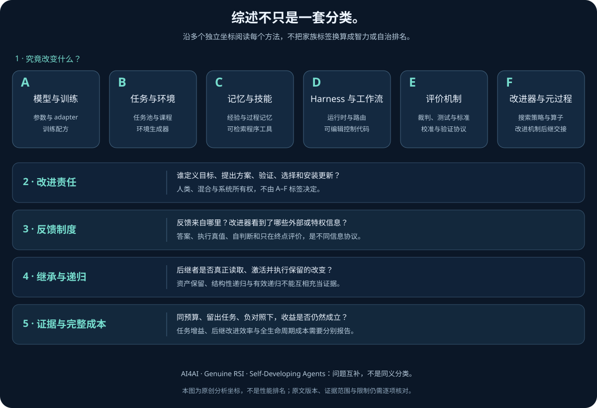

# RSI 研究综合：从可保留的改变到可检验的改进能力

> **阅读定位**：这是一篇问题驱动的研究综合，不是论文排行榜。快照截至 **2026-11-06**；图谱中的 **88 条研究与支撑性发布记录**是策展单位，不是 88 个独立算法，更不是 88 次成功复现。A–F 是本图谱的操作性分析分类，不是领域标准，也不是下述论文原有的分类。
>
> **材料与边界**：本章完整阅读了三份指定中文二级材料，并采用图谱中四项焦点工作的核验记录；引用指向相关原始论文与公开项目。没有在本次写作中重新阅读全文所引全部原始论文，没有运行研究代码或复现实验。数值均属原作者报告，且保留协议、分母与版本限定；不可公开核对的企业内部材料不作为证据。

## 1. 先确定研究对象：不是所有循环都在改进自己

RSI 最容易被误读成一种界面效果：模型反思一下、运行几个工具、生成下一版代码，便出现了“递归”。真正值得研究的对象却不是循环语法，而是**一个系统如何把经验变成经过验收、实际进入后续运行的改变，以及这种改变是否提高了继续改进的能力**。这同时涉及学习、软件工程、实验设计和治理，任何单一排行榜都无法替代这四方面的证据。

应当先分开三种结果。第一，当前答案被改好了，但会话结束后没有状态留下，这是输出修订。第二，模型参数、记忆、技能或控制程序被更新，未来任务确实使用更新，这是持久自我改进。第三，产生、判断、选择或固化未来更新的机制也被修改并复用，才进入狭义递归元改进。三者可以组成同一系统，却不能互相充当证据。

本章用**广义 RSI 研究**指围绕持续自我改进闭环的技术群，包括自训练、课程、记忆和 harness 优化；它们不必各自满足严格递归条件。用**狭义 RSI**指持久更新已经返回改进者自身，并影响后续改进机制的情形。这个约定便于比较，但不是替所有论文统一改名。尤其要区分结构性递归与有效递归：前者需要机制修改、保留、再调用；后者还需要独立评价与可比预算，证明新机制能产生更好的后继者。[S1][S2]

“自身”也必须划定边界。若系统仅指语言模型，外部技能库不是参数学习；若系统包括模型、运行时、记忆与改进程序，冻结权重仍可发生系统级自我改进。反过来，给外部用户修复一个仓库，通常只是改善产品；除非经验或补丁回到编码 agent，并改变其未来行为，否则没有形成自指回路。系统边界不是措辞选择，它决定哪些更新能算作继承。

动作、候选、轮次、后继者应分别计数。一次工具调用不是一轮改进；一轮搜索可以产生许多失败候选；保存候选源码不等于接受它；接受后也要证明下一轮实际加载并执行。后继者不一定是一个新预训练模型，它也可以是同一个模型搭配已验收的新运行时。最有辨识力的问题因此是：**下一轮究竟从哪里开始，读取了什么，又因读取这些状态做出了什么不同决定？**

还应防止把几个独立维度排成“进化阶梯”。有界系统可以非常有效；高度自治系统可能只是更快地优化错误代理；运行时无人干预，不意味着目标与成功标准由系统产生；修改评价器，也不意味着系统有权自行宣布修改有效。保护性审计、资源上限、部署否决与不可编辑约束，不是递归研究的逻辑障碍，而是使结果可解释的实验边界。

## 2. 三份材料提供三种坐标，A–F 提供第四种

### 2.1 AI4AI Survey：分解主张，而不是给系统授等级

《AI4AI Survey》把问题拆为 D1 可编辑对象、D2 是否自指、D3 阶段所有权、D4 反馈依据、D5 改进证据。阶段所有权区分目标、规划、执行、反馈、修复的实质内容来自人类、混合来源还是系统；设计时固定的人造奖励与测试不能因自动运行就消失。D5 又把测得增益、保留或继续提高、预算匹配的人类比较、保留集迁移分别记录，未报告不等于失败，更不等于成功。[S1，§2–§3、附录 B]

这套坐标的另一个贡献是把长时程从“文本很长”变成“状态依赖很强”。时间、交互、上下文、外部接地、依赖深度、可观测性共同构成任务压力。可靠性属于模型、harness、环境及协议的组合，不属于一个模型名称。局部工具调用正确，仍可能因早期目标误解、状态交接失真或终态检查缺失而整体失败；这就是组合鸿沟。

### 2.2 Genuine RSI：追踪改进责任和后继机制

《The Last AI Built by Humans》以改进回路为单位，追踪系统、状态、经验、目标、改进器、策略、验证器、改进、后继者九个概念。B0 是任务内参照；L1–L5 分别强调执行改进、选择策略、获取未来经验、部署适应、递归继承的责任扩展。它们不是模型智力等级，也不是从算法名自动推导出来的标签。[S2，§2–§3]

这里最重要的不是“到了第几级”，而是责任究竟内化到哪里。一个系统可以自主选择训练数据，却不能修改晋级标准；另一个系统可以编辑改进器代码，却仍由固定规则选择父代。二者具有不同自治形状，不宜只比较数字高低。L5 讨论中的案例也可能只支持有界结构性递归，不能据章节归属推断其有效性已经确立。

版本校准尤其必要：指定旧指南主要精读摘要与早期章节，并明确说明后续内容依据引言与目录归纳；另一份完整阅读材料则校准到 **2609.11873v3**。因此，本章采用 v3 的框架与证据限定，不继承旧指南关于作者规模、行业案例数量或“没有自身分析”的概括。HCI 是协议兼容条件下的观察性能力整理，不是 RSI 检测器；示意闭合未来剩余空间的曲线，也不是递归增长预测。

### 2.3 Self-Developing Agents：拆开复利链条中的三道难题

第三份材料严格说不是另一篇单体综述，而是对 **Aspire、S³Gym、HarnessDev** 的项目级综合。其轴线是目标形成、经验整合、系统整合：宽泛部署诉求能否变成恰当学习目标，交互经验能否改变未来决策，可运行系统的改动能否留存并迁移。它把前置部署工程中经常被 benchmark 预先替人完成的工作，转为可测量对象。[S3a][S3b][S3c]

这三项研究不是已经接通的生产流水线，也不是对真实客户长期部署的验证；它们在可获得外部真值的环境里分别隔离问题。把它们概念上串联，有助于解释依赖，却不能声称实验已证明“目标—经验—harness”端到端复利。共同的方法论是分离内部代理与外部真值、冻结候选后再评价、对照进入前的基座，并记录留存及回滚。这些闸门有不同信息协议，不能一概写成“全程没有反馈”。

### 2.4 为什么不能强行一一映射

| 视角 | 原有分析轴 | 与 A–F 的关系 | 不成立的换算 |
|---|---|---|---|
| AI4AI | 对象、自指、阶段所有权、反馈、证据；另有任务压力 | A–F 主要细化“改什么”，其余维度仍需另记 | D3 五阶段不等于五个对象族 |
| Genuine RSI | 改进回路、责任范围、机制继承与复用 | 同一 A 或 D 方法可形成不同层级回路；F 也需核对再使用 | F 不自动等于有效 L5 |
| Self-Developing Agents | 目标形成、经验整合、系统整合及各自验证闸门 | Aspire 横跨 A/B/D/E；经验跨 A/C/E；系统跨 C/D/E | TARGET 不是 B、EXPERIENCE 不是 C 的别名 |
| 本图谱 | A 模型训练；B 数据任务环境；C 记忆技能；D harness 工作流；E 评价；F 元改进 | 用于查找持久状态和实施接口，可多标签 | 家族位置不代表自治、正确性或证据强度 |

例如，训练一个会修改 harness 的模型，更新载体在 A，修改对象在 D，研究意图在 F，奖励边界在 E。若只能选择一个格子，至少会漏掉三个关系。较合理的描述应是“对象族 + 责任签名 + 反馈边界 + 继承证据”，而非不断增加互斥类别。这也解释了为什么统一比较应围绕状态转移展开，而不是围绕名字展开。

## 3. 一个统一模型：状态、更新、反馈与后继者



图中对象轴与责任、反馈、继承、证据轴分别阅读，不做强行等级映射。[六种异构家族架构](08_Family_Architectures.md)进一步展开每类机制的关键组件与回流结构。

以下记号是本章的分析工具，不冒充任何论文原始公式。把持久状态写为：

```math
S_t=(\theta_t,D_t,M_t,H_t,V_t,U_t,L_t).
```

其中依次是模型参数、数据与任务环境设计、记忆技能、运行时、内部评价机制、改进程序和谱系证据。真实部署中的即时环境状态要另行记录；“环境设计被改进”不同于“agent 在环境里操作了一次”。同一资产也可能跨层：可执行技能既是 C 的积累，也是 D 的工具接口；更新算子的参数属于 A 的载体，却承担 F 的功能。

一轮更新包含提案、执行、观测、筛选和接受，而不只是一次生成：

```math
c_t=U_t(S_t,e_t;b_t),\qquad
(o_t,f_t)=\mathrm{Run}(c_t,Q_t),\qquad
a_t=\mathrm{Accept}(f_t,o_t,V_t,Q_t).
```

协议 $`Q_t`$ 指明可编辑范围、任务划分、预算、可见反馈、人类介入与外层审计。内部接受器可以依赖测试，也可以依赖行为对照或模型判断；因此 $`a_t=1`$ 只说明通过声明规则，不证明真实效用必然提高。需要同时保存候选身份、版本、执行环境、输入、原始结果和接受理由，否则分数无法绑定到具体改变。

```math
S_{t+1}=
\begin{cases}
\mathrm{Commit}(S_t,c_t,L_t),&a_t=1,\\
\mathrm{Restore}(S_t),&a_t=0.
\end{cases}
```

这条转移有两个经常被遗漏的条件。其一，恢复必须恢复合法状态，不是简单把旧分数复制回来；外部副作用、消息协议、文件与数据库都可能需要恢复。其二，提交之后还须发生**读取—激活—执行**，才能确立后继者继承。仅有日志、策略文档、checkpoint 或 State 类，只能证明资产存在，不能证明资产改变了后续行为。

据此可以分开三条证据链：资产链证明新状态保存在哪里；执行链证明后继者确实使用；效果链证明使用产生收益。狭义 RSI 还需要第四条元层链：改变作用于 $`U_t`$、候选选择或经验获取机制，并改善以后产生更新的过程。一个更好的任务模型可能只是搜索到的好结果；一个经修改但无效的搜索器则只有结构变化。二者都不能独自证明有效递归。

冻结层应和可编辑层同样明确。外部基准可能只用于最终审计，也可能提供有限聚合反馈；后者已经参与适应性选择。评价器可以在轮内冻结、轮间替换，但新旧评分不能未经桥接就连成进步曲线。最外层的目标、安全约束和否决权即使始终固定，仍允许内部发生有界元改进；反之，所有组件都可编辑，却可能令实验失去比较尺度。

## 4. 算法模板：同一反馈为何导向不同的持久资产

### 4.1 自训练与拒绝采样：把成功轨迹变成生成分布

STaR 与 ReST-EM 的共同结构是采样、以外部依据筛选、再监督训练。区别于重复推理，训练让后续生成分布发生持久改变；区别于无监督自说自话，筛选所需答案或执行器并非凭空出现。STaR 已有问题及正确答案，失败题可借答案生成解释；ReST-EM 把经验筛选与参数更新分开。具体基座重置和微调调度仍须按原方法执行，不能用一个通用循环覆盖差异。[P1][P2]

这类方法适合“能够偶尔做对、又能廉价识别正确”的区域。若成功轨迹几乎为零，筛选无法自举；若答案正确但解释错误，训练会固化错误路径；若只保留常见成功模式，数据覆盖会收缩。最关键的对照不是更新前后单次分数，而是同预算下继续采样与真正训练的区别。训练带来的部署收益还要抵消生成、过滤和再次训练的成本。

Self-Instruct 则将主要压力放到指令分布的构造。质量过滤和去重可以扩大可训练样本，却不等于语义真值验证。它与 STaR 的差别不是“哪个更自主”，而是何种变量需要可靠：前者依赖指令覆盖与教师能力，后者依赖可验证成功及其推理可迁移性。数据数量、去重率和训练完成率都不是能力增长的充分指标。[P3]

### 4.2 RL：优化可测奖励，不自动获得研究判断

强化学习直接调整动作概率，适合反馈不能简单转成示范答案的情形。长轨迹上的困难是信用分配：终局失败可能来自早期选错对象，也可能只是最后格式错误。整轨迹奖励、状态分组、步骤优势和后验诊断是不同处理方式，它们对可重放状态、额外 rollout、critic 或环境结构有不同要求，不能只比较最终百分比。

与自训练相比，RL 可以利用失败和相对优劣，不必只模仿成功；代价是采样方差、策略漂移及奖励利用。异步长轨迹还会把旧策略数据用于新策略更新，造成额外不稳定。代理奖励越方便，越应单独验证它对独立结果的预测能力。若训练提案模型提高了平均奖励却压缩了提案多样性，发现前沿未必提高；研究搜索有时更关心尾部好方案，而不是平均候选。

SEAL 把生成自我编辑与后续参数适应连接起来，提醒我们内层更新是否有效，也可以成为外层策略的反馈。但“学会生成更新材料”不同于“自行定义最终能力目标”。需要分开自我编辑策略、实际微调步骤、适应任务和审计任务，且把多次内层训练计入元层成本。[P7]

### 4.3 自博弈与偏好：对手可变，正确性边界未必可变

AlphaZero 的自博弈依托明确规则与胜负反馈，变化的是策略和随策略改变的对手分布，不是任意创造成功标准。SPIN 则以真实训练响应和当前模型响应形成训练关系，并不等于两个模型无监督投票就能产生真值。Self-Rewarding LM 进一步让模型参与偏好判断，但回答能力与裁判能力必须分别测量。[P4][P5][P6]

这三类的共同价值是把当前能力转为新的训练压力；共同风险是把相对进步误当绝对进步。面对可被共同错误先验欺骗的任务，双方可能协同走偏，奖励上升却没有外部收益。稳定规则游戏能提供强终局锚点，开放写作的偏好却更依赖校准和覆盖。因而“自博弈”不是一种统一的反馈质量等级，也不是狭义 RSI 的充分条件。

### 4.4 蒸馏：压缩已有优势，与创造改进机制不同

蒸馏把教师或高成本搜索中的行为转到学生，主要改变知识与行为的部署位置。教师来自外部强模型、同模型的额外上下文、正确答案提示，还是多次执行筛选，决定了真正的信息来源。所谓自蒸馏并不必然没有特权监督；同一模型看到答案之后担任教师，仍多了一条学生不可见的信息通道。

2026 年的 DCE + SRCL 把学生在策略采样、教师吸收学生更新、已验证的短自修订响应结合起来，属于训练闭环的新组织方式。其关键比较不是有没有外部教师品牌，而是教师看到了什么、样本怎样验证、迭代后是否仍保持外部优势。Average@12 之类多样本指标不能转写为单次成功率，推理变短也不能在忽略教师与训练开销后宣布全生命周期更便宜。[P8]

### 4.5 课程与环境：优化难度，更要优化学习价值

POET、PAIRED 与 Absolute Zero 都把经验来源从静态数据扩展到可变任务或环境，但它们调整压力的依据不同：环境变异与策略迁移、对抗式环境设计、可执行任务生成与求解，不宜归成同一个“自动出题”。任务正确、对当前学习者困难、值得用于后续学习，是三个不同条件。[P9][P10][P11]

课程需要处于一个窄区间：太简单没有信息，太难没有成功信号；但只挑当前最易产生进步的区域又会漏掉重要能力。比较自适应课程时，应冻结生成器对学习者状态的访问做消融，而不是强令两组拿到完全相同的最终样本，后者会消除自适应本身。还应测覆盖、罕见技能和离开训练环境后的迁移，而非只测课程难度上升。

### 4.6 记忆与技能：低成本可逆更新，不等于免费学习

Reflexion 把失败反馈转成语言记忆；Voyager 将可执行程序保留为技能。两者都可冻结模型权重，却在资产形态上截然不同。文本原则易编辑、易审计，但可能缺少执行细节；程序技能可测试、可组合，但依赖接口和环境前提。记忆召回率不能替代后续动作质量，程序能启动也不能替代功能正确。[P12][P13]

S³Gym 提供了一个重要反证：完整历史和摘要都可能有用，没有普遍最优者。需要精确几何、时序或局部约束的任务，摘要可能保留了合理目标，却丢掉决定动作的状态细节；可压缩为紧凑决策规则的任务则可能受益。这个分界比“长期记忆比上下文高级”更有工程价值。摘要质量也不能只由可读性判定，应通过移除、替换、回放与激活日志证明它如何改变行为。

长期积累还会产生版本冲突、检索干扰和过期知识。技能库越大，并非越接近递归；如果系统不再能判断适用前提，旧经验反而会阻止探索。合理机制需要准入、失效、退休、重新验证和容量预算。将失败记录留在谱系中有助于避免重复错误，但不意味着每条记录都应进入所有任务的提示。

### 4.7 Harness 搜索：编辑空间开放，验证成本随之扩大

ADAS 搜索可执行 agent 程序，AFlow 搜索工作流，TextGrad 用文本反馈优化变量，GEPA 用执行轨迹反思并保留互补候选。它们相对于固定提示的扩展不同：可编辑的是自然语言变量、图结构还是完整代码，决定了有效性检查和搜索成本。[P14][P15][P16][P17]

共同模板是运行基线、诊断失败、提出结构改动、重新执行、选择候选。最关键的区别不是提案写得多聪明，而是“允许哪些证据支持接受”。自偏好适合没有验证器的开放任务，却只能提供相对判断；可执行任务分数更接地，但可能被反复访问而过拟合。修改范围越广，越需要验证权限、工具协议、异常恢复和终态产物，而不只是入口是否能运行。

这里的反例是死机制：源码定义了状态管理，却从未出现保存事件；添加了完成检查，却没有在任何失败样本上触发。触发证明机制参与运行，但仍不证明收益由它造成。因果证据还需同起点去除、恢复或随机化组件，并重复执行，而不是把新增代码行数当作改进规模。

### 4.8 Pareto 与多谱系：保留选择权，而不是承诺所有指标都涨

当任务异质、成本约束不同，一个全局冠军往往不存在。GEPA 的互补候选、DGM 的多谱系档案以及 OO-Harness 的特化类家族，都通过保留选择权减轻过早收缩，但具体结构不同：候选在不同任务上的互补性、可继续演化的父代、按任务选择的运行时，不能混成一种算法。[P17][P18][F4]

Pareto 思想应明确目标向量与不可妥协约束。准确率、token、延迟、风险之间的不可支配关系，只在指定测量和噪声下成立；高分不能补偿越权。维护多个候选增加评估、存储、路由和兼容性成本，前沿也可能全都过拟合。多样性最好按行为或机制测量，而不是只按名称、代码差异或不同随机种子计数。

### 4.9 评价器演化：把尺子变好，也要保护比较尺度

评价器可以是被学习的组件，但必须分开内部筛选器与外层真值锚点。Red Queen Gödel Machine 的意义在于：轮内冻结评价器，轮间替换经过独立依据检查；换尺后旧缓存分数不能继续直接比较，需要重新评价相关候选。[S2，§3.6；S1 的交叉阅读]

这类方法可能减少昂贵全量验证，但会引入第二个学习问题：评价器是否校准，能否识别新型失败，是否被候选定向利用。更强的预测器不等于完备接受器；用于排序的误差和用于发布的误接受有不同后果。若评价器和策略共同变化，却没有固定外部审计，任何“跨代提升”都可能只是标准漂移。

### 4.10 元协同演化：真正的对照是未来搜索能力

STOP 使 improver 程序自身成为改进对象；Hyperagents 扩展 task-agent 与 meta-agent 的可修改关系；Frontis-MA1 把 Draft、Improve、Debug、Crossover 等算子训练与程序搜索连接起来。它们都把经验带到“怎样改进”这一层，但仍可能固定模型、任务效用、搜索预算或外层编排。[P19][P20][P21]

所谓共演化，需要说明两个方向的反馈是否真的闭合：改进器怎样产生更好的对象，对象搜索的结果又怎样更新改进器。若只把优秀轨迹保存到磁盘，没有再次训练或检索，就只有数据生产。若训练过后只展示当前任务冠军，也未证明继续改进更有效。元层最困难的测量，是控制起点、信息和总预算后，让旧、新改进器分别继续工作，再比较其后继者。

## 5. 方法矩阵：比较更新、冻结与证据，而非合并排行榜

下表比较 **29 项具体方法或实验框架**。分组用于阅读，不表示互斥。证据栏说明本章材料支持的范围，不是独立复现认证；成本栏是必须核算的来源，**不是统一实测金额或复杂度排序**。“固定”指相应研究设定中的边界，不能推广到该方法所有可能实现。

### 5.1 参数、经验与任务分布

| 方法 | 更新目标 | 反馈来源 | 持久资产 | 主要冻结层 | 证据及未覆盖处 | 成本关键项 |
|---|---|---|---|---|---|---|
| STaR [P1] | 生成推理的模型参数 | 已知答案筛选、答案条件化解释 | 新权重、合格轨迹 | 问题答案与筛选规则 | 报告任务增益；非无监督真值产生 | 多次采样、解释生成、微调 |
| ReST-EM [P2] | 参数生成分布 | 任务奖励筛选 | 筛选数据及后继模型 | 奖励、问题域、训练调度 | 支持迭代自训练；无一般单调保证 | 拒绝样本、训练与验证 |
| Self-Instruct [P3] | 指令数据及指令模型 | 质量过滤与去重 | 指令池、训练权重 | 种子约束、生成与过滤流程 | 支持指令自举；过滤不等于语义真值 | 数据生成、清洗、训练 |
| AlphaZero [P4] | 对弈策略及价值估计 | 游戏胜负、搜索 | 策略权重 | 游戏规则、算法与效用 | 强自博弈参照；不证明改进器自改 | 自博弈、树搜索、训练 |
| SPIN [P5] | 响应策略 | 真实响应与模型响应对比 | 后继权重 | 真实数据、训练目标 | 迭代偏好训练；并非无监督互评 | 响应生成、每轮优化 |
| Self-Rewarding LM [P6] | 回答与偏好判断能力 | 模型产生的偏好 | 偏好数据、模型参数 | 任务组织与外层评价 | 作者报告质量增益；裁判需独立检验 | 生成、判分、偏好训练 |
| SEAL [P7] | 自我编辑策略与适应参数 | 更新后的下游效用 | 编辑策略、更新后模型 | 任务及外层反馈协议 | 支持学习如何适应；不等于自定目标 | 内层训练、外层探索 |
| DCE + SRCL [P8] | 学生及教师反馈组织 | 特权答案、验证后修订 | 权重、蒸馏轨迹 | 答案与评测协议 | 报告迭代训练；多样本指标不能当单次 | 教师调用、验证、训练 |
| POET [P9] | 环境群体及策略 | 可解性、表现、策略迁移 | 环境—策略配对 | 变异与保留程序 | 支持开放式课程参照；非现实无限开放 | 环境生成、多策略试验 |
| PAIRED [P10] | 环境生成与求解策略 | 对抗式学习信号 | 生成器及策略参数 | 环境参数化与训练规则 | 支持难度塑形；需另测覆盖 | 多角色训练、环境交互 |
| Absolute Zero [P11] | 任务提案与求解策略 | 程序执行与可学习性 | 策略、可执行任务 | 执行器、任务空间、奖励设计 | 无对应人造任务集不等于无外部先验 | 任务执行、筛选、RL |

### 5.2 记忆、代码与搜索机制

| 方法 | 更新目标 | 反馈来源 | 持久资产 | 主要冻结层 | 证据及未覆盖处 | 成本关键项 |
|---|---|---|---|---|---|---|
| Reflexion [P12] | 语言反思与后续上下文 | 任务或环境反馈 | 文本经验 | 模型、反思循环 | 支持经验反馈；跨任务有效性按协议判断 | 重试、反思、检索上下文 |
| Voyager [P13] | 任务课程及程序技能 | 环境执行和错误 | 可执行技能库 | 基础模型、环境接口 | 支持技能积累；受环境与接口约束 | 探索、执行、技能测试 |
| TextGrad [P14] | 提示或程序变量 | 文本评价反馈 | 优化后变量 | 外层优化结构与目标 | 是优化机制；不自动自指或元递归 | 前向执行、反馈、迭代 |
| ADAS [P15] | 可执行 agent 设计 | 任务评价 | agent 代码及档案 | 元搜索框架、指标 | 外部设计搜索；是否自指须另判 | 候选生成、完整任务测试 |
| AFlow [P16] | 工作流结构与算子组合 | 开发任务得分 | 工作流 | 搜索与接受程序 | 支持结构搜索；不证明优化器被修改 | 图搜索、多次执行 |
| GEPA [P17] | 提示程序与候选选择 | 执行轨迹和任务反馈 | 提示、互补候选 | 外层搜索及评价协议 | 支持反思优化；前沿非全任务优胜 | rollout、反思、候选评价 |
| DGM [P18] | coding-agent 实现 | 编码任务测试 | 后继 agent、多谱系档案 | 档案管理与父代选择 | 报告子集增长；非完整元选择自治 | 分支执行、回归、档案评价 |
| STOP [P19] | improver 搜索程序 | 外定 utility | 已修改的 improver | 基础 LM、效用与预算 | 有后续复用与迁移报告；弱设置可退化 | 嵌套搜索、程序评估 |
| Hyperagents [P20] | task/meta-agent 代码 | 外部任务效用 | 两层 agent 与谱系 | 外层任务、资源与审计 | 有迁移探索；更长运行未确立终局优势 | 元层编辑、后继评价 |
| Frontis-MA1 [P21] | 可复用程序演化算子 | 可执行任务结果 | 算子权重、搜索产物 | 操作接口、评价环境 | 有模型/harness 消融和迁移；仍有界 | 轨迹生成、训练、研发搜索 |
| AlphaEvolve [P22] | 算法与系统程序 | 正确性及性能测试 | 候选代码、搜索档案 | 评价器与任务目标 | AI4AI 程序优化；并非所有对象自指 | 程序执行、硬件性能验证 |

### 5.3 学习能力测量与四项焦点

| 方法 | 更新目标 | 反馈来源 | 持久资产 | 主要冻结层 | 证据及未覆盖处 | 成本关键项 |
|---|---|---|---|---|---|---|
| Aspire [S3a] | 学习目标操作化、权重或 harness | 自建验证；协议限定的聚合分 | 合格 checkpoint 或冻结 harness | controller、隐藏评价、轮内决策模型 | 留存稀少；一步 harness 不等于递归链 | 目标诊断、训练、空闲等待、评价 |
| S³Gym [S3b] | 历史、摘要或训练参数 | 自判断组织经验；环境真值仅度量 | 上下文、记忆、权重 | 探索/评估隔离与游戏规则 | 自判断近零预测后续增益；路径无通用赢家 | 探索、摘要、上下文、辅助训练 |
| HarnessDev [S3c] | 可运行 harness | 可见反馈集；冻结后隐藏测试 | 版本化运行时、轨迹 | 开发环境、官方计分通道 | 有创建与局部演化；换执行器可负迁移 | 全量配对评测、probe、执行 token |
| Harness² [F1] | 任务 harness 与改进经验库 | 执行行为对照，不读在线真值 | 可执行 harness、经验及索引 | 模型、阶段规则、新任务共同基线 | 有任务增益与经验消融；回顾性复用非严格在线 | 提案、探测、组合及多次执行 |
| Evo² [F2] | evolver 权重、harness 搜索 | 外部执行分数与轨迹 | 共享双角色策略、harness、策略库 | executor；训练轮内配对快照 | 有训练消融与迁移；闭源扩展仅固定权重搜索 | 搜索、轨迹回收、SFT、GRPO |
| RRSI [F3] | 正则化路径上的 harness | evolve set、critic、成本与噪声 | incumbent、编辑账本 | backbone、接受规则及迁移时 harness | 有冻结迁移；不证明正则器自我演化 | 候选筛漏、重复运行、完整集合评估 |
| OO-Harness [F4] | 特化类家族与任务路由经验 | discovery 簇内评价 | 类层级、设计和路由经验 | executor/router 权重、测试期层级 | 有 held-out 收益；所测 OOD 全回退基线 | 演化、基线预执行、路由及二次执行 |

读表可以发现一个关键不对称：A 的更新通常部署便宜、研发昂贵、回滚粒度粗；C/D 的更新较易检查和撤回，但把成本转移到上下文、执行与验证；E/F 的更新能影响许多后继者，因此一次误接受的传播范围更大。这不是绝对成本排序，而是风险与收益发生位置的区别。选路线时，应先定位瓶颈和可获得反馈，再决定把改变写进哪种资产。

## 6. 发展趋势：机制压力推动汇合，时间顺序不证明继承

从 AutoML、程序搜索到现代 agent，长期存在的共同问题是：如何在昂贵评价下分配试验。语言模型扩大了提案空间，使自然语言诊断、代码修改和实验编排能够共享接口；可执行反馈又把空泛建议变成可接受或拒绝的状态转移。这解释了训练、环境与 harness 为什么汇合，却不意味着较晚论文必然直接继承较早代码或思想。

第一条变化是**由输出质量转向持续状态质量**。任务内反思证明模型能修正某些错误，但跨任务部署要求保留版本、前提与失败原因。记忆和技能因此成为替代参数更新的载体。随后暴露出的不是存储容量不足，而是检索、激活、过期与错误继承；研究压力自然从“能记住什么”转向“什么值得保留、何时应该忘记”。

第二条变化是**由固定学习任务转向学习议程**。当合成数据与 RL 能自动扩展训练，瓶颈上移到选择数据、课程和评价代理。更多训练不再自动有益，因为错误目标可以被优化得更彻底。Aspire 一类研究的重要性不在于创造更强训练器，而在于把目标操作化本身变成失败可能发生、也必须被测量的环节。

第三条变化是**由单一冠军转向特化组合与受控搜索**。广泛编辑容易产生复杂度膨胀、跨任务冲突与噪声选优。保留互补候选、使用局部接受、控制改动幅度和部署回退，分别对付不同病因。它们可能互补，但不能在没有组合实验时宣称拼装后必然更强：正则化可能压掉稀有创新，特化又可能增加路由误差。

第四条变化是**由对象层进步转向改进能力的测量**。优秀轨迹可以训练 evolver，执行历史可以评价策略，元经验可以指导后续研究。然而一旦改进器本身成为学习对象，原来的开发集更容易被多层搜索反复利用。研究前沿于是从“能否写出更好的更新”进一步移到“能否在保护评价边界下证明未来单位资源的改进更有效”。

这些是问题与机制的因果解释，不是已经核实的论文引用网络。除非有原始引文、实现说明或共同实验，不应画直接技术继承箭头。发布日期也只定位文献版本，不能替代首次实验时间、同行评审状态或代码发布状态。

## 7. 最新年度焦点：四种不同的递归或演化落点

这里的“近一年”采用 **2025-11-06 至 2026-11-06** 的图谱窗口。下列四作来自冻结核验记录，而非本次重新执行研究。首发与版本日期采用提交历史，不用 PDF 首页排版日期替代。

### 7.1 Harness²：没有在线真值，也可以积累改进证据，但证据有上限

**Harness²，2610.14224，2026-10-09 v1** 的核心是 Propose–Probe–Compose。先运行参考 harness，再分别提出通用与领域专用修改，在同一任务及匹配配置下实际探测，依据行为与交付物对照选择性组合；组合可以保留原方案，不是只从文本建议中选一个赢家。[F1，§2]

跨任务保留的是改进库，包括采用过的可执行 harness、经验与检索线索。**下一任务仍从共同基线开始，不直接继承上一任务的特化运行时**；库改变的是后续修改上下文。模型权重、阶段指令和决策规则固定，任务内也不更新改进库。称其第二层递归，应准确落在经验介导的后续改进，而非任意重写整个算法。

在线选择不能看评分器、rubric 或标准答案，论文实验评价与改进证据分离。这个边界使它适合缺乏在线验证器的开放任务，却也令行为对照不能升级成正确性证明。GLM-5/OpenCode、单步设置在 WorkBuddy-Bench 报告 **64.2→75.7**；这是指定配置结果，不是所有模型和任务的保证。经验库消融支持库的作用，但排除当前任务后的回顾性复用仍可能使用后续经验，不能当作严格前缀在线学习。

方法的主要风险是共享错误前提、选择器误选与限制性编辑传播。增加并行宽度消耗额外编辑、执行和选择预算；并行降低延迟不等于减少总计算。公开仓库属于研究参考实现，本章没有运行它，也不据静态代码存在声称生产收益已验证。

### 7.2 Evo²：训练的是改进者，而不是同时训练任务执行模型

**Evo²，2610.13025，2026-10-09 v1** 必须与基因组模型 Evo2 及另一项 CoEvo-RSI 区分。它用共享参数、不同角色提示的 Proposer 与 Reflector 搜索 harness；反思器可要求修订、跨分支策略移植或保留。移植适配的是机制，不是把两份完整运行时简单拼接。[F2，§3]

EvoTIDE 将搜索经历回收为训练轨迹：提取可应用编辑，遇到无效后缀时从有效前缀续写，再经执行评价筛选，先 SFT，后交错进行双角色 GRPO。两角色共同更新 evolver；**任务 executor 在主共演化阶段冻结**。每轮冻结的配对快照用于降低角色同时漂移，但没有消除外部评价器依赖。

这比单纯保留一份优秀 harness 更接近元层学习，因为新权重继续参与后续搜索。主表却同时改变搜索框架与 evolver 是否受训，不能把全部差距归给 crossover 或双角色结构；固定搜索、executor 和父 harness 的权重消融更接近隔离训练贡献。论文在该消融中报告 Polyglot **+16.3 点**，但不能把它直接当作完整系统在任意域的增益。

专有模型扩展中相关模型均冻结，只测试 harness 搜索，不是闭源模型参数共演化；其候选选择口径还存在不对称。部署时 executor tokens 较少，也不包含搜索、SFT 与 RL 的全部成本。核验记录未定位可确认的官方代码或权重链接，应表述为状态未确认，而不是断言未发布。

### 7.3 RRSI：限制搜索路径，不等于缩小最终编辑空间

**RRSI，2609.24972，首发 2026-09-21，本章采用 2026-10-04 v3**，针对有限 evolve set 上的记题、追噪声和复杂度膨胀。它保留开放编辑空间，但对提案和选择施加约束：退火减少单候选的独立改动，读取假设与得失账本，停滞时探索未试组件，并把近期无正收益组件列为删除目标。[F3，§3、附录 D]

选择不是一个含混的“分数更高就收”。先做泄漏筛查，再用历史最好分数减噪声容差设置底线，并按增益限制 token 成本增长。**噪声带内候选有单独的成本与结构新颖性规则，并非全部拒绝**；领域有效性门也不能被高分补偿。组件近期收益来自搜索记录，不是独立因果消融，因此剪枝应理解为启发式，而非证明该组件无用。

方法冻结 backbone、正则化规则和迁移期最终 harness，不训练模型，也不让正则器自身演化。作者报告 Terminal-Bench 2.1 evolve 分数 **74.2→80.2**，SWE-bench Verified 迁移 **82.0→83.8**。这些差异支持有界泛化，不证明长期自改不会过拟合。

成本解读尤须保守：workspace 最终 harness 单次执行为 **2.42 million policy tokens**，比同时去除两类正则的 **3.80 million** 少，却仍高于未演化基线 **1.56 million**。摘要、项目页与正文对节省比例及 OOD 上限存在不同口径，不能拼成一个更漂亮的统一数字。公开实现可以核对规则表达，不替代实验复现。

### 7.4 OO-Harness：继承代码与继承智能体不是一回事

**OO-Harness，2610.28380，2026-10-20 v1** 认为单一全局运行时容易让不同任务的修改互相冲突。它先根据 discovery 执行需求形成任务簇，再选择父类，用覆盖、新方法及必要的父方法调用构造特化类；候选只在目标簇直接执行，满足局部提升和领域检查后保留。[F4，§3]

类层级组织代码复用，任务簇组织证据，两者不是同一棵树。部署前冻结层级、经验、executor 与 router 权重；新任务先执行基线，再让路由器依据任务、可观察基线轨迹和冻结经验选择一个完整类，或复用基线结果。**继承链不是多个祖先 agent 逐级运行**，路由器也不能读取测试评分、判决或隐藏答案。

主表在 AutomationBench 报告 partial credit **61.62→77.41**，即 **15.79 个百分点**，不是相对增长率；不同基准使用不同指标，不能合并成统一成功率。执行重复与搜索重复也要分开：三次 executor 运行的标准差不等于多条独立演化轨迹的不确定性。

它最有意义的负边界是应用家族不重叠的 OOD 场景：路由器对全部测试任务选择 Base。这个结果展示了避免负迁移、守住基线，不是特化能力普遍迁移成功。主表 Steps 排除了基线预执行和辅助调用，因此不能据其减少声称总推理更便宜。官方源码链接尚未确认，附录描述不能替代独立实现审计。

### 7.5 四作能怎样比较

Harness² 解决缺少在线真值时的证据组织；Evo² 将编辑经历用于训练改进者；RRSI 约束反复搜索的过拟合和成本；OO-Harness 用特化与路由管理任务冲突。它们不是同一赛道的四个分数，甚至对反馈可见性的假设都不同。

若把它们组合，首先遇到的是接口问题：行为对照能否提供训练奖励，正则化会不会排除有效特化，路由收益能否抵消双重执行，经验库是否泄露测试分布。因而“组合设计可尝试”与“组合收益已证实”必须分开。真正可复用的共同原则是：记录改了什么、冻结了什么、谁看到了何种反馈，以及后继阶段实际用了什么。

## 8. 实践选路：先选反馈制度，再选更新载体

| 当前瓶颈与前提 | 优先尝试 | 首个必要对照 | 暂不应宣称 |
|---|---|---|---|
| 已有廉价答案或执行检查，模型偶尔能做对 | 自训练、拒绝采样、必要时 RL | 同预算额外采样；覆盖及旧能力回归 | 能自主设定学习目标 |
| 成功轨迹不足，任务难度错配 | 学习者条件课程、环境设计 | 固定课程与失去状态访问的生成器 | 任务更难即能力更广 |
| 知识重复但变化快，参数更新昂贵 | 可审计记忆、技能准入与退休 | 无记忆、原始历史、摘要三者 | 保存了经验即完成学习 |
| 错误集中于上下文、工具协议、终态收尾 | 定向 harness 编辑与回归门 | 同模型、同任务、同预算重跑 | 新增代码即新增有效机制 |
| 开放交付没有在线真值 | 行为对照、探测、保守组合 | 匹配执行预算的重试与独立终评 | 内部共识等于正确性验证 |
| 可见分上升，未见任务不升，运行时变重 | 搜索正则化、噪声校准、停止与剪枝 | 无正则但匹配总搜索预算 | 更便宜的最终运行即研发更便宜 |
| 不同任务需要冲突策略 | 互补档案、特化运行时、路由回退 | 单一运行时、任务文本路由、基线复用 | 所有任务应继承同一赢家 |
| 已有大量可验证编辑轨迹 | 训练 evolver 或共享改进算子 | 固定搜索框架只替换改进者 | executor 也获得了同等训练 |
| 内部验证昂贵或逐渐失效 | 校准内部评价器并保护外层锚点 | 固定评价器、全量真值审核样本 | 可以随意改变成功标准 |
| 目标是更有效地产生后继者 | 元改进与配对继续实验 | 共同起点、相同信息、等总预算 | 当前冠军更强即有效递归 |

路线选择最好分阶段扩大权限。先以外部审计稳定的最小系统建立失败谱系，再选择一个明确可编辑面；证据稳定后才增加任务生成、评价器或改进程序的修改权。一次同时开放所有层，虽然更“自主”，却往往让回归定位和收益归因无法完成。

也不必把参数与非参数路线对立起来。频繁变化的事实适合可撤回记忆，稳定且高频的技能可能值得蒸馏，结构性协议错误应先修运行时。最合理的混合路线是先用显式资产验证有效性，再决定是否内化到参数；但内化后仍要测试是否丢失条件、覆盖旧行为或产生无法解释的泛化。

## 9. 评价设计：从“找到好版本”到“未来更会改进”

### 9.1 三层划分和两种反馈协议

至少区分改进数据、适应性选择数据和最终审计数据。一个集合即使从未用于梯度训练，只要其聚合分反复决定分支和停止，就已经提供选择信息，不能再无条件称为独立测试。final-only 与 adaptive-feedback 测量不同能力；前者要求在没有中间分时选择交付物，后者测有界黑箱反馈下的适应。

数据隔离还不够，资产和接口也会泄露。任务名、路径、预装脚本、评分异常、参考答案、模型裁判轨迹都可能成为旁路。计分应来自真实产物或最终环境状态，不信任 harness 自报成功。对可编辑验证器尤其应隔离凭证、审计器和接受规则，明确哪些输出可以回流，查询次数及其成本也要记录。

### 9.2 基线、噪声与选择偏差

每条曲线至少报告进入态、历史最佳、最终提交和实际保留态。在同一已观测分数与门控定义下，回滚能使保留分数不下降，但这是选择机制的结果，不保证未来独立表现，也不能说明每次尝试有效。反过来，负候选也可能对诊断有价值；若系统提前停止或没有留下有效资产，消耗仍属于研发成本，不能从分母剔除。

先对同一冻结版本重复运行，估计执行与评分噪声，再决定什么变化值得继续验证。任务层聚类、随机种子、执行器更新和模型 API 漂移都影响方差。用同一任务多次 rollout 增加样本，不等于增加同样数量的独立任务。置信区间、配对比较与多重选择应和结论强度匹配；不要把最高均值自动称为显著优胜。

pass@k 与 pass^k 也必须分开：前者关心 k 次中至少一次成功，后者关心重复运行全部成功。前者可以由加大搜索提高，后者更接近无人值守可靠性。它们还不能替代完整终态、安全与预算检查。多个 benchmark 的归一化也应披露，S³Gym 已表明仅改变面积归一化就可能重排经验路径的胜场结论。

### 9.3 总成本、边际收益和摊销边界

总成本包括数据或任务生成、失败候选、编辑模型、executor、工具、训练、验证、存储、路由、人工审核与恢复；并分别报告算力、token、墙钟时间和人类分钟。不能无声明地把不同资源合成一个数，更不能把缺失值当零。并行提升吞吐的同时可能加大总消耗，额外验证有时比生成本身更贵。

最终运行便宜，是部署指标；找到它的过程便宜，是研发指标。需要分别给出质量—成本前沿和摊销假设。一个高额训练的 evolver 在许多后续任务上复用可能划算，但任务数量、分布稳定性和模型兼容性都应明示。若工具接口快速变化，资产寿命短，理论摊销可能根本来不及发生。

停止策略应根据经过验证的边际收益，而不是剩余预算自动归零。继续搜索可能引入幸运选择、复杂度与回归；保留旧系统有时是正确结果。应报告达到质量门槛所需资源、预算耗尽比例、最佳与最终差距，以及下一轮继承的实际版本，才能区分发现能力和交付能力。

### 9.4 迁移要按坐标报告

至少分开未见实例、未见任务、未见领域、未见模型、未见工具生态和更长时间跨度。只换随机种子不是跨领域迁移；同领域保留集不是完全 OOD；新执行器能加载代码，也不等于继续保持收益。模型与 harness 的兼容性涉及消息结构、工具语义、停止行为及预算，不能仅检查 Python 接口。

继承测试还应覆盖旧能力和罕见失败。平均新任务分数提高，可能以关键安全约束回归为代价；多领域均值也会掩盖少数能力消失。OO-Harness 的基线回退提示，避免负迁移本身是有价值结果，但应与正迁移分开统计。真实部署还受时间漂移、权限、限流、不可撤销副作用影响，不能由离线任务流替代。

### 9.5 配对继续实验：有效递归的核心检验

比较新旧改进器时，应给它们相同起始系统、允许信息、任务序列和总预算，让两者独立继续产生后继者，而不是让新改进器继承更好的当前冠军。可以对每个起点重复运行，再在任务层做配对分析：

```math
\Delta_{\mathrm{meta}}(B)=
\mathbb E_x\left[
J_{\mathrm{audit}}\!\left(U_{\mathrm{new}}(x;B)\right)
-
J_{\mathrm{audit}}\!\left(U_{\mathrm{old}}(x;B)\right)
\right].
```

这里的预算是预先声明的资源约束，不是把所有资源无权相加；$`J_{\mathrm{audit}}`$ 不向搜索暴露细节。这只是实验估计目标，不是递归增长定理。还应同时测新旧机制的部署效用、继续改进效率及回归风险，因为一个机制可能更会探索，却暂时交付较差；也可能只对某个固定起点有效。

最有价值的消融是分别移除继承资产、打乱检索、保留旧程序但增加搜索预算、只换 evolver 权重、只换 harness，并检查组合交互。并非所有项目都要做完整全因子试验，但凡声称“改进了改进器”，至少要排除多花预算、继承更强起点和多看反馈这三种替代解释。

## 10. 负结果不是尾注，而是机制选择的主要依据

Aspire 的 adaptive-feedback 实验中，**30 个配置×目标单元，28 个产出可评测 checkpoint，21 个满足资格，只有 1 个留存改进**。这不是 30 次完整 RSI 中只有一次成功，更不是领域总体成功率；它说明更新管道比可靠能力增长更容易闭合。唯一留存者也经过同一固定切片的反馈引导选择，没有独立确认切片，不应包装为已复现增益。[S3a]

其另一个反例更具诊断价值：某数学运行的候选分数从 **0.79、1.75 到 2.38** 连续上升，却始终低于 **17.86** 的 base。只画谱系内斜率就会把训练诱发退化后的恢复当成进步。训练输出格式不匹配还可能令模型集中生成单数字标签，这不是更大的训练预算可以自动修复的问题。

S³Gym 中，局部判断质量与下一次增益的总体相关接近零，报告值为 **−0.010 与 −0.018**。这不证明外部反馈无用，而是否定了“判断对了就自然学会”的跳跃。有效链条还需要保留任务条件、形成精确规则、检索并执行。辅助参数训练在部分游戏有收益，在 PvZ 则从 **23 降至 6** 并持续退化；该训练比较有未完成运行等限制，原因未被识别，不能擅自归因于某个单一机制。[S3b]

HarnessDev 的 **64 次相邻版本切换中，反馈与 held-out 方向一致的有 34 次，即 53.1%**。这里是特定轨迹的描述，不是证明选择器总体等同随机猜测。该研究也有正面结果：五条 self-runtime lineage 的 held-out 均提高；但固定另一执行器后，多条 lineage 反而下降，说明局部演化收益受模型—运行时兼容性制约。[S3c]

更重要的是，声明有状态管理与真正保留状态之间存在可观测鸿沟：材料记录的 **26,679 条轨迹没有 checkpoint 事件**。这支持“必须审计激活”，却不证明所有未触发模块在任何任务都没有价值。执行触发、因果收益、跨任务迁移是三道不同门槛。

元层也有类似边界。STOP 与 Hyperagents 的积极结果应和弱模型退化、长运行未确立终局迁移优势一起读；DGM 的后继者增长应和固定档案及父代选择一起读。结论不是停止研究，而是缩小主张、改进对照。能识别哪种条件下失败，通常比一条没有预算与分母的上升曲线更能指导下一项算法设计。

## 11. 未解决的问题：把可编辑性变成可信的长期收益

**第一，目标与代理之间的可识别性。** 系统可以自主分解目标，但怎样判断代理遗漏了真正能力？需要多样的独立任务、反例构造和外部效用反馈，而不是无限叠加自建 checklist。更深的问题是怎样区分“目标本来多义”与“系统选择了便于优化的狭窄解释”，并测量目标操作化对资源分配的因果作用。

**第二，经验的可执行抽象。** 什么信息适合摘要、程序化、参数化或留在原始轨迹？可以围绕状态依赖、环境稳定性、复用频率及错误代价建立选择机制。研究目标不应只是更短记忆，而是最小化对未来决策必要信息的丢失，同时保留可撤回的证据来源。

**第三，多层更新的信用分配。** 权重、课程、记忆与 harness 同时变化时，总分无法解释收益来源。需要模块交叉、状态回放、版本化反事实和成本匹配设计。对于高成本科研任务，无法重做所有实验，如何选择少量最有信息量的对照，本身就是值得学习的元策略。

**第四，评价器演化中的可比性与独立性。** 更新评价器能够发现新失败，也会使历史分数失效。固定锚点覆盖有限，若反复使用又会被适应。怎样在滚动新任务、桥接样本、人工抽查和预算之间取得平衡，尚无通用方案；更不能把模型共识当作独立证据的替代品。

**第五，继承中的错误传播与遗忘。** 一个错误技能可以影响未来任务，一个错误改进规则则会影响未来许多更新。需要同时研究安全准入、局部隔离、能力退休、恢复与回滚。软件资产可恢复，并不意味着已经执行的外部行动可撤销；部署适应必须尊重这种不对称。

**第六，开放探索与正则化的冲突。** 限制改动、控制成本能提高稳定性，也可能让系统永远困在现有组件。应测短期通过率之外的长期覆盖、发现新机制能力与探索多样性，并区分无效复杂度与必要复杂度。仅以代码短、步骤少为优，可能把有价值的验证一并删掉。

**第七，元改进的可迁移性和资产寿命。** 一个训练过的 evolver 是否跨模型、工具和领域仍然有效？经验库多大开始产生干扰？特化家族何时应合并或退休？这些问题决定研发成本能否摊销，也决定“持续复利”是否只是固定 benchmark 上的短期现象。

**第八，长期可复现的实验基础设施。** 模型服务、评分器、数据和工具持续变化，后继者再进入需要保留可执行规格、原始证据和环境身份。没有这些，跨代比较可能混入外部能力升级。应把失败、人工介入、版本漂移和选择历史视为核心研究数据，而不是附录中的可选日志。

这些问题共同指向一个更可检验的目标：不是先追求没有任何固定边界的系统，而是在明确边界内证明，过去的经验改变了下一轮的改进机制，并且在独立任务与相同资源下产生可保持的收益。扩大自治的合理依据应是这样的证据，而不是演示中循环次数的增加。

## 12. 阅读路径与原始参考资料

### 12.1 按问题读，而不是从头收集名称

初学者可先读[技术全景](01_RSI_Technical_Panorama.md)，再用本章前三节明确自身、继承、反馈和后继者。随后读 [S1] 的定义与可靠性、[S2] 的改进回路及责任框架，不必先背层级名称。对每项系统写一句“什么状态在什么边界下被谁修改，并如何进入下一轮”，往往比制作长论文表更有效。

做算法实现，转到[算法手册](04_Algorithm_Handbook.md)，依次比较自训练、课程、记忆和 harness 的反馈假设；再用 Aspire、S³Gym、HarnessDev 的负结果检查设计。理解非参数与参数更新的关系之后，再读 STOP、Frontis-MA1 与 Evo²，避免把优秀搜索产物误认成优秀改进程序。

跟踪新工作可结合[近一年研究](06_Latest_Year_Research.md)、[家族架构](08_Family_Architectures.md)与[四项焦点详解](10_Harness_Focus.md)。[机构与更新](11_Institutions_and_Updates.md)提供来源导航，不作为质量排名；需要代码结构证据时再进入[仓库深读](../repo_deepdive/README.md)。每次比较都先固定文献版本、指标与成本口径。

### 12.2 核心原始资料

以下是原始论文或其正式入口；列出不表示本章逐篇重新全文阅读或复现实验。前三组框架解释和负结果由指定二级材料综合，四项焦点由快照核验记录支撑；其余方法用于机制比较，详证应回到相应原文。

- **[S1]** *AI4AI Survey: From Long-Horizon Agents to Recursive Self-Improvement—Definitions, Reliable Horizons, and Open Problems*，2026，v1，未经同行评审的预印本。[DOI](https://doi.org/10.20944/preprints202608.2108.v1)；重点 §2–§6、附录 B–C。
- **[S2]** *The Last AI Built by Humans: Toward Genuine Recursive Self-Improvement*，2609.11873v3。[原文](https://arxiv.org/abs/2609.11873v3)；重点 §2–§3、挑战与应用边界。
- **[S3a]** Aspire，*Can Models Self-Evolve from Vague Goals?*。[原文](https://arxiv.org/abs/2608.31111)。
- **[S3b]** S³Gym，*Can LLMs Turn Self-Testing and Self-Judging into Self-Improvement?*。[原文](https://arxiv.org/abs/2608.31100)。
- **[S3c]** HarnessDev，*Can LLMs Create and Evolve Their Own Agent Harness?*。[原文](https://arxiv.org/abs/2609.01437)；[系列公开项目](https://self-developing-agents.github.io/)。

**自训练、训练信号与经验生成**

- **[P1]** STaR。[原文](https://arxiv.org/abs/2203.14465)。
- **[P2]** ReST-EM。[原文](https://arxiv.org/abs/2312.06585)。
- **[P3]** Self-Instruct。[原文](https://arxiv.org/abs/2212.10560)。
- **[P4]** AlphaZero，*Mastering Chess and Shogi by Self-Play with a General Reinforcement Learning Algorithm*。[原文](https://arxiv.org/abs/1712.01815)。
- **[P5]** SPIN。[原文](https://arxiv.org/abs/2401.01335)。
- **[P6]** *Self-Rewarding Language Models*。[原文](https://arxiv.org/abs/2401.10020)。
- **[P7]** SEAL。[原文](https://arxiv.org/abs/2506.10943)。
- **[P8]** On-Policy Distillation RSI，DCE + SRCL。[原文](https://arxiv.org/abs/2609.30652)。
- **[P9]** POET。[原文](https://arxiv.org/abs/1901.01753)。
- **[P10]** PAIRED。[原文](https://arxiv.org/abs/2012.02096)。
- **[P11]** Absolute Zero。[原文](https://arxiv.org/abs/2505.03335)。

**记忆、工作流、程序搜索与元改进**

- **[P12]** Reflexion。[原文](https://arxiv.org/abs/2303.11366)。
- **[P13]** Voyager。[原文](https://arxiv.org/abs/2305.16291)。
- **[P14]** TextGrad。[原文](https://arxiv.org/abs/2406.07496)。
- **[P15]** ADAS / Meta Agent Search。[原文](https://arxiv.org/abs/2408.08435)。
- **[P16]** AFlow。[原文](https://arxiv.org/abs/2410.10762)。
- **[P17]** GEPA。[原文](https://arxiv.org/abs/2507.19457)。
- **[P18]** Darwin Gödel Machine。[原文](https://arxiv.org/abs/2505.22954)。
- **[P19]** Self-Taught Optimizer（STOP）。[原文](https://arxiv.org/abs/2310.02304)。
- **[P20]** Hyperagents / DGM-H。[原文](https://arxiv.org/abs/2603.19461)。
- **[P21]** Frontis-MA1。[原文](https://arxiv.org/abs/2607.28568)；不采用二级笔记中数字顺序不同的另一标识。
- **[P22]** AlphaEvolve。[原文](https://arxiv.org/abs/2506.13131)。

**四项焦点的精确身份与证据定位**

- **[F1]** *Harness^2: Recursive Agent Harnessing for an Open World*，2610.14224v1。[原文](https://arxiv.org/abs/2610.14224v1)；[方法 §2](https://arxiv.org/html/2610.14224v1#S2)、[分析 §4](https://arxiv.org/html/2610.14224v1#S4)、[公开参考实现](https://github.com/google-research/harness2)。
- **[F2]** *Evo²: Evolving the Evolver through Weight-Harness Co-Evolution*，2610.13025v1。[原文](https://arxiv.org/abs/2610.13025v1)；[训练 §3.3](https://arxiv.org/html/2610.13025v1#S3.SS3)、[控制消融 §4.6](https://arxiv.org/html/2610.13025v1#S4.SS6)。
- **[F3]** *RRSI: Regularized Recursive Self-Improvement of Agent Harnesses*，2609.24972v3。[原文](https://arxiv.org/abs/2609.24972v3)；[精确接受规则附录 D](https://arxiv.org/html/2609.24972v3#A4)、[公开参考实现](https://github.com/google-research/rrsi)。
- **[F4]** *Object-Oriented Harness: Evolving Agent Harnesses through Object-Oriented Design*，2610.28380v1。[原文](https://arxiv.org/abs/2610.28380v1)；[完整方法](https://arxiv.org/html/2610.28380v1#S3)、[OOD 回退分析](https://arxiv.org/html/2610.28380v1#S5.SS3)。

**结论**：有价值的持续改进并不需要所有边界都内生化。但每扩大一层可编辑性，就要补上一层独立证据。RSI 研究的实质进展，不是更长的论文清单，而是越来越能回答：什么改变被保留、谁真正使用了它、它为什么有效，以及使用它的后继者是否更会进行下一次改进。

[S1]: https://doi.org/10.20944/preprints202608.2108.v1
[S2]: https://arxiv.org/abs/2609.11873v3
[S3a]: https://arxiv.org/abs/2608.31111
[S3b]: https://arxiv.org/abs/2608.31100
[S3c]: https://arxiv.org/abs/2609.01437
[P1]: https://arxiv.org/abs/2203.14465
[P2]: https://arxiv.org/abs/2312.06585
[P3]: https://arxiv.org/abs/2212.10560
[P4]: https://arxiv.org/abs/1712.01815
[P5]: https://arxiv.org/abs/2401.01335
[P6]: https://arxiv.org/abs/2401.10020
[P7]: https://arxiv.org/abs/2506.10943
[P8]: https://arxiv.org/abs/2609.30652
[P9]: https://arxiv.org/abs/1901.01753
[P10]: https://arxiv.org/abs/2012.02096
[P11]: https://arxiv.org/abs/2505.03335
[P12]: https://arxiv.org/abs/2303.11366
[P13]: https://arxiv.org/abs/2305.16291
[P14]: https://arxiv.org/abs/2406.07496
[P15]: https://arxiv.org/abs/2408.08435
[P16]: https://arxiv.org/abs/2410.10762
[P17]: https://arxiv.org/abs/2507.19457
[P18]: https://arxiv.org/abs/2505.22954
[P19]: https://arxiv.org/abs/2310.02304
[P20]: https://arxiv.org/abs/2603.19461
[P21]: https://arxiv.org/abs/2607.28568
[P22]: https://arxiv.org/abs/2506.13131
[F1]: https://arxiv.org/abs/2610.14224v1
[F2]: https://arxiv.org/abs/2610.13025v1
[F3]: https://arxiv.org/abs/2609.24972v3
[F4]: https://arxiv.org/abs/2610.28380v1
