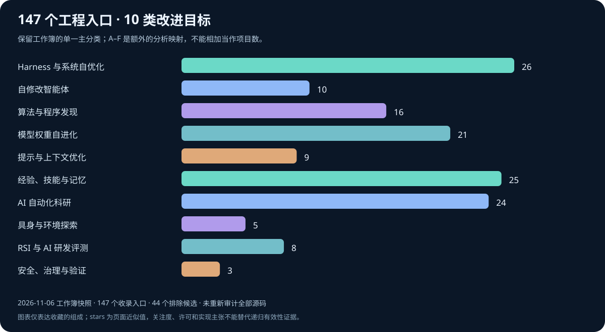

# RSI 开源工程导航：从工作簿到可比较的实现入口

[首页](../../README.md) · [工程交互导航](../../index.html#implementations) · [固定源码深读](../repo_deepdive/README.md) · [技术研究综合](12_RSI_Research_Synthesis.md)

本章整理用户提供的工程汇总工作簿，**不提交原 Excel 文件**。保留所有 147 个收录项目、44 个排除候选及其理由，并把链接公式转换为可点击的仓库入口。日期、stars、forks、许可证、活跃度、实现完整度与机构字段均是工作簿的记录，**不是本次对全部项目重新完成的源码审计、法律许可核验或复现实验**。

## 1. 先看收录边界

- 采集日期：2026-11-06（工作簿标注）；不是所有仓库被同一天重新测量。
- 工作簿说明：核心目标须涉及改进闭环或 RSI 评测/安全；要求实现代码、配置、训练流程或脚本，排除纯论文、成果展示、清单及未完整实现者。
- 影响力门槛：工作簿采用 Star ≥ 50，并对其认定的大型科技公司官方实现豁免。机构和“官方”属性在本章仅按工作簿记录，不作为作者雇佣、官方认证或机构认可的新结论。
- 各项目只进入一个主分类。A–F 对象家族是额外的编辑性映射，不等价于工作簿的十类，也不是自治等级。
- Stars ≥ 1000 可能由页面的 `x.xk` 近似展开；fork 缺失保持“未记录”。最近提交的相对时间锚定采集日，不能据此推导精确提交日期。
- 摘要公式可能把空单元格显示为零：RD-Agent 与 OpenEvolve 的 Fork 在项目主表为空，本数据保留未知值，不把摘要缓存的 0 当作已知零计数。
- 不同工程的名称、README 自进化宣传、代码存在及递归有效性是不同证据。许可证“未声明”不表示允许任意使用；非标准许可需阅读具体条款。

| 工作簿核对项 | 数量 / 口径 |
|---|---|
| 收录的唯一仓库入口 | 147 |
| 十类工程目的 | 10 |
| 被记录为近一月活跃 | 54 |
| 排除候选 | 44 |
| Stars 近似值之和 | 704,898（不是独立用户数或能力指标） |

## 2. 按改进目标选路，而不是只看 Star

| 工作簿主分类 | 适合阅读的问题 | A–F 编辑性映射 | 最需要保留的边界 |
|---|---|---|---|
| Harness 与系统自优化 | 先看可编辑组件、轨迹反馈、候选保留及外层优化器；逐项确认，不能因分类名称就假定权重冻结。 | D / C / F / A | Harness 编辑不等于权重训练，也不一定修改改进器自身；部分条目明确混合权重更新或可选训练。A–F 只是编辑性、多标签阅读对照，不是工作簿分类，也不是每个项目均改变这些状态的证据。 |
| 自修改智能体 | 区分任务智能体代码与元智能体代码，定位评估、隔离、父代选择和实际修改边界。 | D / F / C / E | 热替换插件或临时创建工具只提供可变性，不证明能力提高；基准选择的自身编辑也不是哥德尔机最优性证明。A–F 对照属于编辑判断，采用多对多关系。 |
| 算法与程序发现 | 查看候选表示、评估器、种群多样性及预算；区分解的变化和搜索策略自身的变化。 | F / D / B / A | 程序种群进化可以由固定外层优化器驱动；算法变好或使用 AlphaEvolve 名称，不代表模型递归变强。部分项目另有权重训练或探索策略重写；A–F 标签仅提供编辑性的关联阅读。 |
| 模型权重自进化 | 确认训练哪个模型、初始化、监督来源、奖励有效性及依赖，区分推理、数据策划和实际参数更新。 | A / B / E / C | 自生成监督不等于无监督来源，训练求解器也不证明优化器会改进自身。测试时权重更新应与文本或记忆适应区分。交叉的 A–F 标签是编辑对照，不新增来源分类。 |
| 提示与上下文优化 | 确认文本变量、反馈、提议算子和验证划分；部分框架还允许编辑代码或配置。 | D / C / F / E | 文本梯度、epoch 或技能“训练”本身不代表神经权重更新。固定反思优化器不自动构成元递归；持久小抄是记忆，而非重新训练的模型。A–F 关联为编辑性、多标签对照。 |
| 经验、技能与记忆 | 追踪保存什么、如何检索与修订、怎样淘汰错误资产，并区分个性化与通用能力提升。 | C / D / E | 记忆增加或检索增强，不足以证明推理变强、权重学习或源码递归改进。用户反馈、资产验证与维护状态仍是重要限定。A–F 归属只是编辑性的阅读辅助。 |
| AI 自动化科研 | 定位真正测量的制品、接受规则和人的角色；区分依赖宿主的技能与独立科研引擎。 | F / D / A / E / C | 自动做科研不一定改进科研者、模型或研究策略。指标优化与生成论文，不等于科学有效性或开放式发现保证；权重与 Harness 协同改进需要明确证据。A–F 仍属编辑对照。 |
| 具身与环境探索 | 确认环境、验证渠道、技能表示及迁移边界，区分仿真、源任务学习和新任务部署。 | B / C / D / E | 环境本身不一定进化。Minecraft 成功、桌面探索及机器人迁移的证据范围不同；在新任务上使用冻结技能栈，不等于仍在持续递归改进。A–F 映射为编辑判断。 |
| RSI 与 AI 研发评测 | 比较结果前先读任务范围、受保护数据和评分规则，确认测量的是任务表现还是改进器自身的改进。 | E / F / B / A | 基准测量提交的系统，本身不自动是自改进系统。AI 研发能力不等于递归能力已被证明；近期提交也不推翻弃用声明。A–F 标签描述编辑性的评测关联，不表示基准在修改这些状态。 |
| 安全、治理与验证 | 确认具体规范、检查器、威胁模型和退役规则；区分风险研究与运行时防护。 | E / C / D / F | 证明检查只支持规范中编码的性质，不保证普遍“无法作弊”或安全。技能退役属于有限治理，不是全面保证；风险实验也不一定改进智能体。A–F 为编辑性的多对多对照。 |

先选择可用的反馈，再选择可修改的资产。参数训练、提示优化、运行时编辑、记忆积累、程序发现、科研自动化以及评价/安全支撑，不能用同一条“自我改进”标签替代实现分析。既有六个固定源码案例保留独立入口；这里只因名称匹配而提供链接，不把其核验范围扩展到同类别的其他工程。

## 3. 全部工程，分组呈现

### Harness 与系统自优化（26）

查找改进智能体执行外围的工程：提示、工具、路由、工作流及持久资产。

**阅读重点：**先看可编辑组件、轨迹反馈、候选保留及外层优化器；逐项确认，不能因分类名称就假定权重冻结。

**证据限制：**Harness 编辑不等于权重训练，也不一定修改改进器自身；部分条目明确混合权重更新或可选训练。A–F 只是编辑性、多标签阅读对照，不是工作簿分类，也不是每个项目均改变这些状态的证据。

<strong>google-research/harness2</strong> · ★ 21,500 · Apache-2.0 · 活跃

[仓库](https://github.com/google-research/harness2)

【参考项目】开放世界递归 Agent Harness 优化框架，在模型权重固定下迭代改进执行 harness

| 比较项 | 工作簿记录 |
|---|---|
| 改进对象 | Harness 八类组件：系统提示、护栏、记忆、工具指引、子代理、技能、脚本、插件 |
| 核心机制 | 任务级 Propose–Probe–Compose 对比式精炼（无需真值反馈）+ Harness 级持久“改进 harness”沉淀经验；支持并行/串行递归 |
| 实现形态 / 完整度主张 | 完整 Python 包（pyproject、CLI、测试），含免凭据本地演示及 JobBench / LAB / WorkBuddy-Bench 运行与评测脚本 |
| 机构 / 作者（未重新核验） | Google Research |
| 技术栈 | Python |
| 论文 / 出处 | arXiv:2610.14224 |
| Stars / Forks | 21,500 / 2,100 |
| 许可证记录 | Apache-2.0 |
| 最近提交 / 活跃度 | 2 周前 / 活跃（相对采集日） |
| 提交数 | 3 |
| 工作簿定位 | 全部项目 第 6 行 |

**编辑性提醒：**这是工作簿的参考 Harness² 项目，不是基因组 Evo2，也不应与权重–Harness 协同进化的 Evo² 混同；对比式探查无需真值，不代表结果已经独立验证。

<strong>aiwaves-cn/agents</strong> · ★ 6,000 · Apache-2.0 · 未知

[仓库](https://github.com/aiwaves-cn/agents)

Agents 2.0：以“符号学习”训练语言智能体的数据中心自进化框架

| 比较项 | 工作簿记录 |
|---|---|
| 改进对象 | Agent 流水线、节点提示词与工具 |
| 核心机制 | 仿神经网络反向传播：语言损失 → 语言梯度 → 更新提示词、工具与流水线结构 |
| 实现形态 / 完整度主张 | Python 包（setup.py）+ 示例 |
| 机构 / 作者（未重新核验） | AIWaves（波形智能） |
| 技术栈 | Python |
| 论文 / 出处 | arXiv:2406.18532 |
| Stars / Forks | 6,000 / 479 |
| 许可证记录 | Apache-2.0 |
| 最近提交 / 活跃度 | — / 未知（相对采集日） |
| 提交数 | 1,325 |
| 工作簿定位 | 全部项目 第 19 行 |

**编辑性提醒：**“语言梯度”及符号学习不等于神经权重反向传播；工作簿未给最近提交，活跃度须保留未知。

<strong>EverMind-AI/Raven</strong> · ★ 6,000 · Apache-2.0 · 活跃

[仓库](https://github.com/EverMind-AI/Raven)

“Harness 的 Harness”：面向 RSI 的多智能体宿主，自动生成 DAG 编排多个专业 Agent

| 比较项 | 工作簿记录 |
|---|---|
| 改进对象 | Raven 自身 harness（规划与执行方式） |
| 核心机制 | 提出 harness 改动 → 评估 → 通过验证后采纳；EverOS 提供跨会话记忆与上下文 |
| 实现形态 / 完整度主张 | 完整工程：agents、evolver、benchmarks、TUI/Web UI、Docker 与测试 |
| 机构 / 作者（未重新核验） | EverMind |
| 技术栈 | Python |
| 论文 / 出处 | arXiv:2609.33439 |
| Stars / Forks | 6,000 / 234 |
| 许可证记录 | Apache-2.0 |
| 最近提交 / 活跃度 | 3 小时前 / 活跃（相对采集日） |
| 提交数 | 2,007 |
| 工作簿定位 | 全部项目 第 20 行 |

**编辑性提醒：**“Harness 的 Harness”是项目定位；验证门控和跨会话记忆不能单独证明改进器本身持续变强。

<strong>ANative-Lab/EvoAgentX</strong> · ★ 3,400 · 其他（见 LICENSE） · 活跃

[仓库](https://github.com/ANative-Lab/EvoAgentX)

构建、评估并自动进化 LLM 智能体与工作流的自进化生态框架

| 比较项 | 工作簿记录 |
|---|---|
| 改进对象 | 智能体工作流、提示词与结构 |
| 核心机制 | 单条提示自动构建多智能体工作流 + 内置评估器 + 集成 TextGrad、MIPRO、AFlow 等进化算法 |
| 实现形态 / 完整度主张 | 完整 Python 包 + 文档 + 示例 + 测试 |
| 机构 / 作者（未重新核验） | EvoAgentX 团队 |
| 技术栈 | Python |
| 论文 / 出处 | arXiv:2507.03616 |
| Stars / Forks | 3,400 / 323 |
| 许可证记录 | 其他（见 LICENSE） |
| 最近提交 / 活跃度 | 2 周前 / 活跃（相对采集日） |
| 提交数 | 1,179 |
| 工作簿定位 | 全部项目 第 27 行 |

**编辑性提醒：**集成 TextGrad、MIPRO、AFlow 等方法是框架能力，不应写成已证明的元递归；不同优化器的实际修改范围需分别理解。

<strong>Prism-Shadow/penguin-harness</strong> · ★ 3,100 · Apache-2.0 · 活跃

[仓库](https://github.com/Prism-Shadow/penguin-harness)

统一稳定的 RSI 平台：模型固定、harness 进化，提供桌面/Web/CLI/SDK

| 比较项 | 工作簿记录 |
|---|---|
| 改进对象 | 提示词、Skills、工具与 hooks |
| 核心机制 | 以插件形式集成 OPRO、APE、ACE、AWM、SkillOpt、OpenSkill、TRACE 等 RSI 算法，统一基准、计分板与快照 |
| 实现形态 / 完整度主张 | 完整 TypeScript 工程（packages / plugins）+ Docker + 场景测试 |
| 机构 / 作者（未重新核验） | Prism-Shadow |
| 技术栈 | TypeScript |
| 论文 / 出处 | — |
| Stars / Forks | 3,100 / 334 |
| 许可证记录 | Apache-2.0 |
| 最近提交 / 活跃度 | 11 小时前 / 活跃（相对采集日） |
| 提交数 | 980 |
| 工作簿定位 | 全部项目 第 29 行 |

**编辑性提醒：**统一插件和计分板不是递归能力证明；被集成算法的效果不能直接当作该平台自身已复现的结果。

<strong>hexo-ai/sia</strong> · ★ 2,200 · MIT · 一般

[仓库](https://github.com/hexo-ai/sia)

SIA 自我改进 AI 框架：Meta / Target / Feedback 多智能体代际循环，同时更新 harness 与权重

| 比较项 | 工作簿记录 |
|---|---|
| 改进对象 | 目标智能体的 harness 与模型权重 |
| 核心机制 | Meta Agent 依据反馈逐代改进 Target Agent；论文报告 LawBench +56.6%、GPU 内核运行时间 −91.9% |
| 实现形态 / 完整度主张 | pip 可安装（sia-agent），内置 4 个任务与运行可视化 |
| 机构 / 作者（未重新核验） | Hexo AI |
| 技术栈 | Python |
| 论文 / 出处 | arXiv:2605.27276 |
| Stars / Forks | 2,200 / 255 |
| 许可证记录 | MIT |
| 最近提交 / 活跃度 | 2 个月前 / 一般（相对采集日） |
| 提交数 | 30 |
| 工作簿定位 | 全部项目 第 38 行 |

**编辑性提醒：**虽然列入 Harness 类，原行明确同时更新权重；不能统一标成冻结模型，论文效果数字也不是本次复现实验。

<strong>google-research/rrsi</strong> · ★ 1,700 · Apache-2.0 · 一般

[仓库](https://github.com/google-research/rrsi) · [固定版本源码深读](../repo_deepdive/cases/rrsi.md)

正则化递归自我改进（RRSI）：在开放编辑空间中进化 Agent harness 并抑制过拟合

| 比较项 | 工作簿记录 |
|---|---|
| 改进对象 | Agent harness（提示、控制流、工具、记忆、上下文管理） |
| 核心机制 | 退火编辑预算、全历史条件提议、Critic 泄漏筛查、噪声带选择、新颖性与剪枝 |
| 实现形态 / 完整度主张 | 完整 Python 包 + coding / workspace / engineering 三类实例与测试 |
| 机构 / 作者（未重新核验） | Google Research |
| 技术栈 | Python |
| 论文 / 出处 | arXiv:2609.24972 |
| Stars / Forks | 1,700 / 167 |
| 许可证记录 | Apache-2.0 |
| 最近提交 / 活跃度 | 2 个月前 / 一般（相对采集日） |
| 提交数 | 4 |
| 工作簿定位 | 全部项目 第 42 行 |

**编辑性提醒：**这些控制针对过拟合与选择偏差，不保证泛化或安全；工作簿描述不能替代本次独立代码验证。

<strong>ShengranHu/ADAS</strong> · ★ 1,700 · Apache-2.0 · 低

[仓库](https://github.com/ShengranHu/ADAS)

智能体系统自动设计（ADAS），提出 Meta Agent Search

| 比较项 | 工作簿记录 |
|---|---|
| 改进对象 | 以代码表示的智能体系统设计 |
| 核心机制 | Meta Agent 基于历史发现迭代编写新 Agent 代码，评估后归档 |
| 实现形态 / 完整度主张 | Python 脚本，覆盖 ARC、DROP、MGSM、MMLU、GPQA 等领域 |
| 机构 / 作者（未重新核验） | UBC（Jeff Clune 团队） |
| 技术栈 | Python |
| 论文 / 出处 | ICLR 2025 · arXiv:2408.08435 |
| Stars / Forks | 1,700 / 241 |
| 许可证记录 | Apache-2.0 |
| 最近提交 / 活跃度 | 去年 / 低（相对采集日） |
| 提交数 | 17 |
| 工作簿定位 | 全部项目 第 43 行 |

**编辑性提醒：**任务智能体设计由外层搜索器生成；候选源码变化不等于 Meta Agent Search 自身递归进化。

<strong>stanford-iris-lab/meta-harness</strong> · ★ 1,700 · MIT · 一般

[仓库](https://github.com/stanford-iris-lab/meta-harness)

Meta-Harness：对固定基座模型的任务专属 harness 做端到端自动搜索

| 比较项 | 工作簿记录 |
|---|---|
| 改进对象 | Harness 代码（存储、检索、展示给模型的信息） |
| 核心机制 | Proposer Agent（默认 Claude Code）读取历史候选与日志提出新 harness 并迭代评估 |
| 实现形态 / 完整度主张 | 框架 + 文本分类与 Terminal-Bench 2.0 两个参考实验，附 ONBOARDING 引导 |
| 机构 / 作者（未重新核验） | Stanford IRIS Lab |
| 技术栈 | Python |
| 论文 / 出处 | arXiv:2603.28052 |
| Stars / Forks | 1,700 / 173 |
| 许可证记录 | MIT |
| 最近提交 / 活跃度 | 2 个月前 / 一般（相对采集日） |
| 提交数 | 24 |
| 工作簿定位 | 全部项目 第 44 行 |

**编辑性提醒：**搜索任务专属 Harness 不自动等于搜索器自改进；外部编码 Agent 的能力与候选 Harness 的效果应分开。

<strong>exoharness/exo</strong> · ★ 1,600 · MIT · 活跃

[仓库](https://github.com/exoharness/exo)

完全递归的 agent + harness 架构，可在运行时安全修改自身各部分

| 比较项 | 工作簿记录 |
|---|---|
| 改进对象 | 智能体及其 harness 的全部组成 |
| 核心机制 | 运行时自我修改 + 安全学习架构（沙箱、凭据与网络控制、持久会话） |
| 实现形态 / 完整度主张 | Rust + TypeScript 工程（crates、eval/harbor、fuzz）；文档仍在完善 |
| 机构 / 作者（未重新核验） | Exo（Krentsel、Stoica 等） |
| 技术栈 | Rust |
| 论文 / 出处 | Exo: An Architecture for Self-Improving Systems at Runtime（2026 预印本） |
| Stars / Forks | 1,600 / 127 |
| 许可证记录 | MIT |
| 最近提交 / 活跃度 | 5 天前 / 活跃（相对采集日） |
| 提交数 | 210 |
| 工作簿定位 | 全部项目 第 45 行 |

**编辑性提醒：**运行时可改写与控制机制不等于所有修改均安全或有效；“完全递归”属于来源定位，文档仍在完善。

<strong>greyhaven-ai/autocontext</strong> · ★ 1,300 · Apache-2.0 · 活跃

[仓库](https://github.com/greyhaven-ai/autocontext)

递归自我改进 harness：围绕目标反复运行与评估，保留经验并为后续迭代产出资产

| 比较项 | 工作簿记录 |
|---|---|
| 改进对象 | 上下文、playbook、数据集（可选本地模型训练） |
| 核心机制 | 运行 → 评估 → 保留有效经验 / 丢弃死路 → 产出轨迹、报告、playbook 与训练数据 |
| 实现形态 / 完整度主张 | Python CLI/库 + TypeScript CLI（uv / bun 安装） |
| 机构 / 作者（未重新核验） | Greyhaven AI |
| 技术栈 | Python |
| 论文 / 出处 | — |
| Stars / Forks | 1,300 / 116 |
| 许可证记录 | Apache-2.0 |
| 最近提交 / 活跃度 | 上周 / 活跃（相对采集日） |
| 提交数 | 2,281 |
| 工作簿定位 | 全部项目 第 55 行 |

**编辑性提醒：**主要是上下文与经验资产循环，但存在可选本地训练；不能因所属类别把所有路径写成权重冻结。

<strong>ant-research/AntOmniEvo</strong> · ★ 1,200 · Apache-2.0 · 活跃

[仓库](https://github.com/ant-research/AntOmniEvo)

“优化一切”的自动进化框架：可调对象抽象为文件目录，由 Agent 迭代优化

| 比较项 | 工作簿记录 |
|---|---|
| 改进对象 | Skill、工作流、单文件算法等可调制品 |
| 核心机制 | 用户定义可调制品与评估标准，框架控制循环，Agent 作为提议者编辑文件 |
| 实现形态 / 完整度主张 | 完整 Python 包 + skills + 可视化器 |
| 机构 / 作者（未重新核验） | 蚂蚁集团 Ant Research |
| 技术栈 | Python |
| 论文 / 出处 | arXiv:2609.35855 |
| Stars / Forks | 1,200 / 129 |
| 许可证记录 | Apache-2.0 |
| 最近提交 / 活跃度 | 上周 / 活跃（相对采集日） |
| 提交数 | 70 |
| 工作簿定位 | 全部项目 第 60 行 |

**编辑性提醒：**用户定义目标、框架控制外层循环；“优化一切”不是无限通用能力，也不证明外层优化器会改写自身。

<strong>Gen-Verse/RSI-Anything</strong> · ★ 1,100 · Apache-2.0 · 活跃

[仓库](https://github.com/Gen-Verse/RSI-Anything)

基于世界模型的通用递归自我改进框架

| 比较项 | 工作簿记录 |
|---|---|
| 改进对象 | 决策与候选方案选择（代码修复、GUI 交互、实验规划等） |
| 核心机制 | JEPA 世界模型预测 → 预测引导筛选 → 外部评估 → 学习，闭环改进下一次决策 |
| 实现形态 / 完整度主张 | Python 包 src/rsi\_anything + 配置、任务与测试 |
| 机构 / 作者（未重新核验） | Gen-Verse |
| 技术栈 | Python |
| 论文 / 出处 | arXiv:2610.13912 |
| Stars / Forks | 1,100 / 120 |
| 许可证记录 | Apache-2.0 |
| 最近提交 / 活跃度 | 3 周前 / 活跃（相对采集日） |
| 提交数 | 26 |
| 工作簿定位 | 全部项目 第 61 行 |

**编辑性提醒：**原行没有澄清“学习”是否实际更新神经权重；世界模型预测和外部评估不能自动推导普遍递归能力。

<strong>metauto-ai/GPTSwarm</strong> · ★ 1,100 · MIT · 低

[仓库](https://github.com/metauto-ai/GPTSwarm)

图结构 LLM 智能体框架，支持智能体群自组织与自我改进

| 比较项 | 工作簿记录 |
|---|---|
| 改进对象 | 智能体图（节点提示与连接拓扑） |
| 核心机制 | 把智能体建模为可优化计算图，用 RL / 提示优化自动改进节点与边 |
| 实现形态 / 完整度主张 | Python 包（swarm）+ 实验与 notebooks |
| 机构 / 作者（未重新核验） | KAUST（Schmidhuber 团队） |
| 技术栈 | Python |
| 论文 / 出处 | ICML 2024 Oral |
| Stars / Forks | 1,100 / 108 |
| 许可证记录 | MIT |
| 最近提交 / 活跃度 | 9 个月前 / 低（相对采集日） |
| 提交数 | 70 |
| 工作簿定位 | 全部项目 第 62 行 |

**编辑性提醒：**图连接或提示优化应与基座模型权重训练区分；RL 在此描述优化机制，不足以证明 LLM 参数更新。

<strong>china-qijizhifeng/agentic-harness-engineering</strong> · ★ 960 · MIT · 活跃

[仓库](https://github.com/china-qijizhifeng/agentic-harness-engineering)

Agentic Harness Engineering：可观测性驱动的编码 Agent harness 自动进化

| 比较项 | 工作簿记录 |
|---|---|
| 改进对象 | 系统提示、工具描述与实现、中间件、技能、子代理、长期记忆 |
| 核心机制 | 基座模型固定，基于执行轨迹可观测性迭代进化 harness 组件（Terminal-Bench 2.0 84.7%） |
| 实现形态 / 完整度主张 | 完整 Python 工程（evolve.py、agents、configs、已进化 harness） |
| 机构 / 作者（未重新核验） | AHE 团队 |
| 技术栈 | Python |
| 论文 / 出处 | arXiv（2026-04） |
| Stars / Forks | 960 / 104 |
| 许可证记录 | MIT |
| 最近提交 / 活跃度 | 上周 / 活跃（相对采集日） |
| 提交数 | 49 |
| 工作簿定位 | 全部项目 第 69 行 |

**编辑性提醒：**来源中的 Terminal-Bench 成绩不是本次验证；固定模型的外围改进也不等于模型自身学习。

<strong>A-EVO-Lab/a-evolve</strong> · ★ 842 · 未声明 · 一般

[仓库](https://github.com/A-EVO-Lab/a-evolve)

自我改进智能体的通用基础设施：输入基础 Agent，自动进化出更强 Agent

| 比较项 | 工作簿记录 |
|---|---|
| 改进对象 | Agent 工作区（提示、技能、工具等 harness） |
| 核心机制 | 可插拔进化算法 + 基准驱动循环（3 行代码启动） |
| 实现形态 / 完整度主张 | Python 包 agent\_evolve + seed workspaces + 示例 |
| 机构 / 作者（未重新核验） | A-EVO Lab |
| 技术栈 | Python |
| 论文 / 出处 | arXiv:2602.00359 |
| Stars / Forks | 842 / 97 |
| 许可证记录 | 未声明 |
| 最近提交 / 活跃度 | 3 个月前 / 一般（相对采集日） |
| 提交数 | 80 |
| 工作簿定位 | 全部项目 第 71 行 |

**编辑性提醒：**“更强 Agent”须受评估任务和预算限定；外层算法可插拔不表示会自改写，许可证原值为未声明。

<strong>FoundationAgents/AFlow</strong> · ★ 631 · MIT · 低

[仓库](https://github.com/FoundationAgents/AFlow)

AFlow：自动生成与优化 Agentic 工作流

| 比较项 | 工作簿记录 |
|---|---|
| 改进对象 | 以代码表示的工作流 |
| 核心机制 | 在代码化工作流空间中用蒙特卡洛树搜索迭代改进 |
| 实现形态 / 完整度主张 | Python 工程（run.py、benchmarks、workspace） |
| 机构 / 作者（未重新核验） | FoundationAgents（MetaGPT 团队） |
| 技术栈 | Python |
| 论文 / 出处 | ICLR 2025 Oral · arXiv:2410.10762 |
| Stars / Forks | 631 / 100 |
| 许可证记录 | MIT |
| 最近提交 / 活跃度 | 11 个月前 / 低（相对采集日） |
| 提交数 | 41 |
| 工作簿定位 | 全部项目 第 83 行 |

**编辑性提醒：**这是代码化工作流搜索；固定 MCTS 外层不应被包装成改进器自身的递归优化。

<strong>rsi-gear/gear</strong> · ★ 416 · MIT · 活跃

[仓库](https://github.com/rsi-gear/gear)

“RSI 领域的 scikit-learn”：模块化递归 harness 进化框架

| 比较项 | 工作簿记录 |
|---|---|
| 改进对象 | Agent 的模型、指令、工具与工作流 |
| 核心机制 | 在代表性任务基准上运行 Refine Skill，依据评估结果迭代改进 |
| 实现形态 / 完整度主张 | TypeScript 主体 + Python 子包，含 contracts、示例与测试 |
| 机构 / 作者（未重新核验） | rsi-gear |
| 技术栈 | TypeScript |
| 论文 / 出处 | — |
| Stars / Forks | 416 / 38 |
| 许可证记录 | MIT |
| 最近提交 / 活跃度 | 3 天前 / 活跃（相对采集日） |
| 提交数 | 303 |
| 工作簿定位 | 全部项目 第 94 行 |

**编辑性提醒：**“模型”被列为对象但未明确是否更新权重；应区分模型选择、参数训练与 Harness 变更，不能直接推断冻结或训练。

<strong>simple-agent-lab/RSIHub</strong> · ★ 333 · Apache-2.0 · 活跃

[仓库](https://github.com/simple-agent-lab/RSIHub)

基于文件的进化框架：在固定评估器下进行可复现、可控的智能体自我改进

| 比较项 | 工作簿记录 |
|---|---|
| 改进对象 | 候选智能体（提示、脚手架、技能等） |
| 核心机制 | 候选对固定评估器运行，记录血统，声明修改边界，组合式进化方法（recipes） |
| 实现形态 / 完整度主张 | Python 包 src/evolve + recipes / scaffolds / evals |
| 机构 / 作者（未重新核验） | Simple Agent Lab |
| 技术栈 | Python |
| 论文 / 出处 | NeurIPS 2026 Workshop · arXiv:2610.32253 |
| Stars / Forks | 333 / 19 |
| 许可证记录 | Apache-2.0 |
| 最近提交 / 活跃度 | 上周 / 活跃（相对采集日） |
| 提交数 | 629 |
| 工作簿定位 | 全部项目 第 101 行 |

**编辑性提醒：**固定评估器、血统和边界记录支持可追踪实验，不等于已验证递归或全面可复现；外层 recipes 是否变动须另看。

<strong>bingreeky/MaAS</strong> · ★ 290 · 未声明 · 低

[仓库](https://github.com/bingreeky/MaAS)

基于“智能体超网”的多智能体架构搜索

| 比较项 | 工作簿记录 |
|---|---|
| 改进对象 | 多智能体系统架构 |
| 核心机制 | 优化智能体架构的概率分布（agentic supernet），按查询动态采样子网络 |
| 实现形态 / 完整度主张 | Python 包 maas + 示例 |
| 机构 / 作者（未重新核验） | MaAS 作者团队 |
| 技术栈 | Python |
| 论文 / 出处 | ICML 2025 Oral · arXiv:2502.04180 |
| Stars / Forks | 290 / 29 |
| 许可证记录 | 未声明 |
| 最近提交 / 活跃度 | 去年 / 低（相对采集日） |
| 提交数 | 17 |
| 工作簿定位 | 全部项目 第 103 行 |

**编辑性提醒：**优化架构分布不等于编辑搜索器自身，也不等于基座 LLM 权重训练；原行许可证未声明。

<strong>i3T4AN/KADATH</strong> · ★ 258 · Apache-2.0 · 一般

[仓库](https://github.com/i3T4AN/KADATH)

进化式多智能体运行时：繁殖、评估并改进自主智能体

| 比较项 | 工作簿记录 |
|---|---|
| 改进对象 | 完整 Agent 基因组（系统提示、Python 实现、工具、依赖） |
| 核心机制 | 种群竞争 → 独立评分 → 变异 / 繁殖 / 淘汰的达尔文式进化 |
| 实现形态 / 完整度主张 | Python 包 + Docker 部署 |
| 机构 / 作者（未重新核验） | i3T4AN（个人） |
| 技术栈 | Python |
| 论文 / 出处 | — |
| Stars / Forks | 258 / 2 |
| 许可证记录 | Apache-2.0 |
| 最近提交 / 活跃度 | 2 个月前 / 一般（相对采集日） |
| 提交数 | 7 |
| 工作簿定位 | 全部项目 第 107 行 |

**编辑性提醒：**这里的“基因组”是软件配置与实现的比喻，不是生物基因组模型；种群选择不保证无奖励利用或通用能力增长。

<strong>microsoft/AutoSaddler</strong> · ★ 250 · MIT · 一般

[仓库](https://github.com/microsoft/AutoSaddler)

基于执行轨迹的自动 harness 优化，追求可泛化的持久更新

| 比较项 | 工作簿记录 |
|---|---|
| 改进对象 | 提示词、工具与中间件 |
| 核心机制 | 诊断执行轨迹 → 结构化更新 → 选择可泛化改动（GAIA2 / SWE-Bench Pro / Terminal-Bench 2.0 提升约 9–10pp） |
| 实现形态 / 完整度主张 | Python 包 src/autosaddler（uv）+ 配置与测试 |
| 机构 / 作者（未重新核验） | Microsoft |
| 技术栈 | Python |
| 论文 / 出处 | arXiv:2608.23041 |
| Stars / Forks | 250 / 21 |
| 许可证记录 | MIT |
| 最近提交 / 活跃度 | 2 个月前 / 一般（相对采集日） |
| 提交数 | 13 |
| 工作簿定位 | 全部项目 第 109 行 |

**编辑性提醒：**目标是持久、可泛化更新，不表示泛化已由本次证明；来源中的多基准提升不能改写成独立复现结论。

<strong>tsinghua-fib-lab/AgentSquare</strong> · ★ 235 · 未声明 · 低

[仓库](https://github.com/tsinghua-fib-lab/AgentSquare)

在模块化设计空间中自动搜索 LLM 智能体

| 比较项 | 工作簿记录 |
|---|---|
| 改进对象 | 智能体模块组合（规划 / 推理 / 工具 / 记忆） |
| 核心机制 | 模块进化 + 模块重组，配合性能预测器加速搜索 |
| 实现形态 / 完整度主张 | Python 工程（module\_evolution、module\_recombination、search） |
| 机构 / 作者（未重新核验） | 清华大学 FIB Lab |
| 技术栈 | Python |
| 论文 / 出处 | ICLR 2025 · arXiv:2410.06153 |
| Stars / Forks | 235 / 18 |
| 许可证记录 | 未声明 |
| 最近提交 / 活跃度 | 去年 / 低（相对采集日） |
| 提交数 | 111 |
| 工作簿定位 | 全部项目 第 112 行 |

**编辑性提醒：**性能预测器辅助搜索不替代最终评估；模块组合变化不证明搜索机制递归变强，许可证为未声明。

<strong>Birfy/agentdescent</strong> · ★ 204 · MIT · 活跃

[仓库](https://github.com/Birfy/agentdescent)

“参数是智能体的梯度下降”：并行异步的自进化智能体框架

| 比较项 | 工作簿记录 |
|---|---|
| 改进对象 | 技能、提示词、harness |
| 核心机制 | N 个 worker 并行提出 diff，无屏障聚合器做冲突解决、融合与统计接受 |
| 实现形态 / 完整度主张 | Python 包 + bench + 集成 + 文档站 |
| 机构 / 作者（未重新核验） | Birfy |
| 技术栈 | Python |
| 论文 / 出处 | — |
| Stars / Forks | 204 / 22 |
| 许可证记录 | MIT |
| 最近提交 / 活跃度 | 2 天前 / 活跃（相对采集日） |
| 提交数 | 1,306 |
| 工作簿定位 | 全部项目 第 115 行 |

**编辑性提醒：**“梯度下降”是类比；并行 diff 聚合仍需评估与冲突处理，不能解读为神经权重更新或持续必然收益。

<strong>proteus-evolve/Proteus</strong> · ★ 111 · MIT · 活跃

[仓库](https://github.com/proteus-evolve/Proteus)

与 harness 无关的模块化智能体自我改进框架

| 比较项 | 工作簿记录 |
|---|---|
| 改进对象 | 提示词、记忆、技能或 harness 源码 |
| 核心机制 | 优化方法、运行时与评估协议独立可配置，支持组合式方法与进化过程可视化 |
| 实现形态 / 完整度主张 | Python 包 + recipes / environments / Web 可视化 |
| 机构 / 作者（未重新核验） | Proteus 团队 |
| 技术栈 | Python |
| 论文 / 出处 | 技术报告（PDF） |
| Stars / Forks | 111 / 12 |
| 许可证记录 | MIT |
| 最近提交 / 活跃度 | 昨天 / 活跃（相对采集日） |
| 提交数 | 445 |
| 工作簿定位 | 全部项目 第 135 行 |

**编辑性提醒：**“与 Harness 无关”应理解为不绑定特定宿主，而非不修改 Harness；可组合方法不必然具备元递归。

<strong>airbnb/agent-harness-optimizer</strong> · ★ 11 · Apache-2.0 · 一般

[仓库](https://github.com/airbnb/agent-harness-optimizer)

与基准无关的 LLM Agent harness 自动优化框架（AHO）

| 比较项 | 工作簿记录 |
|---|---|
| 改进对象 | 系统提示与工具调用中间件 |
| 核心机制 | 内层模型跑基准，外层 Proposer 读取失败案例并写入定向修复 |
| 实现形态 / 完整度主张 | Python 包 + 论文复现配置（BFCL） |
| 机构 / 作者（未重新核验） | Airbnb |
| 技术栈 | Python |
| 论文 / 出处 | 见 REPRODUCIBILITY.md |
| Stars / Forks | 11 / 4 |
| 许可证记录 | Apache-2.0 |
| 最近提交 / 活跃度 | 3 个月前 / 一般（相对采集日） |
| 提交数 | 1 |
| 工作簿定位 | 全部项目 第 147 行 |

**编辑性提醒：**外层 Proposer 优化内层 Harness，不等于 Proposer 自身递归变化；来源类别采用企业官方实现的 Star 门槛例外。

### 自修改智能体（10）

比较编辑自身实现、工具或改进流程的智能体，包括维护进化档案的变体。

**阅读重点：**区分任务智能体代码与元智能体代码，定位评估、隔离、父代选择和实际修改边界。

**证据限制：**热替换插件或临时创建工具只提供可变性，不证明能力提高；基准选择的自身编辑也不是哥德尔机最优性证明。A–F 对照属于编辑判断，采用多对多关系。

<strong>facebookresearch/HyperAgents</strong> · ★ 2,900 · 其他（见 LICENSE） · 低

[仓库](https://github.com/facebookresearch/HyperAgents) · [固定版本源码深读](../repo_deepdive/cases/hyperagents.md)

自指式自我改进智能体，可针对任意可计算任务优化

| 比较项 | 工作簿记录 |
|---|---|
| 改进对象 | 任务 Agent 及负责改进的 Meta Agent 自身 |
| 核心机制 | Meta Agent 修改 Agent 代码（含自身的改进流程），开放式档案选择父代 |
| 实现形态 / 完整度主张 | Python 工程（generate\_loop、meta\_agent、Docker） |
| 机构 / 作者（未重新核验） | Meta（FAIR） |
| 技术栈 | Python |
| 论文 / 出处 | arXiv:2603.19461 |
| Stars / Forks | 2,900 / 370 |
| 许可证记录 | 其他（见 LICENSE） |
| 最近提交 / 活跃度 | 7 个月前 / 低（相对采集日） |
| 提交数 | 9 |
| 工作簿定位 | 全部项目 第 33 行 |

**编辑性提醒：**修改范围包括改进流程，是较强自指主张，但不应把“任意可计算任务”写成已证明的普遍能力。

<strong>jennyzzt/dgm</strong> · ★ 2,500 · Apache-2.0 · 低

[仓库](https://github.com/jennyzzt/dgm)

达尔文哥德尔机（DGM）：开放式进化的自我改进编码智能体

| 比较项 | 工作簿记录 |
|---|---|
| 改进对象 | 编码智能体自身源代码 |
| 核心机制 | 迭代修改自身代码并在 SWE-bench / Polyglot 上实证验证，维护开放式智能体档案 |
| 实现形态 / 完整度主张 | 完整 Python 工程（DGM\_outer.py、Docker 沙箱） |
| 机构 / 作者（未重新核验） | UBC / Sakana AI（Jeff Clune 团队） |
| 技术栈 | Python |
| 论文 / 出处 | arXiv:2505.22954 |
| Stars / Forks | 2,500 / 460 |
| 许可证记录 | Apache-2.0 |
| 最近提交 / 活跃度 | 去年 / 低（相对采集日） |
| 提交数 | 5 |
| 工作簿定位 | 全部项目 第 37 行 |

**编辑性提醒：**达尔文式实证筛选不等于哥德尔机形式证明；自身源码演化与固定外层档案搜索应分别说明。

<strong>OpenAutoCoder/live-swe-agent</strong> · ★ 468 · MIT · 低

[仓库](https://github.com/OpenAutoCoder/live-swe-agent)

首个运行时自进化软件工程智能体，在解决问题过程中即时扩展自身能力

| 比较项 | 工作簿记录 |
|---|---|
| 改进对象 | 智能体工具集与行为（运行时自建工具） |
| 核心机制 | 基于 mini-swe-agent，让 Agent 在线创建/修改工具；SWE-bench Verified 79.2%（Claude Opus 4.5） |
| 实现形态 / 完整度主张 | 以 mini-swe-agent 配置与提示词实现，依赖上游框架运行 |
| 机构 / 作者（未重新核验） | UIUC（Lingming Zhang 团队） |
| 技术栈 | YAML 配置 |
| 论文 / 出处 | arXiv 预印本（2025） |
| Stars / Forks | 468 / 47 |
| 许可证记录 | MIT |
| 最近提交 / 活跃度 | 10 个月前 / 低（相对采集日） |
| 提交数 | 11 |
| 工作簿定位 | 全部项目 第 92 行 |

**编辑性提醒：**依赖 mini-swe-agent 运行；临时自建工具不等于完整自改写引擎，来源的模型特定基准成绩不是本次验证。

<strong>metauto-ai/HGM</strong> · ★ 446 · Apache-2.0 · 低

[仓库](https://github.com/metauto-ai/HGM)

赫胥黎-哥德尔机（HGM）：近似最优自我改进机的编码智能体

| 比较项 | 工作簿记录 |
|---|---|
| 改进对象 | 编码智能体自身代码 |
| 核心机制 | 用子树（clade）元生产力估计决定扩展哪些自我修改 |
| 实现形态 / 完整度主张 | Python 工程（hgm.py、Docker、SWE-bench / Polyglot） |
| 机构 / 作者（未重新核验） | KAUST（Schmidhuber 团队） |
| 技术栈 | Python |
| 论文 / 出处 | ICLR 2026 Oral · arXiv:2510.21614 |
| Stars / Forks | 446 / 76 |
| 许可证记录 | Apache-2.0 |
| 最近提交 / 活跃度 | 8 个月前 / 低（相对采集日） |
| 提交数 | 14 |
| 工作簿定位 | 全部项目 第 93 行 |

**编辑性提醒：**“近似最优”是方法定位，不应当作普遍理论保证；子树元生产力估计仍依赖任务与采样。

<strong>MaximeRobeyns/self\_improving\_coding\_agent</strong> · ★ 414 · MIT · 低

[仓库](https://github.com/MaximeRobeyns/self_improving_coding_agent)

SICA：在自身代码库上工作的自我改进编码智能体

| 比较项 | 工作簿记录 |
|---|---|
| 改进对象 | 智能体自身代码库 |
| 核心机制 | 基准评估 → 归档 → 在自身代码上实施改进 → 循环 |
| 实现形态 / 完整度主张 | Python 工程 + Docker 沙箱 + 基准数据 |
| 机构 / 作者（未重新核验） | University of Bristol |
| 技术栈 | Python |
| 论文 / 出处 | ICLR 2025 Workshop |
| Stars / Forks | 414 / 71 |
| 许可证记录 | MIT |
| 最近提交 / 活跃度 | 去年 / 低（相对采集日） |
| 提交数 | 2 |
| 工作簿定位 | 全部项目 第 95 行 |

**编辑性提醒：**自身代码库确属修改对象，但基准内改进不证明无限递归或任务外泛化；来源实现完整度未由本次运行确认。

<strong>sonichi/sutando</strong> · ★ 404 · MIT · 活跃

[仓库](https://github.com/sonichi/sutando)

个人 AI“替身”：白天实时协作，夜间改写自身代码

| 比较项 | 工作簿记录 |
|---|---|
| 改进对象 | 自身代码与技能 |
| 核心机制 | 学习用户模式，空闲时通过 Claude Code / Codex 会话编写并发布自身代码 |
| 实现形态 / 完整度主张 | 完整工程（src、skills、tests），Mac 本地运行 |
| 机构 / 作者（未重新核验） | Chi Wang（AutoGen / AG2 作者） |
| 技术栈 | Python |
| 论文 / 出处 | — |
| Stars / Forks | 404 / 99 |
| 许可证记录 | MIT |
| 最近提交 / 活跃度 | 昨天 / 活跃（相对采集日） |
| 提交数 | 3,340 |
| 工作簿定位 | 全部项目 第 97 行 |

**编辑性提醒：**外部 Claude Code／Codex 会话是实现依赖；个人模式学习和自动发布不能直接证明递归能力或发布安全。

<strong>Arvid-pku/Godel\_Agent</strong> · ★ 239 · MIT · 低

[仓库](https://github.com/Arvid-pku/Godel_Agent)

哥德尔智能体：递归自我改进的自指智能体框架

| 比较项 | 工作簿记录 |
|---|---|
| 改进对象 | 智能体自身逻辑与代码（运行时） |
| 核心机制 | 在运行时读取并修改自身代码与策略（含改进策略本身） |
| 实现形态 / 完整度主张 | Python 源码 + 数据集与结果 |
| 机构 / 作者（未重新核验） | 北京大学 |
| 技术栈 | Python |
| 论文 / 出处 | ACL 2025 · arXiv:2410.04444 |
| Stars / Forks | 239 / 54 |
| 许可证记录 | MIT |
| 最近提交 / 活跃度 | 去年 / 低（相对采集日） |
| 提交数 | 9 |
| 工作簿定位 | 全部项目 第 111 行 |

**编辑性提醒：**自指修改是来源描述，不等于哥德尔机式最优性证明；有效性仍受具体任务与评估约束。

<strong>arcships/rutis</strong> · ★ 166 · MIT · 活跃

[仓库](https://github.com/arcships/rutis)

面向“自我迭代软件”的插件运行时：Agent 编写、替换并热加载自身插件

| 比较项 | 工作簿记录 |
|---|---|
| 改进对象 | 运行中程序的插件与能力 |
| 核心机制 | Rust 内核保障插件生命周期安全，支持 TS / Python / Go / Swift 插件跨进程热替换 |
| 实现形态 / 完整度主张 | 多语言工程（Rust crates + 多语言 SDK + fuzz） |
| 机构 / 作者（未重新核验） | arcships |
| 技术栈 | Rust |
| 论文 / 出处 | — |
| Stars / Forks | 166 / 12 |
| 许可证记录 | MIT |
| 最近提交 / 活跃度 | 11 小时前 / 活跃（相对采集日） |
| 提交数 | 3,161 |
| 工作簿定位 | 全部项目 第 121 行 |

**编辑性提醒：**插件生命周期控制不证明每次替换都更优或全面安全；该行更像自迭代基础设施，而非已测得的递归优化结果。

<strong>UCSB-AI/GEA</strong> · ★ 138 · Apache-2.0 · 低

[仓库](https://github.com/UCSB-AI/GEA)

群体进化智能体（GEA）：以智能体群为进化单元的开放式自我改进

| 比较项 | 工作簿记录 |
|---|---|
| 改进对象 | 编码智能体代码 |
| 核心机制 | 在 DGM 式框架上引入群体内显式经验共享与复用 |
| 实现形态 / 完整度主张 | Python 工程（GEA\_outer.py、Docker、SWE-bench / Polyglot） |
| 机构 / 作者（未重新核验） | UCSB |
| 技术栈 | Python |
| 论文 / 出处 | arXiv:2602.04837 |
| Stars / Forks | 138 / 16 |
| 许可证记录 | Apache-2.0 |
| 最近提交 / 活跃度 | 7 个月前 / 低（相对采集日） |
| 提交数 | 31 |
| 工作簿定位 | 全部项目 第 126 行 |

**编辑性提醒：**群体共享经验是方法差异，不应宣称群体必然优于个体；基于 DGM 的外层循环是否自改写未由该行说明。

<strong>microsoft/STOP</strong> · ★ 53 · MIT · 低

[仓库](https://github.com/microsoft/STOP)

自学优化器 STOP：递归自我改进的代码生成

| 比较项 | 工作簿记录 |
|---|---|
| 改进对象 | 脚手架程序（含改进器自身） |
| 核心机制 | 用改进器改进自身代码（self-improver improves itself） |
| 实现形态 / 完整度主张 | Python 脚本（run\_improver、eval\_improver、tasks） |
| 机构 / 作者（未重新核验） | Microsoft Research |
| 技术栈 | Python |
| 论文 / 出处 | arXiv:2310.02304 |
| Stars / Forks | 53 / 7 |
| 许可证记录 | MIT |
| 最近提交 / 活跃度 | 3 年前 / 低（相对采集日） |
| 提交数 | 2 |
| 工作簿定位 | 全部项目 第 145 行 |

**编辑性提醒：**改进器自身是可修改对象，但脚本级实验不能扩展成无限递归保证；来源较旧的相对提交时间仍仅是快照。

### 算法与程序发现（16）

定位利用语言模型提议来改进可执行程序、启发式或数学构造的搜索工程。

**阅读重点：**查看候选表示、评估器、种群多样性及预算；区分解的变化和搜索策略自身的变化。

**证据限制：**程序种群进化可以由固定外层优化器驱动；算法变好或使用 AlphaEvolve 名称，不代表模型递归变强。部分项目另有权重训练或探索策略重写；A–F 标签仅提供编辑性的关联阅读。

<strong>algorithmicsuperintelligence/openevolve</strong> · ★ 7,700 · Apache-2.0 · 活跃

[仓库](https://github.com/algorithmicsuperintelligence/openevolve)

AlphaEvolve 开源实现：LLM 驱动的进化式编码智能体

| 比较项 | 工作簿记录 |
|---|---|
| 改进对象 | 程序 / 算法代码 |
| 核心机制 | MAP-Elites 质量-多样性 + 岛模型 + LLM 变异，自动评估与选择 |
| 实现形态 / 完整度主张 | 完整 Python 包 + 大量示例 + Docker + 可视化 |
| 机构 / 作者（未重新核验） | algorithmicsuperintelligence（社区） |
| 技术栈 | Python |
| 论文 / 出处 | — |
| Stars / Forks | 7,700 / 未记录 |
| 许可证记录 | Apache-2.0 |
| 最近提交 / 活跃度 | 3 天前 / 活跃（相对采集日） |
| 提交数 | 906 |
| 工作簿定位 | 全部项目 第 14 行 |

**编辑性提醒：**这是社区实现，不是 DeepMind 官方引擎；固定进化搜索器下程序变好，不等于搜索器或模型自身递归变强。

<strong>QuantaAlpha/QuantaAlpha</strong> · ★ 1,600 · 未声明 · 一般

[仓库](https://github.com/QuantaAlpha/QuantaAlpha)

LLM 驱动的自进化量化 Alpha 因子挖掘框架

| 比较项 | 工作簿记录 |
|---|---|
| 改进对象 | 量化因子（假设与代码） |
| 核心机制 | 多样化规划初始化 + 轨迹级进化 + 结构化假设-代码约束 |
| 实现形态 / 完整度主张 | Python 包 + 前端 UI |
| 机构 / 作者（未重新核验） | QuantaAlpha |
| 技术栈 | Python |
| 论文 / 出处 | arXiv:2602.07085 |
| Stars / Forks | 1,600 / 311 |
| 许可证记录 | 未声明 |
| 最近提交 / 活跃度 | 5 个月前 / 一般（相对采集日） |
| 提交数 | 37 |
| 工作簿定位 | 全部项目 第 46 行 |

**编辑性提醒：**因子回测或搜索结果不等于真实投资收益；假设–代码约束也不能消除数据泄漏，许可证为未声明。

<strong>SakanaAI/ShinkaEvolve</strong> · ★ 1,500 · Apache-2.0 · 活跃

[仓库](https://github.com/SakanaAI/ShinkaEvolve)

开放式、样本高效的程序进化框架

| 比较项 | 工作簿记录 |
|---|---|
| 改进对象 | 科学代码 / 程序 |
| 核心机制 | LLM 集成作为变异算子，维护程序种群，新颖性筛选与自适应模型选择 |
| 实现形态 / 完整度主张 | 完整 Python 包 + 文档 + 示例 |
| 机构 / 作者（未重新核验） | Sakana AI |
| 技术栈 | Python |
| 论文 / 出处 | arXiv:2509.19349 |
| Stars / Forks | 1,500 / 296 |
| 许可证记录 | Apache-2.0 |
| 最近提交 / 活跃度 | 上个月 / 活跃（相对采集日） |
| 提交数 | 475 |
| 工作簿定位 | 全部项目 第 50 行 |

**编辑性提醒：**自适应选择模型不等于更新模型权重或改写进化器；样本效率与开放式发现仍需任务内证据。

<strong>Optima-CityU/LLM4AD</strong> · ★ 802 · BSD-2-Clause · 活跃

[仓库](https://github.com/Optima-CityU/LLM4AD)

LLM4AD：大模型驱动的自动算法设计平台

| 比较项 | 工作簿记录 |
|---|---|
| 改进对象 | 启发式 / 算法 |
| 核心机制 | 集成 EoH、FunSearch、ReEvo 等多种 LLM 搜索方法与基准任务 |
| 实现形态 / 完整度主张 | Python 包 + GUI + 文档 |
| 机构 / 作者（未重新核验） | 香港城市大学 Optima 团队 |
| 技术栈 | Python |
| 论文 / 出处 | arXiv:2412.17287 |
| Stars / Forks | 802 / 110 |
| 许可证记录 | BSD-2-Clause |
| 最近提交 / 活跃度 | 2 天前 / 活跃（相对采集日） |
| 提交数 | 259 |
| 工作簿定位 | 全部项目 第 73 行 |

**编辑性提醒：**平台集成 EoH、FunSearch、ReEvo 不代表统一递归机制；算法搜索与改进器自修改要分开。

<strong>CarperAI/OpenELM</strong> · ★ 748 · MIT · 低

[仓库](https://github.com/CarperAI/OpenELM)

大模型进化（ELM）开源库：在代码与自然语言上做进化搜索

| 比较项 | 工作簿记录 |
|---|---|
| 改进对象 | 代码 / 文本 |
| 核心机制 | LLM 作为变异/差分模型，结合 MAP-Elites 等质量-多样性算法 |
| 实现形态 / 完整度主张 | Python 包 + 环境示例 |
| 机构 / 作者（未重新核验） | CarperAI |
| 技术栈 | Python |
| 论文 / 出处 | Evolution through Large Models（arXiv:2206.08896） |
| Stars / Forks | 748 / 89 |
| 许可证记录 | MIT |
| 最近提交 / 活跃度 | 3 年前 / 低（相对采集日） |
| 提交数 | 124 |
| 工作簿定位 | 全部项目 第 78 行 |

**编辑性提醒：**进化的是代码或文本候选，不必是 LLM 权重；多样性档案的增长不能单独证明通用能力提高。

<strong>Optima-CityU/LLM4AD\_Next</strong> · ★ 691 · BSD-3-Clause · 活跃

[仓库](https://github.com/Optima-CityU/LLM4AD_Next)

下一代自动算法设计平台（OpenLoopX）：一条命令从问题描述到进化搜索

| 比较项 | 工作簿记录 |
|---|---|
| 改进对象 | 算法 |
| 核心机制 | LLM 驱动进化优化，可接入 AutoResearchClaw 研究流程 |
| 实现形态 / 完整度主张 | Python 工程 + Docker + skills |
| 机构 / 作者（未重新核验） | 香港城市大学 Optima 团队 |
| 技术栈 | Python |
| 论文 / 出处 | — |
| Stars / Forks | 691 / 45 |
| 许可证记录 | BSD-3-Clause |
| 最近提交 / 活跃度 | 4 天前 / 活跃（相对采集日） |
| 提交数 | 446 |
| 工作簿定位 | 全部项目 第 80 行 |

**编辑性提醒：**命令入口及科研流程联动是集成功能；不要将 Next／OpenLoopX 另造为独立已验证项目或保证发现成功。

<strong>FeiLiu36/EoH</strong> · ★ 376 · MIT · 一般

[仓库](https://github.com/FeiLiu36/EoH)

启发式进化（EoH）：进化计算 + LLM 自动设计算法/启发式

| 比较项 | 工作簿记录 |
|---|---|
| 改进对象 | 启发式算法（思想 + 代码） |
| 核心机制 | “思想”与代码协同进化 |
| 实现形态 / 完整度主张 | Python 包 eoh + 示例 |
| 机构 / 作者（未重新核验） | 香港城市大学 |
| 技术栈 | Python |
| 论文 / 出处 | ICML 2024 · arXiv:2401.02051 |
| Stars / Forks | 376 / 75 |
| 许可证记录 | MIT |
| 最近提交 / 活跃度 | 3 个月前 / 一般（相对采集日） |
| 提交数 | 99 |
| 工作簿定位 | 全部项目 第 99 行 |

**编辑性提醒：**思想与代码协同进化不等于进化算子自身变化；效果依赖问题与评估预算。

<strong>ai4co/reevo</strong> · ★ 307 · MIT · 低

[仓库](https://github.com/ai4co/reevo)

ReEvo：LLM 作为带反思进化的超启发式

| 比较项 | 工作簿记录 |
|---|---|
| 改进对象 | 组合优化启发式 |
| 核心机制 | 短期 / 长期反思指导进化搜索 |
| 实现形态 / 完整度主张 | Python 工程（reevo.py、problems） |
| 机构 / 作者（未重新核验） | AI4CO |
| 技术栈 | Python |
| 论文 / 出处 | NeurIPS 2024 · arXiv:2402.01145 |
| Stars / Forks | 307 / 64 |
| 许可证记录 | MIT |
| 最近提交 / 活跃度 | 10 个月前 / 低（相对采集日） |
| 提交数 | 307 |
| 工作簿定位 | 全部项目 第 102 行 |

**编辑性提醒：**反思改善候选搜索，不自动证明反思器自身变强；组合优化任务成绩不能泛化成普遍 RSI。

<strong>ypwang61/ThetaEvolve</strong> · ★ 182 · Apache-2.0 · 低

[仓库](https://github.com/ypwang61/ThetaEvolve)

开放问题上的测试时学习：简化并扩展 AlphaEvolve，同时扩展上下文学习与测试时 RL

| 比较项 | 工作簿记录 |
|---|---|
| 改进对象 | 程序解 + 模型权重（测试时 RL） |
| 核心机制 | 单 LLM 进化 + 测试时强化学习，8B 模型在开放优化问题上超越 AlphaEvolve |
| 实现形态 / 完整度主张 | 基于 slime 的 Python 工程 + Docker |
| 机构 / 作者（未重新核验） | UW / Microsoft 等 |
| 技术栈 | Python |
| 论文 / 出处 | arXiv:2511.23473 |
| Stars / Forks | 182 / 18 |
| 许可证记录 | Apache-2.0 |
| 最近提交 / 活跃度 | 8 个月前 / 低（相对采集日） |
| 提交数 | 12 |
| 工作簿定位 | 全部项目 第 118 行 |

**编辑性提醒：**该行明确结合测试时 RL 更新权重，不能只标冻结模型的程序搜索；“超越 AlphaEvolve”是来源报告而非本次比较。

<strong>inter-co/science-codeevolve</strong> · ★ 153 · Apache-2.0 · 活跃

[仓库](https://github.com/inter-co/science-codeevolve)

CodeEvolve：用于算法发现与优化的开源进化编码智能体

| 比较项 | 工作簿记录 |
|---|---|
| 改进对象 | 算法代码 |
| 核心机制 | LLM + 遗传算法进化搜索 |
| 实现形态 / 完整度主张 | Python 包 src/codeevolve + problems |
| 机构 / 作者（未重新核验） | inter-co |
| 技术栈 | Python |
| 论文 / 出处 | — |
| Stars / Forks | 153 / 27 |
| 许可证记录 | Apache-2.0 |
| 最近提交 / 活跃度 | 5 天前 / 活跃（相对采集日） |
| 提交数 | 73 |
| 工作簿定位 | 全部项目 第 123 行 |

**编辑性提醒：**目标是算法代码；遗传算法外层和 LLM 提议者是否改变没有来源证据，不能推断元递归。

<strong>liugangcode/deepevolve</strong> · ★ 144 · 未声明 · 低

[仓库](https://github.com/liugangcode/deepevolve)

DeepEvolve：结合深度研究与 AlphaEvolve 的科学算法发现智能体

| 比较项 | 工作簿记录 |
|---|---|
| 改进对象 | 多文件算法代码库 |
| 核心机制 | Deep Research 规划/检索新想法 + AlphaEvolve 式代码进化与自动调试 |
| 实现形态 / 完整度主张 | Python 工程（deepevolve.py、examples） |
| 机构 / 作者（未重新核验） | Gang Liu 等 |
| 技术栈 | Python |
| 论文 / 出处 | arXiv:2510.06056 |
| Stars / Forks | 144 / 17 |
| 许可证记录 | 未声明 |
| 最近提交 / 活跃度 | 去年 / 低（相对采集日） |
| 提交数 | 19 |
| 工作簿定位 | 全部项目 第 124 行 |

**编辑性提醒：**多文件搜索与研究检索不是科学新颖性保证，也不证明外层策略自改写；原行许可证未声明。

<strong>QuantaAlpha/EvoControl</strong> · ★ 134 · Apache-2.0 · 低

[仓库](https://github.com/QuantaAlpha/EvoControl)

受控自进化（CSE）：面向算法代码效率优化的自进化框架

| 比较项 | 工作簿记录 |
|---|---|
| 改进对象 | 算法代码（时间/空间复杂度） |
| 核心机制 | 多样化规划初始化 + 遗传进化 + 层次化经验记忆 |
| 实现形态 / 完整度主张 | Python 工程（SE\_Perf、perfagent） |
| 机构 / 作者（未重新核验） | QuantaAlpha |
| 技术栈 | Python |
| 论文 / 出处 | arXiv:2601.07348 |
| Stars / Forks | 134 / 9 |
| 许可证记录 | Apache-2.0 |
| 最近提交 / 活跃度 | 10 个月前 / 低（相对采集日） |
| 提交数 | 7 |
| 工作簿定位 | 全部项目 第 128 行 |

**编辑性提醒：**时间／空间效率优化仍需正确性与公平预算；“受控”不表示全部风险被解决，改进对象是算法代码。

<strong>FusionBrainLab/gigaevo-core</strong> · ★ 128 · MIT · 一般

[仓库](https://github.com/FusionBrainLab/gigaevo-core)

GigaEvo：用 LLM 自动改进程序的进化算法框架

| 比较项 | 工作簿记录 |
|---|---|
| 改进对象 | Python 函数 / 程序 |
| 核心机制 | MAP-Elites、多岛进化与提示词协同进化 |
| 实现形态 / 完整度主张 | Python 包 + notebooks + 问题集 |
| 机构 / 作者（未重新核验） | FusionBrain Lab |
| 技术栈 | Python |
| 论文 / 出处 | arXiv:2511.17592 |
| Stars / Forks | 128 / 28 |
| 许可证记录 | MIT |
| 最近提交 / 活跃度 | 3 个月前 / 一般（相对采集日） |
| 提交数 | 1,876 |
| 工作簿定位 | 全部项目 第 131 行 |

**编辑性提醒：**提示与程序共同进化不等于神经权重训练，也不自动说明外层进化机制会改写自身。

<strong>kitft/funsearch</strong> · ★ 76 · Apache-2.0 · 低

[仓库](https://github.com/kitft/funsearch)

FunSearch 高性能社区实现：以 LLM 为变异算子的遗传编程

| 比较项 | 工作簿记录 |
|---|---|
| 改进对象 | 数学构造 / 优化程序 |
| 核心机制 | LLM 变异 + 岛模型进化，支持任意函数签名与并行 |
| 实现形态 / 完整度主张 | Python 包 + Docker + 示例 |
| 机构 / 作者（未重新核验） | kitft（社区） |
| 技术栈 | Python |
| 论文 / 出处 | 基于 FunSearch（Nature 2023） |
| Stars / Forks | 76 / 18 |
| 许可证记录 | Apache-2.0 |
| 最近提交 / 活跃度 | 去年 / 低（相对采集日） |
| 提交数 | 328 |
| 工作簿定位 | 全部项目 第 140 行 |

**编辑性提醒：**这是 kitft 社区实现，不能与被排除的官方 FunSearch 仓库混同；搜索产物提高不等于优化器递归提高。

<strong>google-research/dream-rsi</strong> · ★ 61 · Apache-2.0 · 活跃

[仓库](https://github.com/google-research/dream-rsi)

DREAM-RSI 官方代码：通过“演化世界”递归改进探索策略

| 比较项 | 工作簿记录 |
|---|---|
| 改进对象 | 探索策略（编码 Agent 如何分配发现预算） |
| 核心机制 | 在线 rollout 形成发现树并存为回放世界 → 离线“做梦”重写策略代码并在回放世界上评估 |
| 实现形态 / 完整度主张 | Python 包 dream\_rsi + 任务与脚本（含 KernelBench） |
| 机构 / 作者（未重新核验） | Google Research |
| 技术栈 | Python |
| 论文 / 出处 | arXiv:2609.14858 |
| Stars / Forks | 61 / 12 |
| 许可证记录 | Apache-2.0 |
| 最近提交 / 活跃度 | 上个月 / 活跃（相对采集日） |
| 提交数 | 2 |
| 工作簿定位 | 全部项目 第 142 行 |

**编辑性提醒：**这里修改探索策略，较普通解搜索更接近改进搜索机制；回放世界上的收益仍不保证新任务迁移。

<strong>google-deepmind/alphaevolve</strong> · ★ 2 · 见 LICENSE 文件 · 未知

[仓库](https://github.com/google-deepmind/alphaevolve)

AlphaEvolve 官方仓库：最小实现 + 数学发现与矩阵乘法成果

| 比较项 | 工作簿记录 |
|---|---|
| 改进对象 | 算法 / 数学构造程序 |
| 核心机制 | LLM 进化式编码（/src 为带本地评估的最小实现） |
| 实现形态 / 完整度主张 | /src 最小实现；其余为成果验证 Colab 与数据（新发布，Star 可能滞后） |
| 机构 / 作者（未重新核验） | Google DeepMind |
| 技术栈 | Python |
| 论文 / 出处 | 论文链接待补（README 标注 TODO） |
| Stars / Forks | 2 / 0 |
| 许可证记录 | 见 LICENSE 文件 |
| 最近提交 / 活跃度 | — / 未知（相对采集日） |
| 提交数 | 未记录 |
| 工作簿定位 | 全部项目 第 149 行 |

**编辑性提醒：**仅按来源标为 /src 最小实现，其余多为成果验证；论文链接 TODO、许可证需见文件、活跃度未知，不能补造完整引擎。

### 模型权重自进化（21）

比较以自生成数据、自博弈、偏好信号、课程或测试时适应驱动的参数学习循环。

**阅读重点：**确认训练哪个模型、初始化、监督来源、奖励有效性及依赖，区分推理、数据策划和实际参数更新。

**证据限制：**自生成监督不等于无监督来源，训练求解器也不证明优化器会改进自身。测试时权重更新应与文本或记忆适应区分。交叉的 A–F 标签是编辑对照，不新增来源分类。

<strong>yizhongw/self-instruct</strong> · ★ 4,600 · Apache-2.0 · 低

[仓库](https://github.com/yizhongw/self-instruct)

Self-Instruct：用模型自身生成的指令数据对齐预训练模型

| 比较项 | 工作簿记录 |
|---|---|
| 改进对象 | 模型权重（指令遵循） |
| 核心机制 | 自举生成指令/输入/输出 → 过滤 → 微调自身 |
| 实现形态 / 完整度主张 | Python 脚本 + 数据 |
| 机构 / 作者（未重新核验） | University of Washington |
| 技术栈 | Python |
| 论文 / 出处 | ACL 2023 · arXiv:2212.10560 |
| Stars / Forks | 4,600 / 519 |
| 许可证记录 | Apache-2.0 |
| 最近提交 / 活跃度 | 3 年前 / 低（相对采集日） |
| 提交数 | 22 |
| 工作簿定位 | 全部项目 第 24 行 |

**编辑性提醒：**自生成训练数据仍依赖预训练模型与过滤流程；微调自身不代表优化器自身递归改进。

<strong>Continual-Intelligence/SEAL</strong> · ★ 1,900 · MIT · 低

[仓库](https://github.com/Continual-Intelligence/SEAL)

自适应语言模型 SEAL：模型生成“自我编辑”来更新自身权重

| 比较项 | 工作簿记录 |
|---|---|
| 改进对象 | 模型权重 |
| 核心机制 | RL 训练模型生成微调数据与更新指令（self-edits），用于知识整合与少样本适应 |
| 实现形态 / 完整度主张 | Python 代码 + 数据（general-knowledge / few-shot） |
| 机构 / 作者（未重新核验） | MIT CSAIL |
| 技术栈 | Python |
| 论文 / 出处 | arXiv:2506.10943 |
| Stars / Forks | 1,900 / 未记录 |
| 许可证记录 | MIT |
| 最近提交 / 活跃度 | 去年 / 低（相对采集日） |
| 提交数 | 9 |
| 工作簿定位 | 全部项目 第 39 行 |

**编辑性提醒：**self-edit 在此指用于权重更新的数据及指令，不是一般源码热修改；权重适应不等于普遍持续学习已成立。

<strong>LeapLabTHU/Absolute-Zero-Reasoner</strong> · ★ 1,900 · MIT · 低

[仓库](https://github.com/LeapLabTHU/Absolute-Zero-Reasoner)

绝对零（AZR）：零数据强化自博弈推理

| 比较项 | 工作簿记录 |
|---|---|
| 改进对象 | 模型权重（推理） |
| 核心机制 | 同一模型自提任务、自解任务，以代码执行器验证奖励 |
| 实现形态 / 完整度主张 | 完整训练与评估代码（基于 veRL） |
| 机构 / 作者（未重新核验） | 清华大学 LeapLab |
| 技术栈 | Python |
| 论文 / 出处 | arXiv:2505.03335 |
| Stars / Forks | 1,900 / 300 |
| 许可证记录 | MIT |
| 最近提交 / 活跃度 | 去年 / 低（相对采集日） |
| 提交数 | 25 |
| 工作簿定位 | 全部项目 第 40 行 |

**编辑性提醒：**“零数据”不等于没有预训练、执行器或奖励设计；依赖 veRL 的训练路线不能写成冻结权重 Harness 优化。

<strong>modelscope/AgentEvolver</strong> · ★ 1,600 · Apache-2.0 · 低

[仓库](https://github.com/modelscope/AgentEvolver)

AgentEvolver：高效自进化智能体系统的端到端训练框架

| 比较项 | 工作簿记录 |
|---|---|
| 改进对象 | 智能体模型权重 |
| 核心机制 | 自我提问（任务生成）+ 自我导航（经验复用探索）+ 自我归因（细粒度奖励） |
| 实现形态 / 完整度主张 | 完整训练框架 + 环境服务 + 游戏竞技场 |
| 机构 / 作者（未重新核验） | 阿里巴巴 ModelScope |
| 技术栈 | Python |
| 论文 / 出处 | arXiv:2511.10395 |
| Stars / Forks | 1,600 / 173 |
| 许可证记录 | Apache-2.0 |
| 最近提交 / 活跃度 | 7 个月前 / 低（相对采集日） |
| 提交数 | 858 |
| 工作簿定位 | 全部项目 第 47 行 |

**编辑性提醒：**任务自生成、经验复用及奖励归因服务于参数训练；环境和奖励设计仍是外部条件，不证明改进器自进化。

<strong>lucidrains/self-rewarding-lm-pytorch</strong> · ★ 1,400 · MIT · 低

[仓库](https://github.com/lucidrains/self-rewarding-lm-pytorch)

Self-Rewarding LM 训练框架的 PyTorch 实现（附 SPIN）

| 比较项 | 工作簿记录 |
|---|---|
| 改进对象 | 模型权重 |
| 核心机制 | 模型自评打分构造偏好对 → 迭代 DPO |
| 实现形态 / 完整度主张 | pip 可安装的 PyTorch 库 |
| 机构 / 作者（未重新核验） | lucidrains（社区复现） |
| 技术栈 | Python |
| 论文 / 出处 | 复现 arXiv:2401.10020 |
| Stars / Forks | 1,400 / 70 |
| 许可证记录 | MIT |
| 最近提交 / 活跃度 | 2 年前 / 低（相对采集日） |
| 提交数 | 140 |
| 工作簿定位 | 全部项目 第 52 行 |

**编辑性提醒：**必须标明社区实现；自评奖励可能偏离真实质量，不能把库存在或迭代 DPO 当作已复现效果。

<strong>microsoft/rStar</strong> · ★ 1,400 · MIT · 低

[仓库](https://github.com/microsoft/rStar)

rStar 系列：rStar-Math 自我进化深度思考；主线为 rStar2-Agent 智能体 RL

| 比较项 | 工作簿记录 |
|---|---|
| 改进对象 | 策略模型与过程奖励模型权重 |
| 核心机制 | MCTS 生成可验证轨迹，多轮自我进化训练策略 SLM 与 PPM（rStar-Math 分支） |
| 实现形态 / 完整度主张 | 完整训练代码（主分支 rStar2-Agent，rStar-Math 在独立分支） |
| 机构 / 作者（未重新核验） | Microsoft Research Asia |
| 技术栈 | Python |
| 论文 / 出处 | arXiv:2501.04519；arXiv:2508.20722 |
| Stars / Forks | 1,400 / 133 |
| 许可证记录 | MIT |
| 最近提交 / 活跃度 | 去年 / 低（相对采集日） |
| 提交数 | 11 |
| 工作簿定位 | 全部项目 第 53 行 |

**编辑性提醒：**rStar-Math 机制对应独立分支，不能套到主分支所有代码；策略模型和奖励模型权重变化需分开。

<strong>aiming-lab/Agent0</strong> · ★ 1,300 · Apache-2.0 · 一般

[仓库](https://github.com/aiming-lab/Agent0)

Agent0 系列：零数据自进化智能体（含 Agent0-VL）

| 比较项 | 工作簿记录 |
|---|---|
| 改进对象 | 智能体模型权重 |
| 核心机制 | 课程 Agent 与执行 Agent 协同进化，工具集成推理 |
| 实现形态 / 完整度主张 | Agent0 与 Agent0-VL 训练代码 |
| 机构 / 作者（未重新核验） | UNC / Salesforce / Stanford |
| 技术栈 | Python |
| 论文 / 出处 | ICML'26 &amp; COLM'26 · arXiv:2511.16043 |
| Stars / Forks | 1,300 / 151 |
| 许可证记录 | Apache-2.0 |
| 最近提交 / 活跃度 | 4 个月前 / 一般（相对采集日） |
| 提交数 | 45 |
| 工作簿定位 | 全部项目 第 56 行 |

**编辑性提醒：**“零数据”不能抹去预训练、工具与奖励依赖；Agent0 和 Agent0-VL 为同一仓库系列，不另造重复项目。

<strong>uclaml/SPIN</strong> · ★ 1,300 · Apache-2.0 · 低

[仓库](https://github.com/uclaml/SPIN)

自博弈微调 SPIN：把弱模型变强

| 比较项 | 工作簿记录 |
|---|---|
| 改进对象 | 模型权重 |
| 核心机制 | 模型与上一迭代的自身对弈，区分人类数据与自生成数据 |
| 实现形态 / 完整度主张 | Python 训练脚本 + 配置 |
| 机构 / 作者（未重新核验） | UCLA（Quanquan Gu 团队） |
| 技术栈 | Python |
| 论文 / 出处 | ICML 2024 · arXiv:2401.01335 |
| Stars / Forks | 1,300 / 106 |
| 许可证记录 | Apache-2.0 |
| 最近提交 / 活跃度 | 2 年前 / 低（相对采集日） |
| 提交数 | 100 |
| 工作簿定位 | 全部项目 第 57 行 |

**编辑性提醒：**自博弈仍以人类数据作参照；重复训练不是训练算法自身递归变更的证据。

<strong>PRIME-RL/TTRL</strong> · ★ 1,100 · MIT · 低

[仓库](https://github.com/PRIME-RL/TTRL)

测试时强化学习 TTRL：在无标签测试数据上自我进化

| 比较项 | 工作簿记录 |
|---|---|
| 改进对象 | 模型权重 |
| 核心机制 | 多数投票估计奖励，在测试数据上进行 RL |
| 实现形态 / 完整度主张 | 基于 veRL 的实现 |
| 机构 / 作者（未重新核验） | 清华大学 PRIME-RL |
| 技术栈 | Python |
| 论文 / 出处 | NeurIPS 2025 · arXiv:2504.16084 |
| Stars / Forks | 1,100 / 83 |
| 许可证记录 | MIT |
| 最近提交 / 活跃度 | 8 个月前 / 低（相对采集日） |
| 提交数 | 20 |
| 工作簿定位 | 全部项目 第 63 行 |

**编辑性提醒：**多数投票是奖励估计而不是真值，可能强化一致性错误；测试时参数更新应与仅上下文学习严格区分。

<strong>Chengsong-Huang/R-Zero</strong> · ★ 862 · 未声明 · 低

[仓库](https://github.com/Chengsong-Huang/R-Zero)

R-Zero：从零数据自我进化的推理 LLM

| 比较项 | 工作簿记录 |
|---|---|
| 改进对象 | 模型权重（推理） |
| 核心机制 | Challenger 出题、Solver 解题，两者协同进化 |
| 实现形态 / 完整度主张 | 基于 veRL 的训练与评估代码 |
| 机构 / 作者（未重新核验） | Chengsong Huang 等 |
| 技术栈 | Python |
| 论文 / 出处 | ICLR 2026 · arXiv:2508.05004 |
| Stars / Forks | 862 / 77 |
| 许可证记录 | 未声明 |
| 最近提交 / 活跃度 | 9 个月前 / 低（相对采集日） |
| 提交数 | 19 |
| 工作簿定位 | 全部项目 第 70 行 |

**编辑性提醒：**“从零数据”是任务数据定位，不代表无预训练或无监督机制；许可证原行未声明。

<strong>ezelikman/quiet-star</strong> · ★ 737 · Apache-2.0 · 低

[仓库](https://github.com/ezelikman/quiet-star)

Quiet-STaR：语言模型自学“先思考再说话”

| 比较项 | 工作簿记录 |
|---|---|
| 改进对象 | 模型权重 |
| 核心机制 | 为每个 token 生成内部理由并强化学习有用的思考 |
| 实现形态 / 完整度主张 | 基于 Transformers 的 Mistral 补丁 + 训练脚本 |
| 机构 / 作者（未重新核验） | Stanford（Eric Zelikman 等） |
| 技术栈 | Python |
| 论文 / 出处 | arXiv:2403.09629 |
| Stars / Forks | 737 / 未记录 |
| 许可证记录 | Apache-2.0 |
| 最近提交 / 活跃度 | 2 年前 / 低（相对采集日） |
| 提交数 | 12 |
| 工作簿定位 | 全部项目 第 79 行 |

**编辑性提醒：**这是特定模型补丁与参数训练；内部理由的奖励学习不等于自修改推理引擎或推理正确性保证。

<strong>uclaml/SPPO</strong> · ★ 590 · Apache-2.0 · 低

[仓库](https://github.com/uclaml/SPPO)

自博弈偏好优化 SPPO

| 比较项 | 工作簿记录 |
|---|---|
| 改进对象 | 模型权重（对齐） |
| 核心机制 | 把对齐视为两人常和博弈，迭代逼近纳什均衡 |
| 实现形态 / 完整度主张 | 训练脚本 + 发布模型 |
| 机构 / 作者（未重新核验） | UCLA（Quanquan Gu 团队） |
| 技术栈 | Python |
| 论文 / 出处 | ICLR 2025 · arXiv:2405.00675 |
| Stars / Forks | 590 / 48 |
| 许可证记录 | Apache-2.0 |
| 最近提交 / 活跃度 | 去年 / 低（相对采集日） |
| 提交数 | 28 |
| 工作簿定位 | 全部项目 第 85 行 |

**编辑性提醒：**纳什均衡是优化目标与分析框架，不代表任意实际训练已收敛；模型发布不等于本次验证。

<strong>THUDM/WebRL</strong> · ★ 541 · 未声明 · 低

[仓库](https://github.com/THUDM/WebRL)

WebRL：自进化在线课程强化学习训练网页智能体

| 比较项 | 工作簿记录 |
|---|---|
| 改进对象 | 网页智能体模型权重 |
| 核心机制 | 从失败中生成新任务的自进化课程 + 结果监督奖励模型 + 自适应 RL |
| 实现形态 / 完整度主张 | Python 训练代码（含 LLaMA-Factory） |
| 机构 / 作者（未重新核验） | 清华大学 THUDM |
| 技术栈 | Python |
| 论文 / 出处 | ICLR 2025 · arXiv:2411.02337 |
| Stars / Forks | 541 / 37 |
| 许可证记录 | 未声明 |
| 最近提交 / 活跃度 | 去年 / 低（相对采集日） |
| 提交数 | 48 |
| 工作簿定位 | 全部项目 第 89 行 |

**编辑性提醒：**网页环境中的课程与奖励设计是训练条件；不能只归为记忆技能积累，许可证原值未声明。

<strong>spiral-rl/spiral</strong> · ★ 211 · MIT · 未知

[仓库](https://github.com/spiral-rl/spiral)

SPIRAL：零和游戏自博弈激励推理能力

| 比较项 | 工作簿记录 |
|---|---|
| 改进对象 | 模型权重（推理） |
| 核心机制 | 多智能体、多轮 RL，在零和游戏中自博弈 |
| 实现形态 / 完整度主张 | 完整训练代码 + 评估 |
| 机构 / 作者（未重新核验） | SPIRAL 团队 |
| 技术栈 | Python |
| 论文 / 出处 | arXiv:2506.24119 |
| Stars / Forks | 211 / 23 |
| 许可证记录 | MIT |
| 最近提交 / 活跃度 | — / 未知（相对采集日） |
| 提交数 | 11 |
| 工作簿定位 | 全部项目 第 113 行 |

**编辑性提醒：**零和游戏自博弈的迁移范围需要实测；工作簿未给最近提交，应保留活跃度未知。

<strong>zli12321/Vision-SR1</strong> · ★ 186 · Apache-2.0 · 低

[仓库](https://github.com/zli12321/Vision-SR1)

Vision-SR1：通过推理分解实现自奖励的视觉语言模型

| 比较项 | 工作簿记录 |
|---|---|
| 改进对象 | VLM 权重 |
| 核心机制 | 将推理拆分为视觉感知与语言推理，模型对自身感知给奖励 |
| 实现形态 / 完整度主张 | 基于 veRL 的训练代码 + 数据 |
| 机构 / 作者（未重新核验） | Zongxia Li 等 |
| 技术栈 | Python |
| 论文 / 出处 | arXiv:2508.19652 |
| Stars / Forks | 186 / 18 |
| 许可证记录 | Apache-2.0 |
| 最近提交 / 活跃度 | 7 个月前 / 低（相对采集日） |
| 提交数 | 214 |
| 工作簿定位 | 全部项目 第 117 行 |

**编辑性提醒：**自奖励针对感知部分，不能等同外部真值检查；权重训练效果与视觉推理可靠性仍需独立验证。

<strong>KnowledgeXLab/EvolveR</strong> · ★ 129 · MIT · 未知

[仓库](https://github.com/KnowledgeXLab/EvolveR)

EvolveR：经验驱动生命周期的自进化 LLM 智能体

| 比较项 | 工作簿记录 |
|---|---|
| 改进对象 | 策略权重 + 经验原则库 |
| 核心机制 | 从轨迹蒸馏抽象原则并检索复用，结合 RL 更新策略 |
| 实现形态 / 完整度主张 | Python 实现（含 veRL、LLaMA-Factory） |
| 机构 / 作者（未重新核验） | KnowledgeXLab |
| 技术栈 | Python |
| 论文 / 出处 | ICML 2026 · arXiv:2510.16079 |
| Stars / Forks | 129 / 7 |
| 许可证记录 | MIT |
| 最近提交 / 活跃度 | — / 未知（相对采集日） |
| 提交数 | 19 |
| 工作簿定位 | 全部项目 第 130 行 |

**编辑性提醒：**它同时使用原则库与 RL 更新策略，不能简化为免训练记忆方法；活跃度原行未知。

<strong>zou-group/sirius</strong> · ★ 113 · MIT · 低

[仓库](https://github.com/zou-group/sirius)

SiriuS：通过自举推理实现自我改进的多智能体系统

| 比较项 | 工作簿记录 |
|---|---|
| 改进对象 | 多智能体各角色模型权重 |
| 核心机制 | 维护成功轨迹经验库并从失败中自举修正，用于微调 |
| 实现形态 / 完整度主张 | Python 代码（问题求解 / Actor-Critic / 竞争三种设置） |
| 机构 / 作者（未重新核验） | Stanford（James Zou 团队） |
| 技术栈 | Python |
| 论文 / 出处 | NeurIPS 2025 · arXiv:2502.04780 |
| Stars / Forks | 113 / 10 |
| 许可证记录 | MIT |
| 最近提交 / 活跃度 | 去年 / 低（相对采集日） |
| 提交数 | 13 |
| 工作簿定位 | 全部项目 第 133 行 |

**编辑性提醒：**经验库最终用于各角色微调，不只是推理时检索；成功轨迹和自修正仍需可靠的筛选标准。

<strong>Alibaba-Quark/SSP</strong> · ★ 106 · Apache-2.0 · 一般

[仓库](https://github.com/Alibaba-Quark/SSP)

搜索自博弈 SSP：无监督提升搜索智能体能力

| 比较项 | 工作簿记录 |
|---|---|
| 改进对象 | 智能体模型权重 |
| 核心机制 | Proposer 生成难题、Solver 求解，双方均可多轮调用搜索引擎的对抗自博弈 RL |
| 实现形态 / 完整度主张 | 基于 veRL 与 Search-R1 的实现 |
| 机构 / 作者（未重新核验） | 阿里巴巴夸克 LLM 团队 |
| 技术栈 | Python |
| 论文 / 出处 | arXiv:2510.18821 |
| Stars / Forks | 106 / 9 |
| 许可证记录 | Apache-2.0 |
| 最近提交 / 活跃度 | 4 个月前 / 一般（相对采集日） |
| 提交数 | 10 |
| 工作簿定位 | 全部项目 第 136 行 |

**编辑性提醒：**“无监督”不代表没有搜索引擎、预训练和奖励规则；提议者／求解者自博弈仍受这些外部条件约束。

<strong>Self-Improving-Coding-Agents/SI2CA</strong> · ★ 90 · Apache-2.0 · 活跃

[仓库](https://github.com/Self-Improving-Coding-Agents/SI2CA)

(Self-Improving)² 编码智能体：经递归自我改进策划高质量训练轨迹

| 比较项 | 工作簿记录 |
|---|---|
| 改进对象 | 编码智能体模型（训练数据） |
| 核心机制 | 回合级 Self-Judgement / Self-Likelihood 选动作，RSI 框架优化分支时机以降低成本 |
| 实现形态 / 完整度主张 | 完整工程（轨迹策划、评估、训练） |
| 机构 / 作者（未重新核验） | SI2CA 团队 |
| 技术栈 | Python |
| 论文 / 出处 | 技术报告（2026） |
| Stars / Forks | 90 / 5 |
| 许可证记录 | Apache-2.0 |
| 最近提交 / 活跃度 | 2 周前 / 活跃（相对采集日） |
| 提交数 | 2 |
| 工作簿定位 | 全部项目 第 138 行 |

**编辑性提醒：**主要桥梁是轨迹策划与训练；分支时机优化不应直接写成基座模型在运行时自改写。

<strong>lili-chen/self-questioning-lm</strong> · ★ 57 · Apache-2.0 · 低

[仓库](https://github.com/lili-chen/self-questioning-lm)

自提问语言模型 SQLM：非对称自博弈

| 比较项 | 工作簿记录 |
|---|---|
| 改进对象 | 模型权重 |
| 核心机制 | Proposer 按主题出题，Solver 作答，基于 veRL 训练 |
| 实现形态 / 完整度主张 | 基于 veRL 的实现 |
| 机构 / 作者（未重新核验） | CMU（Lili Chen 等） |
| 技术栈 | Python |
| 论文 / 出处 | SQLM（2025） |
| Stars / Forks | 57 / 7 |
| 许可证记录 | Apache-2.0 |
| 最近提交 / 活跃度 | 11 个月前 / 低（相对采集日） |
| 提交数 | 817 |
| 工作簿定位 | 全部项目 第 143 行 |

**编辑性提醒：**主题约束、奖励与训练框架仍是条件；非对称自博弈不自动证明提问策略或优化器持续变优。

<strong>XMUDeepLIT/TTCS</strong> · ★ 56 · 未声明 · 活跃

[仓库](https://github.com/XMUDeepLIT/TTCS)

测试时课程合成 TTCS：Synthesizer–Solver 协同自进化

| 比较项 | 工作簿记录 |
|---|---|
| 改进对象 | 模型权重（数学推理） |
| 核心机制 | 测试时动态合成课程，合成器与求解器共同进化 |
| 实现形态 / 完整度主张 | 基于 veRL 的代码 + 评估 |
| 机构 / 作者（未重新核验） | 厦门大学 DeepLIT |
| 技术栈 | Python |
| 论文 / 出处 | NeurIPS 2026 · arXiv:2601.22628 |
| Stars / Forks | 56 / 6 |
| 许可证记录 | 未声明 |
| 最近提交 / 活跃度 | 2 周前 / 活跃（相对采集日） |
| 提交数 | 11 |
| 工作簿定位 | 全部项目 第 144 行 |

**编辑性提醒：**测试时课程合成与双模型训练要区分；数学任务效果不是普遍迁移证明，许可证为未声明。

### 提示与上下文优化（9）

查找优化提示、自然语言技能、策略手册及其他文本参数的工具，理解其如何支撑更大的智能体循环。

**阅读重点：**确认文本变量、反馈、提议算子和验证划分；部分框架还允许编辑代码或配置。

**证据限制：**文本梯度、epoch 或技能“训练”本身不代表神经权重更新。固定反思优化器不自动构成元递归；持久小抄是记忆，而非重新训练的模型。A–F 关联为编辑性、多标签对照。

<strong>microsoft/SkillOpt</strong> · ★ 18,900 · MIT · 活跃

[仓库](https://github.com/microsoft/SkillOpt)

SkillOpt：为冻结 LLM 智能体训练可复用自然语言技能的文本空间优化器

| 比较项 | 工作簿记录 |
|---|---|
| 改进对象 | 技能文档（best\_skill.md） |
| 核心机制 | 像训练神经网络一样使用 epoch、批次、学习率与验证门控做轨迹驱动编辑 |
| 实现形态 / 完整度主张 | 完整 Python 框架 + WebUI + 插件 + 文档 |
| 机构 / 作者（未重新核验） | Microsoft |
| 技术栈 | Python |
| 论文 / 出处 | arXiv:2605.23904 |
| Stars / Forks | 18,900 / 1,800 |
| 许可证记录 | MIT |
| 最近提交 / 活跃度 | 昨天 / 活跃（相对采集日） |
| 提交数 | 601 |
| 工作簿定位 | 全部项目 第 7 行 |

**编辑性提醒：**epoch、批次和学习率属于文本优化类比；best\_skill.md 变化不等于 LLM 权重更新。

<strong>gepa-ai/gepa</strong> · ★ 7,300 · MIT · 活跃

[仓库](https://github.com/gepa-ai/gepa) · [固定版本源码深读](../repo_deepdive/cases/gepa.md)

GEPA：基于反思与 Pareto 进化优化任意文本参数

| 比较项 | 工作簿记录 |
|---|---|
| 改进对象 | 提示词、代码、智能体架构、配置 |
| 核心机制 | LLM 读取完整执行轨迹做反思式变异 + Pareto 前沿选择 |
| 实现形态 / 完整度主张 | Python 包 + Claude 插件 + 示例（已集成至 DSPy） |
| 机构 / 作者（未重新核验） | GEPA 团队 |
| 技术栈 | Python |
| 论文 / 出处 | arXiv:2507.19457 |
| Stars / Forks | 7,300 / 605 |
| 许可证记录 | MIT |
| 最近提交 / 活跃度 | 4 天前 / 活跃（相对采集日） |
| 提交数 | 938 |
| 工作簿定位 | 全部项目 第 16 行 |

**编辑性提醒：**支持任意文本制品不表示每次都编辑改进器；Pareto 选择及反思需要可信评估，不能自动声称元递归。

<strong>NousResearch/hermes-agent-self-evolution</strong> · ★ 5,600 · 未声明 · 一般

[仓库](https://github.com/NousResearch/hermes-agent-self-evolution)

Hermes Agent 进化式自我改进：自动优化技能、工具描述、系统提示与代码

| 比较项 | 工作簿记录 |
|---|---|
| 改进对象 | Hermes Agent 的技能、工具描述、系统提示与代码 |
| 核心机制 | DSPy + GEPA 反思式进化搜索，无需 GPU 训练 |
| 实现形态 / 完整度主张 | Python 工程（evolution、datasets、reports） |
| 机构 / 作者（未重新核验） | Nous Research |
| 技术栈 | Python |
| 论文 / 出处 | — |
| Stars / Forks | 5,600 / 691 |
| 许可证记录 | 未声明 |
| 最近提交 / 活跃度 | 5 个月前 / 一般（相对采集日） |
| 提交数 | 8 |
| 工作簿定位 | 全部项目 第 23 行 |

**编辑性提醒：**与 hermes-agent 主工程是不同仓库；无需 GPU 的外围搜索不是模型训练，许可证未声明。

<strong>zou-group/textgrad</strong> · ★ 3,800 · MIT · 低

[仓库](https://github.com/zou-group/textgrad)

TextGrad：通过文本实现自动“微分”

| 比较项 | 工作簿记录 |
|---|---|
| 改进对象 | 提示词、解答、代码等文本变量 |
| 核心机制 | LLM 文本反馈作为“梯度”进行反向传播优化 |
| 实现形态 / 完整度主张 | pip 可安装的 Python 库 |
| 机构 / 作者（未重新核验） | Stanford（James Zou 团队） |
| 技术栈 | Python |
| 论文 / 出处 | Nature 2025 · arXiv:2406.07496 |
| Stars / Forks | 3,800 / 295 |
| 许可证记录 | MIT |
| 最近提交 / 活跃度 | 去年 / 低（相对采集日） |
| 提交数 | 140 |
| 工作簿定位 | 全部项目 第 25 行 |

**编辑性提醒：**“自动微分”和“梯度”在此是文本反馈类比；优化文本不意味着真实权重梯度或普遍效果保证。

<strong>ace-agent/ace</strong> · ★ 1,400 · Apache-2.0 · 一般

[仓库](https://github.com/ace-agent/ace)

智能体上下文工程 ACE：把上下文当作不断演化的 playbook

| 比较项 | 工作簿记录 |
|---|---|
| 改进对象 | 上下文 / 策略手册 |
| 核心机制 | 生成 – 反思 – 策展三角色增量更新，避免简略偏置与上下文坍缩 |
| 实现形态 / 完整度主张 | Python 框架 + 评估 + 教程 |
| 机构 / 作者（未重新核验） | ACE 团队 |
| 技术栈 | Python |
| 论文 / 出处 | arXiv:2510.04618 |
| Stars / Forks | 1,400 / 174 |
| 许可证记录 | Apache-2.0 |
| 最近提交 / 活跃度 | 3 个月前 / 一般（相对采集日） |
| 提交数 | 12 |
| 工作簿定位 | 全部项目 第 54 行 |

**编辑性提醒：**上下文手册持续修订不同于权重更新；避免坍缩是设计目标，不保证经验永远正确或可迁移。

<strong>google-deepmind/opro</strong> · ★ 789 · Apache-2.0 · 低

[仓库](https://github.com/google-deepmind/opro)

OPRO：大语言模型作为优化器

| 比较项 | 工作簿记录 |
|---|---|
| 改进对象 | 提示词（及数学优化解） |
| 核心机制 | 把历史解与得分写入元提示，迭代生成更优解 |
| 实现形态 / 完整度主张 | Python 代码 |
| 机构 / 作者（未重新核验） | Google DeepMind |
| 技术栈 | Python |
| 论文 / 出处 | ICLR 2024 · arXiv:2309.03409 |
| Stars / Forks | 789 / 92 |
| 许可证记录 | Apache-2.0 |
| 最近提交 / 活跃度 | 2 年前 / 低（相对采集日） |
| 提交数 | 12 |
| 工作簿定位 | 全部项目 第 76 行 |

**编辑性提醒：**历史解与分数驱动搜索不等于模型自训练；固定元提示的外层也不必递归变化。

<strong>microsoft/Trace</strong> · ★ 764 · MIT · 低

[仓库](https://github.com/microsoft/Trace)

Trace：面向 AI 智能体的端到端生成式优化

| 比较项 | 工作簿记录 |
|---|---|
| 改进对象 | 智能体代码、提示与参数 |
| 核心机制 | 类 AutoDiff 的执行图追踪 + OptoPrime 优化器，利用一般反馈端到端更新 |
| 实现形态 / 完整度主张 | Python 库 opto + 示例 |
| 机构 / 作者（未重新核验） | Microsoft Research |
| 技术栈 | Python |
| 论文 / 出处 | NeurIPS 2024 · arXiv:2406.16218 |
| Stars / Forks | 764 / 63 |
| 许可证记录 | MIT |
| 最近提交 / 活跃度 | 去年 / 低（相对采集日） |
| 提交数 | 447 |
| 工作簿定位 | 全部项目 第 77 行 |

**编辑性提醒：**“参数”涵盖可优化程序变量，不能直接推断基座模型权重训练；执行图追踪不等于改进器自修改。

<strong>suzgunmirac/dynamic-cheatsheet</strong> · ★ 279 · MIT · 低

[仓库](https://github.com/suzgunmirac/dynamic-cheatsheet)

Dynamic Cheatsheet：带自适应记忆的测试时学习

| 比较项 | 工作簿记录 |
|---|---|
| 改进对象 | 推理时持久“小抄”上下文 |
| 核心机制 | 跨查询存储并复用策略、代码片段与解题技巧 |
| 实现形态 / 完整度主张 | Python 代码 + 基准运行脚本 |
| 机构 / 作者（未重新核验） | Stanford（Mirac Suzgun 等） |
| 技术栈 | Python |
| 论文 / 出处 | arXiv:2504.07952 |
| Stars / Forks | 279 / 41 |
| 许可证记录 | MIT |
| 最近提交 / 活跃度 | 8 个月前 / 低（相对采集日） |
| 提交数 | 4 |
| 工作簿定位 | 全部项目 第 105 行 |

**编辑性提醒：**测试时学习在这里依靠持久小抄；内容增多不一定变准，不能写成测试时 RL 权重更新。

<strong>beeevita/EvoPrompt</strong> · ★ 254 · MIT · 低

[仓库](https://github.com/beeevita/EvoPrompt)

EvoPrompt：LLM + 进化算法的离散提示词优化

| 比较项 | 工作簿记录 |
|---|---|
| 改进对象 | 提示词 |
| 核心机制 | LLM 实现遗传算法 / 差分进化的变异与交叉 |
| 实现形态 / 完整度主张 | Python 脚本 |
| 机构 / 作者（未重新核验） | EvoPrompt 作者团队 |
| 技术栈 | Python |
| 论文 / 出处 | ICLR 2024 · arXiv:2309.08532 |
| Stars / Forks | 254 / 43 |
| 许可证记录 | MIT |
| 最近提交 / 活跃度 | 去年 / 低（相对采集日） |
| 提交数 | 22 |
| 工作簿定位 | 全部项目 第 108 行 |

**编辑性提醒：**进化的是提示词；遗传／差分进化外层并不必自改写，也不代表神经权重训练。

### 经验、技能与记忆（25）

查找将交互或执行轨迹沉淀为可复用记忆、技能、本体更新或可执行子智能体的系统。

**阅读重点：**追踪保存什么、如何检索与修订、怎样淘汰错误资产，并区分个性化与通用能力提升。

**证据限制：**记忆增加或检索增强，不足以证明推理变强、权重学习或源码递归改进。用户反馈、资产验证与维护状态仍是重要限定。A–F 归属只是编辑性的阅读辅助。

<strong>NousResearch/hermes-agent</strong> · ★ 261,000 · MIT · 活跃

[仓库](https://github.com/NousResearch/hermes-agent)

自我改进的 AI 智能体，内置学习闭环（“与你一同成长”）

| 比较项 | 工作簿记录 |
|---|---|
| 改进对象 | 技能、记忆、用户模型 |
| 核心机制 | 从经验中创建技能并在使用中改进，主动持久化知识并检索历史 |
| 实现形态 / 完整度主张 | 大型完整工程（CLI、消息网关、桌面应用） |
| 机构 / 作者（未重新核验） | Nous Research |
| 技术栈 | Python |
| 论文 / 出处 | — |
| Stars / Forks | 261,000 / 57,600 |
| 许可证记录 | MIT |
| 最近提交 / 活跃度 | 3 天前 / 活跃（相对采集日） |
| 提交数 | 62,744 |
| 工作簿定位 | 全部项目 第 3 行 |

**编辑性提醒：**“与你一同成长”是产品定位；技能记忆及用户模型积累不能直接等同权重训练或已证明递归自增强。

<strong>volcengine/OpenViking</strong> · ★ 41,500 · AGPL-3.0 · 活跃

[仓库](https://github.com/volcengine/OpenViking)

面向 AI 智能体的自进化上下文数据库

| 比较项 | 工作簿记录 |
|---|---|
| 改进对象 | 记忆、知识与技能上下文 |
| 核心机制 | 事件驱动的长期记忆抽取 / 更新 / 整合，以文件系统范式统一上下文 |
| 实现形态 / 完整度主张 | 完整工程（AGPL-3.0） |
| 机构 / 作者（未重新核验） | 字节跳动 火山引擎 |
| 技术栈 | Python |
| 论文 / 出处 | arXiv:2605.29640 等 |
| Stars / Forks | 41,500 / 3,400 |
| 许可证记录 | AGPL-3.0 |
| 最近提交 / 活跃度 | 5 天前 / 活跃（相对采集日） |
| 提交数 | 3,124 |
| 工作簿定位 | 全部项目 第 5 行 |

**编辑性提醒：**上下文数据库更新不等于 Agent 推理能力递归提升；AGPL 是来源快照中的许可标签，不能自动推断所有制品许可。

<strong>lsdefine/GenericAgent</strong> · ★ 14,400 · MIT · 活跃

[仓库](https://github.com/lsdefine/GenericAgent) · [固定版本源码深读](../repo_deepdive/cases/genericagent.md)

极简自进化自主智能体：从 3.3K 行种子代码长出技能树

| 比较项 | 工作簿记录 |
|---|---|
| 改进对象 | 技能树 / 工具代码 |
| 核心机制 | 9 个原子工具 + 约 100 行 Agent Loop，在任务中自写技能并反思沉淀 |
| 实现形态 / 完整度主张 | 完整 Python 工程（CLI、前端、插件、记忆） |
| 机构 / 作者（未重新核验） | lsdefine |
| 技术栈 | Python |
| 论文 / 出处 | — |
| Stars / Forks | 14,400 / 1,700 |
| 许可证记录 | MIT |
| 最近提交 / 活跃度 | 2 天前 / 活跃（相对采集日） |
| 提交数 | 1,435 |
| 工作簿定位 | 全部项目 第 11 行 |

**编辑性提醒：**自写技能与技能树增长，不自动等于核心 Agent Loop 自修改或一般能力持续增长。

<strong>MemTensor/MemOS</strong> · ★ 12,300 · Apache-2.0 · 活跃

[仓库](https://github.com/MemTensor/MemOS)

面向 LLM 与智能体的自进化记忆操作系统

| 比较项 | 工作簿记录 |
|---|---|
| 改进对象 | 多层记忆（轨迹 / 策略 / 世界模型 / 技能） |
| 核心机制 | 混合检索 + 跨任务技能复用 + 反馈驱动检索 |
| 实现形态 / 完整度主张 | 完整工程 + Hermes / OpenClaw 插件 |
| 机构 / 作者（未重新核验） | MemTensor（记忆张量） |
| 技术栈 | TypeScript |
| 论文 / 出处 | arXiv:2505.22101；arXiv:2507.03724 |
| Stars / Forks | 12,300 / 1,100 |
| 许可证记录 | Apache-2.0 |
| 最近提交 / 活跃度 | 3 天前 / 活跃（相对采集日） |
| 提交数 | 2,194 |
| 工作簿定位 | 全部项目 第 12 行 |

**编辑性提醒：**记忆层含世界模型或策略内容，不代表相应神经权重被更新；应保留检索与复用层面的机制限定。

<strong>EvoMap/evolver</strong> · ★ 8,700 · GPL-3.0 · 一般

[仓库](https://github.com/EvoMap/evolver)

基于 GEP 的智能体自进化引擎，进化过程可审计

| 比较项 | 工作簿记录 |
|---|---|
| 改进对象 | 记忆、技能与进化资产（Genes / Capsules） |
| 核心机制 | Genes、Capsules、Events 三类进化资产 + 审计链 |
| 实现形态 / 完整度主张 | Node.js 工程（GPL-3.0，正转向 source-available） |
| 机构 / 作者（未重新核验） | EvoMap |
| 技术栈 | JavaScript |
| 论文 / 出处 | arXiv:2604.15097 |
| Stars / Forks | 8,700 / 848 |
| 许可证记录 | GPL-3.0 |
| 最近提交 / 活跃度 | 2 个月前 / 一般（相对采集日） |
| 提交数 | 149 |
| 工作簿定位 | 全部项目 第 13 行 |

**编辑性提醒：**审计链不证明每项资产有效；GPL-3.0 与转向 source-available 的说明存在许可边界，不能直接宣称当前 OSI 开源。

<strong>memodb-io/Acontext</strong> · ★ 3,700 · Apache-2.0 · 活跃

[仓库](https://github.com/memodb-io/Acontext)

把 Agent Skills 作为记忆层：自动从运行中捕获经验并沉淀为技能文件

| 比较项 | 工作簿记录 |
|---|---|
| 改进对象 | 技能文件（可读、可编辑、可共享） |
| 核心机制 | 运行轨迹 → 经验抽取 → 技能文件 |
| 实现形态 / 完整度主张 | 完整工程（src、dashboard、charts）；官方注明已停止维护 |
| 机构 / 作者（未重新核验） | memodb-io |
| 技术栈 | JavaScript |
| 论文 / 出处 | — |
| Stars / Forks | 3,700 / 332 |
| 许可证记录 | Apache-2.0 |
| 最近提交 / 活跃度 | 2 周前 / 活跃（相对采集日） |
| 提交数 | 1,082 |
| 工作簿定位 | 全部项目 第 26 行 |

**编辑性提醒：**来源同时写“已停止维护”和“活跃”；提交新近度不能覆盖维护终止声明，技能抽取也非递归能力证明。

<strong>noahshinn/reflexion</strong> · ★ 3,400 · MIT · 低

[仓库](https://github.com/noahshinn/reflexion)

Reflexion：基于语言强化学习的智能体

| 比较项 | 工作簿记录 |
|---|---|
| 改进对象 | 情节记忆中的自我反思 |
| 核心机制 | 试错后生成语言反思并存入记忆，指导后续尝试 |
| 实现形态 / 完整度主张 | Python 代码 + notebooks（HotPotQA / ALFWorld / 编程） |
| 机构 / 作者（未重新核验） | Northeastern / Princeton 等 |
| 技术栈 | Python |
| 论文 / 出处 | NeurIPS 2023 · arXiv:2303.11366 |
| Stars / Forks | 3,400 / 336 |
| 许可证记录 | MIT |
| 最近提交 / 活跃度 | 去年 / 低（相对采集日） |
| 提交数 | 176 |
| 工作簿定位 | 全部项目 第 28 行 |

**编辑性提醒：**语言强化学习在此主要指反思记忆，不等于神经 RL 参数训练；重试收益仍受任务与反馈限制。

<strong>AMAP-ML/SkillClaw</strong> · ★ 2,700 · MIT · 活跃

[仓库](https://github.com/AMAP-ML/SkillClaw)

SkillClaw：让技能在多会话、多智能体、多用户间集体进化

| 比较项 | 工作簿记录 |
|---|---|
| 改进对象 | 智能体技能 |
| 核心机制 | Agentic Evolver 从每次真实交互中进化技能，经验跨设备复利 |
| 实现形态 / 完整度主张 | Python 客户端 + 进化服务器 |
| 机构 / 作者（未重新核验） | 阿里巴巴 高德 AMAP-ML |
| 技术栈 | Python |
| 论文 / 出处 | arXiv:2604.08377 |
| Stars / Forks | 2,700 / 279 |
| 许可证记录 | MIT |
| 最近提交 / 活跃度 | 2 周前 / 活跃（相对采集日） |
| 提交数 | 85 |
| 工作簿定位 | 全部项目 第 35 行 |

**编辑性提醒：**跨用户技能共享须考虑适用性、误迁移和权限；“复利”是来源定位，不能作为持续收益证明。

<strong>Memento-Teams/Memento</strong> · ★ 2,700 · MIT · 低

[仓库](https://github.com/Memento-Teams/Memento)

Memento：不微调 LLM 也能“微调”智能体的记忆式持续学习框架

| 比较项 | 工作簿记录 |
|---|---|
| 改进对象 | 案例记忆（Case Bank） |
| 核心机制 | 规划-执行架构 + 基于案例推理的记忆增强学习 + MCP 工具 |
| 实现形态 / 完整度主张 | 完整 Python 工程（client / server / memory） |
| 机构 / 作者（未重新核验） | Memento 团队 |
| 技术栈 | Python |
| 论文 / 出处 | arXiv:2508.16153 |
| Stars / Forks | 2,700 / 317 |
| 许可证记录 | MIT |
| 最近提交 / 活跃度 | 去年 / 低（相对采集日） |
| 提交数 | 79 |
| 工作簿定位 | 全部项目 第 36 行 |

**编辑性提醒：**“不微调也能微调”是行为适应类比；Case Bank 更新不是 LLM 参数训练，也不保证任务外泛化。

<strong>ruc-datalab/EvoOntology</strong> · ★ 1,100 · MIT · 活跃

[仓库](https://github.com/ruc-datalab/EvoOntology)

面向数据智能体的自进化本体层

| 比较项 | 工作簿记录 |
|---|---|
| 改进对象 | 本体层（表、文件、数据库语义） |
| 核心机制 | 基于真实负载证据构建版本化本体，并从执行轨迹持续适配 |
| 实现形态 / 完整度主张 | Python 包 + MCP 插件 |
| 机构 / 作者（未重新核验） | 中国人民大学 |
| 技术栈 | Python |
| 论文 / 出处 | arXiv:2609.15779 |
| Stars / Forks | 1,100 / 99 |
| 许可证记录 | MIT |
| 最近提交 / 活跃度 | 上个月 / 活跃（相对采集日） |
| 提交数 | 29 |
| 工作簿定位 | 全部项目 第 64 行 |

**编辑性提醒：**本体版本变化不等于模型权重或推理核心变强；负载证据驱动的适配需要防止错误语义沉淀。

<strong>xvirobotics/metabot</strong> · ★ 1,000 · MIT · 活跃

[仓库](https://github.com/xvirobotics/metabot)

构建受监督、自我进化的 Agent 组织的基础设施

| 比较项 | 工作簿记录 |
|---|---|
| 改进对象 | Agent 组织的共享记忆与 Agent 工厂 |
| 核心机制 | 在飞书 / Telegram 运行 Claude Code / Kimi Code，共享记忆、定时任务、通信总线 |
| 实现形态 / 完整度主张 | 完整工程（MIT） |
| 机构 / 作者（未重新核验） | XVI Robotics |
| 技术栈 | TypeScript |
| 论文 / 出处 | — |
| Stars / Forks | 1,000 / 168 |
| 许可证记录 | MIT |
| 最近提交 / 活跃度 | 上周 / 活跃（相对采集日） |
| 提交数 | 715 |
| 工作簿定位 | 全部项目 第 67 行 |

**编辑性提醒：**原行更明确的是组织编排与共享记忆；自进化闭环细节不足，不应补写自动评估或保证自主递归。

<strong>ReflexioAI/claude-smart</strong> · ★ 791 · Apache-2.0 · 活跃

[仓库](https://github.com/ReflexioAI/claude-smart)

Claude Code / Codex / OpenCode 自我改进插件：把交互沉淀为持久技能

| 比较项 | 工作簿记录 |
|---|---|
| 改进对象 | 项目级与共享技能、偏好 |
| 核心机制 | 从用户纠正与成功路径中学习 |
| 实现形态 / 完整度主张 | 插件工程 + 仪表盘 + 基准 |
| 机构 / 作者（未重新核验） | Reflexio |
| 技术栈 | Python |
| 论文 / 出处 | — |
| Stars / Forks | 791 / 89 |
| 许可证记录 | Apache-2.0 |
| 最近提交 / 活跃度 | 昨天 / 活跃（相对采集日） |
| 提交数 | 306 |
| 工作簿定位 | 全部项目 第 75 行 |

**编辑性提醒：**宿主插件从交互学习，不等于宿主模型权重更新；共享技能仍需作用域、隐私和质量约束。

<strong>jmerelnyc/Photo-agents</strong> · ★ 676 · MIT · 一般

[仓库](https://github.com/jmerelnyc/Photo-agents)

自主自进化电脑操作智能体：视觉落地的分层记忆与自写技能

| 比较项 | 工作簿记录 |
|---|---|
| 改进对象 | 分层记忆与技能 |
| 核心机制 | 感知 – 推理 – 行动框架，智能体自写技能 |
| 实现形态 / 完整度主张 | Python 工程 |
| 机构 / 作者（未重新核验） | jmerelnyc |
| 技术栈 | Python |
| 论文 / 出处 | — |
| Stars / Forks | 676 / 22 |
| 许可证记录 | MIT |
| 最近提交 / 活跃度 | 5 个月前 / 一般（相对采集日） |
| 提交数 | 117 |
| 工作簿定位 | 全部项目 第 81 行 |

**编辑性提醒：**自写电脑操作技能不证明核心推理器自改写；视觉落地和层级记忆也不保证 GUI 任务安全与泛化。

<strong>google-research/reasoning-bank</strong> · ★ 640 · Apache-2.0 · 一般

[仓库](https://github.com/google-research/reasoning-bank)

ReasoningBank：以推理记忆扩展智能体自进化

| 比较项 | 工作簿记录 |
|---|---|
| 改进对象 | 推理记忆（策略级经验） |
| 核心机制 | 从成功与失败轨迹中提炼推理记忆 + 记忆感知的测试时扩展 |
| 实现形态 / 完整度主张 | Python 代码（WebArena、SWE-Bench） |
| 机构 / 作者（未重新核验） | Google Research |
| 技术栈 | Python |
| 论文 / 出处 | ICLR 2026 |
| Stars / Forks | 640 / 81 |
| 许可证记录 | Apache-2.0 |
| 最近提交 / 活跃度 | 6 个月前 / 一般（相对采集日） |
| 提交数 | 6 |
| 工作簿定位 | 全部项目 第 82 行 |

**编辑性提醒：**策略级记忆与测试时扩展不是权重更新；成功／失败经验抽取仍需有效筛选，不能保证跨任务正确。

<strong>ViktorAxelsen/MemSkill</strong> · ★ 600 · Apache-2.0 · 一般

[仓库](https://github.com/ViktorAxelsen/MemSkill)

MemSkill：学习并进化记忆技能的自进化智能体

| 比较项 | 工作簿记录 |
|---|---|
| 改进对象 | 记忆构建技能 |
| 核心机制 | 数据驱动循环：学习、精炼并复用记忆操作技能 |
| 实现形态 / 完整度主张 | Python 代码 + 评估脚本 |
| 机构 / 作者（未重新核验） | MemSkill 团队 |
| 技术栈 | Python |
| 论文 / 出处 | NeurIPS 2026 · arXiv:2602.02474 |
| Stars / Forks | 600 / 37 |
| 许可证记录 | Apache-2.0 |
| 最近提交 / 活跃度 | 2 个月前 / 一般（相对采集日） |
| 提交数 | 36 |
| 工作簿定位 | 全部项目 第 84 行 |

**编辑性提醒：**“学习”未在该行澄清是否训练模型参数；应写为记忆操作技能优化，不擅自补成冻结权重或 RL。

<strong>agentic-in/elephant-agent</strong> · ★ 584 · 未声明 · 一般

[仓库](https://github.com/agentic-in/elephant-agent)

以个人模型为先的自进化 AI 智能体

| 比较项 | 工作簿记录 |
|---|---|
| 改进对象 | 个人模型、记忆与工作路径 |
| 核心机制 | 持续理解用户并塑造可复用路径 |
| 实现形态 / 完整度主张 | 完整工程 |
| 机构 / 作者（未重新核验） | agentic-in |
| 技术栈 | Python |
| 论文 / 出处 | — |
| Stars / Forks | 584 / 63 |
| 许可证记录 | 未声明 |
| 最近提交 / 活跃度 | 2 个月前 / 一般（相对采集日） |
| 提交数 | 195 |
| 工作簿定位 | 全部项目 第 86 行 |

**编辑性提醒：**个人模型指用户理解，未必是独立神经模型；验证机制未展开，许可证未声明，不应补写训练或递归保证。

<strong>YunjueTech/Yunjue-Agent</strong> · ★ 544 · Apache-2.0 · 低

[仓库](https://github.com/YunjueTech/Yunjue-Agent)

完全可复现、零起点的原位自进化智能体系统

| 比较项 | 工作簿记录 |
|---|---|
| 改进对象 | 工具 / 技能与经验 |
| 核心机制 | 在开放式任务中原位自我进化 |
| 实现形态 / 完整度主张 | Python 工程 + Web Demo + 技术报告 |
| 机构 / 作者（未重新核验） | 云珏科技 |
| 技术栈 | Python |
| 论文 / 出处 | arXiv:2601.18226 |
| Stars / Forks | 544 / 65 |
| 许可证记录 | Apache-2.0 |
| 最近提交 / 活跃度 | 9 个月前 / 低（相对采集日） |
| 提交数 | 34 |
| 工作簿定位 | 全部项目 第 88 行 |

**编辑性提醒：**“完全可复现”“零起点”是来源主张；本次没有运行工程，不能宣称已复现，也不能抹去基础模型依赖。

<strong>zorazrw/agent-workflow-memory</strong> · ★ 481 · Apache-2.0 · 低

[仓库](https://github.com/zorazrw/agent-workflow-memory)

智能体工作流记忆 AWM：诱导并复用可重用工作流

| 比较项 | 工作簿记录 |
|---|---|
| 改进对象 | 工作流记忆 |
| 核心机制 | 从经验中诱导常用子流程并作为记忆指导后续任务（离线 / 在线） |
| 实现形态 / 完整度主张 | WebArena 与 Mind2Web 流水线 |
| 机构 / 作者（未重新核验） | CMU（Zora Wang 等） |
| 技术栈 | Python |
| 论文 / 出处 | arXiv:2409.07429 |
| Stars / Forks | 481 / 52 |
| 许可证记录 | Apache-2.0 |
| 最近提交 / 活跃度 | 11 个月前 / 低（相对采集日） |
| 提交数 | 25 |
| 工作簿定位 | 全部项目 第 91 行 |

**编辑性提醒：**在线／离线经验诱导应分开；复用子流程不等于源码递归修改，也不保证新网站上仍正确。

<strong>ReflexioAI/reflexio</strong> · ★ 383 · Apache-2.0 · 活跃

[仓库](https://github.com/ReflexioAI/reflexio)

让智能体自我改进的 harness：从真实用户交互中持续学习

| 比较项 | 工作簿记录 |
|---|---|
| 改进对象 | 行为偏好与成功执行路径 |
| 核心机制 | 用户纠正 → 持久化行为改进；捕获成功路径以复用 |
| 实现形态 / 完整度主张 | Python SDK / CLI + TS 客户端 + 基准 |
| 机构 / 作者（未重新核验） | Reflexio |
| 技术栈 | Python |
| 论文 / 出处 | — |
| Stars / Forks | 383 / 52 |
| 许可证记录 | Apache-2.0 |
| 最近提交 / 活跃度 | 3 小时前 / 活跃（相对采集日） |
| 提交数 | 931 |
| 工作簿定位 | 全部项目 第 98 行 |

**编辑性提醒：**用户纠正是外部反馈；行为持久化不等于 LLM 自训练，成功路径复用也可能出现作用域错误。

<strong>LeapLabTHU/ExpeL</strong> · ★ 249 · Apache-2.0 · 低

[仓库](https://github.com/LeapLabTHU/ExpeL)

ExpeL：作为经验学习者的 LLM 智能体

| 比较项 | 工作簿记录 |
|---|---|
| 改进对象 | 经验池与洞见 |
| 核心机制 | 收集经验 → 提取洞见 → 推理时检索使用 |
| 实现形态 / 完整度主张 | Python 代码（train / eval / insight\_extraction） |
| 机构 / 作者（未重新核验） | 清华大学 LeapLab |
| 技术栈 | Python |
| 论文 / 出处 | AAAI 2024 Oral · arXiv:2308.10144 |
| Stars / Forks | 249 / 29 |
| 许可证记录 | Apache-2.0 |
| 最近提交 / 活跃度 | 2 年前 / 低（相对采集日） |
| 提交数 | 11 |
| 工作簿定位 | 全部项目 第 110 行 |

**编辑性提醒：**文件入口叫 train 不足以证明权重训练；该行机制是经验池、洞见与检索，不应误写成参数更新。

<strong>OSU-NLP-Group/SkillWeaver</strong> · ★ 157 · MIT · 低

[仓库](https://github.com/OSU-NLP-Group/SkillWeaver)

SkillWeaver：网页智能体通过发现与打磨技能自我改进

| 比较项 | 工作簿记录 |
|---|---|
| 改进对象 | 技能 API 库 |
| 核心机制 | 自主探索网站 → 练习 → 蒸馏为可复用 API |
| 实现形态 / 完整度主张 | Python 代码 |
| 机构 / 作者（未重新核验） | 俄亥俄州立大学 OSU NLP |
| 技术栈 | Python |
| 论文 / 出处 | SkillWeaver（2025） |
| Stars / Forks | 157 / 22 |
| 许可证记录 | MIT |
| 最近提交 / 活跃度 | 去年 / 低（相对采集日） |
| 提交数 | 35 |
| 工作簿定位 | 全部项目 第 122 行 |

**编辑性提醒：**可复用 API 需要适用性与验证；网站探索中的技能增长不等于模型权重学习或普遍递归能力。

<strong>AgentToolkit/altk-evolve</strong> · ★ 135 · Apache-2.0 · 活跃

[仓库](https://github.com/AgentToolkit/altk-evolve)

Evolve：AI 智能体的在岗学习

| 比较项 | 工作簿记录 |
|---|---|
| 改进对象 | 可复用指南 |
| 核心机制 | 把历史轨迹转为指南；MCP 服务器 + 向量记忆 + LLM 冲突消解 |
| 实现形态 / 完整度主张 | Python 包 + 插件 + 平台集成 |
| 机构 / 作者（未重新核验） | IBM（ALTK） |
| 技术栈 | Python |
| 论文 / 出处 | — |
| Stars / Forks | 135 / 19 |
| 许可证记录 | Apache-2.0 |
| 最近提交 / 活跃度 | 上周 / 活跃（相对采集日） |
| 提交数 | 338 |
| 工作簿定位 | 全部项目 第 127 行 |

**编辑性提醒：**向量记忆和冲突消解帮助组织指南，不保证指南正确；“在岗学习”不是神经权重训练的充分证据。

<strong>Zhang-Henry/CoEvoSkills</strong> · ★ 84 · Apache-2.0 · 一般

[仓库](https://github.com/Zhang-Henry/CoEvoSkills)

CoEvoSkills：通过协同进化验证实现自进化智能体技能

| 比较项 | 工作簿记录 |
|---|---|
| 改进对象 | 多文件技能包 |
| 核心机制 | 无需真值答案，技能与验证器协同进化 |
| 实现形态 / 完整度主张 | Python 代码 + 任务 |
| 机构 / 作者（未重新核验） | CoEvoSkills 团队 |
| 技术栈 | Python |
| 论文 / 出处 | COLM 2026 · arXiv:2604.01687 |
| Stars / Forks | 84 / 9 |
| 许可证记录 | Apache-2.0 |
| 最近提交 / 活跃度 | 2 个月前 / 一般（相对采集日） |
| 提交数 | 12 |
| 工作簿定位 | 全部项目 第 139 行 |

**编辑性提醒：**技能与验证器共同变化有共谋、自评分漂移风险；无需真值不表示无需外部校准，也不证明收益真实。

<strong>zzatpku/AgentFactory</strong> · ★ 67 · MIT · 一般

[仓库](https://github.com/zzatpku/AgentFactory)

AgentFactory：通过可执行子智能体积累与复用实现自进化

| 比较项 | 工作簿记录 |
|---|---|
| 改进对象 | 可执行子智能体代码库 |
| 核心机制 | 把成功方案保存为子智能体代码，并依据执行反馈持续精炼 |
| 实现形态 / 完整度主张 | Python 代码 + Web 界面 |
| 机构 / 作者（未重新核验） | zzatpku |
| 技术栈 | Python |
| 论文 / 出处 | ACL 2026 System Demo |
| Stars / Forks | 67 / 8 |
| 许可证记录 | MIT |
| 最近提交 / 活跃度 | 4 个月前 / 一般（相对采集日） |
| 提交数 | 9 |
| 工作簿定位 | 全部项目 第 141 行 |

**编辑性提醒：**保留子智能体代码不等于核心 Agent 自改写；持续精炼需要可靠执行反馈与适用范围。

<strong>microsoft/EvoLib</strong> · ★ 40 · MIT · 一般

[仓库](https://github.com/microsoft/EvoLib)

EvoLib：基于演化知识库的测试时学习

| 比较项 | 工作簿记录 |
|---|---|
| 改进对象 | 共享知识抽象库 |
| 核心机制 | 从自身推理轨迹提取、复用并演化知识抽象，无参数更新 |
| 实现形态 / 完整度主张 | Python 代码（AgentBoard） |
| 机构 / 作者（未重新核验） | Microsoft Research |
| 技术栈 | Python |
| 论文 / 出处 | arXiv:2605.14477 |
| Stars / Forks | 40 / 3 |
| 许可证记录 | MIT |
| 最近提交 / 活跃度 | 5 个月前 / 一般（相对采集日） |
| 提交数 | 8 |
| 工作簿定位 | 全部项目 第 146 行 |

**编辑性提醒：**该行明确无参数更新；演化知识抽象是记忆资产，不可改写成测试时权重训练。

### AI 自动化科研（24）

比较涵盖假设、代码、实测实验、证据管理及写作的研究助手与实验循环。

**阅读重点：**定位真正测量的制品、接受规则和人的角色；区分依赖宿主的技能与独立科研引擎。

**证据限制：**自动做科研不一定改进科研者、模型或研究策略。指标优化与生成论文，不等于科学有效性或开放式发现保证；权重与 Harness 协同改进需要明确证据。A–F 仍属编辑对照。

<strong>karpathy/autoresearch</strong> · ★ 99,300 · 未声明 · 低

[仓库](https://github.com/karpathy/autoresearch)

让 AI 智能体在单 GPU nanochat 训练上自动做研究

| 比较项 | 工作簿记录 |
|---|---|
| 改进对象 | LLM 训练代码（train.py） |
| 核心机制 | 智能体按 program.md 修改训练代码 → 固定时长训练评估 → 保留或回退，持续循环 |
| 实现形态 / 完整度主张 | 极简完整工程（prepare.py、train.py、program.md） |
| 机构 / 作者（未重新核验） | Andrej Karpathy |
| 技术栈 | Python |
| 论文 / 出处 | — |
| Stars / Forks | 99,300 / 13,700 |
| 许可证记录 | 未声明 |
| 最近提交 / 活跃度 | 8 个月前 / 低（相对采集日） |
| 提交数 | 36 |
| 工作簿定位 | 全部项目 第 4 行 |

**编辑性提醒：**改进对象是 train.py 与实验指标；训练被研究的模型不等于训练研究 Agent，固定外层保留／回退规则不必自改写。

<strong>microsoft/RD-Agent</strong> · ★ 15,200 · MIT · 一般

[仓库](https://github.com/microsoft/RD-Agent)

自动化数据驱动 AI 研发（R&amp;D）的智能体框架

| 比较项 | 工作簿记录 |
|---|---|
| 改进对象 | 模型、因子与数据科学方案 |
| 核心机制 | Research（提出想法）+ Development（实现）双智能体循环持续演进 |
| 实现形态 / 完整度主张 | 完整 Python 包 + Web UI + 文档 |
| 机构 / 作者（未重新核验） | Microsoft Research Asia |
| 技术栈 | Python |
| 论文 / 出处 | arXiv:2505.14738 |
| Stars / Forks | 15,200 / 未记录 |
| 许可证记录 | MIT |
| 最近提交 / 活跃度 | 2 个月前 / 一般（相对采集日） |
| 提交数 | 1,023 |
| 工作簿定位 | 全部项目 第 8 行 |

**编辑性提醒：**研究／开发循环推进方案，不自动证明科研 Agent 或优化器自身变强；模型、因子等目标须按场景区分。

<strong>SakanaAI/AI-Scientist</strong> · ★ 14,900 · 其他（见 LICENSE） · 低

[仓库](https://github.com/SakanaAI/AI-Scientist)

AI 科学家：迈向全自动开放式科学发现

| 比较项 | 工作簿记录 |
|---|---|
| 改进对象 | 研究想法、实验代码与论文 |
| 核心机制 | 想法生成 → 实验 → 写作 → 自动评审的端到端循环 |
| 实现形态 / 完整度主张 | 完整 Python 工程 + 模板 |
| 机构 / 作者（未重新核验） | Sakana AI |
| 技术栈 | Python |
| 论文 / 出处 | arXiv:2408.06292 |
| Stars / Forks | 14,900 / 2,100 |
| 许可证记录 | 其他（见 LICENSE） |
| 最近提交 / 活跃度 | 11 个月前 / 低（相对采集日） |
| 提交数 | 98 |
| 工作簿定位 | 全部项目 第 9 行 |

**编辑性提醒：**自动实验、写作和评审不等于科学结论可靠；“开放式发现”应保留为来源定位，不能扩成科研者自递归证明。

<strong>aiming-lab/AutoResearchClaw</strong> · ★ 14,800 · MIT · 一般

[仓库](https://github.com/aiming-lab/AutoResearchClaw)

全自主、自进化的科研系统：输入想法，输出论文

| 比较项 | 工作簿记录 |
|---|---|
| 改进对象 | 研究流程与经验 |
| 核心机制 | 多阶段研究流水线 + 人机协作 + 自我强化 |
| 实现形态 / 完整度主张 | 完整 Python 工程 + 前端 |
| 机构 / 作者（未重新核验） | UNC AIMING Lab |
| 技术栈 | Python |
| 论文 / 出处 | arXiv:2605.20025 |
| Stars / Forks | 14,800 / 1,700 |
| 许可证记录 | MIT |
| 最近提交 / 活跃度 | 3 个月前 / 一般（相对采集日） |
| 提交数 | 303 |
| 工作簿定位 | 全部项目 第 10 行 |

**编辑性提醒：**“全自主”与人机协作并存，不能删去人的角色；自我强化细节未展开，不擅自补成权重训练。

<strong>SakanaAI/AI-Scientist-v2</strong> · ★ 7,400 · 其他（见 LICENSE） · 低

[仓库](https://github.com/SakanaAI/AI-Scientist-v2)

AI 科学家 v2：基于智能体树搜索的研讨会级自动科学发现

| 比较项 | 工作簿记录 |
|---|---|
| 改进对象 | 实验与论文 |
| 核心机制 | 渐进式智能体树搜索（BFTS）+ 实验管理智能体 |
| 实现形态 / 完整度主张 | Python 工程 |
| 机构 / 作者（未重新核验） | Sakana AI |
| 技术栈 | Python |
| 论文 / 出处 | arXiv:2504.08066 |
| Stars / Forks | 7,400 / 1,000 |
| 许可证记录 | 其他（见 LICENSE） |
| 最近提交 / 活跃度 | 11 个月前 / 低（相对采集日） |
| 提交数 | 58 |
| 工作簿定位 | 全部项目 第 15 行 |

**编辑性提醒：**基于树搜索的实验探索不等于外层搜索器自进化；“研讨会级”是来源定位，不保证任意论文质量。

<strong>uditgoenka/autoresearch</strong> · ★ 6,800 · MIT · 一般

[仓库](https://github.com/uditgoenka/autoresearch)

Autoresearch Skill：目标驱动的自主迭代（受 Karpathy autoresearch 启发）

| 比较项 | 工作簿记录 |
|---|---|
| 改进对象 | 任意可度量目标的代码库 |
| 核心机制 | 约束 + 机械指标 + 自主迭代循环 |
| 实现形态 / 完整度主张 | Agent Skill / 插件形式（Claude Code、OpenCode、Codex） |
| 机构 / 作者（未重新核验） | Udit Goenka |
| 技术栈 | JavaScript |
| 论文 / 出处 | — |
| Stars / Forks | 6,800 / 493 |
| 许可证记录 | MIT |
| 最近提交 / 活跃度 | 3 个月前 / 一般（相对采集日） |
| 提交数 | 195 |
| 工作簿定位 | 全部项目 第 18 行 |

**编辑性提醒：**这是受 Karpathy 启发的 Skill／插件，不是同一仓库；可度量代码目标不必是科学研究或递归改进器。

<strong>HKUDS/AI-Researcher</strong> · ★ 5,900 · 未声明 · 低

[仓库](https://github.com/HKUDS/AI-Researcher)

AI-Researcher：自主科学创新

| 比较项 | 工作簿记录 |
|---|---|
| 改进对象 | 研究全流程 |
| 核心机制 | 从文献到算法实现再到论文的端到端多智能体 |
| 实现形态 / 完整度主张 | 完整 Python 工程 + 基准 + Docker |
| 机构 / 作者（未重新核验） | 香港大学 HKUDS |
| 技术栈 | Python |
| 论文 / 出处 | NeurIPS 2025 · arXiv:2505.18705 |
| Stars / Forks | 5,900 / 729 |
| 许可证记录 | 未声明 |
| 最近提交 / 活跃度 | 去年 / 低（相对采集日） |
| 提交数 | 35 |
| 工作簿定位 | 全部项目 第 21 行 |

**编辑性提醒：**端到端科研编排不必改变科研者自身；原行许可证未声明，不能据名称宣称完整 OSI 开源授权。

<strong>SamuelSchmidgall/AgentLaboratory</strong> · ★ 5,900 · MIT · 低

[仓库](https://github.com/SamuelSchmidgall/AgentLaboratory)

Agent Laboratory：以 LLM 智能体作为科研助理的端到端流程

| 比较项 | 工作簿记录 |
|---|---|
| 改进对象 | 文献综述、实验与报告 |
| 核心机制 | 多阶段研究智能体 + AgentRxiv 共享研究成果 |
| 实现形态 / 完整度主张 | 完整 Python 工程 |
| 机构 / 作者（未重新核验） | Samuel Schmidgall 等 |
| 技术栈 | Python |
| 论文 / 出处 | arXiv:2501.04227 |
| Stars / Forks | 5,900 / 806 |
| 许可证记录 | MIT |
| 最近提交 / 活跃度 | 去年 / 低（相对采集日） |
| 提交数 | 44 |
| 工作簿定位 | 全部项目 第 22 行 |

**编辑性提醒：**科研助理与共享成果机制不自动构成科研者自进化；报告和论文需要独立事实、实验及质量检查。

<strong>leo-lilinxiao/codex-autoresearch</strong> · ★ 3,100 · MIT · 一般

[仓库](https://github.com/leo-lilinxiao/codex-autoresearch)

Codex 自主可度量实验技能

| 比较项 | 工作簿记录 |
|---|---|
| 改进对象 | 代码库指标（测试、覆盖率、性能等） |
| 核心机制 | 改一处 → 验证 → 保留/回退 → 重复直至达标 |
| 实现形态 / 完整度主张 | Agent Skill（SKILL.md + scripts） |
| 机构 / 作者（未重新核验） | leo-lilinxiao |
| 技术栈 | Python |
| 论文 / 出处 | — |
| Stars / Forks | 3,100 / 130 |
| 许可证记录 | MIT |
| 最近提交 / 活跃度 | 2 个月前 / 一般（相对采集日） |
| 提交数 | 143 |
| 工作簿定位 | 全部项目 第 30 行 |

**编辑性提醒：**这是 leo-lilinxiao 的 Skill，别与 TheGreenCedar 同名仓库混淆；保留／回退循环不是优化器自身递归进化。

<strong>OpenNSWM-Lab/FAROS</strong> · ★ 3,000 · MIT · 活跃

[仓库](https://github.com/OpenNSWM-Lab/FAROS)

智塔 FAROS：蓝图驱动的 AutoResearch 运行时 / AI 科学家系统

| 比较项 | 工作簿记录 |
|---|---|
| 改进对象 | 选题到论文写作全流程 |
| 核心机制 | 多智能体协作 + 人机协同 + 证据审计 |
| 实现形态 / 完整度主张 | 完整前后端工程 |
| 机构 / 作者（未重新核验） | OpenNSWM Lab |
| 技术栈 | Python |
| 论文 / 出处 | — |
| Stars / Forks | 3,000 / 388 |
| 许可证记录 | MIT |
| 最近提交 / 活跃度 | 2 周前 / 活跃（相对采集日） |
| 提交数 | 189 |
| 工作簿定位 | 全部项目 第 31 行 |

**编辑性提醒：**蓝图、协作与审计属于研究过程控制；人机协同应保留，不能把审计视为研究有效性或递归能力保证。

<strong>RightNow-AI/autokernel</strong> · ★ 1,600 · MIT · 低

[仓库](https://github.com/RightNow-AI/autokernel)

GPU 内核版 autoresearch：自动优化 Triton / CUDA 内核

| 比较项 | 工作簿记录 |
|---|---|
| 改进对象 | GPU 内核代码 |
| 核心机制 | 剖析瓶颈 → 抽取内核 → 智能体修改 → 基准评估 → 保留/回退 |
| 实现形态 / 完整度主张 | Python 工程（含 KernelBench） |
| 机构 / 作者（未重新核验） | RightNow AI |
| 技术栈 | Python |
| 论文 / 出处 | — |
| Stars / Forks | 1,600 / 164 |
| 许可证记录 | MIT |
| 最近提交 / 活跃度 | 8 个月前 / 低（相对采集日） |
| 提交数 | 43 |
| 工作簿定位 | 全部项目 第 48 行 |

**编辑性提醒：**内核性能提升需同时保持正确性及硬件公平；固定实验外层不等于研究 Agent 权重或改进算法自进化。

<strong>WecoAI/aideml</strong> · ★ 1,600 · MIT · 活跃

[仓库](https://github.com/WecoAI/aideml)

AIDE：机器学习工程智能体（MLE-bench 参考实现）

| 比较项 | 工作簿记录 |
|---|---|
| 改进对象 | 机器学习代码 |
| 核心机制 | 树搜索：起草、调试、基准测试，直至指标最优 |
| 实现形态 / 完整度主张 | Python 包 + CLI + 可视化 |
| 机构 / 作者（未重新核验） | Weco AI |
| 技术栈 | Python |
| 论文 / 出处 | arXiv:2502.13138 |
| Stars / Forks | 1,600 / 237 |
| 许可证记录 | MIT |
| 最近提交 / 活跃度 | 3 周前 / 活跃（相对采集日） |
| 提交数 | 97 |
| 工作簿定位 | 全部项目 第 49 行 |

**编辑性提醒：**ML 工程树搜索针对实验代码；MLE-bench 参考实现身份不是独立复现或科研者递归能力证明。

<strong>evo-hq/evo</strong> · ★ 1,500 · Apache-2.0 · 未知

[仓库](https://github.com/evo-hq/evo)

把任意代码库变成 autoresearch 循环的插件

| 比较项 | 工作簿记录 |
|---|---|
| 改进对象 | 代码库指标 |
| 核心机制 | 自动发现指标与评估 → 树搜索实验 → 保留改进 |
| 实现形态 / 完整度主张 | 插件 + SDK |
| 机构 / 作者（未重新核验） | evo-hq |
| 技术栈 | Python |
| 论文 / 出处 | — |
| Stars / Forks | 1,500 / 117 |
| 许可证记录 | Apache-2.0 |
| 最近提交 / 活跃度 | — / 未知（相对采集日） |
| 提交数 | 460 |
| 工作簿定位 | 全部项目 第 51 行 |

**编辑性提醒：**自动发现指标也需确认指标有效；插件依赖宿主，代码收益不等于模型或搜索器自身提高，活跃度未知。

<strong>OpenRaiser/NanoResearch</strong> · ★ 1,300 · MIT · 活跃

[仓库](https://github.com/OpenRaiser/NanoResearch)

端到端自主 AI 科研引擎（含 Evo 自进化流水线）

| 比较项 | 工作簿记录 |
|---|---|
| 改进对象 | 研究想法到论文 |
| 核心机制 | 真实提交 GPU 实验并收集结果 + 自进化流水线 |
| 实现形态 / 完整度主张 | 完整 Python 工程 + MCP + 飞书机器人 |
| 机构 / 作者（未重新核验） | OpenRaiser |
| 技术栈 | Python |
| 论文 / 出处 | arXiv:2605.10813 |
| Stars / Forks | 1,300 / 91 |
| 许可证记录 | MIT |
| 最近提交 / 活跃度 | 上个月 / 活跃（相对采集日） |
| 提交数 | 166 |
| 工作簿定位 | 全部项目 第 58 行 |

**编辑性提醒：**来源强调真实 GPU 实验，但本次未运行；Evo 流水线的实际自改进边界未展开，不能补写权重训练。

<strong>Human-Agent-Society/CORAL</strong> · ★ 1,100 · Apache-2.0 · 活跃

[仓库](https://github.com/Human-Agent-Society/CORAL)

由自主编码智能体驱动的开源 autoresearch

| 比较项 | 工作簿记录 |
|---|---|
| 改进对象 | 解决方案代码与共享知识 |
| 核心机制 | 多智能体自进化：运行实验、共享知识、评分驱动持续改进 |
| 实现形态 / 完整度主张 | 完整 Python 工程 + 插件 + Docker |
| 机构 / 作者（未重新核验） | Human-Agent-Society |
| 技术栈 | Python |
| 论文 / 出处 | COLM 2026 |
| Stars / Forks | 1,100 / 142 |
| 许可证记录 | Apache-2.0 |
| 最近提交 / 活跃度 | 上个月 / 活跃（相对采集日） |
| 提交数 | 229 |
| 工作簿定位 | 全部项目 第 65 行 |

**编辑性提醒：**评分驱动代码与知识更新不等于改进器自递归；多智能体共享不保证新颖性、质量或无奖励利用。

<strong>RUC-NLPIR/Arbor</strong> · ★ 1,100 · Apache-2.0 · 一般

[仓库](https://github.com/RUC-NLPIR/Arbor)

通用自主科研智能体：生长假设树并只保留经留出数据验证的收益

| 比较项 | 工作簿记录 |
|---|---|
| 改进对象 | 基准代码与假设 |
| 核心机制 | 提出假设 → 改代码 → 真实实验 → 保留留出集上成立的收益 |
| 实现形态 / 完整度主张 | Python 包（pip install arbor-agent） |
| 机构 / 作者（未重新核验） | 中国人民大学 NLPIR |
| 技术栈 | Python |
| 论文 / 出处 | arXiv:2606.11926 |
| Stars / Forks | 1,100 / 129 |
| 许可证记录 | Apache-2.0 |
| 最近提交 / 活跃度 | 2 个月前 / 一般（相对采集日） |
| 提交数 | 234 |
| 工作簿定位 | 全部项目 第 66 行 |

**编辑性提醒：**留出验证有助约束过拟合，不能保证科学新颖性或普遍泛化；优化基准代码也不等于改进研究者本身。

<strong>beita6969/ScienceClaw</strong> · ★ 1,000 · MIT · 活跃

[仓库](https://github.com/beita6969/ScienceClaw)

AI4Science 智能体的可验证程序级自进化

| 比较项 | 工作簿记录 |
|---|---|
| 改进对象 | 技能与类型化算子 |
| 核心机制 | 从回放验证的执行证据中更新持久 Skill–Operator 程序 |
| 实现形态 / 完整度主张 | 完整工程（TypeScript / Python） |
| 机构 / 作者（未重新核验） | beita6969 |
| 技术栈 | TypeScript |
| 论文 / 出处 | arXiv:2610.08691 |
| Stars / Forks | 1,000 / 111 |
| 许可证记录 | MIT |
| 最近提交 / 活跃度 | 5 天前 / 活跃（相对采集日） |
| 提交数 | 102 |
| 工作簿定位 | 全部项目 第 68 行 |

**编辑性提醒：**回放验证只覆盖所测执行条件，不是全面形式证明；程序级技能更新应与权重训练区分。

<strong>TheGreenCedar/codex-autoresearch</strong> · ★ 837 · Apache-2.0 · 活跃

[仓库](https://github.com/TheGreenCedar/codex-autoresearch)

在代码库内运行优化循环的 Codex 插件

| 比较项 | 工作簿记录 |
|---|---|
| 改进对象 | 代码性能与资源指标 |
| 核心机制 | 记录基线 → 评估小改动 → 产出带证据的补丁 |
| 实现形态 / 完整度主张 | Codex 插件 |
| 机构 / 作者（未重新核验） | TheGreenCedar |
| 技术栈 | 未识别 |
| 论文 / 出处 | — |
| Stars / Forks | 837 / 58 |
| 许可证记录 | Apache-2.0 |
| 最近提交 / 活跃度 | 上个月 / 活跃（相对采集日） |
| 提交数 | 569 |
| 工作簿定位 | 全部项目 第 72 行 |

**编辑性提醒：**这是 TheGreenCedar 的插件，勿与 leo-lilinxiao 同名 Skill 混同；证据补丁仍需评估协议，技术栈原行未识别。

<strong>mims-harvard/AutoScientists</strong> · ★ 792 · 未声明 · 一般

[仓库](https://github.com/mims-harvard/AutoScientists)

AutoScientists：自组织智能体团队进行长时科学实验

| 比较项 | 工作簿记录 |
|---|---|
| 改进对象 | 实验假设与方案 |
| 核心机制 | 去中心化团队围绕假设自组织、互评提案、共享成败经验 |
| 实现形态 / 完整度主张 | Python 工程（system + 3 类任务） |
| 机构 / 作者（未重新核验） | 哈佛大学 Zitnik Lab |
| 技术栈 | Python |
| 论文 / 出处 | arXiv:2605.28655 |
| Stars / Forks | 792 / 127 |
| 许可证记录 | 未声明 |
| 最近提交 / 活跃度 | 6 个月前 / 一般（相对采集日） |
| 提交数 | 1 |
| 工作簿定位 | 全部项目 第 74 行 |

**编辑性提醒：**自组织与互评是协作机制，不自动证明科学发现成立或团队策略递归提高；许可证原行未声明。

<strong>damonwan1/AutoScholarLoop</strong> · ★ 535 · 其他（见 LICENSE） · 活跃

[仓库](https://github.com/damonwan1/AutoScholarLoop)

可审计的多智能体 AUTO Research 循环

| 比较项 | 工作簿记录 |
|---|---|
| 改进对象 | 研究想法、实验与论文 |
| 核心机制 | 分阶段研究循环 + 质量审计 |
| 实现形态 / 完整度主张 | Python 包 + Skills + Web |
| 机构 / 作者（未重新核验） | damonwan1 |
| 技术栈 | Python |
| 论文 / 出处 | — |
| Stars / Forks | 535 / 28 |
| 许可证记录 | 其他（见 LICENSE） |
| 最近提交 / 活跃度 | 上个月 / 活跃（相对采集日） |
| 提交数 | 18 |
| 工作簿定位 | 全部项目 第 90 行 |

**编辑性提醒：**质量审计不等于外部独立验证；研究产物与审计器自身改进应区分，许可为非标准／待看文件。

<strong>Gen-Verse/ScienceBuddy</strong> · ★ 413 · MIT · 一般

[仓库](https://github.com/Gen-Verse/ScienceBuddy)

递归中的递归自我改进：交互式科学智能体

| 比较项 | 工作簿记录 |
|---|---|
| 改进对象 | 分析流程与模型 |
| 核心机制 | 与用户协作中改进流程（内层）并改进模型（外层） |
| 实现形态 / 完整度主张 | Python 包（uv） |
| 机构 / 作者（未重新核验） | Gen-Verse |
| 技术栈 | Python |
| 论文 / 出处 | arXiv:2609.17523 |
| Stars / Forks | 413 / 54 |
| 许可证记录 | MIT |
| 最近提交 / 活跃度 | 2 个月前 / 一般（相对采集日） |
| 提交数 | 9 |
| 工作簿定位 | 全部项目 第 96 行 |

**编辑性提醒：**内层流程与外层模型改进须分别呈现；“递归中的递归”是来源主张，原行未充分澄清模型更新细节。

<strong>Sibyl-Research-Team/AutoResearch-SibylSystem</strong> · ★ 288 · 未声明 · 低

[仓库](https://github.com/Sibyl-Research-Team/AutoResearch-SibylSystem)

基于 Claude Code 的全自主 AI 科研系统，含自进化研究流水线

| 比较项 | 工作簿记录 |
|---|---|
| 改进对象 | 研究流水线 |
| 核心机制 | 多智能体科学发现 + GPU 实验执行 + 自进化 |
| 实现形态 / 完整度主张 | 完整工程（插件、WebUI） |
| 机构 / 作者（未重新核验） | Sibyl Research Team |
| 技术栈 | Python |
| 论文 / 出处 | — |
| Stars / Forks | 288 / 38 |
| 许可证记录 | 未声明 |
| 最近提交 / 活跃度 | 8 个月前 / 低（相对采集日） |
| 提交数 | 1,033 |
| 工作簿定位 | 全部项目 第 104 行 |

**编辑性提醒：**依赖 Claude Code 宿主；流水线自进化边界未展开，不能补写模型训练、独立运行或普遍全自主能力。

<strong>Gen-Verse/DiscoveryRSI</strong> · ★ 140 · 见 LICENSE 文件 · 未知

[仓库](https://github.com/Gen-Verse/DiscoveryRSI)

DiscoveryRSI：递归学习发现有价值的研究假设（开放 27B 假设模型）

| 比较项 | 工作簿记录 |
|---|---|
| 改进对象 | 假设生成模型 |
| 核心机制 | 研究循环中从证据、批评与修订中学习 |
| 实现形态 / 完整度主张 | Python 包 + 插件 + 示例 |
| 机构 / 作者（未重新核验） | Gen-Verse |
| 技术栈 | Python |
| 论文 / 出处 | arXiv:2610.23839 |
| Stars / Forks | 140 / 10 |
| 许可证记录 | 见 LICENSE 文件 |
| 最近提交 / 活跃度 | — / 未知（相对采集日） |
| 提交数 | 未记录 |
| 工作簿定位 | 全部项目 第 125 行 |

**编辑性提醒：**假设生成模型的“学习”没有明确训练细节；不得自行补写 RL、权重更新或性能，许可证与活跃度仍待来源文件。

<strong>Shanghua-Gao/RSI-Jev</strong> · ★ 132 · MIT · 活跃

[仓库](https://github.com/Shanghua-Gao/RSI-Jev)

递归自我改进的研究循环，构建 Jev 式决策模型（AutoScientists 下一版）

| 比较项 | 工作簿记录 |
|---|---|
| 改进对象 | 决策模型（训练与评估） |
| 核心机制 | 智能体提出假设、预注册预测、运行实验、依证据淘汰冠军模型 |
| 实现形态 / 完整度主张 | Python 包 + notebooks + 站点 |
| 机构 / 作者（未重新核验） | Shanghua Gao |
| 技术栈 | Python |
| 论文 / 出处 | — |
| Stars / Forks | 132 / 11 |
| 许可证记录 | MIT |
| 最近提交 / 活跃度 | 上个月 / 活跃（相对采集日） |
| 提交数 | 229 |
| 工作簿定位 | 全部项目 第 129 行 |

**编辑性提醒：**预注册预测与淘汰冠军是研究规则，不保证结论正确；“AutoScientists 下一版”是关联描述，不应合并两个仓库。

### 具身与环境探索（5）

比较数字环境或实体机器人任务中的技能构建与记忆适应。

**阅读重点：**确认环境、验证渠道、技能表示及迁移边界，区分仿真、源任务学习和新任务部署。

**证据限制：**环境本身不一定进化。Minecraft 成功、桌面探索及机器人迁移的证据范围不同；在新任务上使用冻结技能栈，不等于仍在持续递归改进。A–F 映射为编辑判断。

<strong>MineDojo/Voyager</strong> · ★ 7,300 · MIT · 低

[仓库](https://github.com/MineDojo/Voyager)

Voyager：Minecraft 中的开放式具身终身学习智能体

| 比较项 | 工作簿记录 |
|---|---|
| 改进对象 | 可执行技能库 |
| 核心机制 | 自动课程 + 不断增长的技能库 + 迭代提示（环境反馈 / 自我验证） |
| 实现形态 / 完整度主张 | 完整 Python 工程 |
| 机构 / 作者（未重新核验） | NVIDIA / Caltech 等（MineDojo） |
| 技术栈 | Python |
| 论文 / 出处 | arXiv:2305.16291 |
| Stars / Forks | 7,300 / 707 |
| 许可证记录 | MIT |
| 最近提交 / 活跃度 | 3 年前 / 低（相对采集日） |
| 提交数 | 35 |
| 工作簿定位 | 全部项目 第 17 行 |

**编辑性提醒：**Minecraft 数字具身环境不等于真实机器人；技能库持续增长不保证核心模型或改进器本身递归增强。

<strong>PhyAgentOS/PhyAgentOS-core</strong> · ★ 3,000 · MIT · 活跃

[仓库](https://github.com/PhyAgentOS/PhyAgentOS-core)

面向物理 / 具身智能体的递归自我改进基础设施

| 比较项 | 工作簿记录 |
|---|---|
| 改进对象 | 技能与执行策略 |
| 核心机制 | 认知规划、物理执行与任务验证闭环 |
| 实现形态 / 完整度主张 | 完整 Python 工程 + Docker |
| 机构 / 作者（未重新核验） | PhyAgentOS |
| 技术栈 | Python |
| 论文 / 出处 | arXiv:2607.16636 |
| Stars / Forks | 3,000 / 136 |
| 许可证记录 | MIT |
| 最近提交 / 活跃度 | 上周 / 活跃（相对采集日） |
| 提交数 | 363 |
| 工作簿定位 | 全部项目 第 32 行 |

**编辑性提醒：**具身基础设施与任务验证不自动证明真实机器人安全或迁移成功；原行未展开具体实验条件。

<strong>AetherLabsAI/RSIAgent</strong> · ★ 580 · Apache-2.0 · 活跃

[仓库](https://github.com/AetherLabsAI/RSIAgent)

免训练多智能体框架：在新数字环境中先广后深探索并递归自我改进

| 比较项 | 工作簿记录 |
|---|---|
| 改进对象 | 可复用记忆 |
| 核心机制 | 课程 / 执行 / 验证三智能体，验证后的经验写入记忆 |
| 实现形态 / 完整度主张 | 完整 Python 工程（OSWorld / ALE 运行脚本） |
| 机构 / 作者（未重新核验） | Aether Labs |
| 技术栈 | Python |
| 论文 / 出处 | arXiv:2609.15364 |
| Stars / Forks | 580 / 64 |
| 许可证记录 | Apache-2.0 |
| 最近提交 / 活跃度 | 28 天前 / 活跃（相对采集日） |
| 提交数 | 40 |
| 工作簿定位 | 全部项目 第 87 行 |

**编辑性提醒：**免训练机制靠验证后记忆沉淀；数字环境探索不等于权重学习，也不保证所有新环境有效。

<strong>nssmd/RoboRSI</strong> · ★ 170 · Apache-2.0 · 活跃

[仓库](https://github.com/nssmd/RoboRSI)

复杂真实环境中稳定、高效、可复用的机器人自进化 harness

| 比较项 | 工作簿记录 |
|---|---|
| 改进对象 | 任务 – 技能树 |
| 核心机制 | Manager / Planner / Engineer / Reviewer 多智能体 + 自上而下技能精炼（TSR） |
| 实现形态 / 完整度主张 | Python 工程 + CLI + Web 控制台 |
| 机构 / 作者（未重新核验） | nssmd |
| 技术栈 | Python |
| 论文 / 出处 | arXiv:2610.12424 |
| Stars / Forks | 170 / 13 |
| 许可证记录 | Apache-2.0 |
| 最近提交 / 活跃度 | 2 周前 / 活跃（相对采集日） |
| 提交数 | 75 |
| 工作簿定位 | 全部项目 第 120 行 |

**编辑性提醒：**“稳定、高效、可复用”是来源定位；任务–技能树精炼不保证真实机器人部署安全或基座模型训练。

<strong>cocacola-lab/Recursia</strong> · ★ 114 · Apache-2.0 · 活跃

[仓库](https://github.com/cocacola-lab/Recursia)

面向机器人操作的递归自我改进（真实机器人实验）

| 比较项 | 工作簿记录 |
|---|---|
| 改进对象 | 共享可执行 Python 技能栈 |
| 核心机制 | 基于源任务反馈改进程序，冻结后复用于新任务组合 |
| 实现形态 / 完整度主张 | Python 代码（Franka FR3 实验 + 仿真） |
| 机构 / 作者（未重新核验） | cocacola-lab |
| 技术栈 | Python |
| 论文 / 出处 | arXiv:2610.24464 |
| Stars / Forks | 114 / 1 |
| 许可证记录 | Apache-2.0 |
| 最近提交 / 活跃度 | 上周 / 活跃（相对采集日） |
| 提交数 | 9 |
| 工作簿定位 | 全部项目 第 132 行 |

**编辑性提醒：**新任务阶段冻结技能栈，不能写成在那里仍持续递归改进；真实机器人实验是工作簿报告而非本次复现。

### RSI 与 AI 研发评测（8）

查找用于机器学习工程、论文复现、科研及方法改进的任务和评分基础设施。

**阅读重点：**比较结果前先读任务范围、受保护数据和评分规则，确认测量的是任务表现还是改进器自身的改进。

**证据限制：**基准测量提交的系统，本身不自动是自改进系统。AI 研发能力不等于递归能力已被证明；近期提交也不推翻弃用声明。A–F 标签描述编辑性的评测关联，不表示基准在修改这些状态。

<strong>openai/mle-bench</strong> · ★ 1,800 · 其他（见 LICENSE） · 低

[仓库](https://github.com/openai/mle-bench)

MLE-bench：评估 AI 智能体的机器学习工程能力

| 比较项 | 工作簿记录 |
|---|---|
| 改进对象 | 评测：ML 工程 / AI 研发能力 |
| 核心机制 | Kaggle 竞赛任务 + 奖牌制评分 |
| 实现形态 / 完整度主张 | 数据集构建、评分逻辑与基线智能体代码 |
| 机构 / 作者（未重新核验） | OpenAI |
| 技术栈 | Python |
| 论文 / 出处 | arXiv:2410.07095 |
| Stars / Forks | 1,800 / 263 |
| 许可证记录 | 其他（见 LICENSE） |
| 最近提交 / 活跃度 | 7 个月前 / 低（相对采集日） |
| 提交数 | 59 |
| 工作簿定位 | 全部项目 第 41 行 |

**编辑性提醒：**机器学习工程得分是任务能力证据，不自动是 RSI 证据；基准本身也不是自改进 Agent。

<strong>openai/frontier-evals</strong> · ★ 1,300 · MIT · 活跃

[仓库](https://github.com/openai/frontier-evals)

前沿能力评测集（含 PaperBench 论文复现）

| 比较项 | 工作簿记录 |
|---|---|
| 改进对象 | 评测：AI 研究复现能力 |
| 核心机制 | 端到端复现前沿 AI 论文并按评分细则打分 |
| 实现形态 / 完整度主张 | 多个评测项目（uv 管理） |
| 机构 / 作者（未重新核验） | OpenAI |
| 技术栈 | Python |
| 论文 / 出处 | PaperBench（arXiv:2504.01848） |
| Stars / Forks | 1,300 / 181 |
| 许可证记录 | MIT |
| 最近提交 / 活跃度 | 3 周前 / 活跃（相对采集日） |
| 提交数 | 82 |
| 工作簿定位 | 全部项目 第 59 行 |

**编辑性提醒：**论文复现能力与改进器自身递归改进不同；集合中的评测不能统一解读成一个 RSI 机制。

<strong>snap-stanford/MLAgentBench</strong> · ★ 359 · MIT · 低

[仓库](https://github.com/snap-stanford/MLAgentBench)

MLAgentBench：评估语言智能体的机器学习实验能力

| 比较项 | 工作簿记录 |
|---|---|
| 改进对象 | 评测：ML 实验能力 |
| 核心机制 | 端到端 ML 实验任务环境 |
| 实现形态 / 完整度主张 | Python 包 + 运行脚本 |
| 机构 / 作者（未重新核验） | Stanford SNAP |
| 技术栈 | Python |
| 论文 / 出处 | arXiv:2310.03302 |
| Stars / Forks | 359 / 75 |
| 许可证记录 | MIT |
| 最近提交 / 活跃度 | 2 年前 / 低（相对采集日） |
| 提交数 | 48 |
| 工作簿定位 | 全部项目 第 100 行 |

**编辑性提醒：**ML 实验能力不是递归自增强的充分证据；环境评测与被评测 Agent 的学习机制应分开。

<strong>InternScience/ResearchClawBench</strong> · ★ 276 · MIT · 活跃

[仓库](https://github.com/InternScience/ResearchClawBench)

评估 AI 智能体自动科研：从再发现到新发现

| 比较项 | 工作簿记录 |
|---|---|
| 改进对象 | 评测：自主科研能力 |
| 核心机制 | 从原始数据到报告，并与人类论文对比评估 |
| 实现形态 / 完整度主张 | 评测框架 + 任务 + 工作区 |
| 机构 / 作者（未重新核验） | InternScience |
| 技术栈 | 未识别 |
| 论文 / 出处 | arXiv:2606.07591 |
| Stars / Forks | 276 / 28 |
| 许可证记录 | MIT |
| 最近提交 / 活跃度 | 上周 / 活跃（相对采集日） |
| 提交数 | 196 |
| 工作簿定位 | 全部项目 第 106 行 |

**编辑性提醒：**从再发现到新发现是评测范围；对比人类论文不自动证明科学新颖性，技术栈原行未识别。

<strong>Danielxu0208/rsi\_eval</strong> · ★ 210 · 见 LICENSE 文件 · 未知

[仓库](https://github.com/Danielxu0208/rsi_eval)

跨智能体基准评测 RSI 方法的轻量 SDK / CLI

| 比较项 | 工作簿记录 |
|---|---|
| 改进对象 | 评测：RSI 方法 |
| 核心机制 | 统一 candidate → evaluate → feedback 接口 |
| 实现形态 / 完整度主张 | Python SDK + CLI |
| 机构 / 作者（未重新核验） | Danielxu0208 |
| 技术栈 | Python |
| 论文 / 出处 | — |
| Stars / Forks | 210 / 未记录 |
| 许可证记录 | 见 LICENSE 文件 |
| 最近提交 / 活跃度 | — / 未知（相对采集日） |
| 提交数 | 未记录 |
| 工作簿定位 | 全部项目 第 114 行 |

**编辑性提醒：**统一接口不保证任务可比或反馈正确；许可证需看文件，活跃度未知，不能自行补全。

<strong>aiming-lab/RSI-Exam</strong> · ★ 192 · MIT · 活跃

[仓库](https://github.com/aiming-lab/RSI-Exam)

RSI-Exam：在长程可执行研究任务上度量递归自我改进

| 比较项 | 工作簿记录 |
|---|---|
| 改进对象 | 评测：RSI 能力 |
| 核心机制 | 在 harbor 沙箱中要求智能体把弱方法改进为在隐藏数据上更好的方法 |
| 实现形态 / 完整度主张 | 评测基础设施 |
| 机构 / 作者（未重新核验） | UNC AIMING Lab |
| 技术栈 | Python |
| 论文 / 出处 | — |
| Stars / Forks | 192 / 9 |
| 许可证记录 | MIT |
| 最近提交 / 活跃度 | 3 周前 / 活跃（相对采集日） |
| 提交数 | 23 |
| 工作簿定位 | 全部项目 第 116 行 |

**编辑性提醒：**隐藏数据提高评测约束，但方法变好不必意味着改进器自身变好；长程任务得分仍受预算与协议限定。

<strong>METR/RE-Bench</strong> · ★ 171 · 其他（见 LICENSE） · 活跃

[仓库](https://github.com/METR/RE-Bench)

RE-Bench：对比人类专家评估前沿 AI 研发能力（官方已标注弃用）

| 比较项 | 工作簿记录 |
|---|---|
| 改进对象 | 评测：AI 研发能力 |
| 核心机制 | 7 个 AI R&amp;D 任务环境 |
| 实现形态 / 完整度主张 | 任务代码（METR Task Standard） |
| 机构 / 作者（未重新核验） | METR |
| 技术栈 | Python |
| 论文 / 出处 | arXiv:2411.15114 |
| Stars / Forks | 171 / 26 |
| 许可证记录 | 其他（见 LICENSE） |
| 最近提交 / 活跃度 | 2 周前 / 活跃（相对采集日） |
| 提交数 | 25 |
| 工作簿定位 | 全部项目 第 119 行 |

**编辑性提醒：**来源已标弃用，即使近期提交仍“活跃”也不能删去弃用说明；人机研发能力比较不等于递归能力证明。

<strong>scaleapi/rsi-benchmark</strong> · ★ 113 · MIT · 活跃

[仓库](https://github.com/scaleapi/rsi-benchmark)

RSI Bench：评估 AI 智能体推进 AI 研发所需能力

| 比较项 | 工作簿记录 |
|---|---|
| 改进对象 | 评测：RSI / AI 研发能力 |
| 核心机制 | 后训练等类别任务（如改进 on-policy 自蒸馏方法） |
| 实现形态 / 完整度主张 | 任务 + 检查脚本 + 工具 |
| 机构 / 作者（未重新核验） | Scale AI |
| 技术栈 | Python |
| 论文 / 出处 | — |
| Stars / Forks | 113 / 61 |
| 许可证记录 | MIT |
| 最近提交 / 活跃度 | 3 小时前 / 活跃（相对采集日） |
| 提交数 | 1,113 |
| 工作簿定位 | 全部项目 第 134 行 |

**编辑性提醒：**名称含 RSI 仍需看实际任务；后训练方法改进不自动证明元递归，基准与被测系统应分开。

### 安全、治理与验证（3）

查找针对奖励利用、危险进化及可复用技能库漂移的实验和控制机制。

**阅读重点：**确认具体规范、检查器、威胁模型和退役规则；区分风险研究与运行时防护。

**证据限制：**证明检查只支持规范中编码的性质，不保证普遍“无法作弊”或安全。技能退役属于有限治理，不是全面保证；风险实验也不一定改进智能体。A–F 为编辑性的多对多对照。

<strong>sahibzada-allahyar/Formal-Verification-RSI</strong> · ★ 2,900 · MIT · 活跃

[仓库](https://github.com/sahibzada-allahyar/Formal-Verification-RSI)

形式化验证 + “无法作弊”的递归自我改进（Lean 4 / Dafny）

| 比较项 | 工作簿记录 |
|---|---|
| 改进对象 | 编码智能体（经验证的 RSI） |
| 核心机制 | Lean 4 + Dafny 证明检查器识别伪证明（奖励黑客） |
| 实现形态 / 完整度主张 | Python 工程 + 基准 + 运行记录 |
| 机构 / 作者（未重新核验） | Sahibzada Allahyar |
| 技术栈 | Python |
| 论文 / 出处 | — |
| Stars / Forks | 2,900 / 127 |
| 许可证记录 | MIT |
| 最近提交 / 活跃度 | 5 天前 / 活跃（相对采集日） |
| 提交数 | 7 |
| 工作簿定位 | 全部项目 第 34 行 |

**编辑性提醒：**“无法作弊”是过强来源表述；证明检查只约束编码规范与检查器边界，不保证全面安全或无限递归。

<strong>ShaoShuai0605/Misevolution</strong> · ★ 102 · 未声明 · 一般

[仓库](https://github.com/ShaoShuai0605/Misevolution)

自进化智能体的“误进化”风险

| 比较项 | 工作簿记录 |
|---|---|
| 改进对象 | 研究对象：模型 / 记忆 / 工具 / 工作流进化中的安全退化 |
| 核心机制 | 四类误进化路径的实验与评测 |
| 实现形态 / 完整度主张 | 四个实验目录代码 |
| 机构 / 作者（未重新核验） | Shuai Shao 等 |
| 技术栈 | 未识别 |
| 论文 / 出处 | ICLR 2026 · arXiv:2509.26354 |
| Stars / Forks | 102 / 2 |
| 许可证记录 | 未声明 |
| 最近提交 / 活跃度 | 6 个月前 / 一般（相对采集日） |
| 提交数 | 30 |
| 工作簿定位 | 全部项目 第 137 行 |

**编辑性提醒：**研究误进化风险不等于提供可部署防护，也不说明自身在改进；许可证未声明，技术栈未识别。

<strong>amazon-science/Self-Evolving-Agents-Ratchet</strong> · ★ 6 · Apache-2.0 · 一般

[仓库](https://github.com/amazon-science/Self-Evolving-Agents-Ratchet)

Ratchet：自进化 LLM 智能体的最小“卫生”配方

| 比较项 | 工作簿记录 |
|---|---|
| 改进对象 | 受治理的自然语言技能库 |
| 核心机制 | 从聚类失败合成技能、注入提示、失效即退役，限制技能库漂移 |
| 实现形态 / 完整度主张 | Python 参考实现 |
| 机构 / 作者（未重新核验） | Amazon Science |
| 技术栈 | Python |
| 论文 / 出处 | arXiv:2605.19576 |
| Stars / Forks | 6 / 0 |
| 许可证记录 | Apache-2.0 |
| 最近提交 / 活跃度 | 3 个月前 / 一般（相对采集日） |
| 提交数 | 4 |
| 工作簿定位 | 全部项目 第 148 行 |

**编辑性提醒：**失败聚类、技能注入及退役属于有限卫生治理；不能保证无漂移、无奖励利用或普遍安全。

## 4. 排除候选不是实现案例

这些是工作簿的排除判断，可能随项目公开程度、维护状态或仓库重命名而变化；没有在本次重新断言仓库当前仍符合这些理由。保留原入口与理由便于复核，不把它们补入收录数量。

| 候选 | 工作簿 Star | 排除类别 | 原记录理由 |
|---|---:|---|---|
| [TokenRhythm/NeoHorse](https://github.com/TokenRhythm/NeoHorse) | 1,700 | 仅论文/报告 | 发布模型权重、技术报告与推理示例，未开源 RSI 后训练流程 |
| [zhengkid/Dream-RSI](https://github.com/zhengkid/Dream-RSI) | 1,600 | 仅论文/报告 | 仅含论文 PDF、项目页与引用信息；完整代码在 google-research/dream-rsi（已收录） |
| [CharlesQ9/Alita](https://github.com/CharlesQ9/Alita) | 882 | 仅论文/报告 | 仓库仅有 README 与图片，无实现代码 |
| [Tencent-Hunyuan/Hyra-results](https://github.com/Tencent-Hunyuan/Hyra-results) | 211 | 仅论文/报告 | 仅发布 Hyra 产出的成果产物，不含智能体实现 |
| [hyperspaceai/agi](https://github.com/hyperspaceai/agi) | 2,100 | 实现不完整 | 以智能体产出、文档与模型产物为主，运行时（Hyperspace CLI）不在本仓库 |
| [google-deepmind/funsearch](https://github.com/google-deepmind/funsearch) | 1,100 | 实现不完整 | 官方说明：仅含发现结果与单线程流程骨架，不含 LLM、沙箱与分布式基础设施 |
| [DAGroup-PKU/PyRUA-Lean](https://github.com/DAGroup-PKU/PyRUA-Lean) | 199 | 实现不完整 | 主体为机器人代码策略运行时，RSI 部分（PyRUA-RSI）标注为即将发布 |
| [Google-Cloud-AI/alphaevolve-on-googlecloud](https://github.com/Google-Cloud-AI/alphaevolve-on-googlecloud) | 126 | 实现不完整 | 托管服务客户端，AlphaEvolve 进化引擎本身未开源 |
| [webfuse-com/awesome-autoresearch](https://github.com/webfuse-com/awesome-autoresearch) | 2,600 | 资源列表/综述 | autoresearch 资源清单 |
| [ANative-Lab/Awesome-Self-Evolving-Agents](https://github.com/ANative-Lab/Awesome-Self-Evolving-Agents) | 2,500 | 资源列表/综述 | 自进化智能体综述与论文清单 |
| [CharlesQ9/Self-Evolving-Agents](https://github.com/CharlesQ9/Self-Evolving-Agents) | 1,300 | 资源列表/综述 | 自进化智能体综述论文清单 |
| [WecoAI/awesome-autoresearch](https://github.com/WecoAI/awesome-autoresearch) | 1,100 | 资源列表/综述 | autoresearch 用例清单 |
| [lobehub/awesome-rsi](https://github.com/lobehub/awesome-rsi) | 954 | 资源列表/综述 | RSI 研究地图（论文清单） |
| [selfimproving-agent/Awesome-Self-Improving-Agents](https://github.com/selfimproving-agent/Awesome-Self-Improving-Agents) | 610 | 资源列表/综述 | 自我改进智能体论文清单 |
| [Prism-Shadow/awesome-rsi](https://github.com/Prism-Shadow/awesome-rsi) | 581 | 资源列表/综述 | RSI 论文索引站点 |
| [XMUDeepLIT/Awesome-Self-Evolving-Agents](https://github.com/XMUDeepLIT/Awesome-Self-Evolving-Agents) | 481 | 资源列表/综述 | 自进化智能体综述资源清单 |
| [zgcagi/Harness-RSI](https://github.com/zgcagi/Harness-RSI) | 433 | 资源列表/综述 | Harness 自进化阅读清单与项目网页 |
| [EvoMap/awesome-agent-evolution](https://github.com/EvoMap/awesome-agent-evolution) | 238 | 资源列表/综述 | 智能体进化资源清单 |
| [KaiWU5/Awesome-AI4AI](https://github.com/KaiWU5/Awesome-AI4AI) | 207 | 资源列表/综述 | AI4AI 论文目录 |
| [Shiyao-Huang/awesome-agent-evolution](https://github.com/Shiyao-Huang/awesome-agent-evolution) | 188 | 资源列表/综述 | 智能体进化证据地图 |
| [letta-ai/letta](https://github.com/letta-ai/letta) | 25,400 | 非 RSI 主题 | 有状态智能体记忆平台；本仓库代码已迁至 letta-code，仅余文档 |
| [spinabot/brigade](https://github.com/spinabot/brigade) | 11,400 | 非 RSI 主题 | 通用个人智能体产品，自我改进为附属功能 |
| [aden-hive/hive](https://github.com/aden-hive/hive) | 11,100 | 非 RSI 主题 | 生产级多智能体运行时，README 未体现自我改进机制 |
| [Orkas-AI/Orkas](https://github.com/Orkas-AI/Orkas) | 9,000 | 非 RSI 主题 | 桌面多智能体编排应用，自我改进为附属功能 |
| [ghostwright/phantom](https://github.com/ghostwright/phantom) | 1,500 | 非 RSI 主题 | AI 同事产品，自进化非核心；页面未能完整核验 |
| [huytieu/COG-second-brain](https://github.com/huytieu/COG-second-brain) | 1,300 | 非 RSI 主题 | “自进化”指个人知识库内容，而非 AI 系统能力 |
| [zylos-ai/zylos-core](https://github.com/zylos-ai/zylos-core) | 1,200 | 非 RSI 主题 | 通用智能体基础设施，自我改进为附属功能 |
| [RecursiveMAS/RecursiveMAS](https://github.com/RecursiveMAS/RecursiveMAS) | 985 | 非 RSI 主题 | “递归”指潜空间多智能体循环推理，并非系统自我改进 |
| [uclanlp/OpenVLHarness](https://github.com/uclanlp/OpenVLHarness) | 389 | 非 RSI 主题 | 视觉工具调用 harness，无自我改进闭环 |
| [feng-rrRay/Continual-Harness-ARC-AGI-3](https://github.com/feng-rrRay/Continual-Harness-ARC-AGI-3) | 42 | Star 低于门槛 | Continual Harness 官方实现（Star &lt; 50） |
| [RUCBM/LaSeR](https://github.com/RUCBM/LaSeR) | 37 | Star 低于门槛 | LaSeR 官方实现（Star &lt; 50） |
| [yf-he/EvoTest](https://github.com/yf-he/EvoTest) | 35 | Star 低于门槛 | EvoTest 官方实现（Star &lt; 50） |
| [mmtmn/Darwin-Godel-Machine](https://github.com/mmtmn/Darwin-Godel-Machine) | 26 | Star 低于门槛 | DGM 本地 Ollama 版社区实现（Star &lt; 50） |
| [empero-org/autocode](https://github.com/empero-org/autocode) | 13 | Star 低于门槛 | 单文件自修改编码智能体（Star &lt; 50） |
| [answers111/alpha-research](https://github.com/answers111/alpha-research) | 12 | Star 低于门槛 | AlphaResearch 代码（Star &lt; 50） |
| [argszero/emrg](https://github.com/argszero/emrg) | 6 | Star 低于门槛 | 自进化编码智能体实验（Star &lt; 50） |
| [USTC-StarTeam/RSIR](https://github.com/USTC-StarTeam/RSIR) | 3 | Star 低于门槛 | 递归自我改进推荐系统 ICML 2026 代码（Star &lt; 50） |
| [suvalaki/prompt\_breeder](https://github.com/suvalaki/prompt_breeder) | 1 | Star 低于门槛 | Promptbreeder 社区实现（Star &lt; 50） |
| [SpecRSI-GPR/SpecRSI](https://github.com/SpecRSI-GPR/SpecRSI) | 0 | Star 低于门槛 | 推测式递归自我改进代码（新发布，Star &lt; 50） |
| [david-jung-lab/self-evolving-agent](https://github.com/david-jung-lab/self-evolving-agent) | 0 | Star 低于门槛 | DGM 启发的自改写编码智能体（Star &lt; 50） |
| [Memorithm/RSI](https://github.com/Memorithm/RSI) | 0 | Star 低于门槛 | RSI 数学模型的 Rust 模拟（Star &lt; 50，且非 AI 系统实现） |
| [evonti-ai/rsi](https://github.com/evonti-ai/rsi) | 未记录 | Star 低于门槛 | Go 语言自进化 harness 种子版本（Star 未显示） |
| [Agent-on-the-Fly/Memento](https://github.com/Agent-on-the-Fly/Memento) | 2,700 | 镜像/分叉 | 已重定向至 Memento-Teams/Memento（已收录） |
| [leafheavy/TTRL-Agent](https://github.com/leafheavy/TTRL-Agent) | 0 | 镜像/分叉 | PRIME-RL/TTRL 的分叉（原仓库已收录） |

## 5. 实践复核清单

1. 检查实际源码、入口、依赖和资源要求；不要只读项目标题。
2. 明确哪个状态跨轮变化，什么仍冻结，以及外部奖励/教师/判断从哪里来。
3. 核对候选接受与后继使用；有结果文件不等于机制已参与下一轮。
4. 阅读当前 LICENSE，检查模型、数据、工具与运行时许可是否各自不同。
5. 固定版本、同起点与完整预算，记录失败、负迁移与回滚，再评价真实改进。

[结构化工程数据](../../data/engineering-projects.json) · [动态图与检索](../../index.html#implementations) · [证据与验证专题](chapters/04_Meta_RSI_Evaluation_and_Safety.md)
