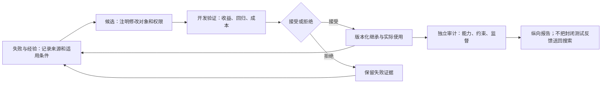

# 14｜RSI 综述全文更新：从“会改自己”到“可验证地改善改进过程”

> 检索截止：2026-11-09。本章为综述全文复核的独立增补，区分实际阅读版本、原始首发、修订和检索范围。延伸阅读：[研究综合](./12_RSI_Research_Synthesis.md)、[Harness 专题](./10_Harness_Focus.md)、[方法家族架构](./08_Family_Architectures.md)。页码统一指物理 PDF 页序；两篇 Preprints.org 文件含封面，因此比印刷页码大一。

## 1. 先交代读了什么，什么没有读

本次完整阅读六篇文件的 **387 个物理页**：三篇用户提供综述，共 200 页；另补三篇高度相关、可取得全文的近期安全与可信性综述，共 187 页。逐页提取后，以完整页组成有界阅读块，覆盖正文、图表提取文字、图注、附录及参考文献；另回看六个关键框架或实验边界页面的原始渲染。**没有把摘要、目录、截断输出或者参考文献中的引用当作已读全文，也没有复现论文实验。**

| 代号 | PDF 内核实的标题与标识 | 实际全文版本、页数 | 日期与版本边界 |
|---|---|---|---|
| A | AI4AI Survey: From Long-Horizon Agents to Recursive Self-Improvement—Definitions, Reliable Horizons, and Open Problems | DOI `10.20944/preprints202608.2108.v1`；63 页 | PDF 发布日 2026-08-28；远端后续版本是否存在未确认 |
| B | The Last AI Built by Humans: Toward Genuine Recursive Self-Improvement | `arXiv:2609.11873v3`；79 页 | 首投 09-10；v2 为 09-15；实际读的是 09-22 的 v3，不是文件名暗示的首版 |
| C | Recursive Self-Improvement in AI: A Survey | DOI `10.20944/preprints202609.2680.v1`；58 页 | PDF 发布日 09-30；主要文献检索截止 09-12，历史补充为 09-20 |
| T | Trustworthy Recursive Self-Improvement in the Era of Large Models: Foundation, Risks, Evaluation and Open Challenges | `arXiv:2610.35193v1`；82 页 | 首投 10-26；官方记录仅显示 v1；文献覆盖至 10-26 |
| E | Evolutionary Safety of Recursive Self-Improving AI: Taxonomy, Risk Discovery, and Evaluation | `arXiv:2609.31186v2`；25 页 | 首投 09-25；读的是 10-16 修订版，不能写成“10 月首次发表” |
| S | Safety in Self-Evolving Agents: A Survey | `arXiv:2610.00093v1`；80 页 | 官方首投记录与 PDF 边注均为 09-08；PDF 正文另写 October 2, 2026，存在未解决日期冲突 |

上述文件是预印本或综述稿，不因有 DOI、引文数量多、图表完整就自动获得同行评议地位。S 的编号月份、正文日期和首投记录不能互相替代；本文原样保留冲突，不擅自推定真实首投日。A 的系统检索冻结于 08-04、定向核验至 08-13；C 发布更晚，也不代表其覆盖了全部九月新工作。[A：附录 A，p25–27；C：§2.2，p7；S：p1、附录 A，p57–59]

**十一月的新发现需要分层报告。** OpenReview 的 *A Survey on the Self-Evolution of Large Language Models: From Self-Improvement to Recursive Self-Improvement*，标识 `tykR0clBMa`，搜索索引所呈现的官方页面记录为首发 10-12、修改 11-05。其摘要称以演化对象组织八个领域，包括提示与程序、数据、记忆、权重与推理、环境、评估、群体与研究过程、系统级 RSI。论坛访问遇浏览器验证，官方 PDF 和官方 API 也拒绝访问；未绕过验证，未用其他论文代替。因此它是**元数据与摘要级线索，不是本文的全文比较对象**。修改日也不能证明 PDF 内容何时改变。

检索还核实了十月二十日的 *Auditing the Product, Not the Recursion*（`2610.27610v1`）：这是一篇对评价证据进行全文编码的实证文献审计，而非广谱方法综述；本次只核验其官方摘要和版本记录。`2610.02996v1` 是范围更宽的可信 AI 演化计算综述，本次亦仅查元数据。七月的 `2607.07663v2`、三月首投的 `2603.25681v3` 都是相关综述，但九月修订不构成新的十月、十一月首投。

本次选择的是**可读全文且直接补足 RSI 可信性与继承风险的三篇近期综述**，不是声称穷尽所有相邻领域、严格列出全球最新三篇。十一月搜索返回的 RSI-Env、Recursa 等属于方法或环境论文，未拿来凑“新综述”数量。在可核验范围内，T 是本次完整读过、首投最新的专门可信 RSI 综述；不能据此断言十一月没有其他综述。

## 2. 更新后的核心认识：六个问题不能压成一个等级

更扎实的 RSI 解释，应当先问六件事：**改什么、依据什么改、谁有决定权、什么被保留、保留物如何影响下一轮、什么证据证明收益。** “无人干预跑了很多轮”只回答部分执行问题；“自己写了代码”只回答编辑来源；“分数上升”只回答某种测量结果。

A 把 AI4AI 定义为 AI 参与改善 AI 工件或其生产过程，范围比自我改善更宽。一个代理给另一个模型设计训练集可以属于 AI4AI，但不必改变自身。自身组件被修改，才进入自指；继任者生产机制成为可编辑对象，才进一步触及递归。运行闭环的所有权则是另一维：人可以审批一个自修改系统，系统也可以独立执行一个完全不改自己的研究流程。[A：§2.1–2.4，p6–12]

C 更强调“结构依赖”和“实证改善”的分离。修改过程确实返回下一轮，是结构性递归；返回之后能够更有效地制造继任者，是额外的经验性主张。B 同样区分 structural L5 和 effective L5。T 则把严格递归落在偏置更新函数的修订与复用上。这些定义不是完全同义，但共同反对把重复运行直接称为递归进步。[B：§3.6，p31–35；C：§3.1–3.4，p10–15；T：§2.1，p9–12]

因此需要保留三个层次的结论：当前系统变好；变好的能力跨任务、跨版本保留下来；生产下一次改进的方法也变好。前三者均可能失败，后者不能由前者自动推出。更强的“加速”还需要比较单位总成本的改善速度，并观察更长轨迹，不能用四个上升点外推无限增长。

## 3. 框架对照：不是谁替代谁，而是谁回答哪种问题

| 框架 | 基本单位与主要坐标 | 最适合回答 | 容易误用的地方 |
|---|---|---|---|
| A：AI4AI 五维 | 对象、自指、阶段所有权、反馈锚定、`G/R/H/T`；另列任务压力与可靠性 | 长程执行怎样组成一个可信改进 pass | 把所有权、压力、收益揉成“自主分数” |
| B：B0–L5 | 执行、策略、经验获取、部署适应、元改进责任的转移 | 哪项改进决策交给了 AI | 把 L5 当效果优于 L2，或将整家公司分级 |
| C：双目标、机制与证据 | 基础设施设计／现有系统修复；保留的 solver 与 improver 状态 | 该选哪个机制家族、如何隔离改进器贡献 | 把记忆、权重、代码当互斥层级 |
| T：`h/B/U` 与 S1–S4/RI | 策略、归纳偏置、偏置更新机制；诊断、提案、评估、实施 | 同一轨迹上是否同时保持收益、约束与监督 | 把某一文件类型固定映射到某个理论角色 |
| E：演化安全 | 五个变化领域；状态、更新、轨迹、谱系 | 风险如何保留、累积、传播，如何恢复 | 把同类后代失败直接当作已证实传播 |
| S：SAVER | 载体与适应操作配对，再追踪违反、暴露、响应 | 一条经验在哪一步变成越权的可复用影响 | 把分析箭头当真实事故必然时间顺序 |

A 的 `G/R/H/T` 分别是测得收益、保持、同预算人类比较、留出迁移，不是一项总分。其保持坐标还允许“后来轮次继续改善”，不能等同于逐项旧能力回放的严格无遗忘证明；“未报告”与“测试失败”也必须分开。B 的级别只针对具体配置与闭环。相同的反思、树搜索或强化学习，可以服务不同级别；技术名字不能决定自主性。[A：§2.1，p7；附录 B，p27–28；B：表2，p13]

C 的 solver/improver 是功能角色，可能共享同一模型或代码。T 更细分：执行任务的提示属于 `h`，选择训练轨迹的提示属于 `B`，修改这种选择方法的过程属于 `U`。因此同一技能文件，若教代理怎样完成任务，是执行知识；若教改进器怎样定位失败、选择实验，是改进知识。不能因为文件叫 `meta` 就认定它修改了更高一层。[C：§3.3，p12–14；T：§2.1.1，p10–11]

还有一个实质性定义差异。Promptbreeder 同时演化任务提示与突变提示，在 C 中是可编辑改进生产的一类机制；T 指出，突变提示可属于 `B`，而固定超突变程序仍属于 `U`，因此不能直接满足其最严格定义。它们并非事实冲突，而是评价边界不同。比较时应展示“哪些程序和状态确实改变”，再注明按哪个定义分类。

## 4. 理论根系：历史连续性不等于技术继承链

RSI 的理论根不始于 LLM。Gödel Machine 的原始 arXiv 首投为 2003 年，后有修订与书籍版本。其关键是：在给定效用与公理下，用证明支持软件重写，证明搜索器本身也可能被重写。它说明一种条件性自修改机制，而不是给经验性 LLM 搜索授予普遍最优保证。现代系统用执行测试和统计验证替代部分证明义务，换来工程可行性，也把保证变成任务、规格与测试覆盖条件下的经验结论。[C：§3.1，p11；T：p11；[原始记录][godel]]

AutoML 的根系是把模型选择、超参数和架构设计纳入反馈搜索。贝叶斯优化即使外层规则固定，也会更新搜索状态；NAS 的控制器可以学习怎样提出架构。不能把旧方法描述为完全不适应、现代代理描述为突然首次闭环。新增问题在于：搜索中获得的结果是否改善下一次搜索，能否在新起点与成本约束下重复获得优势。[C：p11–14]

元学习则把初始化、学习动态或更新规则变成可学习对象。2016 年 learned optimizer、2017 年 MAML 是不同的元学习路线：一个学习更新行为，一个学习容易适应的初始化。它们并不天然修订训练自身的外层算法。这个区分直接解释 T 为什么分开 `B` 和 `U`，也解释“训练了一个优化器”为什么尚不足以证明整个训练流程递归变好。[T：p10–11；[优化器][optimizer]；[MAML][maml]]

开放式演化提供另一组资源：种群、档案、跨环境迁移、可产生新难题的课程。POET 在 2019 年把环境与解的共同发展联系起来，重要直觉是保留不同探索路径和可迁移的踏脚石，而非坚持每一步都改善同一指标。LLM 扩大了自然语言与通用程序的编辑接口，但保留多样性、评估后代、验证迁移的义务并没有消失。[C：§3.1、§5.1，p11、18；[POET][poet]]

这些是机制层面的根系关系，不是“POET 生出 Voyager，Voyager 生出 DGM”的已验证引用血统。时间线用于看同类问题何时出现；证明继承，还需要作者明确关系、代码或算法复用、依赖记录等证据。C 的研究路线图明确提醒，枝线是研究家族而非技术祖先。[C：图4，p6]

## 5. 训练路线：从生成答案，到选择可学习经验

训练型自改善的核心不是“数据由谁写”，而是生成、筛选、训练和继承如何连接。STaR 把被答案正确性支持的推理轨迹回送训练；C 特别指出其迭代会从原始预训练模型重新微调，连续性部分存在于扩展的数据池中。由此不能看到“第十六轮”就推断是十六次连续 checkpoint 继承。[C：§6.1、表5，p21、25]

自奖励和元奖励把模型判断作为学习信号，减少部分逐样本标注，但不消除人类原则、种子数据、预训练知识与参考测量。生成器与判断器共享参数时，同一次更新可能既改善答案，也改变打分偏好。需要分别测 actor、judge 校准和反馈对后继训练的作用，不能以内部偏好更一致作为外部正确性更高的证据。[C：§6.4，p23；T：§3，p16–22]

可执行奖励使代码与数学成为较早产生可信局部收益的场景：反馈较快、明确，可以大量试验并筛选成功轨迹。但代码执行只证明某个程序在测试输入上的行为，证明检查只证明相对于形式规格的正确性。规格是否有意义、任务是否太容易、经验能否教会学习者、是否转移到新任务，仍是不同问题。

B 的 L3 将瓶颈从“怎样改”推进到“接下来学什么”。当前学习者的错误、能力和历史需要影响经验获取，经验又须产生持久更新，进而改变下一轮获取。一个固定选择算法也能实现这种学习者条件化；一个不断生成新数据的流水线却不一定实现它。最合适的消融不是强行让两组数据完全一样，而是冻结学习者状态输入或换成非自适应计划，同时匹配来源、交互和总预算。[B：§3.4，p22–26]

这条路线的因果趋势是：便宜反馈支持较密集实验，成功轨迹支持训练，能力改变使课程需要重估；不是“数据生成在前，所以课程方法都继承了它”。训练改善可能是知识内化，也可能主要提高已可达解的采样概率。必须注明推理预算，尤其不能用低采样预算的优势推导整个能力集合扩大。

## 6. 记忆与技能路线：持久不是有效，压缩不是无损

记忆让每次任务不再从空白状态开始，但经验记录、一般化教训、可执行技能是三种不同产物。记录保留具体条件；教训提炼规律；技能规定动作。规律提炼越强，越容易漏掉原先使它成立的条件。一个没有来源、日期、适用任务和失败例外的“经验”，可能只是被长期保存的猜测。[A：§5.2，p20；C：§6.2，p21–22]

B 将收益链拆得很清楚：提出有用修改，不等于执行代理能获益。相关技能可能没被激活，或者被加载却未被忠实遵循。因而至少分别检查生成质量、检索或激活、正确使用、下游效果。只记录技能库增量、文件数或 token 体积，会漏掉真正的瓶颈。[B：§3.5.2–3.5.4，p29–31]

Library Drift 的综述证据还提醒，库增长可能使检索变差、改进停滞；退役太激进同样可能损失好技能。应比较有证据的新增、合并、退役和重新验证，观察旧任务回放与新任务收益，而不是默认无限追加最有利。内容更新与管理算法更新也应分别消融：同时删掉内容和检索器，无法判断谁带来收益。

S 给这条路线补上关键安全含义：**允许存储，不等于允许成为指令；相关，不等于有权控制行动。** 某用户在一个项目中偏好简短回答，抽象成全局规定就是扩大范围；一次局部方便的操作被编译为技能，可能扩大权限。它不需要恶意原文，也不要求模型在最终调用中违反可见指令层级：边界可以更早在记忆合并或上下文重建时被改变。[S：§2.3、§4–5，p7、20–29]

## 7. Harness 路线：从组合能力，到修改组合方法

Harness 是围绕模型的执行循环、上下文管理、存储、工具接口、验证、恢复和停止规则。模型一次调用不会自动维持可复现工作区，也不会自动保存版本或判断是否回滚。A 的 composition gap 指出：浏览、编码、规划单项得分高，不足以保证这些环节在共享目标和状态下可靠组成一个改进过程。[A：§1、§3、§5，p3–5、12–16、19–21]

因此长程不该只计时长。A 的任务压力包括人类所需时间、依赖动作数、上下文需求、环境锚定、规划依赖与验证可观察性。它们不能互换；长时间等待训练不等于复杂依赖，多次独立采样也不等于状态耦合。一百万可分离步骤的成功，不自动覆盖每步都会改变后续条件的研究任务。

```math
R_{S,Q}(z)=\Pr[Y_Q(\tau)=1\mid Z=z]
```

这里 `S` 是声明的模型、Harness 与环境系统，`Q` 固定预算、重试、工具、评分与人工介入规则，`z` 是任务压力。公式重述 A 的条件可靠性概念，不是本次测得的可靠性。只换 Harness 或验证规则，可靠区域也可能变化；所以宣称模型扩展长程能力，至少要披露这些条件。[A：§2.3，p9]

编辑 Harness 有四种不同关系：人固定设计；外部优化器改善另一个代理；代理修改自身执行逻辑；改动进一步影响后续改进提案的生产。ADAS 和外部 Harness 搜索可以产生优质代理，但不能仅由“有 meta-agent”推出自指。DGM 允许后代代码自改，却仍有固定的档案与亲本选择；STOP 的可执行改进程序直接以自身源码作为对象，更明确暴露改进器返回路径。[A：§5.4，p21；C：§6.5，p23–24]

这条路线让可编辑对象从文本提示走向程序、接口和控制逻辑，也让风险扩大到证据采集链。候选者不改 scorer，但可以改日志、测试调用或产物来源，同样影响验收。因此保护独立评价不能只锁一个打分文件，还须覆盖相关观测、版本、预算与部署权限。

## 8. 元改进与评估路线：真正困难的是归因

元改进要求保留下来的方法真的参与下一次更新。改进器源码、提案策略、实验记忆、内部评价器或课程修改程序，都可能承载这种作用；名称本身不能证明因果关系。B 的 L5 要求记录哪项机制被修订、怎样继承、下一轮在哪里调用；有效 L5 还须证明更好的后继产出。[B：p31–35]

```math
\Gamma(B)=\mathbb{E}_{S^\star}\!\left[Q(S^+(I_t;S^\star,B))-Q(S^+(I_0;S^\star,B))\right]
```

这是对 C 配对改进器测试的简化解释：从相同留出起点 `S^\star` 出发，以相同后续预算 `B`，分别运行演化改进器 `I_t` 和原始改进器 `I_0`，用共同独立评价 `Q` 看各自产生的继任者。它隔离的是后续使用效果，不包括制造 `I_t` 的成本；整体效率还要另计发现、验证、训练和维护成本。[C：§3.4、§7.4，p14、30；T：§7.2，p46–47]

若改进器依赖新的记忆格式、工具接口或共享权重，直接交换可能把系统弄坏。应把必要依赖作为干预包，或者承認只能得到较窄的组件结论。不能让新改进器从更强起点开始、旧改进器从残缺代理开始，再把差距全算成元学习收益。

评价器演化尤其容易出现度量漂移。内部 judge 可以随系统改进，但还要保留独立参考；共同冻结工件在旧、新 judge 下重评分，可以拆分“系统变了”和“标准变了”。RQGM 的综述描述采用 epoch 内冻结、外部锚点校验替换，并重估受替换影响的分数；这支持受约束的动态评价，不是允许任意目标漂移。[B：§3.6.2，p33；E：§4.4，p15–16]

十月文献审计的官方摘要给出一个重要提醒：在其 26 篇声称更好改进程序的研究中，23 篇报告相关比较，只有 4 篇从相同初始工件、匹配预算比较新旧程序。本文未读该审计全文，因此不扩写编码规则或把比例外推到整个领域；T 的 p47 也引用这项结果。它说明产品评价与过程评价仍有距离，不说明其他研究都无效。[审计摘要][audit]

## 9. 新可信性综述改变了什么：安全是纵向验证，不是附加评分

T 的新增重点是把三个要求放在同一演化轨迹上：收益真实且持续，行为与系统约束继续成立，授权监督仍有效。四个主题是持续改善、行为约束与公平、系统安全与隐私、透明与可控；S1–S4 是过程位置，RI 是对更新机制本身施用这些阶段，不能混为一张单轴安全成熟度表。[T：§2.3、表3，p14–15]

E 的五个领域补充了载体与执行边界：持久代理状态、模型状态、评价与环境反馈、计算基底、元更新与共同适应。它进一步分开状态、更新、轨迹、谱系：当前配置安全，不代表一次接受的改动安全；连续接受的局部安全改动，也未必组合安全；多个后代出同类问题，尚需干预与来源记录证明是传播，而非共同暴露。[E：§3–4，p7–16]

SAVER 更适合追一个具体事件：某条观察进入记忆，被抽象成程序规则，后来被激活为行动依据，在哪里造成违反，哪种响应阻断了什么。它的价值在于区分“发现错误”“阻断一次调用”“删除源记录”“修复派生技能”“恢复后持续适应仍无复发”。没有这些边界，安全得分可能只是同一误差被不同术语重复计数。[S：§7–8，p36–50]

独立验证不是因为人类绝不会错，而是因为候选生成、选择与验收共享盲点时，系统可以把自己的错误当新证据。换一个提示、换一家模型、增加几个投票者，都不自动获得独立性；还须分析共同训练数据、暴露测试、候选访问权和共享测量通道。形式验证也只验证编码性质及其假设，不能取代用户意图、现实影响和规格有效性评估。

可信性还不能拼接：甲实验报告能力提高，乙实验报告安全，丙实验报告能停止，不能合成“一个 RSI 系统全程可信”。T 要求版本、任务与威胁条件对齐；若中间一代发生强制约束违反，即使首尾都通过，也不能说整条轨迹保持约束。[T：§7.3，p48–49]

一个可落地的分析流程如下，图是本文跨综述综合示意，不是某论文实际部署：



## 10. 负结果与限定条件必须进入主线

第一类是**会搜，但不会保持**。A 汇总 RSIBench-Data：58.33% 的设置超过首次有效尝试；继续越过最佳 checkpoint 的搜索中，78.26% 最终低于此前峰值。两个比例分母不同，不能相加，也不是“78% 的 RSI 都失败”。工程启示是分别报告最佳、最终、已部署版本，声明停止与选择规则。[A：§3.3，p15；表A15，p47]

第二类是**结构存在，但效率增益没有建立**。B 对 AIDE2 的公开披露综述记载：把演化 Harness 安装成外层改进器，没有建立统计显著的效率优势。Hyperagents 的更长继续实验也没有建立转移初始化的显著最终优势。C 对部分比较同样注明显著性与起点格式限制。这不是证明递归不可能，而是不能把有限样本或选中个例包装成可靠加速。[B：p33–34；C：p33]

第三类是**奖励增加，但探索变窄**。执行锚定 AI 研究的综述证据指出，直接按执行奖励训练提案器，平均奖励上升，却偏向简单模式而未提高最佳结果。目标函数质量、多样性与发现质量是不同测量；论文产量或流畅报告也不等于科学有效性。[A：p18、23；C：§5.4、§8.7，p20、35]

第四类是**同预算优势缩小或消失**。A 对 Harness 演化评估的概括指出，匹配反馈与推理预算后，它不稳定地优于测试时扩展，留出任务迁移也有限。应保留独立采样、固定改进器、简单管线等基线，而不是只和一个很弱初始代理比较。[A：p21；C：§7.4，p30]

第五类是**安全改善伴随不同时间范围的效用损失**。S 对 SkillMisevo-Bench 的综述拆开在线效用与后续复用效用：SafeEvolve 在线均值约 58.44% 至 58.00%，但 carryover 效用约 53.33% 至 40.67%。“在线只损失约 0.4 个百分点”不能被改写成“几乎无代价地保证安全”。这些是该研究配置的作者报告，非本文复现实验。[S：§8.3，p47]

第六类是**源移除不等于后代修复**。T 所述 Hyperagents 基准污染实验发现，不安全指令在干净基准继续演化后仍可保留；对漏洞显式施加惩罚的后续演化，在受测运行中移除了指令。但受改动对象是任务代理指令，不能因此声称实验已隔离更新函数自身修订的安全效果。[T：§5.4.1，p35]

模型坍塌同样要限定：不断替换真实数据的递归生成训练，与保留并积累真实和合成数据，是不同机制。稀有模式丢失、能力遗忘、目标漂移、探索收缩与安全退化不能全部叫“坍塌”；它们作用于不同状态，需要不同检查。[C：§8，p33–35；T：§3，p16–22]

## 11. 怎样选家族、分类和工程路线

分类建议是本文分析，不是修改既有正式目录。主类按照**直接改进对象与目标**确定，副标签记反馈、持久边界、自主责任与递归证据。普通仓库 patch 属于产品修复；编码代理自身 patch 属于代理改善；修改写 patch 的搜索程序再复用于下一轮，才额外标记改进器演化。一个项目可以跨类，但每个具体实验都应有明确边界。

| 观察到的瓶颈 | 优先路线 | 主要持久工件 | 最小决定性检验 |
|---|---|---|---|
| 经常忘记有效做法 | 记忆与技能维护 | 条件化经验、版本技能 | 重置后复用；含过期和冲突例子 |
| 能推理但工具组合失效 | Harness 修复 | 接口、状态与恢复逻辑 | 同模型对照完整轨迹，定位首次失效 |
| 已有经验未形成稳定行为 | 训练与蒸馏 | 参数、训练数据与配方 | 固定推理预算、旧技能回放、迁移 |
| 固定任务池学不到弱项 | 课程与环境获取 | 任务生成或选取状态 | 冻结学习者条件输入的同预算对照 |
| 提案反复停滞 | 改进器或研究策略 | 搜索规则、失败档案 | 相同起点的新旧改进器配对 |
| 指标上升却外部质量不升 | 评价与审计 | 锚点、版本、验收契约 | 共同冻结工件重评分与独立留出 |

更稳妥的实施顺序是：先声明目标与保护能力；建版本与成本记录；用便宜而可检验的局部修改找瓶颈；再考虑训练；最后只有改进过程本身有证据性限制时才开放元编辑。这不是所有项目的必经历史，也不表示 Harness 永远优于权重更新。便宜重试掩盖不了知识不足，训练也修不了丢失的权限来源或错误环境。

预算至少分开候选生成、训练、开发验证、环境执行、人工检查和独立审计；失败尝试也算。美元、GPU 小时和实体实验没有可靠换算时保留资源向量。昂贵改进器的复用可以摊销，但需要给出实际复用次数、每次适用范围与维护成本，不能把训练账单从图中删掉就叫高效。

路线升级应跟着证据走，而不是跟着名词走。先证明一次修改有效；再证明重置、迁移与旧能力保持；再证明新改进器从共同起点制造更好继任者；最后检查同一轨迹的约束和监督保持。授权与独立评价应扩大覆盖，却不应被系统自行删除来获得所谓更高自主等级。

## 12. 本次版本缺口与可成立的结论

全文比较采用 A/C 的本地 DOI v1、B 的 v3、T/S 的 arXiv v1、E 的 v2。B 的远端记录与实际版本一致；A/C 的后续版本情况因出版社访问受限而未知。S 日期冲突尚未解释。OpenReview 十一月修改稿和可靠自演化综述 `CGO1hDTHNe` 均未取得全文，不能给章节级判断，也没有以 Preprints.org 的可能同名稿替代。

还有一个重要的新旧差异：本次查到 Hyperagents 已在 2026-11-01 更新至 v2，而 C 等综述引用或讨论较早记录。本次仅查其官方版本历史，没有读取方法论文 v2，因此本文有关实验限制明确是综述所讨论版本的证据，不宣称仍完整描述新版本。要比较综述覆盖范围、方法首投日、最新方法修订日，必须保持三个时间字段。

本次最可靠的综合判断是：**持久状态已使经验能回到未来行为；可编辑的改进器已使未来更新规则成为实验对象；但任务收益、递归结构、改进效率与可信继承仍需要不同证据。** 理论提供条件，训练提供内化，记忆提供跨任务连续性，Harness 提供可执行组合，元机制提供改变未来搜索的接口，独立评价决定这些变化能否被可信地称为进步。

这不是已经建立自主无限增长，也不是已经证明这种增长不可能。研究目标应当收敛到可复查的问题：哪种保留物，在什么反馈与预算下，使后续改进更有效，持续多久，牺牲了什么，以及约束与人为纠正能力是否同时保持。

## 一手来源

- [A：Preprints.org DOI v1][a]；全文定位：§2 p6–12，§3 p12–16，§5 p19–21，附录 p25–47。
- [B：arXiv v3][b]；全文定位：§2 p7–12，§3 p12–35，§6 p46–49。
- [C：Preprints.org DOI v1][c]；全文定位：§3 p10–16，§4–6 p16–26，§7 p26–33，§8 p33–36。
- [T：arXiv v1][t]；全文定位：§2 p9–15，§3–6 p16–43，§7 p43–49，附录 p80–82。
- [E：arXiv v2][e]；全文定位：§2–3 p3–12，§4 p12–16，§6–7 p17–19。
- [S：arXiv v1][s]；全文定位：§2 p5–12，§3–7 p12–43，§8 p43–51，附录 p57–62。
- [十一月修改的 OpenReview 综述][openreview]：索引元数据与摘要级，全文访问受限。
- [十月评价证据审计][audit]：官方摘要与版本级，不是本次全文阅读对象。

[a]: https://doi.org/10.20944/preprints202608.2108.v1
[b]: https://arxiv.org/abs/2609.11873v3
[c]: https://doi.org/10.20944/preprints202609.2680.v1
[t]: https://arxiv.org/abs/2610.35193v1
[e]: https://arxiv.org/abs/2609.31186v2
[s]: https://arxiv.org/abs/2610.00093v1
[openreview]: https://openreview.net/forum?id=tykR0clBMa
[audit]: https://arxiv.org/abs/2610.27610v1
[godel]: https://arxiv.org/abs/cs/0309048
[optimizer]: https://arxiv.org/abs/1606.04474
[maml]: https://arxiv.org/abs/1703.03400
[poet]: https://arxiv.org/abs/1901.01753
