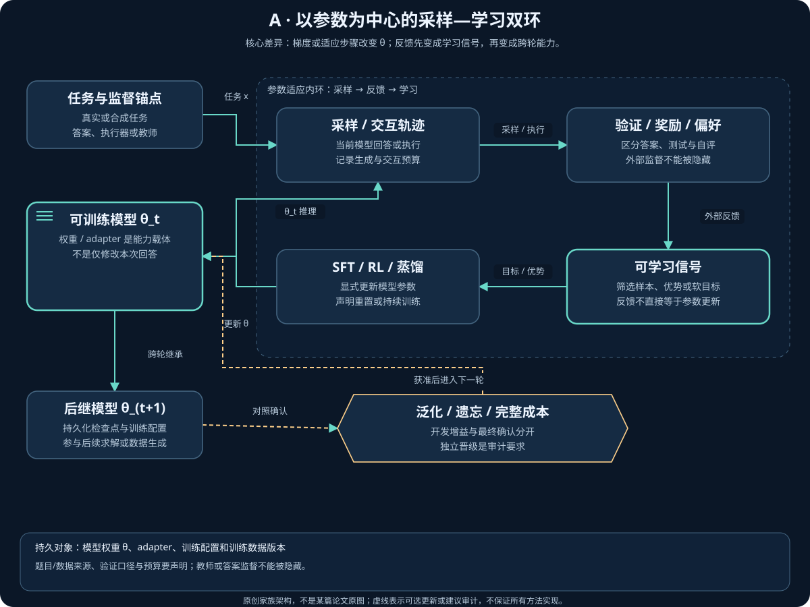
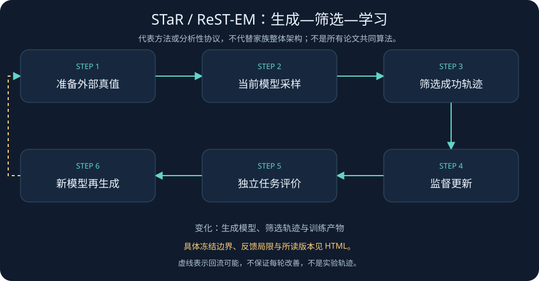
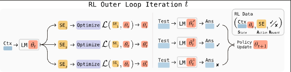
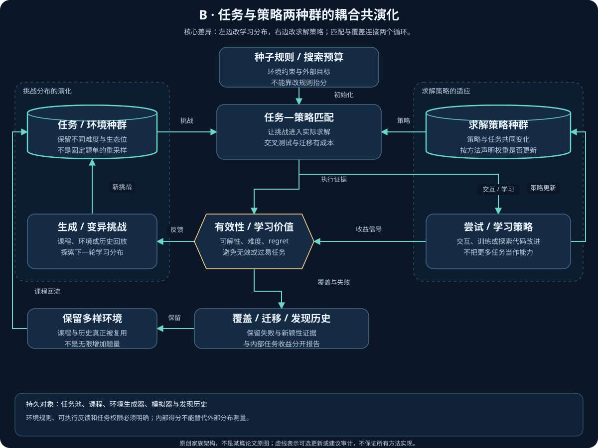
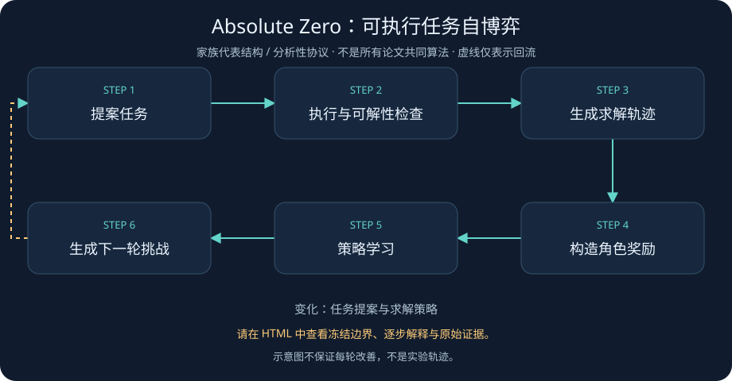
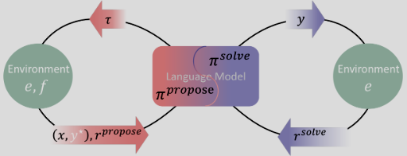

# 训练、环境与 AI 研究：递归发生在何处

> 阅读范围说明：本章保留专题作者截至 2026-11-05 的版本化阅读与审计记录；正文中的“本次／本轮”指该来源记录，不表示本次公开同步重新精读论文或独立复现。私有笔记原稿不公开，见[来源说明](../Reading_Notes_Provenance.md)；日期、近期入口与未决来源见[近期研究](../06_Latest_Year_Research.md)。

[返回 RSI 技术全景](../01_RSI_Technical_Panorama.md) · [方法地图与时间线](../03_Method_Map_and_Timeline.md)

本章讨论模型训练、任务与环境生成，以及 AI 参与 AI 研究时的改进闭环。核心问题不是系统是否反复运行，而是改进结果保存在哪里、由什么信号选择、是否改变下一轮改进的能力。

文献核验日期：2026-11-05。原始中文笔记仅作为检索线索；论文、作者仓库和机构页面才是事实依据。阅读范围与未核实内容在证据记录中单列。

A 家族的持久产物是可继续训练或部署的权重；B 家族的持久产物是后续学习会实际消费的数据、课程或可执行环境。二者可以耦合，但环境变难、技能库变大或搜索策略改变都不能单独证明基础模型被训练。下文保留既有 AI 研究案例，用来辨别训练产物与研究者交接；完整 F 家族分析由[元 RSI、评测与安全](04_Meta_RSI_Evaluation_and_Safety.md)承接。

## 1. 分析坐标：状态与闭环深度

以下是 RSI Atlas 的操作性分类，不是文献已经统一采用的等级标准，也不是“递归智能”的证明。

| 可变状态 | 含义 | 本章关注的问题 |
|---|---|---|
| A：训练权重 | 策略、生成模型或其他可训练参数 | 新权重改变做题能力，还是也改变数据生成与研究决策能力？ |
| B：数据、任务与环境 | 训练分布、课程、任务生成器、交互环境 | 难度与覆盖是否增长，任务是否仍可验证？ |
| C：记忆与技能 | 跨任务保留的经验、检索库、技能程序 | 经验能否在不同任务上产生增益？ |
| D：脚手架与工作流 | 工具路由、搜索、预算分配与执行控制 | 增益来自模型还是外部搜索？ |
| E：评价器 | 奖励模型、测试、裁判与选择规则 | 评价器变强，还是被优化对象学会迎合它？ |
| F：AI 研究与元改进者 | 选择假设、实验、训练方案与改进程序的组件 | 被改进的研究者是否真正接管下一轮研究？ |

| 深度 | 操作性定义 | 必须保留的证据 |
|---|---|---|
| L0：输出修订 | 修改当前答案、程序或候选，不跨轮保存能力变化 | 单次运行的候选与反馈 |
| L1：固定改进者下的持久适应 | 状态发生持久变化，但改进程序或决策者保持固定 | 更新前后状态、固定更新规则与独立测试 |
| L2：改进产物参与后续改进 | 新权重、数据、技能或系统组件进入下一轮改进过程 | 明确的回流路径、跨代谱系与受控对照 |
| L3：改进者本身改变 | 提出、选择或实施改进的机制发生变化并接管后续迭代 | 元改进者版本、交接记录、固定元改进者基线 |

同一项目可以同时包含不同深度的子循环。程序搜索中的候选更新，不自动等于研究策略更新；训练后的模型被部署，也不自动证明它改善了后继模型的训练过程。

### 1.1 一个便于审计的闭环表示

令 $S_t=(\theta_t,\mathcal D_t,\mathcal E_t,\mathcal M_t,H_t,J_t,U_t)$ 分别表示权重、数据、环境、记忆、脚手架、评价器与改进程序。以下是本章的分析性记号，而非任何一篇论文的原始公式：

$$
\widehat S_{t+1}=U_t(S_t;B_t),\qquad
S_{t+1}=\mathrm{Accept}_{J_{\mathrm{ext}}}(S_t,\widehat S_{t+1}).
$$

$B_t$ 是预算向量，包含推理、训练、候选执行与验证成本；$J_{\mathrm{ext}}$ 是预先约定的外部验收协议。接受规则可能回滚候选，不能默认为每次更新都算进步。
$t$ 是外层迭代编号，$\widehat S_{t+1}$ 是候选状态，$\mathrm{Accept}$ 是依据外部协议选择旧状态或候选状态的规则。这里的验收表示本章建议的分析接口，不是声称每篇论文都实现独立确认集。

如果只有 $\theta_t$ 变化，应先报告权重适应；如果新 $\theta_{t+1}$ 生成下一批训练任务，可讨论 L2；只有当改进机制 $U_t$ 的变化及其后续使用有证据时，才讨论 L3。

### 1.2 本章采用的证据规则

- 论文标题、项目愿景与系统架构只说明研究对象，不单独证明改进效果。
- 机制解释优先依据一手 HTML 论文中实际读到的章节；只读到摘要或页面片段时明确降低证据等级。
- 数值结果必须绑定版本、章节或表格、模型、预算、任务集合与选择规则。
- 不把更多推理、更多候选、更多训练或更强教师带来的增益直接称为“改进效率提高”。
- 不把训练期、开发期与隐藏测试期的反馈混为一谈；反复访问隐藏分数也会产生适应性泄漏。
- AI-for-AI 的可执行成果与开放式 RSI 的证据分别报告，不以名称替代闭环验证。

## 2. A 家族：模型与训练，从自生成数据到内生信号

### 2.0 核心机制、必要输入与分析性目标

<!-- family-a-architecture:start -->


[交互架构](../../../pics/family-a-architecture.html) · [六家族说明](../08_Family_Architectures.md)。把可用反馈转成跨轮保留的模型能力；关键是参数或训练配方真的变化，而不是本次答案被修改。 这是家族级原创架构；下方流程图是代表方法或参考协议，二者不互相替代。
<!-- family-a-architecture:end -->



[A 家族动态图与 repository 入口](../../../pics/family-a-flow.html)。图是本家族的分析性参考闭环，用来区分生成、反馈、参数更新和下一轮使用；其中的独立验收、冻结评测或回滚是审计建议，不表示本章每篇论文都实现了这些步骤，也不表示各仓库具有相同接口。

| 要素 | 最低要求 | 不能省略的归因问题 |
|---|---|---|
| 持久状态 | 基座或适配器权重、checkpoint 谱系；必要时保留优化器状态 | 新权重是下一轮生成者，还是只作为最后交付物？ |
| 生成输入 | 初始模型、题目或生成器、提示模板、采样预算 | 正确答案、教师或人工种子从何而来？ |
| 反馈输入 | 答案验证器、执行测试、偏好标注或特权教师分布 | 反馈是在判断输出，还是测量更新后的泛化收益？ |
| 更新输入 | SFT、偏好优化、RL 或蒸馏规则及训练预算 | 每轮重置、连续训练与 LoRA 适配不能混写 |
| 外部检查 | 与训练及选择用途分开的测试协议和成本账本 | 更多生成、更多训练、不同 harness 是否解释了收益？ |

下面是本文分析抽象，不是某篇论文的损失，也不是把 SFT、DPO 与 RL 当成同一实现。固定某轮任务分布时，一个带漂移约束的概念性目标为：

$$
J_A(\theta;\rho_t)=\mathbb E_{x\sim\rho_t,\,y\sim\pi_\theta(\cdot\mid x)}[R_t(x,y)]-\beta\,\mathbb E_{x\sim\rho_t}D_{\mathrm{KL}}\!\left(\pi_\theta(\cdot\mid x)\Vert\pi_{\mathrm{ref}}(\cdot\mid x)\right).
$$

$t$ 是外层轮次，$\theta$ 是待更新参数，$\rho_t$ 是题目分布，$x$ 是输入，$y$ 是完整输出，$\pi_\theta$ 是输出策略，$R_t$ 是本轮反馈，$\pi_{\mathrm{ref}}$ 是选定的参考策略，$\beta\geq0$ 控制漂移惩罚，$D_{\mathrm{KL}}$ 是 Kullback–Leibler 散度，$J_A$ 是这个分析目标。真实方法可能使用筛选后的似然、偏好对或 token 级教师信号，并不直接优化此式；参考策略的冻结或刷新也必须逐篇说明。

```text
state = initial_checkpoint
for round in training_budget:
	tasks = supplied_tasks_or_current_generator(state)
	trajectories = generate(state, tasks)
	feedback = verify_or_judge(trajectories, external_information)
	training_signal = construct_targets(trajectories, feedback)
	candidate = update(reset_base_or_current_state, training_signal)
	record(candidate, lineage, generation_and_training_cost)
	state = next_generator_or_delivered_model(candidate)
```

这段伪代码仅给出共同接口；是否重置、是否拒绝候选以及候选是否回流，取决于原方法。STaR/ReST-EM 把正确轨迹回流，SPIN 把旧策略变成对手，Self-Rewarding 把评分角色回流，OPD 的 DCE 刷新特权教师。比较时应冻结其余环节，再问是哪条回流带来增量收益。

### 2.1 STaR：答案监督没有消失，推理轨迹由模型补全

[STaR: Bootstrapping Reasoning With Reasoning](https://arxiv.org/abs/2203.14465) 将少量推理示例与已有题目、正确答案结合；自生成的是 rationale，而不是全部监督。
依照[作者论文 HTML 转换版 §3](https://ar5iv.labs.arxiv.org/html/2203.14465#S3)，当前模型先生成推理与答案，仅保留最终答案正确的样本。
对失败问题，rationalization 将正确答案作为提示，让模型反推解释；训练时删去这条答案提示，再学习该解释与答案。
用 $x$ 表示问题、$z$ 表示推理、$\hat y$ 表示生成的答案、$y^*$ 表示已知答案，可以把核心筛选概括为：

$$
\mathcal D_t^+=\{(x,z,\hat y):\hat y=y^*\},\qquad
\mathcal L_t(\theta)=-\mathbb E_{\mathcal D_t^+}\log\pi_\theta(z,y^*\mid x).
$$

这是对论文流程的简写，不意味着所有正确推理都可被当前采样找到，也不意味着答案正确能证明解释忠实。
原始 STaR 每轮用新模型生成数据，却从最初预训练模型重新微调，避免连续训练导致过拟合；持久改进通过数据与生成器交替继承。
因此它是 A↔B 的有界 L2 回流，而不是模型编写新的训练算法。
公平对照需固定题目、答案信息、生成次数和训练预算，并分别消融正确性过滤、答案提示与额外采样。
论文 §5–6 与附录 G 讨论偶然答对、错误解释和偏差放大；“正确输出可作监督”是工程假设，不是对推理过程的逻辑证明。

### 2.2 Self-Instruct：增长的是任务池，不必然是改进者

[Self-Instruct](https://arxiv.org/abs/2212.10560) 从人工种子任务出发，生成新指令、输入和输出，过滤重复与无效实例，再用于指令微调。
[§2.2–2.3](https://ar5iv.labs.arxiv.org/html/2212.10560#S2) 区分分类与非分类任务：前者先生成标签再生成对应输入，以减轻单类偏置；后者采用输入优先生成。
新任务进入池后会成为后续生成的提示示例，这是 B 状态的反馈；论文主流程不是每产生一批指令便更新生成模型权重。
所以可以识别任务池层面的 L2 回用，但不能据此声称已经验证多代权重递归。
相似度过滤主要控制重复，不能验证答案语义正确；覆盖面也受种子、生成器及预训练分布影响。
对照应同时看固定规模人工数据、同量自生成数据和更强教师重写的数据；最后一种是额外教师蒸馏，不应并入“纯自举”结果。
其[官方代码与数据](https://github.com/yizhongw/self-instruct)可核查生成流水线；原始 API 模型和微调服务的历史可用性仍限制今天的逐项复现。

### 2.3 ReST 与 ReST-EM：把采样与优化解耦

原始 [ReST，v2 §3、算法 1](https://arxiv.org/html/2308.08998v2#S3) 有两个不同频率的循环：Grow 从当前策略为给定输入生成多份输出；Improve 对这批输出评分、过滤并离线训练，可在不重新生成的情况下提高阈值、重复更新，然后才再次 Grow。给定输入 $x$ 与候选 $y$，过滤条件为 $R(x,y)>\tau$，其中 $R$ 是奖励模型，$\tau$ 是本次 Improve 的阈值。原始数据仍混入生成池，内层策略从前一个策略继续微调；数据复用摊薄了生成成本，但没有使训练和评分免费。

[§4、§6 与附录 A.4](https://arxiv.org/html/2308.08998v2#S4) 的主要实证是机器翻译，采用学习得到的、无需参考译文的 Metric X 奖励模型，而非数学答案的二元验证器。论文比较离线损失、Grow/Improve 次数、Best-of-N 和 PPO；报告的奖励模型排名与人工偏好排名并不一致，重复 Grow 可能越来越迎合奖励模型。因此“验证集奖励持续提高”不能直接写为“人类评价持续提高”。比较应同时控制生成量、离线更新量、奖励模型和推理候选数，不把复用数据等同于全系统等算力。

[Beyond Human Data: Scaling Self-Training for Problem-Solving with Language Models](https://arxiv.org/abs/2312.06585) 将方法命名为 ReST-EM；不要与原始 ReST 的具体训练调度混淆。
[§3](https://arxiv.org/html/2312.06585v4#S3) 的 E-step 在给定题目上采样，并用二元奖励筛选；M-step 对保留响应做监督训练，随后重新生成。
在理想化概率表达中，奖励倾斜分布为：

$$
q_{t+1}(y\mid x)\propto r(x,y)\,\pi_{w_t}(y\mid x),\qquad
w_{t+1}\in\arg\min_w D_{\mathrm{KL}}(q_{t+1}\Vert\pi_w).
$$

$w_t$ 表示当前模型参数，$r$ 是非负奖励，$q$ 仅在奖励加权概率质量为正时可归一化；实验使用答案校验或测试用例给出的二元反馈，题目来源仍是外部数据集。
采样期策略固定，更新期可复用采样结果，利于工程上的批量生成与训练解耦。
论文实际每轮也从原始基座微调；理想精确 EM 的单调下界不能当作有限采样、参数重置和 SGD 条件下测试准确率单调的保证。
[§5.1–5.3](https://arxiv.org/html/2312.06585v4#S5.SS1) 展示训练集进步与测试集饱和或回落可以并存，并比较更多单轮样本与多轮重采样。
这条路线减少人工解答轨迹需求，却没有取消奖励设计、题目收集、失败候选计算和验证成本。

### 2.4 SPIN：用旧模型作对手，不是两个无监督模型互相投票

[Self-Play Fine-Tuning Converts Weak Language Models to Strong Language Models](https://arxiv.org/abs/2401.01335) 的正例来自固定 SFT 目标，负例由上一轮策略生成。
依照 [§4.1，式 (4.7)](https://arxiv.org/html/2401.01335v3#S4.SS1)，令 $y^+\sim p_{\mathrm{data}}(\cdot\mid x)$、$y^-\sim\pi_t(\cdot\mid x)$：

$$
\mathcal L_{\mathrm{SPIN}}(\theta)=\mathbb E\log\left(1+\exp\left[-\lambda\left(\log\frac{\pi_\theta(y^+\mid x)}{\pi_t(y^+\mid x)}-\log\frac{\pi_\theta(y^-\mid x)}{\pi_t(y^-\mid x)}\right)\right]\right).
$$

$\lambda>0$ 控制相对旧策略的变化，旧策略兼任负样本生成器与参考分布；训练后策略成为下轮对手。
该 logistic 形式类似 DPO，但偏好对的来源不同：SPIN 不需要对每个新生成对追加人工偏好标签。
“不需要新增标注”不等于“不需要外部目标分布”；其理论结论依赖可实现性、损失条件与适当优化，见 [§5](https://arxiv.org/html/2401.01335v3#S5)。
更细的来源区别是：论文形式化常称 human data，而主实验使用的 UltraChat 目标本身包含模型生成对话，见 §6.1；应写“固定 SFT 目标”，而非笼统断言全为人工手写。
一个必要基线是在原数据上继续 SFT，并把自生成负例和重采样的成本计入；仅与少训练几轮的模型比较不能隔离自博弈机制。
该方法显示 A、B 的循环依赖，训练规则仍固定，按本章首先归为有界 L2。

### 2.5 Self-Rewarding LMs：评价能力进入学习环，但外部锚点仍在

[Self-Rewarding Language Models](https://arxiv.org/abs/2401.10020) 同时训练指令响应与 LLM-as-a-Judge 能力，利用自身生成候选的评分构造偏好对，再做迭代 DPO。
[§2](https://arxiv.org/html/2401.10020v3#S2) 从 IFT 指令数据及 EFT 评价示例暖启动，下一轮既生成响应也提供奖励，因此存在 A↔E 回流。
EFT 的解释与分数不是直接全由人工书写，而是模型生成后按人类排序一致性筛选，见 [§3.1.1](https://arxiv.org/html/2401.10020v3#S3.SS1.SSS1)。
主实验的提示池由固定 Llama 2-Chat 生成；随迭代变化的是响应生成与评分模型，见 §3.1.3 与附录 A.5。
同节还用 Claude 2 验证表现选择早停点；所以“奖励来自自身”不等于端到端完全没有外部选择信号。
评价器变得更符合保留的人类排序，是局部质量证据；不等于系统自行发现了更真实、更广泛的价值标准。
论文 [§6](https://arxiv.org/html/2401.10020v3#S6) 明确讨论响应长度增长、奖励投机和训练裁判与最终裁判虽不同仍可能共享偏差。
本章将已核验结果记为 A、B、E 的有界 L2 耦合；是否上升到更强元改进，应另测评价机制的变化和跨代有效性，不能从自评分变高直接推导。

### 2.6 DeepSeek-R1：固定可验证目标上的 RL 是能力训练，不是研究自治

[DeepSeek-R1](https://arxiv.org/abs/2501.12948) 的原始报告中，R1-Zero 从 DeepSeek-V3-Base 直接进行 RL，省去作为前置步骤的推理 SFT。
其[§2.2](https://arxiv.org/html/2501.12948v1#S2.SS2) 仍依赖任务分布、最终答案或预定义测试，以及人为规定的格式奖励。
GRPO 通过同题候选奖励估计相对优势 $A_i=(r_i-\bar r)/\mathrm{std}(r)$，其中 $r_i$ 是候选奖励、$\bar r$ 与标准差在同题组内计算；再结合策略比率裁剪与 KL 约束更新。这是非零方差组的优势简写，不是完整损失。
组内全对或全错可能使任务缺乏相对信号，这为后续主动任务生成提供动机；并不说明所有 RL 实现都在这些组上有相同处理方式。
R1 正式流水线还包括冷启动、推理 RL、拒绝采样生成 SFT 数据以及更广任务上的后续 RL，不能用 R1-Zero 概括全部。
蒸馏版本在原报告中主要接受教师生成数据的 SFT，不能把蒸馏成绩称为小模型从零自主研究的成果。
R1-Zero 的直接 RL 子过程主要是 A/L1；R1 的模型输出回流为训练数据可形成有界 L2 连接，但训练配方仍由研究者定义。
可验证任务的提升也不能外推到无确定答案的科研品味、目标形成或长期自治；[论文 §5](https://arxiv.org/html/2501.12948v1#S5) 另列一般能力和工程任务上的限制。

### 2.7 SEAL：奖励的是“编辑后学会多少”，不是编辑文本看起来多好

<!-- paper-figure-seal:start -->


原论文 Figure 1（v1），[作者原文及图注](https://arxiv.org/html/2506.10943v1#S1.F1)；[CC BY 4.0](https://creativecommons.org/licenses/by/4.0/)。Zweiger, Adam；Pari, Jyothish；Guo, Han；Akyürek, Ekin；Kim, Yoon；Agrawal, Pulkit。裁取原论文 HTML 图形区域并转换为 PNG，未重绘或改写图内内容；完整图注另见原文。自编辑生成、内层参数适应和下游评价连接成外层学习环；不把每种模型训练方法都等同于 SEAL。
<!-- paper-figure-seal:end -->

[Self-Adapting Language Models / SEAL](https://arxiv.org/abs/2506.10943) 首次提交于 2025-06-12；采用 2025-09-18 的 [v2 §3–5](https://arxiv.org/html/2506.10943v2#S3)。它把数据生成与参数适应嵌套起来：模型读取新上下文，生成 self-edit，内层以该编辑提供的数据或工具配置做 SFT，外层用**更新后的模型**在对应任务上的表现训练编辑生成策略。知识任务的编辑是可学习的推论或重述；few-shot 任务的编辑还可指定预定义数据增强、学习率和训练设置。

必要输入不只是一段无标签文本，还包括基座、允许调用的更新工具、每次适应预算，以及训练编辑策略时与上下文配对的评测问题和答案。以下是对原式 (1)–(4) 的本文分析性重记：

$$
\theta'(e)=\mathrm{SFT}(\theta,e),\qquad
J_{\mathrm{edit}}(\theta)=\mathbb E_{(C,\tau)\sim\mathcal D,\,e\sim\pi_\theta(\cdot\mid C)}[R(\theta'(e),\tau)].
$$

$\theta$ 是编辑生成前的模型参数，$C$ 是新上下文，$\tau$ 是配对下游评测，$\mathcal D$ 是这类配对的训练集合，$e$ 是生成的编辑，$\pi_\theta$ 是编辑生成分布，$\theta'(e)$ 是内层适应结果，$R$ 是适应后的评测奖励，$J_{\mathrm{edit}}$ 是期望奖励。实际外层采用 ReST-EM 式筛选行为克隆，并对依赖当前参数的奖励停止梯度，不是穿过全部内层训练做端到端元梯度。模型改变后，旧 self-edit 的收益也可能改变，所以论文强调在当前模型上重新生成并评估。

```text
for context, training_evaluation in adaptation_tasks:
	edits = current_model.generate_self_edits(context)
	for edit in edits:
		adapted = inner_sft(copy_of_current_model, edit)
		reward[edit] = evaluate(adapted, training_evaluation)
	retained = select_by_domain_protocol(edits, reward)
	current_model = reinforce_edit_generation(current_model, retained)
```

伪代码是本文归纳。各候选内层适应分开评估，不能把它们误写成全部合并到同一条连续知识更新链；知识实验附录 B.2 按多 seed 平均后的最佳编辑筛选，也不等同于笼统保留全部正奖励样本。跨时间保留知识的连续编辑是另一个实验，§5 报告仍有灾难性遗忘。

| 作者报告的结果 | 版本、基准与预算 | 解释边界 |
|---|---|---|
| 单段知识吸收：原文训练 33.5%，未训练编辑生成器的合成数据 39.7%，SEAL 47.0% | [v2 §4.2、表 2；附录 B.2/B.4/B.5](https://arxiv.org/html/2506.10943v2#S4.SS2)；Qwen2.5-7B；200 段、974 道 no-context SQuAD 问题；外层两轮，每轮 50 段、每段五编辑、各三 seed；每轮 750 次内层更新，约六小时、两张 H100 | 测的是更新后不带原文的问答，不是无外部文本学习；GPT-4.1 同时用于答案评分，完整成本不只包含模型训练 |
| ARC 子集：未训练编辑策略 20%，SEAL 72.5% | [v2 §4.1、表 1；附录 A.1–A.4](https://arxiv.org/html/2506.10943v2#S4.SS1)；Llama-3.2-1B-Instruct；训练 11 题、每题 15 编辑；八个预筛选保留任务各五编辑，共 40 配置；剔除超过 375 训练步的配置 | 分母是配置，不是完整 ARC；题目已按基座能否在合适 TTT 配置下解决筛选；单 GPU 类型为 A100/H100/H200 之一，不是统一硬件总成本对照 |

SEAL 改变了 A，也训练了如何构造 B 与局部更新指令；但工具集合、外层训练规则和目标仍由人规定。它比只按文本表面质量筛选更接近“测量实际学习收益”，同时付出每个编辑都需训练及评测的开销。[§5](https://arxiv.org/html/2506.10943v2#S5) 明确指出显式下游监督限制了向无标签语料扩展；不能将这些有限适应实验写成无监督无限自改进。

### 2.8 TTT-Discover：为当前发现任务训练，不以通用后继模型为交付物

[Learning to Discover at Test Time / TTT-Discover](https://arxiv.org/abs/2601.16175) 首次提交于 2026-01-22；采用 2026-02-05 的 [v2 §2–3](https://arxiv.org/html/2601.16175v2#S3)。它与 Dream-RSI 的关键区别是确实用当前任务的执行结果更新策略适配器。必要输入是单个问题描述、初始策略、候选解或空起点、有效性检查和连续奖励；经验档案保存已有解，PUCT 式状态复用决定从哪条解继续生成，新的执行结果既更新档案又形成在线训练信号。

目标不是所有输出的平均质量，而是在有限发现预算内得到一个最优候选。§3.2 的 entropic objective 对高奖励结果做指数倾斜，按初始状态自适应控制权重集中程度；附录 A.1 的 KL 预算约束的是这种样本重加权，不能误读为每次实际神经网络更新都获得相同强度的全局保证。状态复用使用子结果的最大分数并保留探索奖励，不是只沿当前最高分路径贪心修改。

[§3.3、§4、§4.5](https://arxiv.org/html/2601.16175v2#S3.SS3) 报告 gpt-oss-120b、rank-32 LoRA、50 次训练更新、每次 512 rollouts；正文据此与 Best-of-25,600 和同采样量的 OpenEvolve 比较，并分别冻结训练或状态复用做消融。生成次数相同仍不等于总成本相同，OpenEvolve 还受到长提示截断影响。约 500 美元是作者基于特定平均输入/输出长度估算的 Tinker 费用，不包含所有候选执行、硬件评测和研究成本。HTML 图 4 图注的总样本数多写了一个零，与正文和乘积不一致，本章采用 §3.3/§4 的明示预算，不据错误图注扩大预算。

论文明确目标是解决这个问题而不是向其他问题泛化；数学构造、内核运行时、竞赛隐藏测试和单细胞去噪分别需要不同验证。部分领域得到新结果并不等于所有尝试都突破旧纪录，§4.1 对未突破的情形也有报告。§6 将稀疏、二元和不可验证奖励列为后续方向。这是任务内 A 与经验档案回流的证据，不是已经产生通用、持续更强的自主研究者。[作者代码](https://github.com/test-time-training/discover)在本次未执行。

### 2.9 从 OPSD 到 DCE：特权上下文与教师刷新是两个设计轴

[Self-Distilled Reasoner: On-Policy Self-Distillation for Large Language Models](https://arxiv.org/abs/2601.18734v1) 的 v1 提交于 2026-01-26。本节读历史初版 [§3–4、§7、§8.1](https://arxiv.org/html/2601.18734v1#S4.SS1)，用于解释本章 §6.1 的前驱，不声称已核验三月后的全部修订。学生只看问题并生成自己的前缀；同基座的教师分支另看参考解，在这些相同前缀上给出下一 token 分布；逐 token 散度只对学生分支回传梯度。数据仍需要经验证的题解，教师自身也必须足以理解参考解。

需要把概念与配置分开：§3 用共享模型的两种条件分布形式化，§4.1 的实际实验明确把教师固定为**初始策略**以稳定训练。原始配置默认采用完整词表的 JSD，而九月 DCE/SRCL 论文主要采用 Forward KL 并刷新教师；“on-policy”首先指轨迹由当前学生产生，不自动意味着教师同步更新。完整 logits 与只在采样 token 上给 log-ratio 信号也不是同一种损失或显存开销。

原始 [§4.2、图 3，§8.1 表 5–6](https://arxiv.org/html/2601.18734v1#S4.SS2) 的 4–8 倍效率表述指特定 Qwen3-4B 对照中的生成 token 预算：OPSD 每题一条 rollout、训练生成上限 2,048；GRPO 每题八条、图 3 上限 16,384。其评测使用 thinking、Average@16 和 38,912 输出上限，训练为八张 A100、LoRA。它不能与九月论文非 thinking、Average@12、32K 的主表直接相减，更不能把抽样效率等同于总 FLOPs 节约。九月论文中的 OPSD 数值是该文自身协议的基线，而不是这里原论文表 2 的数字。

### 2.10 分类边界：TRM 与 recurrent depth 的递归主要发生在一次推理内

原 overview 中的 [TRM / Less is More，v1](https://arxiv.org/abs/2510.04871v1) 和 [Recurrent Depth，v2](https://arxiv.org/abs/2502.05171v2) 本次只读原始摘要与 submission history，未精读方法或复核其基准数字。摘要分别研究小网络的递归推理，以及通过重复 recurrent block 增加潜在空间计算；这与本章的跨轮持久改进是不同轴。

本文可用 $h_{j+1}=f_\theta(x,h_j)$ 示意网络内迭代：$x$ 是当前输入，$h_j$ 是第 $j$ 次迭代的隐状态，$f_\theta$ 是参数为 $\theta$ 的共享计算模块。该式是分析示意，不是两篇论文的原公式。即使更深迭代改善当前答案，也没有据此证明跨任务更新了权重、训练分布、评价器或改进程序。架构可以通过常规训练获得能力，也可能被未来 RSI 系统采用；**仅有 recurrent depth、重复前向或 recursive 名称，不能直接计为 RSI**。两条记录以边界资料单列，不混入本章机制时间线。

## 3. B 家族：数据、任务与环境，谁产生下一轮挑战

### 3.0 核心机制、必要输入与分析性目标

<!-- family-b-architecture:start -->


[交互架构](../../../pics/family-b-architecture.html) · [六家族说明](../08_Family_Architectures.md)。让下一轮的学习分布也成为可改进对象；同时维持可解性、覆盖与反馈可靠性，而非只把题目变难。 这是家族级原创架构；下方流程图是代表方法或参考协议，二者不互相替代。
<!-- family-b-architecture:end -->



[B 家族动态图与 repository 入口](../../../pics/family-b-flow.html)。图是本家族的分析性参考闭环，不是所有论文共同实现的流水线；独立盲测、回滚、反作弊和数据隔离节点表示建议的审计边界，不能据图声称某方法已经完成这些验证。

B 的持久状态可以是筛选后的数据池、带来源的任务档案、课程采样权重、生成器参数或环境程序。只有它改变了后续训练或探索的实际分布，才构成持久回流；一次对话临时出题不够。生成器可以是固定模型，学习者也可以不更新权重，所以 B 不必伴随 A。

必要输入包括种子或任务语法、可执行环境及资源限制、可用反馈、当前学习者、生成预算和保留规则。Self-Instruct 需要种子与去重，POET 需要环境编码和最小可解标准，PAIRED 需要两个求解策略的回报差，AZR 需要程序执行与任务有效性检查。不同输入决定了“自生成”究竟替代哪一种人工劳动。

理想上应选择能改善学习者而不只是让它失败的任务。以下双层目标是本文分析抽象，不是这些方法都求解的论文公式：

$$
J_B(\phi;\theta)=\mathbb E_{\tau\sim q_\phi}\!\left[Q_{\mathrm{val}}\!\left(\mathrm{Update}(\theta,\tau)\right)-Q_{\mathrm{val}}(\theta)-\lambda C(\tau)\right].
$$

$\phi$ 是任务生成或采样器的状态，$q_\phi$ 是其任务分布，$\tau$ 是任务，$\theta$ 是当前学习者参数，$\mathrm{Update}$ 是给定预算的训练操作，$Q_{\mathrm{val}}$ 是开发验证分数，$C$ 是生成、执行与学习的成本，$\lambda\geq0$ 是成本权重，$J_B$ 表示期望净学习收益。若每次更新后重测代价过高，实际方法使用成功率、regret、新颖度或奖励差等代理；这些代理不等于已测得真实学习增益。最终确认集不能再充当这里的开发验证器。

```text
archive = seed_tasks_or_environments
for round in generation_budget:
	proposals = generate_or_mutate(archive, learner_feedback)
	valid = check_solvability_execution_and_provenance(proposals)
	candidates = score_learning_proxy_and_diversity(valid, learner)
	selected = retain_under_budget(candidates, archive)
	learner_feedback = train_or_explore(learner, selected)
	archive = version_with_outcomes(archive, selected, learner_feedback)
```

这是数据、课程和环境路线的共同分析接口，不意味着每种方法都做神经训练。对于回放模拟器或冻结模型的环境探索，应把持久状态写为搜索历史、课程或记忆，并连接[技能与 Harness](03_Agent_Skills_and_Harness.md)；不能用上式暗示其基础模型参数发生变化。

### 3.1 POET：同时维护挑战、解法与跨环境迁移

[POET](https://arxiv.org/abs/1901.01753) 维护环境–策略配对群体，交替变异环境、优化配对策略并尝试跨环境迁移。
[§3 与补充 §6.1–6.2](https://arxiv.org/html/1901.01753v3#S3) 的 minimal criterion 排除对当前策略过易或过难的新环境，新颖度控制保留的挑战是否足够不同。
直接迁移测试其他环境的现成策略；proposal transfer 先在目标环境做一次优化，再比较是否值得替换。
价值不在于保证每条路径都越来越难，而在于允许一个分支学到的行为成为另一个分支的有效起点。
原论文的内部策略优化器是固定 ES，环境表示也由人设计；因此 A、B 相互推动不等于学习规则自身可编辑。
[§4.3](https://arxiv.org/html/1901.01753v3#S4.SS3) 的对照包括直接优化、朝目标推进的课程和取消迁移的 POET，但其成本口径与事后选择目标环境的方式都必须一并阅读。
特别是路径课程对照匹配的是到达目标的祖先路径优化开销，不能直接改写为涵盖整个人群探索成本的全系统等算力实验。
[§5](https://arxiv.org/html/1901.01753v3#S5) 明确承认环境参数上界和固定身体限制；“open-ended”在这里是研究方向与有限实验性质，不是已证明无限增长。
POET 提供 B 与 A 的有界 L2 例子，也提醒 LLM 训练研究：只保留当前最强策略可能丢掉未来有用的多样性。

#### 3.1.1 PAIRED：找“另一个策略能做、当前策略还不会”的环境

[PAIRED，v2 §3–4](https://arxiv.org/html/2012.02096v2#S4) 的输入是人定义但参数尚未指定的环境族。环境 adversary 产生障碍、目标位置或外力等参数；protagonist 是要训练的学习者，antagonist 提供该环境可达到的回报参照。生成器追求两者的 regret 差，而非单纯让 protagonist 失败，从而减少把课程推向双方都做不到的区域。

将 §4 的有限采样近似改记为：

$$
\widehat r_{\mathrm{adv}}(e)=\max_{\xi\in\mathcal T_A(e)}G(\xi)-\frac{1}{|\mathcal T_P(e)|}\sum_{\xi\in\mathcal T_P(e)}G(\xi).
$$

$e$ 是一次生成的环境参数配置，$\mathcal T_A(e)$ 与 $\mathcal T_P(e)$ 是 antagonist 和 protagonist 在同一配置中的非空轨迹集合，$\xi$ 是轨迹，$G(\xi)$ 是其折扣回报，$\widehat r_{\mathrm{adv}}$ 是环境生成器的样本奖励。它是“已采到的最佳对手”减“学习者均值”，不是已知全局最优策略减当前策略；双方都失败时的零差也不能证明环境不可解。

算法顺序为生成环境、两策略分别 rollout、估计 regret、更新生成器与求解策略，再生成下一批环境。持久变化包含 B 的生成分布与 A 的策略；三方优化程序仍固定。§4 的 minimax-regret 理论需要 Nash 均衡及对手与生成器的联合最佳响应，不能推出有限 PPO 训练必然收敛或每个样本都有可解性证明。

[§5.1 与附录 E/F](https://arxiv.org/html/2012.02096v2#S5.SS1) 比较随机环境、minimax、群体 minimax 和 PAIRED，并在未用于训练的手工迷宫测试迁移；共享超参数按相同搜索方式调优，但没有据此证明三方训练与两方基线总算力完全相等。群体 minimax 只是作者在导航域对 POET 的近似参照，不是原版 POET 的直接复现。复杂度实验与迁移实验采用的 agent 奖励和选参规则也不同，不能把所有消融拼成一条单调曲线。[作者实现入口](https://github.com/google-research/google-research/tree/master/social_rl/)由论文直接给出，本次未运行。

### 3.2 Absolute Zero：任务分布也由学习者产生

<!-- paper-figure-absolute-zero:start -->


原论文 Figure 3（v2），[作者原文及图注](https://arxiv.org/html/2505.03335v2#S2.F3)；[CC BY 4.0](https://creativecommons.org/licenses/by/4.0/)。Zhao, Andrew；Wu, Yiran；Yue, Yang；Wu, Tong；Xu, Quentin；Yue, Yang；Lin, Matthieu；Wang, Shenzhi；Wu, Qingyun；Zheng, Zilong；Huang, Gao。裁取原论文 HTML 图形区域并转换为 PNG，未重绘或改写图内内容；完整图注另见原文。任务提案经环境校验后产生可求解问题，提案与求解两种角色共同学习；它是任务自博弈的具体实现，不代表全部环境生成方法。
<!-- paper-figure-absolute-zero:end -->

[Absolute Zero: Reinforced Self-play Reasoning with Zero Data](https://arxiv.org/abs/2505.03335) 的首次提交日为 2025-05-06，训练系统称 Absolute Zero Reasoner，简称 AZR。
[§2–3](https://arxiv.org/html/2505.03335v1#S3) 用同一模型承担 proposer 和 solver；Python 执行器验证任务并提供解答判据。
对程序、输入、输出三元组 $(p,i,o)$，deduction 给定 $(p,i)$ 求 $o$，abduction 给定 $(p,o)$ 找一个可行输入，induction 根据部分输入输出例子构造程序。
逆向求输入不要求还原唯一原始输入，只要求执行后输出一致；归纳任务必须保留未展示测试，防止仅记忆可见例子。
论文 [§3.1，式 (4)](https://arxiv.org/html/2505.03335v1#S3.SS1) 的 proposer 学习性代理为：

$$
r_{\mathrm{propose}}(\tau)=
\begin{cases}
0,&\hat p_{\mathrm{solve}}\in\{0,1\},\\
1-\hat p_{\mathrm{solve}},&0<\hat p_{\mathrm{solve}}<1.
\end{cases}
$$

$\tau$ 是 proposer 产生的候选任务，$r_{\mathrm{propose}}$ 是该任务的提案奖励，$\hat p_{\mathrm{solve}}$ 是有限 solver 采样的成功比例；它奖励仍可偶尔解出的困难任务，不是直接测量训练后的真实泛化增益。
有限采样的全失败不能证明任务不可解，全成功也不能证明没有任何学习价值；这个奖励只是可计算课程信号。
任务格式、确定性检查、执行权限和资源边界仍由实现者规定，代码执行环境不能因为“可验证”就被当成安全沙箱证明。
“零外部数据”应限于该自博弈后训练阶段不用人工策划任务集，不能抹去预训练基座、提示模板、任务模式与初始化先验。
附录 D.5 还讨论全局变量可能携带答案信息及保留它们的取舍；生成任务内部的捷径与公共测试集污染是不同问题，都需要审计。
AZR 的 A↔B 回流比固定题库 RL 更明显，但环境语义和训练机制仍有边界；这不是任意真实世界领域都能无监督自进化的证据。

### 3.3 合成数据、课程与环境演化的对照

| 路线 | 自生成对象 | 仍由外部提供 | 最易混淆的结论 |
|---|---|---|---|
| STaR / ReST-EM | 解答或推理轨迹 | 题目与正确性判据 | 没有人写推理不等于没有监督 |
| Self-Instruct | 指令、输入与输出 | 种子、生成模型与过滤规则 | 任务池迭代不等于权重逐轮改进 |
| SPIN | 旧策略响应 | 固定 SFT 目标分布 | 自博弈不等于无外部正例 |
| Self-Rewarding LM | 响应与偏好信号 | 种子、人写 rubric、部分生成与验证组件 | 同模型做裁判不等于评价器独立 |
| R1-Zero | 任务内推理与响应 | 任务分布、答案或测试 | 无前置 SFT 不等于无数据 |
| AZR | 课程任务与解答 | 预训练知识、程序语义、验证器 | 后训练零数据不等于从零知识起步 |
| POET | 环境参数与配对策略 | 环境编码、奖励与优化器 | 有界多样化不等于无限开放式增长 |
| PAIRED | 面向当前学习者的环境分布 | 未指定参数的环境族、可执行反馈与对手策略 | 样本 regret 不是全局可解性证明 |

共同的检查不是“有没有循环”，而是新任务是否可验证、是否覆盖新能力、是否比固定课程在同预算下更有价值。
真正扩展训练分布应同时报告成功任务覆盖、失败类型、生成任务退化率与独立目标分布表现，而非只展示越来越复杂的字符串或代码。

### 3.4 Dream-RSI：增长的是回放世界，更新的是探索策略代码

[Dream-RSI](https://arxiv.org/abs/2609.14858) 首次提交于 2026-09-14；这里采用 2026-10-06 的 [v2 §2–5、附录 B/D](https://arxiv.org/html/2609.14858v2#S3)，不混用早期版本的实验表。它是 B 与 D/F 交界的案例，不是基础模型训练：历史发现树构成持久回放池，探索策略代码决定开新分支、深化分支、并发与停止；论文 §3 明确固定模型、评价器和执行接口。

必要输入是初始策略、固定 discovery agent、可执行且评分方向一致的任务、工作区快照、完整父子谱系与执行记录，以及在线和回放预算。在线每次从父节点快照生成并执行新候选；回放只揭示历史树中已经记录的子节点，既不调用基础 agent 重做候选，也不会推断未出现分支的结果。因此这里的“world”是已实现搜索空间的经验模拟器，不是能任意生成反事实的神经世界模型。

依据 §3，在线和离线共用选择根节点或当前叶节点的批次接口；回放策略只能看已经揭示的前缀。策略开发者读取回放轨迹及分数，再修改可执行控制策略；附录 D.2 禁止把未揭示分数、获胜节点编号或完整 trace 偷渡进运行策略。权限约束写进提示，不等于已经证明无信息泄漏。

```text
history = completed_discovery_trees
policy = initial_exploration_code
for cycle in online_budget:
	tree = online_discovery(frozen_agent, policy, fixed_evaluator)
	history = append_completed_tree(history, tree)
	versions = [policy]
	for revision in replay_budget:
		feedback = replay_prefix_only(versions[-1], history)
		versions.append(revise_policy_code(frozen_agent, feedback))
	policy = best_replay_version(versions, history)
```

这段是本文对论文流程的伪代码抽象，不是可直接运行的作者实现。论文式 (1) 用归一化质量–调用量 Pareto 超体积减去顺序轮数/调用量惩罚，在不同预算偏好下评价策略；它不是基础模型的 RL loss。版本选择可以简写为：

$$
\pi_{t+1}\in\arg\max_{\pi\in\mathcal P_t}\widehat V_{\mathcal H_t}(\pi),\qquad \pi_t\in\mathcal P_t.
$$

这是本文记号简写：$t$ 是在线轮次，$\pi_t$ 是当前探索代码，$\mathcal P_t$ 是含当前代码的候选集合，$\mathcal H_t$ 是截至该轮的历史树池，$\widehat V$ 是该池上的平均回放分数。旧策略也参与选择，所以同一历史池上的分数不下降由选择规则保证；它不保证新一轮在线搜索、另一任务或整套系统成本必然改善。

| 作者报告的对照 | v2 原文定位与预算 | 可支持的解释及限制 |
|---|---|---|
| Lasso：平均运行时 3587.1 ms → 2931.0 ms；发现调用 550 → 317 | [§4.3、图 4](https://arxiv.org/html/2609.14858v2#S4.SS3)；Gemini-3.1-Pro；双方五轮；搜索用 17 个合成实例，最终测六个保留数据集 | 与固定探索比较，但均值改善主要来自 RCV1，其余五个数据集反而更慢；不能称为全域支配 |
| VGG16 / LayerNorm 达相近性能需 2.43 / 1.79 倍更少生成；ConvDiv / ConvMax 在可比调用预算下性能为 2.09 / 1.44 倍 | [§4.1、图 3，附录 B.1–B.2](https://arxiv.org/html/2609.14858v2#S4.SS1)；Gemini-3.1-Pro；四个 KernelBench 任务；L40S；九轮；性能为通过正确性检查后的逆运行时间 | 单项任务的质量–调用量曲线，不是整个 KernelBench 的统一加速率；调用量不等于总 token 或墙钟时间 |
| Harness 全套分数 0.7247 → 0.8090 | [§4.4、图 5](https://arxiv.org/html/2609.14858v2#S4.SS4)；Terminus-Kira 起点；Claude Opus 4.8；Terminal-Bench 2.1 的 89 任务、每任务两次执行 | §4 明确未做昂贵的固定探索全流程对照；这里不能单独归因 dreaming，也不是独立隐藏确认集上的提升 |

“最多 162 倍更少调用”来自与使用不同 backbone 的 SimpleTES 的比较，不能替代上表同 backbone 的固定探索对照。发现调用不包含全部策略开发、回放、提示和基础模型成本。§5 的全历史与仅当前历史对照也使用不同调用量，不能据此认定纯历史容量的等算力因果收益。

核心局限是回放支持集：策略只能重排已发生的结果，不能知道从未探索的候选会怎样；在线顺序变化还可能改变基础 agent 的上下文和生成分布。这是本章根据 §3 接口提出的外推风险，不是假称论文给出了无偏离线估计证明。该方法确实把可修改的探索控制器接回在线执行，但固定外层开发者与评分器的边界仍在；更完整的 D/F 归因见[技能与 Harness](03_Agent_Skills_and_Harness.md)和[元 RSI、评测与安全](04_Meta_RSI_Evaluation_and_Safety.md)。[作者仓库](https://github.com/zhengkid/Dream-RSI)仅作实现入口，本次未运行。

### 3.5 RSIAgent：目标相关课程生成，最终冻结的是记忆

[RSIAgent](https://arxiv.org/abs/2609.15364) 首次提交于 2026-09-14；采用 2026-09-18 的 [v2 §2–4、§7–10](https://arxiv.org/html/2609.15364v2#S3)。它明确不更新模型参数：B 是 curriculum agent 生成的练习分布，C 是 actor 写入的持久知识、程序与失败经验，D 是固定的 actor–verifier 执行框架。把 broad-then-deep 类比为预训练/后训练，只是阶段组织的类比，不应变成“模型经历了两阶段训练”的事实陈述。

必要输入是目标 query、可重置软件环境、可执行动作、固定角色模型、初始记忆和停止协议。BRS 并行开展不同方向的练习，每波共享不可变的起始记忆；verifier 检查真实产物后，原 actor 上下文按顺序整合到最新记忆，避免并行覆盖。DRS 先尝试**目标本身**，再围绕失败、隐含条件或不确定成功生成顺序练习；必要时重置环境后重试目标。最终冻结记忆、禁用 curriculum 与宿主写回，重新执行目标并由官方 evaluator 评分，见 [§8.2–8.3](https://arxiv.org/html/2609.15364v2#S8.SS3)。

局部 verifier 看不到 actor 的私有推理和记忆，但共享模型先验仍可能造成相关错误。失败经验也可进入记忆，只是不能被记录为成功；因果叙述需保留证据范围，不能把一次 PASS 当成可靠因果发现。§4.6 的实际失败包括不完整验证将缺失信息错误固化为可重复使用规则。

| 作者报告的变化 | v2 协议和分母 | 不能直接推出的结论 |
|---|---|---|
| OSWorld partial：71.97% → 78.98%；binary：37.80% → 42.68% | [§4.2、§10.1–10.4](https://arxiv.org/html/2609.15364v2#S10.SS4)；0808 offline 的 82 任务，41 个已报告非诊断 RSI 结果替换原分，其余保留基线；基础设施失败按约计零 | 不是全部 82 任务各自完成同预算 RSI 的平均效应，也不是未知目标上的零样本迁移 |
| ALE partial：83.75% → 84.82%；binary：49.25% → 50.75% | 同上；67 个 Near-term 任务，19 个 RSI 栏结果与 48 个基线分组合；包含更正评分、特定迁移和 no-BRS 变体 | 不是统一协议对外部排行榜的比较；partial 的领先不代表 binary 也领先 |

[§4.1、§10.2](https://arxiv.org/html/2609.15364v2#S10.SS2) 的参考配置为 GLM-5.3 actor、分上下文的 Kimi-K3 verifier/curriculum。BRS 名义预算八项目、最多四并发，但只在整波完成后检查，实际可超过八；DRS 由课程判断停止。单次目标执行的十小时 watchdog **不是整条探索谱系十小时上限**。选择未满分任务、历史重试、不同停止策略和额外练习计算都要计入比较。

§10.5 的四任务阶段消融来自已观察到改善的探索队列，单阶段与完整 RSI 的重复数及练习预算不同，不能当作普遍且等成本的“先广后深必胜”证明。可保留的结论是：环境内主动练习、验证和记忆回用能改善部分目标执行；权重递归、严格新任务泛化与长期无退化仍未建立。实现入口为[作者仓库](https://github.com/AetherLabsAI/RSIAgent)，记忆工程详见[技能与 Harness](03_Agent_Skills_and_Harness.md)。

### 3.6 RLVE：人工定义环境族，课程难度随学习者移动

[RLVE](https://arxiv.org/abs/2511.07317) 首次提交于 2025-11-10；采用 2026-06-06 的 [v2 §2–4](https://arxiv.org/html/2511.07317v2#S2)。环境由输入模板、程序化题目生成器和算法验证器组成；模型答题、环境验答案，而不允许模型直接调用环境的求解程序。持续变化的是每个环境的难度窗口和模型策略，不是模型自动写出新环境语义：RLVE-Gym 的 400 个环境由作者人工工程化。

核心步骤是均匀选环境、在该环境当前难度窗口采样题目、执行策略 rollout 并验证、累积最高难度层的正确率；样本足够且达到掌握阈值后，将难度上界提高并滑动下界，再继续训练。每个环境维护独立统计，检查后重置计数。§2.3 使用 DAPO，对同题全部回报相同的组做动态过滤；课程尽量在生成之前减少过易或过难样本，过滤则在生成之后丢弃无相对信号的组，二者不能混为同一操作。

[§4.1–4.2](https://arxiv.org/html/2511.07317v2#S4.SS1) 的静态/自适应难度对照与环境数量扩展试验分别回答“课程是否匹配能力”和“任务族覆盖是否重要”，并保留未见环境评估。不要将 §5 全部环境上的训练与 §4 排除保留环境的训练混写为一个实验。

作者在 [v2 §5.1、图 6，附录 C/D](https://arxiv.org/html/2511.07317v2#S5.SS1) 报告：从 ProRL-1.5B-v2 出发，RLVE 约用 1,100 H100 GPU-hours 在六项推理基准汇总中改善 3.37 个百分点，而继续原 ProRL 数据训练约用 3,600 GPU-hours 改善 0.49 个百分点。范围含 AIME 2024/2025、OMEGA-500、OlympiadBench、LiveCodeBench v6 与 BBEH；各自采用不同采样指标，不能把这个均值当统一题集准确率。对照更换了训练来源，也不包含人工环境开发成本，因此不是“只改难度控制器”的单变量等算力实验。

[§7](https://arxiv.org/html/2511.07317v2#S7) 将可靠的自动环境工程和不可验证任务扩展留作未来工作。问题实例可持续生成，不等于任务族无限创新；难度级别没有预设上限，也不证明有限模型会一直学会更高一级。它是晚 2025 的 B→A 课程适应参照，连接 POET/PAIRED 的能力匹配思想与 LLM 的可验证 RL，不应被改写成“全自动环境自造”。

## 4. OpenRSI：把可执行搜索经验接回训练

### 4.1 名称、时间与研究边界

[Frontis-MA1: Training an AI4AI Model towards Recursive Self-Improvement in Machine Learning Engineering](https://arxiv.org/abs/2607.28568) 的 arXiv 首次提交日为 2026-07-30；[作者仓库](https://github.com/FrontisAI/OpenRSI) 将首次产品发布记为 2026-07-31，两者不能混作同一事件。
OpenRSI 是开放计划，OpenMLE 是可执行技术栈，Frontis-MA1 是在该栈上后训练的模型；三者不是三个独立算法。
论文的机构栏将 Horizon Research 列为 Frontis.AI 的研究组织，并列有清华等机构；不应把它改写成“清华大学 Horizon Research”。
作者在 [§2 与 §8](https://arxiv.org/html/2607.28568v1#S2) 区分 evolution、meta-evolution 与更强的持续 RSI，本章不把作者自己的概念阶梯与 Atlas 的 L0–L3 直接等同。
最强的已展示链路是：可执行任务产生程序及反馈，训练程序变换模型，训练后的模型再作为搜索的变异引擎。
尚未展示的是：系统持续自主改写训练和搜索机制，并在多代独立研究问题上提高改进效率。

### 4.2 Gym 的关键不是任务数量，而是可信的交互契约

[§3.1–3.4](https://arxiv.org/html/2607.28568v1#S3) 给出任务规格、公开资产、隐藏答案、提交格式、执行环境、资源限制与评分器的统一接口。
任务构建同时利用人工精选问题、Kaggle 数据集和竞赛；生成准备脚本与评分脚本后，先检查可执行性，再做语义质量筛选。
“评分脚本能返回一个数”只证明接口可运行，不证明数据切分无泄漏、目标有研究价值或任务不能被平凡规则解决。
LLM 语义筛选补充任务有效性、数据充分性、原始资产使用、复杂度与质量判断，但它仍是可能犯错的评价器。
隐藏答案必须保持在受信任评分边界内；候选程序拿到执行反馈，不等于拥有评分实现及所有私有资产。
论文报告的任务规模和公开可再分发资产不是同一个集合；复现应检查 [发布边界](https://github.com/FrontisAI/OpenRSI/blob/main/docs/release.md)，不能把仓库可访问等同于训练环境齐备。
这类 Gym 主要改变 B，并支撑 A、D 与 F；任务集合规模化本身不构成开放式环境演化。

### 4.3 共享算子接口如何连接训练与搜索

四类算子来自 [§4.1](https://arxiv.org/html/2607.28568v1#S4.SS1)：Draft 生成新程序，Improve 改进父程序，Debug 修复失败，Crossover 重组两个父程序。
训练对象是这些局部程序变换，而不是某个搜索控制器的整条端到端轨迹；因此训练策略与推理搜索可以在同一接口下组合。
依照 [§2](https://arxiv.org/html/2607.28568v1#S2)，令任务为 $\tau$、算子为 $a$、父程序及反馈上下文为 $c$：

$$
p\sim g_\theta(\cdot\mid\tau,a,c),\qquad s=R_\tau(\mathcal E(p,\tau)).
$$

$g_\theta$ 是待训练的程序生成策略，$\mathcal E$ 执行程序，$R_\tau$ 将任务结果映射为分数。
SFT 保留经过执行筛选的完整解和有用修订；RL 再使用在线生成、执行与组内比较更新同一策略。
论文的加权负对数似然是概括性表达，不能当作裁剪策略目标的精确实现；真实 RL 还涉及采样分布、重要性比率、优势估计与裁剪。
暖启动包含外部教师生成及轨迹选择，故不能称作“完全无教师的从零自举”。

### 4.4 连续异质奖励、上尾目标与异步执行

不同任务可能最大化准确率或最小化损失，必须先统一方向，不能直接把原始分数放在同一优势归一化组中。
论文 [§4.3，式 (1)，附录 B.5](https://arxiv.org/html/2607.28568v1#S4.SS3) 的基础奖励可写为：

$$
r_{\mathrm{base}}(z;B,W)=\left[\mathrm{clip}\left(\frac{z-W}{B-W},0,1\right)\right]^\alpha,\quad B>W,\quad\alpha>0.
$$

$z$ 是方向统一后的分数，$B,W$ 是上下界，$\alpha$ 调整形状；这里先裁剪再取幂，与原笔记的运算顺序不同。
动态边界随当前和历史成功程序的分数前沿收紧，目的是保持当前候选间的可辨识性，不是让原始任务成绩自动变好。
熵优势对组内高分候选赋予更强学习信号；若全部奖励相等，当前组没有可区分的相对学习信号。
这种上尾偏好与“预算内找到最优程序”的目标相符，但也更依赖顶端分数可靠，须防止噪声赢家与评分漏洞被放大。
异步 rollout 让训练消费已完成的生成与执行组，避免等待最慢任务；代价是需要控制策略陈旧和快速任务过度曝光。
论文附录 B.4 的计时研究是特定运行时分布下的吞吐证据，不能外推成所有任务上的普适加速率。
附录 B.6 还采用独立 LLM 检查可疑提交；“可执行奖励”并不意味着不再需要反作弊判断，也不意味着该判断不会误伤合法策略。

### 4.5 两种父选择不能合并成一个公式

| 阶段 | 直接优化的对象 | 使用的主要信号 | 解释边界 |
|---|---|---|---|
| 训练期，§4.3、附录 C.1 | 哪些程序状态值得采样训练 | 父奖励、子奖励方差、访问冷却 | 寻找有学习信号的状态 |
| 搜索期，§5.2、附录 C.4 | 下一个候选从哪条分支扩展 | 当前质量、相对父节点进步、方法族新颖度 | 分配当前任务的搜索预算 |

搜索期另保存结构化经验卡与聚合经验板，先选择算子和父节点，再按需生成相关记忆，见 [§5](https://arxiv.org/html/2607.28568v1#S5)。
这支持经验影响后续候选，但“记住当前任务的搜索树”与“跨任务持续改善研究策略”不是同一个命题。
按本章分类，A 与搜索经验确有回流接口，可以分析为有界 L2 耦合；论文 §8 明确说明演化系统本身仍大体固定，不能据此认定已实现 L3。

### 4.6 可引用的受控结果

| 对照 | 已报告结果 | 条件与精确出处 | 允许的结论 |
|---|---|---|---|
| 换模型、固定 OpenMLE-Evo | Medal Average：39.39% → 60.61% | [§6.1–6.2，表 1](https://arxiv.org/html/2607.28568v1#S6.SS2)；Qwen3.6-35B-A3B → Frontis-MA1-35B；22 个 MLE-Bench Lite 任务；三次独立运行；每任务 12 小时、RTX 4090 限 12 GB 显存 | 后训练改善相同搜索系统内的任务结果 |
| 固定 Frontis-MA1-35B，改用 Evo-Max | Medal Average：71.21% | [§6.1–6.2，表 1](https://arxiv.org/html/2607.28568v1#S6.SS2)；加入跨任务先验与异步多 GPU 搜索，论文称保持总沙箱算力预算不变 | 系统级增益，不是纯权重增益 |
| NatureBench 适配器固定，换训练后模型 | Match-SOTA：50% → 70% | [§6.6，表 2](https://arxiv.org/html/2607.28568v1#S6.SS6)；固定十任务子集；每任务四小时；禁止网页搜索；隐藏评分器 | 有限范围的跨基准迁移证据 |
| NatureBench 基座模型固定，换搜索框架 | Match-SOTA：20% → 50% | [§6.6，表 2](https://arxiv.org/html/2607.28568v1#S6.SS6)；Qwen3.6-35B-A3B；原 AIRA-Evo → OpenMLE-Evo 适配器；其余协议同上 | 搜索框架也影响迁移结果 |

以上预算主要约束候选程序的沙箱计算，不代表远程 LLM 服务、教师数据生成、后训练和评测的全生命周期成本相等。
附录 D.1 说明一般编码助手参照有些只运行一次；不要把不同重复次数的点估计解读为统计上确定的排名。
NatureBench 的结果相对于论文规定的 published-SOTA 参照，不是对全部科研能力或未知问题发现能力的全面测量。
“首次全栈”等优先权表述来自作者对所选公开系统的审计，应保留这个范围，不能改写为对所有历史工作的穷尽性事实。

## 5. 自我开发基准：更新成功为何不等于能力增长

### 5.1 Aspire：谁决定应该训练什么

[Aspire: Can Models Self-Evolve from Vague Goals?](https://arxiv.org/abs/2608.31111) 首次提交于 2026-08-31；它提出评测设定，不是新优化器。
Agent 接收宽泛能力目标，自选数据、训练方案与内部验证；控制器管理执行、预算、候选谱系以及隐藏评价器。
“模糊目标”指尚未操作化为任务与指标，不是故意提供含糊不清、不可理解的指令。
[§3.1–3.3](https://arxiv.org/html/2608.31111v1#S3) 将目标模型 $M$、运行 harness $H$、决策模型 $D$ 分开；更新 $M$ 不能自动写成更新了 $D$。
接口允许在轮次边界提升训练后的后代，但 [§4.3](https://arxiv.org/html/2608.31111v1#S4.SS3) 明确说明已报告运行均固定初始决策模型。
因此这里主要测 A、B 与 F 决策下的 L1 适应；“系统支持递归交接”与“实验验证递归交接有效”必须分开。

### 5.2 回滚是选择机制，不是能力保证

依照 [§3.3](https://arxiv.org/html/2608.31111v1#S3.SS3)，候选的原始变化是 $\Delta_{\mathrm{raw}}=\hat s(M')-\hat s(M_0)$；不合格或未超过基线的候选被回滚。
$M'$ 是候选模型，$M_0$ 是本轮基线，$\hat s$ 是同一固定评价协议给出的估计分数，$\Delta_{\mathrm{raw}}$ 是回滚之前的分数变化。
因此在同一评分记录上，保留变化非负是接受规则的性质，并不保证新的随机种子、另一批题目或其他能力也不退化。
还要区分最佳已评分候选、满足完成规则的候选、正式提交候选与回滚后模型；这些分母不同。

| 协议 | 关键证据 | 条件与出处 | 不能推出什么 |
|---|---|---|---|
| Final-only | 24 次终局运行中 3 次高于各自 base，其余 21 次回滚 | [§4.3；附录 C.3、表 4](https://arxiv.org/html/2608.31111v1#S4.SS3)；Qwen3.5-4B/9B Self、六目标、每组合两次运行、每次至多 40 训练 GPU-hours；只提交一个终局 checkpoint | 不能据此比较未知中间 checkpoint，也不能声称全程单调退化 |
| Adaptive-feedback | 30 个配置–目标单元中 28 个可评测、21 个合格、1 个留存改进 | [§4.3、图 7；附录 C.4/C.6](https://arxiv.org/html/2608.31111v1#S4.SS3)；每单元一次运行、40 训练 GPU-hours 及十小时墙钟上限；两个 Self 与三个外部决策配置；在同一隐藏目标切片上有限查询 | 唯一留存增益不是独立确认集上的复现结果 |

隐藏题目但返回聚合分，只阻断内容直读，不能消除适应性选择：分数仍会指导下一次数据、训练与停止决策。
论文的 OOD 是相对 agent 训练数据与自建验证数据的操作性定义，不保证与基座预训练分布不相交。
训练 GPU-hours 排除了推理、部署、裁判和空闲时间，不能直接当作整个研究者的成本。
RQ3 仅生成一步后继 harness；重复执行冻结产物不是重复运行整个演化过程，更不是多代 RSI。

### 5.3 S3Gym：内生判断与外部真值必须分开

[S3Gym: Can LLMs Turn Self-Testing and Self-Judging into Self-Improvement?](https://arxiv.org/abs/2608.31100) 首次提交于 2026-08-31。
[§4](https://arxiv.org/html/2608.31100v1#S4) 的流程是探索、判断、整合、更新、严格评估；主要比较原始历史和摘要记忆，另有参数训练研究。
Agent 联合生成动作和即时奖励估计 $s_i$，环境另计算真值 $r_i$；主设定探索期不将 $r_i$ 或终局验证分暴露给 agent。
因此自评分不是环境奖励，也不是随意的“我有多自信”；它是待校准的即时奖励预测。
探索与评估使用不同种子和更严格的条件，评估轨迹不回流为训练数据或记忆。
这种设置能测经验是否迁移，但不能将“同样交互次数”视为同样 token、训练或摘要生成成本。
摘要压缩跨 episode 经验，当前 episode 的原始状态历史仍保留；不要误写为所有状态都被摘要替换。
论文名为 Chess 的环境实际是隐藏移动规则下的棋子位置预测，见 [附录 A.2](https://arxiv.org/html/2608.31100v1#A1.SS2)，不能按标准国际象棋成绩解读。

| 证据 | 条件与精确出处 | 边界 |
|---|---|---|
| 局部判断与下次增益的相关为 −0.010 与 −0.018 | [§6.2，表 6](https://arxiv.org/html/2608.31100v1#S6.SS2)；分别为事件一致性、负校准误差与后续严格模式分数变化的块级相关；七模型、七游戏、两种上下文路径 | 观察相关，既不是判断无用的因果证明，也不代表所有环境 |
| 参数更新在 PvZ 从初始 23 降至 6，所有 19 个更新 checkpoint 都未恢复 | [§6.1，图 7](https://arxiv.org/html/2608.31100v1#S6.SS1)；Qwen3-8B 单独的二十 checkpoint 研究；严格配置，推理时不用历史或摘要 | 负迁移原因未被识别；与上下文方法不是匹配训练成本的对照 |

正面积指标可概括为 $\mathrm{AUC}^{+}=\int\max(0,y(b)-y(0))\,\mathrm db$，其中 $b$ 是实验采用的探索或训练进度，$y(b)$ 是该进度的严格评测分数，$y(0)$ 是初始分数，$\mathrm{AUC}^{+}$ 只积累高于基线的面积；不同实验的横轴不能混用。
正面积丢弃低于基线的部分，不能单独表示稳定性；应同时报告负面积、终局变化和全程均值。
不同游戏的原始面积量纲不同；用 NABA 或游戏内排序会改变汇总结论，须公开归一化规则而不是只报“哪个路径获胜”。
论文与 [项目页的证据边界](https://self-developing-agents.github.io/#evidence) 支持“没有跨环境一致的经验路径赢家”，不支持“所有摘要都有效”或“参数训练必然更好”。

### 5.4 HarnessDev 对训练研究的提醒

[HarnessDev](https://arxiv.org/abs/2609.01437) 首次提交于 2026-09-01；本章只使用它作为模型与执行系统归因的对照，不展开完整 harness 工程。
Creator 生成系统，Executor 在冻结系统内解题，外部评价器评分；固定 executor 可以减少模型差异，却不能消除模型与 harness 的交互作用。
[§4.3](https://arxiv.org/html/2609.01437v1#S4.SS3) 报告：在九条单轨迹、64 次可比版本切换中，可见反馈与隐藏结果仅 34 次同向，即 53.1%；隐藏结果只来自 SWE-Pro-630，开发反馈来自 SWE-Pro-100 与 Terminal-Bench-89。
这个比例不能直接称为“统计上等同随机猜测”：切换并不独立，正负基率和噪声也未必均衡。
创建了状态类、摘要文件或验证函数，不代表这些机制进入真实执行；执行过也不代表带来因果收益。
[§6.1](https://arxiv.org/html/2609.01437v1#S6.SS1) 将“演化后的 harness 能否成为下一轮开发环境”留作未来工作，所以本研究不是已经验证的 L3 自修改。
三项基准是互补诊断，不是已完成串联部署的同一生产闭环；项目页的前置部署工程师类比也不能代替真实客户部署证据。

## 6. 近期训练与研究闭环：真正发生了哪一种交接

### 6.1 On-policy RSI：让更新后的学生成为下一轮特权教师

[Recursive Self-Improvement via On-Policy Distillation for Reasoning](https://arxiv.org/abs/2609.30652) 首次提交于 2026-09-25，方法包含 Dynamic Co-Evolution（DCE）与 Self-Refined Concise Learning（SRCL）。
OPSD 的学生仅看问题，冻结的教师副本另看正确解答；DCE 将教师刷新为当前 checkpoint 的停止梯度分支，使已学行为进入下一轮监督。
依照 [§3.1，式 (3)–(4)](https://arxiv.org/html/2609.30652v1#S3.SS1)，在同一个学生生成前缀上：

$$
q_{k,t}=\mathrm{stopgrad}\pi_{\theta_k}(\cdot\mid x,g,\tau,y_{<t}),\quad
p_{k,t}=\pi_{\theta_k}(\cdot\mid x,y_{<t}),\quad
\mathcal L_G=\mathbb E\frac1m\sum_{t=1}^{m}D_{\mathrm{KL}}(q_{k,t}\Vert p_{k,t}).
$$

$k$ 是更新步，$t$ 是 token 位置，$m$ 是参与指导损失的保留序列长度，$x$ 是问题，$g$ 是经验证的参考解，$\tau$ 是转接指令，$y_{<t}$ 是同一保留序列的前缀，$\theta_k$ 是当前参数，$q_{k,t}$ 与 $p_{k,t}$ 分别为教师和学生的下一 token 分布，$\mathcal L_G$ 为指导损失；期望取训练题解对及学生采样。公式省略角色消息序列化，真实排列是实验变量。主配置为 Forward KL，不是 Reverse KL。
SRCL 在不展示参考解的条件下改写自身响应，只保留更短、自然终止、结构有效且答案正确的结果，再加自回归交叉熵损失。
原始 rollout 的特权指导与筛选后的简洁目标使用不同上下文；“改写时不看答案”不意味着训练全过程没有答案监督。
相对 OPSD，完整方案还改变正确解的提示位置，故归因教师刷新必须读 [§5.6–5.7 的匹配消融](https://arxiv.org/html/2609.30652v1#S5.SS6)，不能仅看主表差值。
主表报告 Qwen3-8B 的 Average@12 为 65.97%，OPSD 为 30.35%；条件是四个各含 30 题的数学集合、每题 12 次采样、非 thinking 模式与 32K 输出上限，见 [§4.1、§5.1 表 1](https://arxiv.org/html/2609.30652v1#S5.SS1)。
Average@12 是样本正确率平均，不是“十二次中有一次正确”的 pass@12；同输出上限也不代表实际生成 token 相同。
该论文的等推理预算控制帮助排除“只因想得更久”，但没有自动匹配参考解构建、教师前向、重写和训练的总成本。
已证据化的是 A 与监督分支的 L2 回流；固定 loss、答案来源与刷新规则仍不等于通用 L3 改进程序搜索。
附录 D/F 指出单训练轨迹、小模型后期不稳定等限制，不能由局部数学收益推导无界复利。

按 [v1 附录 J、表 24](https://arxiv.org/html/2609.30652v1#A10)，主要 Qwen3 设置使用同一批 14,717 道 OpenThoughts 题、rank-128 LoRA、八张 H100、至多 200 个 optimizer steps、seed 42。教师上下文实际只取参考解前 512 tokens；“教师看见参考解”不应理解为每次都能读完任意长度的解答。训练 rollout 与贪心重写的上限各为 12K，不能和评测的 32K 上限混用。

```text
response = student.generate(problem)
teacher_targets = detached_current_checkpoint.score(problem, reference_prefix, response)
rewrite = current_checkpoint.rewrite(problem, response)
accepted = shorter_and_natural_and_structurally_valid_and_correct(rewrite)
loss = forward_kl_on_response(teacher_targets, student)
if accepted:
	loss = loss + weighted_cross_entropy(rewrite)
student = optimize(loss)
teacher = detached_copy(student)
```

这是对 §3 算法 1 的本文伪代码简写；一个 minibatch 无合格改写时只做 DCE，不把空集合归一化成无定义 loss。§5.1 表 1 的 8B 输出长度从 DCE 的 19,046 降至 DCE+SRCL 的 17,561 tokens，作者报告减少 7.80%，**比较对象是 DCE，不是 OPSD**。同表 OPSD 为 6,009 tokens，故不能将完整方案描述为相对 OPSD 同时更短。表 1 的最优 checkpoint 不必同一步；§5.1 另报告 step 100 的 DCE 为 64.93% / 19,036 tokens，对应 DCE+SRCL 为 65.97% / 17,561 tokens。附录 C/F 的轨迹还说明“越训越强”和“每种规模都更简洁”均不成立。

### 6.2 RSI-Master：把研究方向和实验执行分成两张图

[RSI-Master: Structuring Experiments to Guide Autonomous Model Improvement](https://arxiv.org/abs/2609.35561) 首次提交于 2026-09-28，本章读的是 2026-09-30 修订的 v2。
[§2](https://arxiv.org/html/2609.35561v2#S2) 中 Experiment OS 规定数据、训练、评估动作及产物谱系；研究 DAG 另组织 Workers、Reviewers 与 Main Agent。
Worker 执行局部方向，Reviewer 查证实验记录并指出缺失对照，Main Agent 根据这些证据继续、验证、分支或修订研究方向。
实验图记录 checkpoint 的因果来源，研究图记录谁研究什么及谁复核哪些证据；把两者混成一条线性聊天历史会丢失可归因性。
Reviewer 的权限较广，但回传报告应删去受保护题目与答案；权限分离不自动保证报告不会泄漏信息，仍需审计。
主实验由同一 Kimi-K3 驱动研究 harness，改进目标为 Qwen3-4B-Base；不是小模型逐代接管整个研究者。
在[§3.2 表 2、附录 A.1](https://arxiv.org/html/2609.35561v2#S3.SS2)条件下，七项 PostTrainBench 分数的非加权均值为 54.49，对比最强代理基线 46.53；每次研究预算十二小时，目标训练使用单 H100，允许受限外部模型 API。
这个均值不能直接与 Aspire 引用的官方加权均值横比，也不代表候选训练、研究推理与外部 API 消耗完全相等。
“跨领域泛化”部分含各任务分别进行后训练的运行，不能解释成同一个最终 checkpoint 零样本迁移全部领域。
§3.5 的未发现违规是特定审计范围内的记录；附录 E 的 LLM 审计与人工复核不构成所有未来运行绝无作弊的保证。
它是 F、D 组织外部模型开发的重要 AI-for-AI 证据，但缺少“训练后目标模型提升下一轮研究者”的交接，不能仅凭 RSI 名称判 L3。

### 6.3 CoEvo-RSI：最佳模型和最佳 harness 未必同代出生

[CoEvo-RSI: When Harnesses Evolve, Which Models Should Follow?](https://arxiv.org/abs/2610.25078) 首次提交于 2026-10-18，直接针对模型与执行系统不兼容。
[§3](https://arxiv.org/html/2610.25078v1#S3) 维护历史 harness、checkpoint、谱系和执行结果；编辑者从历史结构出发，模型侧独立选择旧权重或 TIES 合并候选。
选择兼容配对后，固定其 harness，用该模型自身通过验证的轨迹做 SFT；验证再比较旧配对、继承配对与训练后配对，而非强制晋升最新模型。
这使 A、C、D 产生有界 L2 回流；但 §3.1 明确规定元智能体参数 $\phi$ 固定，不是元研究者权重的递归训练。
TIMR 测量可观察接口违规，而非全部“能力不匹配”；模型可以完全符合工具格式却做错任务，见 [附录 B](https://arxiv.org/html/2610.25078v1#A2)。
最有区分力的基线是只改 harness、只训模型和只继承最新版；它们比“超过某个大模型”更能回答历史继承是否有用。
任务训练集、持续用于选择的验证集与最终测试集应分别记录；把历史档案越做越大也会增加搜索机会与选择偏差。
论文的 API 成本、rollout 数和 GPU 训练成本分开报告，不能将很低的 API 账单当作完整训练价格。
其结论定位于垂直领域专门化；与大型模型的比较是任务系统比较，不代表通用能力全面赶超。

### 6.4 AReaL-RSI：持久研究团队，不是名字暗示的基座 RL

[AReaL-RSI: Adaptive Scaling and Coordination of Recursive Self-Improvement](https://arxiv.org/abs/2610.18083) 首次提交于 2026-10-13，研究团队包括 Ant Group、浙江大学与 HKUST。
[§2–4](https://arxiv.org/html/2610.18083v1#S2) 区分当前候选质量与研究方向潜力，Leader 为持续研究者选择不同方向，而每位研究者仍负责完整任务。
共享记忆保留观察、解释、适用条件、不确定性与来源；未解决问题和已有支持的发现使用不同传播规则，减少全员追逐同一未经证实的解释。
Campaign 结束后复盘研究方向、知识与技能，版本化发布后供新 campaign 使用；模型权重、工具权限、编排规则及 Leader policy 不变。
因此 C、D、F 中的研究资源可持久更新，但不能写成训练了 A 或自动改写全部元控制器。
发布门槛检查结构、来源与资源，**不要求先证明未来任务增益**；被接受的程序性经验仍可能无效。
[§5.1–5.3 与 §7](https://arxiv.org/html/2610.18083v1#S5) 明确说明：团队与单代理有各自资源分配，未建立全系统等算力效率，跨 campaign harness 演化收益也尚未测量。
因此可认可协调式并行研究的配置比较，却不能将当前任务增益直接视为跨代 L2 已产生复利；这里“回流实现”和“回流效果”必须分别标注。

### 6.5 R2Orch：用随机隐藏技能检验内化，而非看一次成功率

[R2Orch: Recursive Self-Improvement for Agent Orchestration via Self-Play within a Skill-Internalization Loop](https://arxiv.org/abs/2610.22740) 首次提交于 2026-10-15，本章采用 v2。
Director 学习构造 agent graph，Workers 固定；Proposer 从候选任务中选择训练对象，外层逐步撤除已经不再带来收益的上下文技能。
[§4.2，式 (8)](https://arxiv.org/html/2610.22740v2#S4.SS2) 定义 $\ell_{\mathrm{rec}}(x)=4p_-(1-p_-)$，其中 $p_-$ 是隐藏待测技能后的成功概率。
这个量偏好有成功也有失败的任务，避免只在“有技能时容易、撤除后全错”的任务上训练；实际 proposer 奖励另有收缩估计、失败惩罚和成本修正。
[§4.3，式 (11)](https://arxiv.org/html/2610.22740v2#S4.SS3) 在同任务组内随机决定部分 rollout 看见技能，比较 $z_x=\bar y_{\mathrm{visible}}-\bar y_{\mathrm{hidden}}$，再累积技能版本的后验效应。
$x$ 是当前任务，两个 $\bar y$ 分别是技能可见组与隐藏组的平均成功结果，$z_x$ 是该组内的样本差；它不同于跨代训练效果。
撤除依据是预计正向收益已足够小，而非总体成功率越过任意阈值；技能更新后需新谱系，旧证据不能无条件混合。
这给 A、B、C、D 的 L2 耦合提供具体机制，但技能撤除规则本身仍是人设计的固定程序。
初始技能按数据集人工定制，任务也来自既有训练池；“zero-skill deployment”不是“zero-data training”。
理论依赖小信赖域、受控策略与上下文；[附录 A.2](https://arxiv.org/html/2610.22740v2#A1.SS2) 进一步区分结果方差与编排者可控制的方差，随机 Workers 的输出波动不必然是可学收益。
随机组内对照能识别当时任务上的平均技能效应，但跨轮分布漂移和技能交互仍会影响外推；不能把局部后验门槛当作终身无退化保证。

### 6.6 Skill1：一个终局信号，三段可训练行为

[Skill1](https://arxiv.org/abs/2605.06130) 首次提交于 2026-05-07；采用 2026-05-12 的 [v3 §3](https://arxiv.org/html/2605.06130v3#S3)。它的主要耦合是 A 的统一策略与 C 的持久技能库，不是自动生成全新环境。固定环境和任务划分提供终局成败；同一策略生成检索 query、重排技能、带技能执行，再从轨迹提炼策略和适用情境。冻结的向量编码器只负责候选召回，query 和重排本身可学习；库从空库开始，成功轨迹的新技能才允许入库。

按 [§3.2，式 (5)、(7)](https://arxiv.org/html/2605.06130v3#S3.SS2)，采用原记号的关键更新是：

$$
U(s)\leftarrow(1-\alpha)U(s)+\alpha r(\tau_i),\quad s\in\mathcal B_{K,i},\qquad
R_i^{\mathrm{distill}}=r(\tau_i)-\max_{s\in\mathcal B_{K,i}}U(s).
$$

$i$ 表示 rollout，$\tau_i$ 是完整轨迹，$r(\tau_i)\in\{0,1\}$ 为终局结果，$s$ 为技能，$\mathcal B_{K,i}$ 为召回的 $K$ 个技能，$U(s)$ 是滑动效用，$\alpha$ 是 EMA 更新率，$R_i^{\mathrm{distill}}$ 为提炼奖励。上述涉及最大值的表达适用于有召回候选的情形；空库启动需按实现处理，不能对空集合直接取最大值。这里“低频”指历史滑动趋势，“高频”指当前结果的残差，不是额外的神经频域模块。

有两处归因尤其重要。第一，式 (5) 更新**所有召回候选**，不只更新最终采用的技能；共同召回只提供相关性，不能证明每个技能都造成了当前成功。第二，式 (7) 没有真的插入新技能后在未来任务做反事实测量，它只是未来价值的代理。query 与行动按任务结果学习；重排按效用排序的 NDCG 使用 REINFORCE 式更新，不能因论文总称 GRPO 就把重排也写成同组相对优势；技能提炼的 GRPO 优势另行归一化，见 §3.3。

作者在 [v3 §4.1–4.2、表 1](https://arxiv.org/html/2605.06130v3#S4.SS2) 报告：Qwen2.5-7B-Instruct 的 ALFWorld 平均成功率为 97.5%，复现的 RetroAgent 为 94.9%；WebShop 成功率为 82.9% 对 82.3%，不能把 WebShop 的 Score 列当成功率。Skill1 结果平均三次运行，训练每任务 16 rollouts；附录 C 报八张 H800-80GB、约 100–150 steps、ALFWorld 约三十小时，技能库最多 5,000 条。主表多数其他基线借用既有论文，只有对应复现与预算证据充分的行才适合做严格机制比较。

[§4.3.1](https://arxiv.org/html/2605.06130v3#S4.SS3.SSS1) 的同基座、同训练预算消融更接近“选择和提炼是否有用”的问题；但不能把共享信号的代理量上涨当作独立技能质量真值。附录 C 的“150 epochs”与同附录“100–150 steps”口径未解释一致，表 6 的 UCB/greedy 与正文学习式重排接口也需代码核对；本章不擅自统一。§5 仅验证两类文本环境，未证明视觉任务迁移。技能结构与使用层面的讨论交叉见[技能与 Harness](03_Agent_Skills_and_Harness.md)；[作者代码](https://github.com/AlphaLab-USTC/Skill1)仅作入口，未执行。

### 6.7 COSPLAY：策略适配器与可验证技能契约共同更新

[COSPLAY / COS-PLAY](https://arxiv.org/abs/2604.20987) 的 [v1 §3–4](https://arxiv.org/html/2604.20987v1#S4) 把长期技能保存为含前提、计划、成功/中止条件和预期状态变化的契约。决策 agent 按当前意图检索或延续技能并执行原子动作；技能库 agent 从轨迹提出边界、分段标注、聚合状态谓词变化，并在证据支持后细化、实体化、合并、拆分或淘汰技能。不是看到一次高分轨迹就把全文永久塞入库。

从 A/B 角度，必要输入是文本化游戏状态、可执行动作、环境反馈、初始策略与技能更新规则。循环是“当前决策策略生成轨迹 → 技能管线整理和验证 → 更新技能库与适配器 → 新策略使用新库”；持续变化包括 A 的适配器、B 的轨迹池及 C 的技能库。主实验的两种 agent 使用共享冷启动模型，但有五个分功能 LoRA：决策侧的行动与检索，以及技能侧的分段、契约与维护，见 [§4.3](https://arxiv.org/html/2604.20987v1#S4.SS3)。不能描述为只改外部记忆、权重完全冻结。

与 Skill1 不同，[附录 F](https://arxiv.org/html/2604.20987v1#A6) 的奖励不是一个终局成败信号的统一分解：行动奖励合并环境进展、技能契约满足的 shaping 与切换成本；检索侧考虑完成、效率和中止；技能侧另外衡量分段一致性、契约效果的支持率与维护决策质量。观察状态变化支持的契约也不是形式化程序规格，更不能自动解释为因果效果。

作者在 [v1 §5.1、表 1 图注](https://arxiv.org/html/2604.20987v1#S5.SS1) 报告单人游戏相对 GPT-5.4 平均奖励改善 25.1%。范围是四个单人游戏、每个 16 次评测 rollout；另两项多人任务分别报 Avalon 胜率和 Diplomacy supply centers，不能把六环境合成“胜率提高 25.1%”。预算与外部信息包括 Qwen3-8B、每游戏由 GPT-5.4 生成 60 条冷启动轨迹、最多 25 次共演化迭代、八张 A100；多人训练与评测按 §5/附录 A 分别使用 GPT-5-mini 与 GPT-5.4 对手。这里不是无教师、等总算力的大小模型比较。

这次 HTML 提取缺少主表数值单元，25.1% 仅作为可定位的作者正文报告，不独立重算。更有归因价值的是 §5.2 的无技能、固定初始库、固定最终库和完整共演化比较，以及附录 E 的分功能/合并 LoRA 对照。仍需核实两处版本内部差异：§4.3 将检索奖励写为 episode 末结算，附录 F.1 写为技能切换时；§5/附录 A 的外部训练对手与附录 H 的全体同模型 self-play 描述不一致。文本状态摘要会丢失视觉和时间信息，跨游戏有效不等于任意新环境零样本迁移。更完整的技能机制见[技能与 Harness](03_Agent_Skills_and_Harness.md)；[作者仓库](https://github.com/wuxiyang1996/COS-PLAY)未运行。

### 6.8 MASS：把多智能体工作流的执行经验蒸馏给下一轮改进者

[Recursive Self-Improvement through Multi-Agent Self-Supervision / MASS，v1](https://arxiv.org/abs/2610.12176) 首次提交于 2026-10-08。[§2–3、附录 A/B](https://arxiv.org/html/2610.12176v1#S3) 中，同代的执行者、工作流优化者和评价者共用同一模型；内层先冻结权重，修改描述角色、调用次序与输出契约的 workflow prompt，并比较执行后的工作区。选定工作流再生成多个轨迹，模型自行做两两比较，Bradley–Terry 排序筛选训练与验证轨迹；SFT 后的模型接管下一轮三种角色。固定的 qwen-code 工具及运行框架没有随 workflow prompt 一起改写。

它需要初始模型、明确的研究任务、可执行工具和产物、工作流约束、成对评价提示、轨迹采样与 SFT 预算。训练任务本身由外部模型生成，不是所有外部信息都已撤除；环内同源监督也不等于三个独立知识来源。不同角色和信息流可暴露互补视角，但不能保证纠正同源错误。

```text
model = initial_model
for generation in mass_cycles:
	workflows = self_optimize_workflows(model, training_tasks)
	traces = execute_many(model, workflows)
	ranked = self_judge_and_rank_workspaces(model, traces)
	train_traces, validation_traces = split_ranked_traces(ranked)
	targets = remove_orchestrator_workflow_and_mask_nonassistant_tokens(train_traces)
	model = sft_then_select_by_validation_loss(model, targets, validation_traces)
	executor = optimizer = evaluator = model
```

这是本文对算法 1–3 的伪代码简写。原方法 §3 的 SFT 目标是带掩码的逐窗口似然：

$$
\mathcal L_{\mathrm{SFT}}(\theta)=-\mathbb E_{z\sim q}\left[\frac{\sum_{\ell=1}^{|z|}\mu_\ell\log p_\theta(z_\ell\mid z_{<\ell})}{\sum_{\ell=1}^{|z|}\mu_\ell}\right].
$$

$\theta$ 是共享模型参数，$z$ 是含至少一个监督 token 的训练窗口，$q$ 是窗口采样分布，$\ell$ 是 token 位置，$p_\theta$ 是下一 token 分布，$\mu_\ell\in\{0,1\}$ 标记 assistant 监督目标，$\mathcal L_{\mathrm{SFT}}$ 是训练损失。系统/用户消息、工具返回和重叠上下文不承受损失；orchestrator 输入去掉优化工作流与收集指令，worker 的真实任务分配保留。因此方法是在学习协作执行，不是把自评文本直接当作正确答案的证明。

| 作者报告的证据 | v1 范围、版本与预算 | 归因边界 |
|---|---|---|
| 两轮后四个研究基准的 score/output-token 比值为基座的 1.2–1.6 倍 | [§4.1–4.2、图 2；附录 C.5](https://arxiv.org/html/2610.12176v1#A3.SS5)；Qwen3.6-27B、qwen-code 0.20.0；ScienceAgentBench 102 任务×三轮、MLR-Bench 子集 12×五轮、AstaBench 40×三轮、DSBench 74×三轮；各自时间上限分别为半小时、两小时、两小时、一小时 | 不同基准得分量纲不同，倍数按各自基座归一；不是统一准确率，也不是单位总算力的增益 |
| 第一代所生成工作流由基座执行时，相对基座生成工作流获 64% 平均胜出份额 | [§4.2、表 1；附录 C.3](https://arxiv.org/html/2610.12176v1#A3.SS3)；12 任务、11 次工作流迭代，每任务每迭代一次执行，每对产物六次外部判断 | 固定了最终执行权重，支持改进者产物质量变化；发现工作流时的执行者和评价者仍各随代变化，不是仅替换优化器的单变量干预 |
| 多智能体学生 68.3% / 28.82M 已处理监督 tokens；单智能体大数据对照 64.0% / 42M | [§4.4、图 6；附录 D.1–D.2](https://arxiv.org/html/2610.12176v1#A4.SS2)；均对基座计胜率，评测混合四个训练任务和一个测试任务 | 不是两学生直接对打；训练任务覆盖、采样器与 checkpoint 选择不同，不能把差异全部归因数据组织形式 |

[附录 B.1–B.2](https://arxiv.org/html/2610.12176v1#A2.SS2) 的第一轮最终使用八个任务的 119 条轨迹、2,435 个窗口；训练使用六张 H100，约十九小时，仅指 SFT。工作流搜索、轨迹生成、自评与外部评价不在这项时长中。主 MASS checkpoint 由验证 loss 选择，外部 GPT-5.5 / Claude Opus 4.8 的判断不回流；但数据组成消融另有外部判断选点协议，须分开报告。六次判决是两位裁判各三 seed 对**同一对产物**打分，不是六次独立研究复现。

同一 [附录 C.5](https://arxiv.org/html/2610.12176v1#A3.SS5) 还报告 Terminal-Bench 均值 37.5% → 35.2%、SWE-bench Verified 62.6% → 61.1%，均为三次运行且按三模型共同有评分的任务取分母。MLR-Bench/AstaBench 的整体上涨伴随更多报告完成，不能自动解释为已完成报告的质量普遍上升；公开 MLR-Bench 执行中甚至没有调用 delegation 工具。评价器更符合外部模型判断也不等于更接近科学真值，附录 G.3 给出改变模拟任务含义仍获得较高偏好的案例。

MASS 的权重后继确实接回了提出与评价下一轮改进的角色，比“模型训练完成但研究控制器始终冻结”更强。相对“哪一个模型决定工作流”这个组件边界，可讨论局部 L3 交接；相对外层搜索、SFT 与验收程序，仍未展示自主重写或无限持续增长。完整 F/E 论证见[元 RSI、评测与安全](04_Meta_RSI_Evaluation_and_Safety.md)，[作者实现](https://github.com/SakanaAI/mass)在本次仅作为引用入口。

## 7. AI 研究系统：产物、研究策略与元改进不能混算

本节保留与 A/B 训练和环境设计直接相关的研究系统证据；研究控制器、后继交接与元评价的完整 F 家族讨论见[元 RSI、评测与安全](04_Meta_RSI_Evaluation_and_Safety.md)。外部实验产物进入训练，与研究者本身变成下一轮改进者，是两项需要分别核验的主张。

### 7.1 AI Scientist：完成研究流水线，不等于完成自我提升流水线

[AI Scientist 的 §3–4](https://arxiv.org/html/2408.06292v3#S3) 将想法生成、文献查重、实验代码修改、运行、制图、写作与自动审稿连接起来。
初始实验代码与数据范围由人提供；Aider 修改具体实验，日志支持下一次实验规划，想法档案为后续提案提供上下文。
必须区分设计与主实验：[§6](https://arxiv.org/html/2408.06292v3#S6) 为并行化，实际生成想法时没有等待已完成论文的审稿结果进入档案。
因此“架构可以用审稿反馈推动下一代”不能直接当作已受控验证的多代研究质量增长。
自动审稿器对历史论文的接受判定接近人类，仍不等于验证了新论文的代码、因果结论或新颖性；历史数据可能进入预训练，接受稿与拒绝稿版本也不完全对称。
[§5、§8](https://arxiv.org/html/2408.06292v3#S8) 具体报告实现错误、未来 token 泄漏、指标改变后仍比较旧基线、未运行实验被写成结果等失效模式。
[§9](https://arxiv.org/html/2408.06292v3#S9) 将开放模型闭环自改进和直接研究自身代码列为未来方向；当前证据主要是 F 工作流下的外部科研产物与 C 档案积累。
其[官方实现](https://github.com/SakanaAI/AI-Scientist)与生成示例可用于追溯，但示例论文的主张不能再次作为独立验证材料循环引用。

### 7.2 AI Scientist-v2：实验树提高探索能力，人工选择仍需入账

[v2 的 §3.2](https://arxiv.org/html/2504.08066v1#S3.SS2) 用实验管理器连接初步验证、超参数调整、研究议程和消融阶段，并以并行实验树替代线性修改。
节点包含计划、代码、执行结果和图像反馈；失败节点走调试分支，成功节点继续改进，复现实验节点与汇总节点分别负责重复运行和统计展示。
VLM 在实验图和最终图文两个位置反馈，减少“看不到图”的缺陷；它不能替代代码审计与数据切分验证。
“移除人工代码模板”只解除特定实现依赖，不代表没有人类主题、资源配置或实验阶段设计。
[§4.1–4.2](https://arxiv.org/html/2504.08066v1#S4.SS2) 说明人类选择初始想法，并从每个想法的多 seed 完整运行中选择稿件；选定单次运行内部没有人工改写内容。
三篇提交中一篇达到 ICLR 2025 ICBINB workshop 的审稿阈值，随后按约撤稿；不是 ICLR 主会录用，也不能把一除以三当作无选择运行的成功率。
作者自己的代码复核还发现数据重叠、已实现但未调用的温度缩放，以及写作仍沿用失败方案的问题，见 [§4.2 与附录 C](https://arxiv.org/html/2504.08066v1#A3)。
附录 C.3 另披露某应用任务由人下载和缩减数据；这项例外必须与主流程的自主执行能力并列。
v1 到 v2 是人类研究团队开发的系统版本进步，不是 v1 自主产出 v2 的证据；[官方代码](https://github.com/SakanaAI/AI-Scientist-v2)和[审稿实验产物](https://github.com/SakanaAI/AI-Scientist-ICLR2025-Workshop-Experiment)可分别追溯。

### 7.3 AlphaEvolve：可验证程序演化与局部元提示演化

[AlphaEvolve §2.1–2.6](https://arxiv.org/html/2506.13131v1#S2) 从人工给定的初始程序、可编辑区域和评价函数开始，反复采样历史程序、生成差异补丁、执行评价并更新程序库。
Gemini 模型组合负责提案；评价级联先用较便宜的检查淘汰候选，再投入昂贵计算，程序库借助多样性与岛屿式组织保留不同路径。
不能把所有候选的正确性都称为形式化证明：有的约束由构造保证，有的靠测试，还有的最终由领域专家复核。
[§2.2 和 §4](https://arxiv.org/html/2506.13131v1#S4) 确实包含单独数据库中的元提示演化，并在张量分解任务消融；所以“只改变外部程序、所有改进提示固定”也不准确。
若将变异提示视为 $U_t$ 的一部分，这是局部改进策略变化的证据；它不等于外层验收器、编排代码和基座权重都自主递归重写。
在[§3.3.2](https://arxiv.org/html/2506.13131v1#S3.SS3.SSS2)，系统优化真实 TPU 上 Gemini 矩阵乘内核的 tiling 启发式，输入形状一半用于搜索、一半用于评估。
该设置报告平均内核加速 23%、对应整体训练时间减少 1%；这是特定部署的训练效率成果，不是 Gemini 推理能力提升 23%，也不是全模型各算子都等比例变快。
[§6](https://arxiv.org/html/2506.13131v1#S6) 将搜索能力蒸馏回下一代基座列为下一步，并指出当前基础设施反馈回路较慢；没有展示自动替换基座后研究效率连续提高的链条。
因此应同时承认可执行 AI-for-AI 成果和局部元提示更新，避免将其升格为通用开放式 RSI，也避免因权重未更新而否认所有元改进。
[官方结果仓库](https://github.com/google-deepmind/alphaevolve_results)提供构造与验证材料，不应标注为完整 AlphaEvolve 框架源码。

### 7.4 ShinkaEvolve：自适应采样与经验提示，不是自创全部优化规则

[ShinkaEvolve §3](https://arxiv.org/html/2509.19349v1#S3) 结合父程序选择、代码新颖度拒绝采样、执行反馈和 LLM 组合选择；[官方框架](https://github.com/SakanaAI/ShinkaEvolve)与 AlphaEvolve 的结果发布不是同一种开放程度。
父选择平衡质量与分支曝光；新颖度先检查代码嵌入相似度，再按配置请求 LLM 判断，不能把语义相似度当作行为差异的完备证明。
Bandit 根据相对父程序及初始程序的增益更新模型选择概率；meta-scratchpad 汇总成功路径并把建议接回变异提示。
这是 C、D 中的持久适应和经验回流；固定 bandit 更新式、模型候选池与评价目标仍限制变化范围，并非自动发明新的优化规则。
不能假设所有组件在所有实验中开启：附录 B.2 的 AIME 配置未启用动态 LLM 选择，B.3 的 ALE-Bench 配置未启用嵌入拒绝采样。
[§4.4、附录 B.4](https://arxiv.org/html/2509.19349v1#S4.SS4) 用小 MoE 训练反馈演化负载均衡损失，再在较大但相近架构上验证，是“AI 改进训练配方”的直接案例。
正文、配置表与附录 C.4 展示代码中的演化轮数和最小使用阈值口径不完全一致；本章保留此复现疑点，不自行猜定正确版本。
公开解、查询次数或程序评估次数的比较，不自动匹配各系统全部 LLM 调用、拒绝候选与训练成本；[§6](https://arxiv.org/html/2509.19349v1#S6) 也将自主目标生成与更强自指改进留作未来工作。

## 8. 研究环境如何变得可训练、可归因

### 8.1 MLE-bench 与 PostTrainBench：评测任务不是 RSI 算法

| 环境 | 实际交付物与反馈 | 关键边界 |
|---|---|---|
| [MLE-bench，v6 §2–4、§6](https://arxiv.org/html/2410.07095v6#S2) | Agent 训练独立预测模型，提交预测文件；本地格式检查器不返回成绩 | 重建的数据切分与历史 Kaggle 榜单并非完全相同；公共竞赛解法和高层策略污染难以排除 |
| [PostTrainBench，v2 §2、附录 B/E](https://arxiv.org/html/2603.08640v2#S2) | Agent 接收基座与目标 benchmark，自选数据和训练策略，最终交 checkpoint；原协议给单 H100、十小时 | 禁止用测试题训练不等于无法接触评测；原版允许查询目标 benchmark，不能当作完全未使用的确认集 |

MLE-bench 的模型、harness、硬件、网络与尝试次数应一起标注；不能把不同协议下的 medal 数当作孤立模型能力排名。
PostTrainBench 的固定聊天模板使基座格式错误也进入得分，简单格式学习和新增知识需要分开解释；单项专门化不等于复现官方通用后训练。
[PostTrainBench §5.3–5.5、§7](https://arxiv.org/html/2603.08640v2#S5.SS3) 记录污染、模型替换和 API 越权；提示中的规则不能代替权限隔离，LLM 审计也可能误判。
其[官方仓库](https://github.com/aisa-group/PostTrainBench)有不同协议版本；原论文、后续加固版与 Lite 的分数聚合及违规处理必须分别核对，不能直接并榜。

### 8.2 RSI-Dojo：训练“会训练模型的模型”，但尚未闭合自身后继链

[RSI-Dojo §3](https://arxiv.org/html/2611.03698v1#S3) 的 RSI-Craft 从人类研究论文与 InspectAI 任务恢复数据、指标及运行依赖，再做执行可靠性与难度可区分性筛选。
这使研究环境能产生可学习轨迹，但任务来源仍是已有研究产物；筛选模型之间的分差也只是当前可学信号的代理，不是任务的内在价值。
轨迹收集基于 AutoTrainess 增补诊断、特殊 token 处理和提交规范；随后同时过滤不良行为、作弊与没有最终增益的轨迹，再进行研究者模型的 SFT。
过程过滤和结果过滤服务不同目的：只看分数可能保留投机路径，只看规范可能保留无效研究；[§5.2](https://arxiv.org/html/2611.03698v1#S5.SS2) 对两者分别消融。
[§4.2–4.3](https://arxiv.org/html/2611.03698v1#S4.SS2) 披露硬件弱于官方配置、自托管模型缺少原生网页搜索工具并预下载资源；评价时不加入收集轨迹时的额外指导。
因此应优先采用同一适配环境的训练前后对照，不能把混合来源榜单上的相邻分数解释成严格等条件超越。
[§7](https://arxiv.org/html/2611.03698v1#S7) 明确说明：训练后的模型改善较小目标模型，尚未用它训练自身的更强后继。这是 F 能力经 A 内化的证据，而非已完成自我继承。

### 8.3 ParetoRSI-Gym：平均上涨不等于能力向量一起上涨

[ParetoRSI-Gym §2–3](https://arxiv.org/html/2610.34386v1#S2) 让数据池、checkpoint 池和书面原则跨轮保留，给出领域级代理反馈，最终另测未向 agent 暴露的泛化集合。
需要纠正摘要式简写：固定的是 LoRA SFT 家族和工具边界，不是除数据外所有选择；§3.3 允许有界超参数，§2.3 允许从历史模型池选起点。
训练沿所选谱系继承，既可继续最新模型，也可回到旧模型或基座；不可概括为每轮必定从原模型重训，也不可概括为必定连续训练。
正文 §2.2 称原则是跨轮证据的唯一通道，但 §3.2 与附录 B 明确保留整段 agent session；本章按实际会话说明解释，不假定已隔离原始历史效应。
[§3.4、表 3](https://arxiv.org/html/2610.34386v1#S3.SS4) 区分 Final、按代理分选择的 Proxy Best 和逐领域取最优的 Domain Best；最后一种可以拼接不同 checkpoint，不是可部署的单模型。
Pareto 改进要求所有领域不差且至少一域更好；等权均值上涨仍可能掩盖数学等能力退化。论文也指出部分增益来自输出格式学习，而非新增领域知识。
代理与泛化集合分离能加强结论，但自动去重不能排除语义近重复或预训练污染；基于同一论文案例的人工解释也不是机制消融。
[附录 D.3](https://arxiv.org/html/2610.34386v1#A4.SS3) 展示曾达到的跨域改进在后续轮次部分丢失，提示“找到好 checkpoint”和“可靠选择并保留它”是不同能力。

## 9. 横向综合：改进发生在何处，下一步应如何验证

| 路线 | 主要变化 | 已有回流 | 仍缺的区分性证据 |
|---|---|---|---|
| STaR、ReST-EM、SPIN | A、B | 更新策略生成下一轮数据或对手 | 同总生成与训练预算下的多代泛化 |
| Self-Instruct | B，随后 A | 任务池回用 | 生成器逐轮更新的增量效应 |
| Self-Rewarding、DCE/SRCL | A、B、E 或特权监督分支 | 新模型参与下轮评价或教学 | 外部锚点撤除、裁判相关偏差与长期稳定性 |
| R1-Zero、AZR、POET | A；后两者另有 B | 固定题目 RL 与任务共演化应分开 | 环境扩展价值及全系统成本匹配 |
| OpenMLE、RSI-Dojo | A、B、C、D、F 中的部分组件 | 训练的程序算子或研究者被重新部署 | 自身后继接管研究后的连续效率收益 |
| Aspire、S3Gym、HarnessDev | 分别隔离目标、经验、系统开发 | 可测的候选更新，不保证有效回流 | 更长谱系、独立确认集与完整重跑 |
| RSI-Master、AReaL-RSI | D、F；后者另有 C | 实验图或团队经验驱动后续研究 | 更新目标不等于更新研究控制器；跨 campaign 收益 |
| CoEvo-RSI、R2Orch | A、C、D，后者含任务选择 B | 历史配对、轨迹训练或技能撤除 | 分布漂移、技能交互与固定元规则的限制 |
| AI Scientist 系列 | F 工作流、C 档案 | 实验内反馈与部分档案回用 | 不经人工择优的运行分布、研究者自身改进 |
| AlphaEvolve、ShinkaEvolve | 程序、C、D 及局部提案策略 | 程序库、元提示或经验提示 | 与自适应但固定规则基线区分，持久跨任务收益 |
| ParetoRSI-Gym | A、B、C，受约束训练配置 | 数据与 checkpoint 谱系 | 同一交付模型的跨域保留和独立确认 |
| SEAL、TTT-Discover | A；编辑数据或解档案另有 B/C | 适应效果训练编辑者，或单任务执行反馈更新策略 | 单次适应/发现不等于长期无遗忘或通用后继 |
| RLVE、PAIRED | A、B | 能力变化调整课程难度或环境分布 | 人定义的环境族、有限采样代理与环境工程成本 |
| Skill1、COSPLAY | A、C；后者含轨迹池 B | 训练策略与技能库共同影响后续执行 | 代理 credit、教师冷启动、协议差异与视觉迁移 |
| Dream-RSI、RSIAgent | B、C、D；前者触及局部探索控制器 F | 历史回放改探索代码，或目标条件化练习改记忆 | 不训练基础模型；支持集或已见目标上的选择偏差 |
| MASS | A、D、E、F 中的共享模型角色 | SFT 后模型接管下轮执行、优化与评价 | 两轮证据、同源裁判偏差、训练与推理成本、其他能力退化 |

L3 必须相对于明确的组件边界判断：存在固定外层验收规则，不能单独否定内层改进策略已经变化；反之，内层提示变化也不能证明整套研究系统无界自演化。
一个更强的实验问题是，在相同初始状态 $S$、资源约束 $B$ 和未参与选择的测试协议 $Q_{\mathrm{test}}$ 下比较改进程序：

$$
\Gamma_t(B)=Q_{\mathrm{test}}\!\left(U_t(S;B)\right)-Q_{\mathrm{test}}\!\left(U_{\mathrm{ref}}(S;B)\right).
$$

$U_t$ 是更新后的改进者，$U_{\mathrm{ref}}$ 是冻结的参照改进者；$\Gamma_t$ 是本章建议的对照量，不是任一论文已经报告的通用指标。
预算应同时覆盖环境制作、教师数据、LLM 推理、失败候选执行、训练、选择与确认评测；只约束其中一项时应保留预算向量，而不是宣称全系统等算力。
最低限度的对照包括：冻结数据生成器、冻结评价器、仅增加采样、只换模型、只换 harness，以及模型和 harness 的交叉配对。
测试分布应包含同任务新样本、新任务族和时间后移任务；冻结候选后再打开确认集，不把确认分数继续用于调参。
重复单位应是完整研究运行或独立谱系；同一最终产物的多次执行只能估计执行方差，不能代替研究过程方差。
记录所有候选、失败与回滚，报告退化概率、负迁移和能力向量；仅展示 best-of-run 或截断为非负的指标会隐藏不稳定性。
结论应保持两层：当前系统已能产生有价值的 AI-for-AI 成果；持续提升“产生改进的效率”仍需更严格的跨代、跨任务证据。

## 10. 来源审计与检索边界

### 10.1 原始材料与一手阅读范围

以下两项是本专题既有阅读记录，本轮保留，不表示本次重新全文阅读：

- [OpenRSI_详解.md](../Reading_Notes_Provenance.md)：全文 1–1046 行已分段读取；覆盖总览、Gym、SFT/RL、Evo、实验、附录和引用，原文未修改。
- [Self-Developing-Agents-技术详细讲解.md](../Reading_Notes_Provenance.md)：全文 1–1780 行已分段读取；覆盖第 0–6 章及渲染附录，原文未修改。

两篇笔记的直接一手论文入口按 Frontis-MA1、Aspire、S3Gym、HarnessDev 去重核验；项目主页与作者仓库用于确认身份和发布范围，不作为独立重复实验。
既有核心阅读记录为 Frontis-MA1 v1 §2–8、附录 A–E；Aspire v1 §3–4、附录 A–D；S3Gym v1 §4–6、附录 A；HarnessDev v1 §3–4、§6.1 及相关附录。
其余方法的确切版本、所读正文和附录片段逐项列在 [training-evidence.json](../research/training-evidence.json)；HTML 返回片段不等于整篇全文精读，所有机制解释限于实际取回内容。
STaR 与 Self-Instruct 使用原论文的 ar5iv HTML 转换；元数据页用于标题和首次提交时间，不用摘要补写未读算法。
本批未下载或执行源码、未复现实验，也未验证原笔记所谓“忠实、可运行实现”；作者链接确认与完整仓库审计是不同阅读等级。

### 10.2 已纠正或降级的关键说法

| 原说法或常见误读 | 本章处理与依据 |
|---|---|
| Frontis-MA1 为 2607.28586 | 正确为 [2607.28568](https://arxiv.org/abs/2607.28568)；[2607.28586](https://arxiv.org/abs/2607.28586) 实为代数几何论文；机构归属也按原论文作者栏修正 |
| 奖励先幂后裁剪；两个父选择规则相同 | OpenMLE 式 (1) 先 clip 再幂；训练状态采样与推理搜索父选择分开 |
| Aspire 的非负留存分证明稳定改进 | 非负由回滚产生；适应性反馈没有另设独立确认切片；决策模型未升级 |
| S3Gym 参数更新必然有效；HarnessDev 同向率等同抛硬币 | 前者有明确负迁移；后者只支持相关切换的描述性比例，不支持未经检验的统计等价 |
| 自博弈、零数据、零技能意味着没有外部信息 | 分别保留固定 SFT 目标、预训练和执行规则、人工初始技能及题库的边界 |
| On-policy RSI 用 Reverse KL；CoEvo 的元模型也进化 | 主配置是 Forward KL；CoEvo 元智能体参数固定；AReaL 不更新基座权重 |
| 科研稿件通过审稿或产生更快内核，就证明通用 RSI | 分开记录成果验证、人工选择、局部元提示变化与真正后继接管 |

### 10.3 公开检索记录

以下保留本专题既有的 2026-11-05 网页检索记录；本轮未重新运行这些搜索。查询是发现入口，不作为论文结果的证据。

| 入口 | 查询 | 既有记录的可访问性与用途 |
|---|---|---|
| Bing | `"recursive self-improvement" "training" "2026"` | 结果可读取但噪声较多，含生成式综述；未将生成式回答当一手证据 |
| Google | `"STaR" "Self-Instruct" "SPIN" self improvement` | 重定向至香港站，本次未取得后续可用结果；不计有效证据 |
| DuckDuckGo HTML | `"AI Scientist" "AlphaEvolve" open-ended` | 可读取但结果稀少；发现 ShinkaEvolve 后转到作者论文与仓库 |
| [arXiv Search](https://arxiv.org/search/?query=recursive+self-improvement&searchtype=all&abstracts=show&order=-announced_date_first&size=50) | `recursive self-improvement`，按新公告排序 | 可读取；选取 RSI-Dojo 与 ParetoRSI-Gym 补读正文，没有把命中列表全部视为已核验方法 |

机构材料实际读取包括 [Self-Developing Agents](https://self-developing-agents.github.io/)、[Sakana AI Scientist](https://sakana.ai/ai-scientist/)、[v2 评审说明](https://sakana.ai/ai-scientist-first-publication/)及 [DeepMind AlphaEvolve](https://deepmind.google/discover/blog/alphaevolve-a-gemini-powered-coding-agent-for-designing-advanced-algorithms/)；机制以原论文为主。
检索命中的 RSI-Env、RSI Arena 与 RSI-Opt 未完成正文核验，不进入方法结论和本章时间线；相邻章节承接其他 harness 与元 RSI 路线，本章不是所有已知方法的穷尽清单。
HTML 提取偶有公式符号、表格单元和脚注缺失；没有可靠正文支持的数字不补猜，论文内部不一致保留为未解决问题。
未核实的官方仓库记为 JSON `null`，含义是本次没有确认，不是断言不存在；所有数值均为作者报告，不是本章独立复现。

### 10.4 本轮 A/B 补充：覆盖、阅读层级与未决项

研究截点仍为 **2026-11-05**；“近一年”指 2025-11-05 至该日，传统参照另行保留。本次完整读取既有 02 专题和证据数组、原 overview 的 A/B 相关条目，并读取 catalog 的相关标题、摘要、日期、版本及来源字段。用户笔记与聚合仓库只用于定位线索，不作为机制或实验的一手证明。

本次实际取回并核对了 **14 篇**原始 HTML 的方法与实验片段：Frontis-MA1、DCE/SRCL、Aspire、Dream-RSI、ReST、SEAL、PAIRED、Skill1、COSPLAY、RSIAgent、MASS、RLVE、TTT-Discover、OPSD。这里没有把带省略号的网页提取称为整篇全文精读；其余既有方法沿用原证据等级。TRM 与 recurrent depth **仅核对原始摘要和版本**，只用于术语边界。原始 OPSD 的 v1 已读，截止前的 v2/v3 未读，不能将初版结论自动扩展到后续版。

| 原 overview 的 A/B 相关线索 | 本章位置与处理 |
|---|---|
| OpenRSI / Frontis-MA1 | §4；模型、Gym 与搜索分别归因 |
| Self-Developing Agents：Aspire / S3Gym | §5；目标选择、训练留存与经验反馈，HarnessDev 只作边界对照 |
| On-policy distillation | §2.9、§6.1；早期 OPSD 与 DCE/SRCL 分版本、分协议 |
| Skill1 / COSPLAY | §6.6–6.7；保留 A↔C 训练接口，技能使用细节交叉引用 03 专题 |
| Dream-RSI / RSIAgent | §3.4–3.5；明确为回放/课程及控制器/记忆，不当作基础模型训练 |
| Multi-agent self-supervision | §6.8；MASS 的两轮共享模型交接，完整 E/F 讨论交叉引用 04 专题 |
| CoEvo-RSI / R2Orch / RSI-Master / AReaL-RSI | §6.2–6.5；保留已有机制和归因边界 |
| TRM / recurrent depth | §2.10；仅作非充分 RSI 证据的边界资料 |

待核实来源或实现细节包括：Skill1 的 steps/epochs 和 UCB/重排口径；COSPLAY 的检索奖励时机、多人训练对手及缺失主表单元；TTT-Discover 的图注样本数不一致；原 OPSD 的后续版本；未确认的官方 repo。Dream-RSI 的未探索分支、RSIAgent 的目标条件化选择、MASS 的共享裁判与跨能力退化属于已识别的证据边界，不能以更多引用消除。逐条 URL、版本、章节、数值和限制写在 [training-evidence.json](../research/training-evidence.json) 的 `sources`、`numeric_claims`、`limitations` 中。

本次公开同步不新增 PDF 或模型，不采集 corpus、不安装依赖、不执行远端代码或论文实验；已有文件未被当作独立复现结果。A/B 的 SVG 和 HTML 图已作为公开配套文件提供；图示表达分析框架，不提升论文证据等级。

## 11. 时间线记录与参考索引

下表为 36 项精选方法、系统或环境记录，统一使用首次 arXiv 提交日，不代表最早公开日期或产品发布日；日期依据既有一手元数据与本次 submission history 核对，阅读等级并不因此自动提升。另两条 TRM/recurrent depth 边界资料只在证据数组中保留。
例如 AI Scientist-v2 与 AlphaEvolve 的机构公告早于 arXiv；Frontis 仓库发布晚于 arXiv。索引不按最新修订时间重排历史。
完整英文标题、官方链接、阅读等级、机制、证据与局限见 [training-evidence.json](../research/training-evidence.json)，可按 `first_date` 排序导入 Atlas。

| 首次 arXiv 提交 | 方法或环境 | 时间线应记录的技术节点 |
|---|---|---|
| 2019-01-07 | [POET](https://arxiv.org/abs/1901.01753) | 环境–策略配对、可解性筛选与跨环境迁移 |
| 2020-12-03 | [PAIRED](https://arxiv.org/abs/2012.02096) | 对手与学习者回报差驱动环境课程 |
| 2022-03-28 | [STaR](https://arxiv.org/abs/2203.14465) | 答案校验、rationalization 与迭代训练 |
| 2022-12-20 | [Self-Instruct](https://arxiv.org/abs/2212.10560) | 自生成指令池及过滤后微调 |
| 2023-08-17 | [ReST](https://arxiv.org/abs/2308.08998) | Grow 生成与多次离线 Improve、奖励模型过滤 |
| 2023-12-11 | [ReST-EM](https://arxiv.org/abs/2312.06585) | 奖励筛选采样与监督更新交替 |
| 2024-01-02 | [SPIN](https://arxiv.org/abs/2401.01335) | 固定正例对比上一轮模型响应 |
| 2024-01-18 | [Self-Rewarding LMs](https://arxiv.org/abs/2401.10020) | 响应生成与自评分共同参与迭代 DPO |
| 2024-08-12 | [AI Scientist](https://arxiv.org/abs/2408.06292) | 自动实验、写作与模拟审稿流水线 |
| 2024-10-09 | [MLE-bench](https://arxiv.org/abs/2410.07095) | 可执行机器学习工程评测 |
| 2025-01-22 | [DeepSeek-R1 / R1-Zero](https://arxiv.org/abs/2501.12948) | 可验证奖励 RL 与分阶段后训练 |
| 2025-04-10 | [AI Scientist-v2](https://arxiv.org/abs/2504.08066) | 分阶段实验树与 VLM 反馈 |
| 2025-05-06 | [Absolute Zero](https://arxiv.org/abs/2505.03335) | 程序执行支撑的任务–解答自博弈 |
| 2025-06-12 | [SEAL](https://arxiv.org/abs/2506.10943) | 实际适应收益训练 self-edit 生成策略 |
| 2025-06-16 | [AlphaEvolve](https://arxiv.org/abs/2506.13131) | 程序库、评价级联与局部元提示演化 |
| 2025-09-17 | [ShinkaEvolve](https://arxiv.org/abs/2509.19349) | 新颖度拒绝、模型组合选择与经验提示 |
| 2025-11-10 | [RLVE](https://arxiv.org/abs/2511.07317) | 人工工程化环境族中的自适应难度课程 |
| 2026-01-22 | [TTT-Discover](https://arxiv.org/abs/2601.16175) | 单个发现任务上的在线策略训练与状态复用 |
| 2026-01-26 | [OPSD](https://arxiv.org/abs/2601.18734) | 冻结特权教师在学生前缀上提供逐 token 监督 |
| 2026-03-09 | [PostTrainBench](https://arxiv.org/abs/2603.08640) | 受限资源下自主后训练评测 |
| 2026-04-22 | [COSPLAY](https://arxiv.org/abs/2604.20987) | 分功能 LoRA 与技能契约共同更新 |
| 2026-05-07 | [Skill1](https://arxiv.org/abs/2605.06130) | 统一任务信号训练技能选择、使用与提炼 |
| 2026-07-30 | [Frontis-MA1 / OpenMLE](https://arxiv.org/abs/2607.28568) | 可执行 Gym、程序算子后训练与经验搜索 |
| 2026-08-31 | [Aspire](https://arxiv.org/abs/2608.31111) | 模糊目标的操作化与权重更新审计 |
| 2026-08-31 | [S3Gym](https://arxiv.org/abs/2608.31100) | 自我测试、自我判断与严格迁移评价 |
| 2026-09-01 | [HarnessDev](https://arxiv.org/abs/2609.01437) | 创建与演化 harness 的归因基准 |
| 2026-09-14 | [Dream-RSI](https://arxiv.org/abs/2609.14858) | 历史回放池改进探索策略代码，基础 agent 固定 |
| 2026-09-14 | [RSIAgent](https://arxiv.org/abs/2609.15364) | 目标相关 broad-then-deep 练习与冻结记忆回用 |
| 2026-09-25 | [DCE + SRCL](https://arxiv.org/abs/2609.30652) | 当前模型特权分支的 on-policy 蒸馏 |
| 2026-09-28 | [RSI-Master](https://arxiv.org/abs/2609.35561) | 结构化实验与审查驱动研究图 |
| 2026-10-08 | [MASS](https://arxiv.org/abs/2610.12176) | 工作流搜索与轨迹 SFT 交替，后继接管三种角色 |
| 2026-10-13 | [AReaL-RSI](https://arxiv.org/abs/2610.18083) | 持续研究团队与带条件的经验共享 |
| 2026-10-15 | [R2Orch](https://arxiv.org/abs/2610.22740) | 可学习编排与随机技能撤除检验 |
| 2026-10-18 | [CoEvo-RSI](https://arxiv.org/abs/2610.25078) | 独立模型继承、harness 配对与轨迹适配 |
| 2026-10-25 | [ParetoRSI-Gym](https://arxiv.org/abs/2610.34386) | 多域数据研究、谱系选择与泛化评价 |
| 2026-10-29 | [RSI-Dojo](https://arxiv.org/abs/2611.03698) | 从研究产物构造环境并训练后训练研究者 |

延伸阅读：[技能与 Harness](03_Agent_Skills_and_Harness.md)、[元 RSI、评测与安全](04_Meta_RSI_Evaluation_and_Safety.md)、[综述、产业与前沿](05_Surveys_Industry_and_Frontiers.md)。
返回：[RSI 技术全景](../01_RSI_Technical_Panorama.md)。