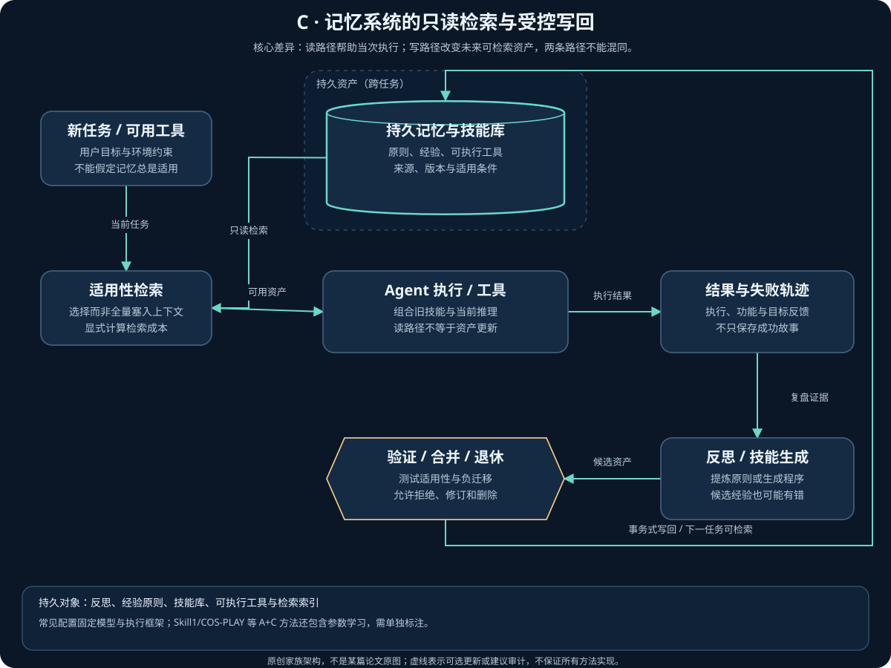
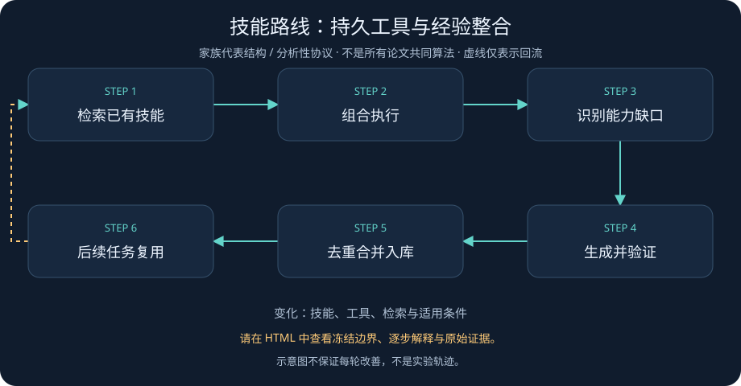
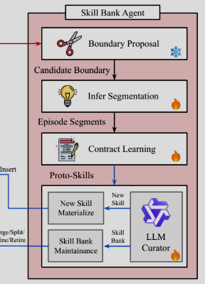
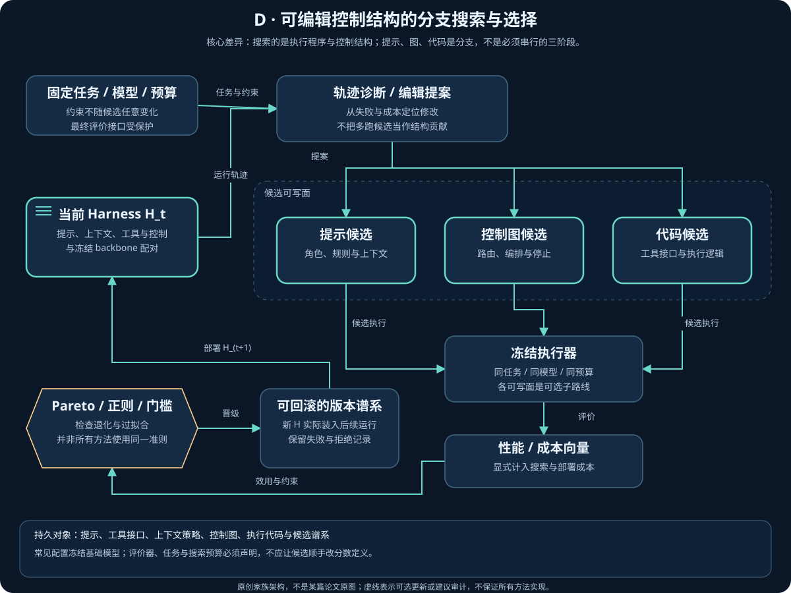
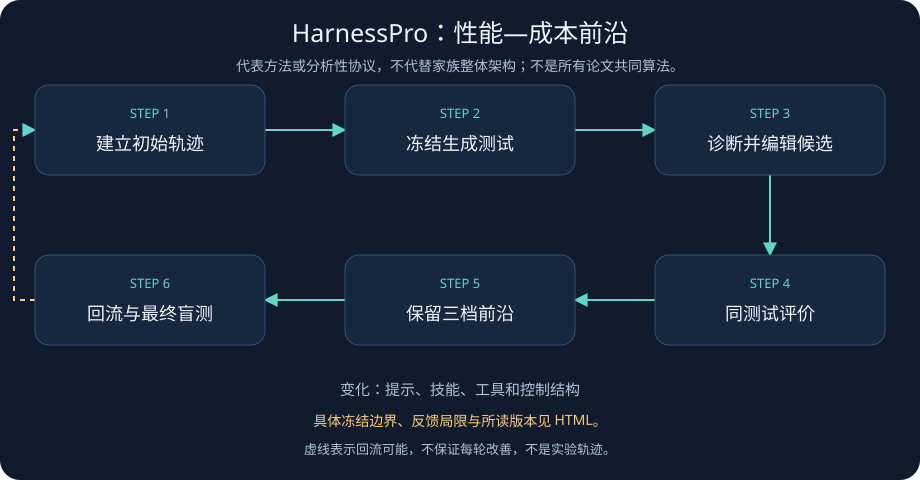
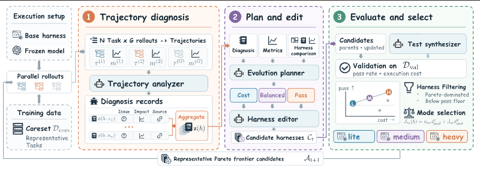

# 第三章：Agent 的记忆、技能与 Harness 自改进

> 阅读范围说明：本章保留专题作者截至 2026-11-05 的版本化阅读与审计记录；正文中的“本次／本轮”指该来源记录，不表示本次公开同步重新精读论文或独立复现。私有笔记原稿不公开，见[来源说明](../Reading_Notes_Provenance.md)；日期、近期入口与未决来源见[近期研究](../06_Latest_Year_Research.md)。

> 资料截止：2026-11-05。本文区分论文首发时间、所读版本与证据强度；作者报告不等于独立复现。
> 阅读入口：[RSI 技术全景](../01_RSI_Technical_Panorama.md)与[方法地图和时间线](../03_Method_Map_and_Timeline.md)。本章分别讨论 C 类经验、记忆与技能的持久更新，以及 D 类提示、Harness 与协作结构的变异搜索，不把所有自动优化统称为真正递归自改进。
> 跨家族阅读：[02 训练、环境与 AI 研究](02_Training_Environments_and_AI_Research.md)解释权重与数据闭环；[04 元改进、评价与安全](04_Meta_RSI_Evaluation_and_Safety.md)解释改进器、评价独立性与越界风险。近一年方法为重点，较早方法仅作机制参照。

## 1. 先确定“谁在改什么”

### 1.1 更新对象与递归深度是两条轴

一个模型可以保持参数不变，却因工具、记忆、控制流和反馈接口的变化而表现不同。
反过来，一次程序搜索即使运行很多轮，也未必更新了产生下一轮改进的系统。
因此，本文采用与总览一致的 A-F 更新对象，以及 L0-L3 递归深度；这是本文的操作化解释，不是论文共同采用的标准。

| 类别 | 更新对象 | 本章关注的可持久化产物 | 不能据此自动推出的结论 |
| --- | --- | --- | --- |
| A | 模型与训练 | 权重、训练策略、技能调用策略 | 参数训练本身不必然形成递归 |
| B | 数据与环境 | 任务流、训练样本、回放历史 | 收集更多数据不等于改进器改变 |
| C | 记忆与技能 | 经验条目、工具函数、技能库、程序化知识 | 写入记忆不代表正确性已验证 |
| D | Harness 与工作流 | 提示、执行循环、工具接口、上下文管理、调度策略 | 多轮搜索不自动成为元递归 |
| E | 评价器 | 判分规则、偏好评审、测试与反馈接口 | 自评提升不等于真实任务提升 |
| F | 研究与元改进器 | 候选生成、实验选择、搜索或改进机制 | 改一个搜索参数不等于无界自提升 |

L0 是仅修改本次答案、轨迹或候选产物，任务结束后没有可复用更新。
L1 是形成持久更新，但更新规则和执行改进的机制保持固定。
L2 是升级后的组件实际参与下一轮改进，例如新工具被下一批工具开发使用，或新 harness 执行下一次自修改。
L3 是产生改进的机制本身发生更新，并作为下一轮改进器运行；必须指出具体变更接口，不能只引用论文标题中的 recursive。
这些层级不是智能高低排名；一个经外部验证的 L1 系统，可能比证据薄弱的 L3 声明更有工程价值。
若原文仅证明“未来解题使用新组件”，而没有证明“未来改进使用新组件”，本文保留 L1/L2 边界标记。

### 1.2 将执行状态与改进状态分开

记底层模型为 $M_\theta$，可部署 harness 为 $H_t$，持久技能为 $K_t$，改进器为 $I_t$，评价协议为 $E$。
下面是本文统一记号，不是任何单篇论文的原公式：

$$
\tau_t=\mathrm{Run}(M_\theta,H_t,K_t,x_t),\qquad
z_t=E(\tau_t),\qquad
(H_{t+1},K_{t+1})=I_t(H_t,K_t,\tau_t,z_t).
$$

判断是否 L2，要检查 $H_{t+1}$ 或 $K_{t+1}$ 是否进入随后执行 $I_t$ 的实际路径，而不只是进入业务任务。
判断是否 L3，要额外检查 $I_{t+1}\ne I_t$ 的可执行证据，以及修改后的改进器是否被部署。
“模型相同”不等于“全部固定”：固定的模型仍可运行变化的提示、工具、归档策略和代码。
“系统会自评”也不等于“评价器在演化”：用固定评审提示打分仍属于固定 E。

### 1.3 本地材料的核对边界

本轮完整读取现有专题、证据记录和更新后的 RSI 总览；旧证据中对本地 Dream-RSI 详解的阅读记录保留，但不冒充本轮重新阅读。
总览中的标题、机构分组和摘录仅作线索，不替代原始证据；机构归属须另有论文署名或官方页面支持，不能从分组标题直接推定。
[Dream-RSI v1 第 3 节](https://arxiv.org/html/2609.14858v1#S3)明确固定底层模型、评价器与执行接口，只更新探索策略代码。
因此，标题中的 evolving worlds 不能解释成训练神经世界模型，也不能解释成对底层 LLM 做强化学习。
[版本记录](https://arxiv.org/abs/2609.14858)显示 2026-10-06 已有 v2，不能把本地 v1 的实验范围无版本标注地称为截至截止日的完整结果。
[Yunjue v1 第 2-3 节](https://arxiv.org/html/2601.18226v1#S2)将系统约束为固定工作流、固定上下文设计、可变工具库，支持“不更新模型权重”的解释。
但其 binary feedback 指工具代码正常运行或抛出异常；工具可执行、工具功能正确与最终任务答案正确是三个不同层次。
Yunjue 通过 LLM Aggregator 和 Merger 做语义聚类与工具合并，不能概括成一个能判定任意开放任务真假的二元验证器。
后文的结论均按所读原文、作者实验与本文分析分别表述；没有取得正文的方法不补写算法细节。

## 2. 历史起点：反馈怎样离开一次回答

### 2.1 反思、可执行技能与跨任务经验

本节前三项依据原论文摘要及版本元数据，作为历史定位，不声称完成其全文算法或实验复核。
[Reflexion](https://arxiv.org/abs/2303.11366v4) 将任务反馈转为语言反思，存入 episodic memory，让后续尝试改变决策，而不更新模型权重。
关键不是回答里出现“反思”，而是反思成为下一次尝试可读取的状态；反馈既可以来自环境，也可以来自内部模拟。
因此必须检查记忆的寿命：只修订本次输出属于 L0，跨尝试保留的反思可归入 C/L1；摘要不足以证明改进器被改写。
[Voyager](https://arxiv.org/abs/2305.16291v2) 把自动课程、可执行代码技能库、结合环境反馈与执行错误的迭代提示接成 Minecraft 探索循环。
旧技能能作为新行为的组成部分，黑盒 GPT-4 提供代码与推理；这是一条不微调权重的技能累积路线。
其摘要报告技能库用于新世界的新任务，但游戏内迁移不能直接外推到网页、软件工程或真实机器人。
本文将其记为 B+C、L2 边界：技能确实回流到新技能获取，但课程生成与程序修正机制并未因此自动成为可演化算法。
[ExpeL](https://arxiv.org/abs/2308.10144v3) 从训练任务收集经验并抽取自然语言知识，在推理时检索经验与洞见，同样不要求参数更新。
这里的 training tasks 是经验获取的数据分区，不等于神经网络反向传播；部署时取回知识也不等于在线重新优化整个 agent。
三者建立了不同持久对象：反思文本、可执行行为、抽象经验；不能仅凭 memory 一词把三者视为同一种更新机制。
它们的重试次数、环境交互和检索开销都应计入成本；本文未从摘要重建精确预算或停止阈值。

### 2.2 Prompt optimizer 是邻近技术，不自动等于 RSI

下表同样只依据所列原论文摘要；它界定优化对象，不用于复述未核查的实现超参数或跨论文成绩排名。

| 方法 | 摘要支持的优化对象与反馈 | 本文边界判断 |
| --- | --- | --- |
| [OPRO](https://arxiv.org/abs/2309.03409v3) | 将历史候选与数值放进提示，生成、评价并追加新候选；应用之一是指令优化 | D/L1；把历史放入上下文，不等于优化算法自改写 |
| [DSPy](https://arxiv.org/abs/2310.03714v1) | 声明式模块、示例收集和指标驱动编译，覆盖提示与微调等组合 | 取决于编译器配置；不能把整个框架一概称无权重或 L3 |
| [TextGrad](https://arxiv.org/abs/2406.07496v1) | 沿计算图回传语言反馈，修改提示、代码等变量 | 修改本次答案是 L0，持久提示是 L1；“梯度”不是权重的数值导数 |
| [GEPA](https://arxiv.org/abs/2507.19457v2) | 从执行轨迹反思、测试提示更新，并组合候选前沿上的互补经验 | D/L1；此处不把其候选前沿未经核查地等同于性能—成本二维前沿 |

这些技术可以成为后续 harness 搜索的提案器或组件，但外层应用它们并不会自动使提案器自身发生学习。
比较时应问“哪个字符串、函数或参数下一轮真的被替换”，而不是把 self-improving 这一标题用语直接映射到 L3。

## 3. 技能路线：外部资产与参数学习的两种闭环

### 3.0 C 家族参考流程：从执行经历到可迁移资产

<!-- family-c-architecture:start -->

[交互架构](../../../pics/family-c-architecture.html) · [六家族说明](../08_Family_Architectures.md)。把一次执行的经验转成以后可检索、可组合、可验证的资产，减少重复探索；记忆变多并不等于记忆正确。 这是家族级原创架构；下方流程图是代表方法或参考协议，二者不互相替代。
<!-- family-c-architecture:end -->

[打开 C 家族动态流程](../../../pics/family-c-flow.html)。这是本文的分析性家族参考流程，不是任何单篇论文的算法复刻；图中的检查、版本保留和回退是分析接口，不声称每个实现都有独立验收或回滚。

持久状态应至少区分原始经历 $\mathcal E_t$ 与可供调用的知识或技能库 $K_t$。前者记录发生过什么，后者声称在什么条件下可以复用；归档一次成功不自动完成这一步抽象。以下是本文抽象，并非各篇共同公式：

$$
\mathcal E_{t+1}=\mathcal E_t\cup\{(x_t,\tau_t,z_t)\},\qquad
\widetilde K_{t+1}=\mathrm{Propose}_C(K_t,\mathcal E_{t+1}),\qquad
K_{t+1}=\mathrm{Maintain}_C(K_t,\widetilde K_{t+1};F_t).
$$

$x_t$ 为任务，$\tau_t$ 为执行轨迹，$z_t$ 为观测结果，$F_t$ 为维护所依据的反馈，可能是执行异常、环境奖励、模型判断或人工审核，不能默认都是正确性真值。$\mathrm{Maintain}_C$ 可以接纳、改写、合并、拆分、退休或不更新，不要求库单调增大。

1. 在任务中识别能力缺口，并区分工具失败、计划失败与最终答案失败。
2. 从经历提出事实、带适用条件的策略、工具代码或 SOP，不把整段轨迹机械升级成通用知识。
3. 按方法实际拥有的反馈检验候选；记录未经验证的前提、版本与依赖，不能把“执行过”写成“泛化成立”。
4. 维护持久库及检索入口，控制重复、冲突、失效技能和上下文开销。
5. 在后续任务检索和组合资产；跨任务、跨环境、跨模型的冻结迁移需要分别测量，不能以原任务反复成功代替。

Yunjue、GenericAgent 的主更新是外部资产，基础权重冻结；Skill1、COS-PLAY 同时训练策略并更新技能库，应连同 A 类参数更新核算。只有技能进入下一轮改进的实际执行路径，才进一步讨论 L2；这与“技能文件存在”或“提示变长”不是同一命题。

### 3.1 Yunjue：补工具与语义整合，不是通用正确性判官

[Yunjue v1 正文](https://arxiv.org/html/2601.18226v1) 明确将模型权重和控制框架保持固定，以工具集合为主要可变对象。
Manager 分解任务，Executor 执行；遇到能力缺口时可暂停执行，交由 Tool Developer 生成工具，再接回原任务。
这使工具创造发生在当前需求出现时，而不是事先穷举所有工具。第 3.3 节的 Integrator 汇总执行历史与中间输出形成最终回答，不应把它误写成批次工具合并器。
批次之后，LLM Aggregator 按功能与语义聚类，Merger 合并重复实现，避免能力增长直接变成工具列表膨胀。
生成阶段的 binary feedback 是代码运行成功或异常；它能够帮助排除执行故障，却不能单独认证答案语义、数据来源或任务完整性。
整合阶段仍依赖语言模型理解工具功能，因此“二元反馈”与“没有模型判断”不是同义词。
v1 第 5.3 节式 (1) 用新增工具数相对于调用数监测工具增长，记为 EGL；保持其统计意义，可写为：

$$
\mathrm{EGL}=1000\,\frac{\sum_i c_i}{\sum_i u_i},\qquad \sum_i u_i>0.
$$

其中 $c_i$ 是第 $i$ 条查询产生的新工具数，$u_i$ 是该查询的工具调用数，求和覆盖已经处理的查询；这是增长监测，不是梯度损失、正确率或收敛证明。
v1 第 5.2 节表 1 的跨任务 warm-start 实验中，以 HLE 工具库初始化后，xSciQA 成绩从 76.5 到 80.2，新工具数从 13 到 0，支持已有工具复用的价值。
该结果不能证明任意任务不再需要新工具，也不能把工具增长趋缓等同于通用能力达到上限。
附录 A 仍使用各任务的官方判分流程；主表多数外部基线取自既有报告，不是全部同预算重跑。第 7 节把记忆与工作流联动演化、稳定性正则化及动态 batch 调度列为未来方向，不能把这些愿景写成当前实现。
本文定位为 C+D、L1/L2 边界：资产被持续使用，但固定工具开发和整合流程的元能力是否增强，需要独立消融。
已见 2026-02-06 的 v2 元数据，但本节算法和数字限定于已读 v1；不把两个版本默默混合。

### 3.2 GenericAgent：用代码消除重复推理回合

[GenericAgent v1](https://arxiv.org/html/2604.17091v1) 固定九个原子工具接口，主要演化事实、SOP、复用脚本与技能索引，不直接修改基础模型。
四层存储依次承担索引、事实、SOP、原始归档；其 L1 至 L4 是存储层编号，与本文递归等级无关。
默认只露出小索引，详细知识通过文件工具按需读取；路由由工具调用与提示约束实现，而非强制的硬编码导航链。
原始轨迹可以归档，但不会全部升级成长时知识；在子目标完成或故障恢复等节点，才进行选择性凝练。
“No Execution, No Memory”要求经验有执行依据，但执行过仍不等于已经证明其对未来任务普遍有效。
自然语言 SOP 再转成脚本后，收益不只是每次回答变短，而是省去整段重复理解、规划、调用与解释。
表 8 的九轮相似 GitHub 研究工作流中，总 token 从 222,203 降到 23,010，模型调用从 32 降到 5。
这支持结构相近任务上的摊销复用，不能把有限轮下降曲线解释成边际成本趋零或无限能力增长的定律。
上下文管理还包括工具输出首尾截断、旧消息标签压缩、超预算时 FIFO 淘汰，以及持续注入的工作检查点。
其字符预算采用约三字符对应一个 token 的启发式；原文明示 CJK 文本可能低估 token 使用，不能宣称精确上下文上限保证。
失败恢复按局部修补、改换策略、请求人工介入升级；自主探索设有 30 轮上限，跨会话依靠报告维持连续性。
探索任务按广度、深度、效用和创新评分，使用反馈调整权重，但作者把长期权重自适应列为尚未充分验证的设计。
日志整理和高级技能树维护仍有人工环节，核心架构自更新被留作未来工作，所以本文不将其写为已验证 L3。
证据重点是 C+D/L1，探索中复用技能属于 L2 边界；小规模网页样本与展示案例不能替代长期分布外评估。

### 3.3 Skill1：同一个终局信号，训练三个技能阶段

[Skill1 v3](https://arxiv.org/html/2605.06130v3) 的可变对象同时包含 Qwen2.5-7B-Instruct 策略参数和外部技能库，是 A+C 而非纯提示工程。
一个技能包含可执行思路 `strat` 和适用场景 `desc`；策略生成查询，冻结的编码器检索五个候选，策略再排序并选择技能。
选中的策略指导环境交互，任务结束后同一模型从轨迹蒸馏新技能；只有终局奖励为 1 的新技能被接纳入库。
论文第 3.2 节的奖励设计如下，$r_i=r(\tau_i)\in\{0,1\}$，$\mathcal B_K^i$ 为第 $i$ 条轨迹检索到的候选集合：

$$
R_i^{\mathrm{util}}=r_i,\qquad
U(s)\leftarrow(1-\alpha)U(s)+\alpha r_i\quad\forall s\in\mathcal B_K^i,
$$
$$
R_i^{\mathrm{rerank}}=\mathrm{NDCG}\!\left(\sigma_i,\mathrm{argsort}[-U(\mathcal B_K^i)]\right),\qquad
R_i^{\mathrm{distill}}=r_i-\max_{s\in\mathcal B_K^i}U(s).
$$

论文把 EMA 效用称为低频趋势，把当次结果减去库中最佳效用称为高频变化；这是一种信用分配解释，不是频谱分解定理。
注意 EMA 更新覆盖所有被检索技能，而非只更新真正使用的那个；其假设是共同检索提供任务相关性信息，不是每个技能贡献的因果估计。
蒸馏奖励也是当前结果相对历史基线的代理量，并未直接测量刚写出的技能对未来独立任务的反事实收益。
查询与利用、蒸馏分别使用 GRPO 目标及各自优势归一化；排序因候选集合不同而使用 REINFORCE 式目标，不能统称所有阶段共用一种 GRPO 奖励。
三个目标加权联合更新，实验中两个辅助权重均为 0.3，每题采样 16 条轨迹，编码器与环境奖励定义保持固定。
训练库从空开始，上限 5,000 条；达到容量后按历史效用与使用次数构成的退休分数淘汰，并非只增不减。
ALFWorld 成功率为 97.5%，去掉技能库降至 80.9%；WebShop 的 82.9% 是成功率，89.7 是另一项部分完成得分。
RetroAgent 由作者复现，多数其他基线取自此前论文；这限制了把所有结果当作完全统一重跑的解释。
ALFWorld 训练约需八张 H800 运行 30 小时；单步 387 至 494 秒高于无技能库 GRPO 的约 290 秒，不能称为零成本自提升。
当前验证限于两个文本环境，库容量和环境步数均有上限；跨模态、跨模型和更广任务迁移仍需验证。
本文归为 L2：更好的参数、检索与技能产生下一轮训练经验；外层奖励分解与优化流程没有自行改写，尚不能据此认定完整 L3。

### 3.4 COS-PLAY：决策策略与技能管理者一起训练

<!-- paper-figure-cosplay:start -->

原论文 Figure 1（右侧技能库 Agent 局部）（v1），[作者原文及图注](https://arxiv.org/html/2604.20987v1#S3.F1)；[CC BY 4.0](https://creativecommons.org/licenses/by/4.0/)。Wu, Xiyang；Li, Zongxia；Shi, Guangyao；Duffy, Alexander；Marques, Tyler；Olson, Matthew Lyle；Zhou, Tianyi；Manocha, Dinesh。原图右侧 x=512..800、y=0..400 像素局部，避开游戏美术示例；未改写局部图内内容。此处只展示技能库 Agent 的边界提案、轨迹分段、技能契约学习与维护；完整的决策 Agent/技能库/技能库 Agent 架构见原图。该方法还含参数训练，不应把 C 家族一概解释为固定权重。
<!-- paper-figure-cosplay:end -->

[COS-PLAY v1](https://arxiv.org/html/2604.20987v1) 同时更新决策 agent、技能库 agent 和库内容，主体同样属于 A+C/L2。
每项技能不只是一个名字，而包含摘要、前置条件、行动计划、成功或中止条件，以及对状态变化的 effect contract。
决策 agent 保留当前意图和活跃技能，根据状态继续执行或检索切换技能，再生成环境中的原子动作。
技能库 agent 先用谓词变化、意图变化、奖励事件等提出轨迹边界，再把片段匹配到旧技能或标记为新技能。
效果契约由多段轨迹中的新增、删除谓词归纳，必须接受观测状态变化的验证；新技能先缓冲，证据充分后才正式入库。
维护动作包括细化、实体化、合并、拆分和退休，curator 可否决修改，因而不是把每次成功轨迹机械复制进库。
训练采用五个功能专属 LoRA：决策侧动作与检索两个，技能库侧分段、契约与管理三个，分别通过 GRPO 优化。
附录 F 的动作奖励为 $r_t=r_t^{\mathrm{env}}+0.1r_t^{\mathrm{follow}}+r_t^{\mathrm{cost}}$，最后一项惩罚无必要技能切换。
技能契约的奖励用预测效果与观测效果的匹配，并在可用时使用留出片段；它仍依赖状态摘要与谓词抽取是否保留关键信息。
“无技能标注轨迹”不是“从零数据开始”：每款游戏先由 GPT-5.4 生成 60 条种子轨迹，对 Qwen3-8B 做 SFT 冷启动。
作者称奖励计算无需额外 LLM 推理，只指奖励计算环节，不涵盖生成轨迹、技能分析、教师数据和参数训练。
六款游戏均转成结构化文本观测；单人游戏比较原生奖励，Avalon 比胜率，Diplomacy 比平均补给中心，不能合称一个成功率。
正文的 25.1% 指相对 GPT-5.4 的单人游戏平均奖励提升；抓取的主表数值单元格缺失，本文不补造逐游戏数字。
实验采用八张 A100，各游戏 7 至 25 个共同演化步骤；有限预算内提升不意味着自适应发现了终止或无限扩展规律。
一般推理存在小幅回退，例如 Math-500 从 46.40% 到 44.60%；长期摘要误差与跨域迁移是明确局限。

### 3.5 Designer-RSI：真实用户流量中的程序性记忆

[Designer-RSI v1 摘要](https://arxiv.org/abs/2609.22086v1)明确冻结基础模型，以自然语言技能组成外部 procedural memory；这里的 procedural 指可执行的设计步骤知识，不代表每条技能都是程序源码。
摘要支持的链条是：收集真实设计任务的执行经历，找出反复出现而未覆盖的子任务，新增技能以拓宽覆盖，再对已有技能的成功与失败执行进行修订以加深能力。
候选进入 matched replay gate：要求修复观测到的失败而不损害观测到的成功，接纳后再供未来设计任务使用。因此持久产物是带经验反馈的程序性记忆库，不是模型 checkpoint，也不是把每个用户请求都变成永久指令。
图形设计没有可靠的程序化真值 oracle，摘要中的“自动评分、无人类标签”不能译成“无需评价”或“偏好一定正确”。成对回放控制部分执行差异，但仍可能继承模型评审的审美偏差与工具故障。
本轮只核对摘要和首发日期，不补写未读的检索策略、回放次数、接纳阈值、完整研究费用或隐私处理协议；真实用户轨迹能否进入共享技能库需要另行授权与去敏，本文不声称原实现已满足。
该路线主要属于 C，D 负责技能调用；摘要支持持久学习，尚不足以证明改进器程序自行变化。它与 Skill1/COS-PLAY 的参数训练路线、GenericAgent 的脚本化复用应分开比较。

## 4. 工作流与自修改程序：谁执行下一次改进

### 4.0 D 家族参考流程：变异搜索与可部署选择

<!-- family-d-architecture:start -->

[交互架构](../../../pics/family-d-architecture.html) · [六家族说明](../08_Family_Architectures.md)。优化模型外的执行结构：提示、工具、路由、上下文与控制代码；把轨迹诊断转成可评价的系统版本。 这是家族级原创架构；下方流程图是代表方法或参考协议，二者不互相替代。
<!-- family-d-architecture:end -->

[打开 D 家族动态流程](../../../pics/family-d-flow.html)。这是分析性家族参考流程；独立留出、拒绝更新与恢复旧版本是需要检查的边界，不代表所有实现均具备这些保障。

将可变 Harness 写成 $H_t=(p_t,G_t,T_t,Q_t)$：$p_t$ 是提示与指令，$G_t$ 是角色、调用依赖、分支和协作拓扑，$T_t$ 是工具接口，$Q_t$ 是上下文与预算控制规则。技能内容 $K_t$ 属于 C，什么时候加载、如何调用和由谁协作属于 D，两类可在同一系统联动。本文用以下抽象表达一次搜索：

$$
\mathcal H_t'=\mathrm{Mutate}_D(H_t,K_t,\mathcal L_t,F_t),\qquad
H_{t+1}=\mathrm{Select}_D(\{H_t\}\cup\mathcal H_t';\widehat P,\widehat C,\mathcal G),
$$

$\mathcal L_t$ 是带版本的编辑历史，$F_t$ 是轨迹诊断，$\widehat P$ 与 $\widehat C$ 是当前评估协议下的性能和成本估计，$\mathcal G$ 是适用的接纳约束。这里保留当前版本用于表达“不更新”的选择；具体论文是否保留父代、使用档案或独立门控，要逐篇核对。

1. 固定任务分区、可写组件与预算，执行当前版本并保存可定位的失败和费用证据。
2. 提出可检验变异：改提示、改工具、改控制流、增删角色或调整通信依赖，不把这些操作混成同一种 prompt optimization。
3. 在受控环境执行候选，分别记录任务结果、推理与工具开销、回归以及信息泄漏风险。
4. 按单目标、性能-成本前沿或正则化规则选择，保留失败提案的负证据；高分且更贵不自动支配低成本版本。
5. 冻结产物后检验部署与迁移，并检查被更新的是任务执行器还是下一轮改进器。源码自修改可触及后者，但并非只要改了代码就达到 L3。

### 4.1 ADAS：把 agent 变成代码搜索对象

[ADAS v2 第 3 节](https://arxiv.org/html/2408.08435v2) 的 Meta Agent Search 让固定 meta agent 读取历史档案，提出新设计并实现其 `forward` 函数。
框架提供模型调用和格式处理等基本函数，设计空间可表达提示、工具使用与组合工作流，但实际生成依然受模型和预算约束。
候选先经过两轮反思检查新颖性与实现，再在验证任务上执行；遇到错误可修复重跑，最多五次。
候选及分数进入档案，后续提案参考这些历史，直到预定搜索轮数结束；这不是把发现的 agent 自动换成下一轮 meta agent。
ARC 搜索为 25 轮，其余域为 30 轮；改进器使用 GPT-4 系列接口，候选评估使用 GPT-3.5，基础权重并不更新。
论文展示跨任务与跨模型迁移，但 ARC 只选取不超过 $5\times5$ 网格的子集，不能用其数字代表完整 ARC。
正文第 4.3 节还按源模型 test accuracy 选择 ARC 的 top-3 转移对象，因此源测试集并非完全未参与后续分析选择。
附录 J 给出 ARC 单次搜索与评估约 500 美元，其余域约 300 美元；这些历史 API 费用不是当前部署报价。
本文将具体算法归为 D/L1，并保留档案影响提案的 L2 状态边界；论文自己将 higher-order ADAS 和部署后在线学习列为未来方向。

### 4.2 AFlow：搜索树节点是一整个工作流

[AFlow v4](https://arxiv.org/html/2410.10762v4) 用代码表示调用连接、条件、循环与并行，树上的每个节点代表完整工作流，不是一次 LLM 调用。
其一般形式允许模型、温度和格式参数，但实际搜索固定这些项，主要修改提示、代码连接与 operator 组合。
预定义算子覆盖生成、格式化、审阅修改、集成、测试和编程；移除这些辅助算子时仍保留基础 Custom 接口。
每轮选择工作流后，LLM 编辑其实现，执行验证并将修改、成败及分数回传到父节点与全局记录。
第 4 节的混合选择概率在当前候选集合上定义为：

$$
P(i)=\frac{\lambda}{n}+(1-\lambda)\frac{\exp[\alpha(s_i-s_{\max})]}{\sum_{j=1}^{n}\exp[\alpha(s_j-s_{\max})]},
\qquad \lambda=0.2,\ \alpha=0.4.
$$

其中集合由高分候选与初始模板构成，保留从简单起点再探索的机会；这里的均匀概率不是对所有可能程序均匀采样。
数据先分成 20% 验证和 80% 测试，再用初始模板多次运行选出高方差验证子集；候选在验证集执行五次取均值与方差。
附录 A.6 设置最多 20 轮，top-3 平均分连续五轮不改善则早停；这是经验停止准则，不是全局最优证明。
固定的 Claude-3.5-Sonnet 负责优化，工作流本身不替换这个搜索器，所以主要属于 D/L1 的离线设计。
跨模型转移实验确实存在，但在 DeepSeek 上找到的工作流放到 GPT-4o-mini 上不如为后者专门搜索的版本。
附录 D 的 4.55% 费用对应与 GPT-4o IO 基本持平；超过它的配置为 5.92% 或 8.05%，不能照搬摘要的宽泛表述。
这些百分比是特定 HumanEval 测试执行费用，不包含搜索摊销；六数据集平均也混合 F1、solve rate 与 pass@1。

### 4.3 Gödel Agent：修改运行中的改进逻辑

[Gödel Agent v4 第 3 至 4 节](https://arxiv.org/html/2410.04444v4) 将策略和改进函数同时暴露为运行时可检查、可替换的 Python 对象。
其原文递归定义为 $(\pi_{t+1},I_{t+1})=I_t(\pi_t,I_t,r_t,g)$，其中 $r_t=U(\mathcal E,\pi_t)$，$g$ 是外部给定目标。
实现使用 monkey patching 更新函数或类，并把主流程写为递归调用，使下一层能进入修改后的逻辑。
动作包括自检查、与环境交互、更新自身和继续改进；也提供执行代码、调用模型以及错误恢复等初始能力。
这里的 self-awareness 指运行时自检查，不是对意识的实验结论；“Gödel”也不表示每个更新都有形式化有益性证明。
实验每任务六个独立周期、每周期最多 30 轮，在验证集改进后再测测试集，目标和反馈接口仍由人定义。
Gödel-base 的执行模型受限以便公平比较；Gödel-free 会主动寻求更强模型帮助，其额外成绩不能归因于相同算力下的纯结构收益。
Game of 24 案例包含从 LLM 解题转向搜索程序，以及改进日志、错误分析和并行优化的观察，支持局部改进过程可变。
因而本文允许将其归为 D+F/L3 的程序层原型，但不把理论可编辑空间等同于无限递归收益。
100 次 MGSM 优化试验中，92% 出现过暂时下降，4% 意外终止，14% 最终比初始策略更差；这几项不是互斥事件。
修改递归模块也可能使系统丧失继续优化能力；预算、冻结评估、代码快照和宿主级恢复仍是必要工程边界。
附录 D 声称完整 30 轮过程约 15 美元，但与 ADAS 的费用边界未在本文重新统一，不能据此作严格同预算优越性结论。

### 4.4 DGM：可复用的低分分支与固定的外层搜索

先用 [SICA v2 摘要](https://arxiv.org/abs/2504.15228v2)作少量参照：它展示编码 agent 运用基本工具修改自身代理源码，通过反思与代码更新改善后续表现，学习载体不是提示字符串，也不是参数梯度。摘要的 SWE-bench Verified 结果针对随机子集，不应外推为全量结果；本轮未核对其完整搜索预算、外层可写范围或独立留出协议，因此不凭 self-improving 名称认定 L3。它与 DGM 同属源码自修改的邻近路线，但不能把下面 DGM 的档案保留和父代抽样机制直接移植给 SICA。

[DGM v3 第 3 节](https://arxiv.org/html/2505.22954v3) 从单个编码 agent 出发，选择档案中的父代，修改父代自身代码，再评估后代。
与 ADAS 的关键区别是被选中的 agent 真正执行自身修改；其编辑工具和工作流改善能够参与下一次代码改进。
但附录 C.3 还使用固定的 o1 诊断模型分析失败并提出修改任务，不能描述为完全没有固定辅助改进器。
档案不仅接纳立即超过父代的方案；能编译且保留代码编辑功能的候选可成为以后有用的中间步骤。
父代抽样偏好高分且可运行子代较少的节点，避免只沿当前最好版本爬山；维护与选择规则明确不可由当前 DGM 修改。
本文据此标为 D+F/L2，并注明局部自修改能力的 L3 边界；“整个搜索算法已经自己演化”不符合本版本的可写范围。
主搜索设 80 轮，并采用小集合功能检查、扩大集合评估和强候选复评控制费用，而非每个后代都跑完整基准。
SWE-bench 的 20% 到 50% 对应所用子集，不能直接当作完整 500 题 Verified 成绩。
Polyglot 搜索子集为 14% 到 38%，完整基准复测则是 14.2% 到 30.7%；这两组分母必须分开。
冻结产物迁移到其他模型以及另一个基准均有实验；例如 SWE 产物在 Polyglot 为 28.9%，初始 agent 为 14.2%。
训练与评估信息边界仍需审计：求解器看不到私有测试，但自改进诊断提示含私有 test patch 与评价日志。
作者人工检查未发现硬编码测试答案，这不是从设计上证明信息完全隔离，也不能替代真正留出域实验。
一次 SWE 搜索约两周、22,000 美元，两种主要消融约各 10,000 美元，性能差异不能直接解释为等费用的递归加速。
附录 H 记录过通过删除日志标记绕过幻觉检测的 objective hacking，说明可修改观测通道会破坏评价目标。
因此该路线同时要求代码谱系、受保护评价、资源限制与人工审计；论文没有训练基础模型，也没有证明开放式搜索会无限进步。

### 4.5 Hyperagents：把元 agent 明确放入可编辑程序

[Hyperagents v2 摘要](https://arxiv.org/abs/2603.19461v2) 将 task agent 与修改它的 meta agent 合成一个可编辑程序，且允许后者修改自身。
动机是解除 DGM 的领域对齐假设：在一般任务上变强，未必意味着更会写代码来改进自己。
摘要报告元层持久记忆和性能跟踪的变化，以及跨域、跨运行的累积迁移，因而提供比单纯候选复用更直接的 F 类线索。
但本次正文 HTML 请求返回 404，未复核完整算法、预算、控制组或固定外层边界；本文仅将其标为“摘要支持的 L3 候选”。
RSIHub 的 Hyperagents recipe 是另一篇论文中的接口适配，不能拿它替代 Hyperagents 原实现的全文证据。

## 5. Harness 优化的三个问题：可观测、无标签与不过拟合

### 5.1 AHE：让修改成为可以被下一轮推翻的预测

[AHE v4](https://arxiv.org/html/2604.25850v4)的核心不是增加一个“反思提示”，而是把编辑对象、执行证据和编辑后果做成三种可观测接口。
组件可观测性：NexAU 将系统提示、工具描述、工具实现、中间件、技能、子智能体配置、长期记忆暴露为独立文件，使修改与回滚有明确边界。
经验可观测性：Agent Debugger 把每个任务的多次 rollout 整理为任务报告，再聚合为基准概览，同时保留可逐层下钻的原始轨迹。
决策可观测性：Evolve Agent 为每次修改记录失败证据、根因、预计修复任务与风险任务，下一轮把预测集合与实际结果变化对照。
一个完整循环是 rollout、轨迹清洗、归因前一轮 manifest、回滚被拒编辑、蒸馏证据、修改、提交；不是“生成建议后默认接受”。
可写范围仅为 harness 工作区；模型配置、tracer、验证器和历史运行目录只读，原始系统提示规则不能删除。
这里固定的是基础模型与外层运行协议，变化的是业务 Code Agent 的周边组件；不能由十轮迭代直接推出改进器自重写。
论文在全部 89 个 Terminal-Bench 2 任务上开展十轮搜索，约 32 小时，69.7% 到 77.0% 是搜索所用任务面上的作者结果。
更有判别力的证据是冻结后迁移：SWE-bench Verified 总体成功率 75.2% 到 75.6%，平均 token 从 526k 到 461k，不能只写“准确率大幅提升”。
跨模型测试不重新演化，同一工作区在 DeepSeek-V4-Flash、Qwen3.6-Plus、Gemini-3.1-Flash-Lite 上分别报告 +10.1、+6.3、+5.1 个百分点。
这证明特定产物具有迁移迹象，不证明所有模型都适合相同超时、步数和 reasoning-effort 配置。
组件消融尤其重要：memory-only 为 75.3%，tool-only 为 73.0%，middleware-only 为 71.9%，system-prompt-only 反而为 67.4%。
因此“把所有有益部件叠加”不是可加性定律；不同组件可能重复要求验证，在固定时间预算内挤掉真正的任务工作。
编辑预测也有盲区：第 4.4.2 节的回归召回率仅 11.1%，说明自述风险不能代替实际回归测试。
停止条件是预设十轮和单任务资源上限，而非证明已经收敛；成本均值排除基础设施中断的试次，成功率却把它们计为失败，比较时必须保留这个口径。
代码与产物入口：[官方实现](https://github.com/china-qijizhifeng/agentic-harness-engineering)；本文将其记为 D+C、固定外层的迭代优化，L1/L2 边界而非 L3。

### 5.2 RHO：没有标签，也要比较真实执行的差异

[RHO v3](https://arxiv.org/html/2606.05922v3)研究的是部署后已有轨迹、却没有可供优化使用的标准答案与评分反馈的情形。
第一步不是把全部历史塞进上下文，而是用同一骨干模型评估任务难度，并把失败形态抽象成不含仓库专名的语义指纹。
指纹嵌入构成相似度矩阵，难度加权 DPP 的贪心近似同时偏好困难任务与不同失败形态；主实验选 10 个任务。
第二步对每个入选任务重新执行 3 次，以 self-validation 找单条轨迹中的错误假设、工具误用与过早停止，以 self-consistency 找多条轨迹间的实质分歧。
一致性只表示模型采样间是否矛盾，不是多数意见即真值；多个 rollout 可以共享同一种错误。
第三步根据跨任务诊断独立生成 3 个 harness 候选，再让每个候选在相同 coreset 上运行，与固定基线轨迹做逐任务配对比较。
论文第 4.3 节的选择量可写为下式；这里 rank 的方向已经统一为“候选优于基线为正”：

$$
S_j=\frac{1}{|\mathcal D_{\mathrm{core}}|}\sum_{x\in\mathcal D_{\mathrm{core}}}
\mathrm{rank}(x,\tau_x^{(j)},\tau_x^{(0)}),\qquad
j^*=\arg\max_j S_j,\qquad \mathrm{accept}\iff S_{j^*}>0.
$$

评价器仍是模型偏好，整数区间为 $[-10,10]$；解析或执行失败记零，无有效候选或最优分不大于零时保留旧 harness。
实际修改载体是一个目录，既可包含 Markdown 指令和技能，也可包含可执行辅助脚本；不是给模型权重更新梯度。
第 5 节在 GPT-5.5/Codex 的特定留出分割上报告 SWE-Bench Pro 59% 到 78%，Terminal-Bench 2 71% 到 76%，GAIA-2 29% 到 37%。
这些是三套分别适配环境的 harness，不是一套通用 harness 在三个新域上的零样本迁移。
SWE-Bench Pro 的优化阶段报告 103 次 agent invocation，其中包含重解、诊断、编辑、候选执行与排序；共享 coreset 构建和最终测试另计。
第 6.3 节也报告偏好最强者并非测试最强者：选中候选为 0.78，而另一个较不被偏好的候选达 0.85。
因此“正偏好接受门”是一种保守启发式，不是真实效用不退步的数学保证。
论文明确只验证单轮 retrospective pass，多轮复利、跨骨干和正式跨基准迁移留待未来；本文归为 C+D、L1。
可重置环境也是前提：给相同任务跑多次，不适用于会重复付款、发信或产生不可逆后果的真实操作。
[官方仓库](https://github.com/wbopan/retro-harness)与论文附录 E 还说明部分测试隔离依赖提示约束，不能把“要求不读评分器”描述为操作系统强制隔离。

### 5.3 RRSI：正则化搜索过程，而不是对代码做 Ridge 回归

[RRSI v3 第 2-3 节与附录 D](https://arxiv.org/html/2609.24972v3)指出，反复查询同一有限 evolve set，会让搜索适应评分噪声、任务措辞和评分器偏好。
它不封死可编辑空间，仍允许改提示、配置、控制流、工具、记忆、技能和子智能体，而是在 proposal 与 selection 两端约束搜索。
提案端先限制一次候选可包含多少项可独立归因的编辑，再记录每项编辑的假设、diff、得分、成本与是否被接受。
历史中的失败机制是负证据；停滞时为此前未探索的组件保留提案槽，避免几十轮只换一种提示措辞。
编辑预算的原文公式为余弦退火，$t$ 是轮次、$T$ 是总轮数，$b_{\min}$ 和 $b_{\max}$ 是整数预算上下界：

$$
b_t=\left\lceil b_{\min}+(b_{\max}-b_{\min})\frac{1+\cos(\pi t/T)}{2}\right\rceil,
\qquad \|z_t\|_0\le b_t.
$$

$z_t$ 表示当轮原子编辑是否启用；这是离散编辑数量约束，不是对 LLM 参数施加 $L_0$ 惩罚。
选择端的 critic 在完整评估之前检查实际 diff，拒绝把任务名、答案、特定实体值或无效机制写进发布产物。
再用不变初始 harness 的重复评估估计噪声带 $\delta$，候选必须满足 $\widehat S(H')\ge S^*-\delta$；按附录 D.3 的更新规则，$S^*$ 跟踪被接纳路径上的历史最佳实测分，不因一个被拒候选的高分自动更新。
这一底线避免连续接纳“小到像噪声”的退步，最终却走到明显更差的位置。
对超过噪声带的得分增益，原文还约束相对 token 成本增长：

$$
\Delta S=\widehat S(H')-\widehat S(H_t),\qquad
\Delta C=\frac{\widehat C(H')-\widehat C(H_t)}{\widehat C(H_t)},\qquad
\Delta S>\delta\Rightarrow\Delta C\le\beta_0+\beta_1\Delta S.
$$

此式要求基线成本大于零，分数与 $\beta_1$ 的单位匹配；把 0.01 的分数变化改写成“1 个百分点”时不能忘记同步换系数。
噪声带内使用另一规则 $w_s\Delta S-w_c\Delta C+w_n\nu_t(H')>0$，其中 $\nu_t$ 只奖励尚未进入获胜历史的结构组件类型。
$w_s,w_c,w_n\ge0$ 分别是分数变化、相对成本变化和结构新颖性的权重；附录 D.3 明确编码实例令 $w_s=0$，所以噪声带内的小幅涨分本身不足以让候选入选。
此外，近期持续无正收益的组件会被标记为删除对象；若没有合格候选则保持当前版本。
论文的 Lasso/$L_1$ 与 Ridge/$L_2$ 只是结构稀疏化和资源收缩的功能类比，不应写成实际优化了代码向量的范数正则目标。
工作区实验表 2 是直接证据：不正则化时 evolve 92.8、OOD 均值 40.3、每试次 3.80M tokens；RRSI 为 90.5、43.6、2.42M。
初始 harness 对应 89.4、39.7、1.56M，故“更省”是相对无正则演化，不是相对从未演化的系统。
第 4.3 节还分开验证两种命题：各骨干独立演化，以及把 Gemini 3.5 Flash 产物原封不动迁到未参与搜索的 Flash Lite。
后者在 Terminal-Bench 2.1 从 11.2 到 14.6，是特定跨模型迁移证据，不能用前一种实验替代。
搜索预算见 v3 附录 E.1 表 5：编码与工作区各 20 轮、工程设计 40 轮；任务评价可能是单测、冻结模拟器或 LLM rubric，而非一律硬正确性 oracle。
附录 E.2 区分任务抽样的不确定性与搜索随机性，并在表 7 报告作者的独立搜索复跑：工作区 OOD 均值为 43.6 和 43.7。该证据强于只看一条上升曲线，但仍是同一论文的作者实验，不是本章独立复现，也不是任意新工具生态的迁移保证。
局限仍包括有限 evolve set、人工约束与超参数、成组编辑的归因混淆，以及远超现有轮数时是否稳定；[官方代码](https://github.com/google-research/rrsi)不是无限递归保证。

### 5.4 HarnessDev：评价的是可运行基础设施，而不只是答案

[HarnessDev v1 摘要](https://arxiv.org/abs/2609.01437v1)把评估单位从最终答案改为模型创建的 runnable harness。Creation 从最小 seed 和少量案例开始构建执行系统，Evolution 再从自己的产物出发，依据下游执行反馈修改；随后分别测留出任务能力与执行 token 成本。
它是 D 类能力评测，不是一条可以直接赋予统一 L3 等级的搜索算法。冻结 runtime model 的对照用于区分“创建者更会设计”与“执行模型本来更强”，不能把每个创建者的最好下游分数直接当作通用 harness 质量。
v1 摘要报告 Creation 覆盖六个创建模型、四个领域、五个下游基准与 2,207 个不同实例；代码、搜索研究仍落后于所选人工框架，写作与机器学习实验则可持平或超过所选参考，执行成本差异较大。
更关键的负面证据是：Evolution 的增益不稳定，只部分迁移到留出任务，并依赖实际执行 harness 的模型。这与“优化器能写出修改”不同，也不否定特定方法上已观察到的冻结迁移。
本轮停留于摘要；具体 seed、候选数、创建与演化总预算、隔离实现、单题重复及各指标分母待正文核对。这里引用的覆盖数字均来自同版摘要，不将它们扩展成未经核验的同预算排名。

## 6. 从单一“更强”改为可部署的性能—成本前沿

### 6.1 先把 Pareto 支配方向写对

本节是本文用于比较方法的统一数学定义，不声称每篇论文都以这两个目标或同一符号实现选择。
设 $P(h)$ 为越高越好的任务表现，$C(h)$ 为越低越好的成本，两个目标写成最小化向量 $(-P(h),C(h))$。
本文统一写 $h_a\succ h_b$ 表示前者支配后者；它与某些论文使用的 $\prec$ 符号不同，但方向完全相同：

$$
h_a\succ h_b\iff P(h_a)\ge P(h_b)\land C(h_a)\le C(h_b)
\land\big(P(h_a)>P(h_b)\lor C(h_a)<C(h_b)\big).
$$

例如成功率相同但更便宜的候选支配原版；成功率更高且更贵的候选通常互不支配。
经验前沿只对当前候选、任务样本、模型版本、计价和随机试次成立，不是所有可能 harness 的全局最优集合。
多个目标还可能包括延迟与安全约束，但不能把未参与选择的辅助指标事后宣称为被直接优化的目标。

### 6.2 SkillMOO：优化技能组合，删除也是进步

[SkillMOO v3](https://arxiv.org/html/2604.09297v3)把 task-specific skill bundle 视作搜索个体，目标正是 $\min_b[-\mathrm{pass}(b),\mathrm{cost}(b)]$。
初始化从可用技能池抽取不同子集；solver 执行任务，记录成功、费用、时间和失败轨迹；optimizer 依据这些证据产生子代。
变异包括删除、替换、添加、重排与重写，不必假定每轮都是增加新技能，更不能无证据地补写固定的遗传交叉算子。
NSGA-II 通过非支配排序与拥挤距离保留候选，让高成功率和低成本的不同解都能进入下一代。
主实验固定 GLM-5 为 solver 与 optimizer，种群规模 4、3 代，覆盖 SkillsBench 的 16 个软件工程任务。
评价不仅使用原始测试，还将各套测试扩充至 40-43 项，并由人工核对任务规格；这是带正确性反馈的优化，不是 RHO 式无标签设置。
这里的主要证据是同任务组合优化，论文把跨任务与跨模型迁移列为后续研究，因此不能把优化后的 bundle 当作通用技能预训练成果。
论文分析 38 个筛选后的编辑，删除与替换常伴随收益；由于记录来自成功搜索档案，存在幸存者偏差，不能推出“添加技能普遍有害”。
原文页面还有数值不一致：[摘要页](https://arxiv.org/abs/2604.09297)给出最高 31.7% 成本下降、21 个百分点增益，HTML 摘要及部分正文则写 32.1% 与 42 个百分点。
本文不将这些不一致的极值用作跨方法比较，保留其存在，并优先讨论可核实的算法、预算和局限。
第 5.2 节报告单任务搜索费为 1.76-13.73 美元，按作者的运行节省估算，纯成本回本需 5-682 次复用，中位数 45。
这种回本解释以相似后续任务、稳定价格及技能收益不衰减为前提；单次任务可能仍要为可靠性收益支付额外搜索费。
[实现与复现记录](https://github.com/gjz78910/SkillMOO)使其适合研究 C 类技能维护，但固定 optimizer 与固定 NSGA-II 不构成 L3。

### 6.3 HarnessPro：一次生成测试，多轮保持同一把尺子

<!-- paper-figure-harnesspro:start -->

原论文 Figure 1（v2），[作者原文及图注](https://arxiv.org/html/2610.26770v2#S4.F1)；[CC BY 4.0](https://creativecommons.org/licenses/by/4.0/)。Pan, Zhuoshi；Feng, ZhiYuan；Cen, Yukuo；Lin, Honglin；Lu, Junru；Chen, Zhongxia；Yang, Shuo；Zhao, H. Vicky；Tang, Jie。裁取原论文 HTML 图形区域并转换为 PNG，未重绘或改写图内内容；完整图注另见原文。轨迹分析、候选 Harness 生成和性能—成本选择；生成测试与最终官方评价仍需区分。
<!-- paper-figure-harnesspro:end -->

[HarnessPro v2 第 3-4 节](https://arxiv.org/html/2610.26770v2)使用训练、验证、测试三部分：训练轨迹驱动修改，验证指标选候选，最终产物在留出测试集上评估。第 5.4 节也展示中间轮次的测试曲线，但图 4 明确这些结果仅作可视化，不参与过滤与选择，不能把“存在曲线”误写成“用测试集选优”。
它同样用 DPP 选 10 个训练任务，每候选每训练任务执行 3 次；Analyzer 提炼可定位到轨迹事件的诊断。
Planner 对每个父代提出省钱、平衡、性能优先三种计划，并可检查同代候选间的差异；Editor 在独立工作区实现这些计划。
父代与子代共同进入评估，这保留了“不必每轮更换”的可能；每轮最多保留三个代表，不维护无限增长的人口。
关键反馈来自 TestSynth：只依据公开任务描述及初始 harness 的执行记录生成测试，随后在所有演化轮次中保持测试固定。
“label-free”指演化不能访问官方答案、官方测试和 grader；它并不表示没有测试，也不表示合成测试具有官方 oracle 的可靠性。
附录 C.3 还明确测试编写与自审由同一次 agent 调用完成，没有独立 reviewer；测试依据是公开任务契约，初始产物仅用于接口检查与故障定位，不能被当成答案模板。
第 4.3 节报告初步失败召回率从直接 LLM 判断的 41.7% 到生成测试的 83.3%；这是所抽实验的比较，不是所有开放任务的通用检测率。
先剔除验证表现低于初始 harness 的候选，再剔除被支配候选，最后按相对理想点的归一化平方距离选三个部署档位。
若当前过滤集合中性能、成本的极差均大于零，原文第 8-9 式为：

$$
d_P(h)=\frac{P_{\max}-P(h)}{P_{\max}-P_{\min}},\qquad
d_C(h)=\frac{C(h)-C_{\min}}{C_{\max}-C_{\min}},\qquad
h_m=\arg\min_h\{\alpha_m d_P(h)^2+\beta_m d_C(h)^2\}.
$$

lite、medium、heavy 的 $(\alpha_m,\beta_m)$ 分别为 $(1,2)$、$(1,1)$、$(2,1)$，不是三个固定模型大小。
极差为零时原式不能直接除；实际复现必须显式处理无差异维度，不能悄悄把额外数值稳定约定写成作者定理。
三档独立选取，所以可能选择同一个候选；相对理想点的距离也不保证前沿上每个有用点都会被保留。
v2 第 5.1 节规定 Terminal-Bench 2 与 SWE-Bench Pro 各演化 3 个 epoch，ProgramBench 为 4 个；达到预算后冻结，不声称搜索达到全局收敛。三者测试集分别为 59、100、100 题，最终 HarnessPro 结果分别汇总 3、3、2 次运行，而不是只报最幸运一次。
v2 表 2 中，GPT-5.5/Codex 的 Terminal-Bench 2 留出结果为 RHO 76.3%、1.09 美元/任务，heavy 80.8%、0.72 美元/任务。
这些 RHO 数值来自 HarnessPro 的统一复测，不能与 RHO 原论文不同设置的 0.76 或 0.78 混为同一实验。
同表还纳入等 epoch 的 RHO+Iteration；因此至少有控制迭代次数的对照，但“等轮数”仍不等于等提案数量、总 token 或完整搜索费用。第 5.5 节表 3 的组件消融支持 Planner 与 TestSynth 的作用，不能仅将收益归因于降低 reasoning effort。
ProgramBench 的 P 是每任务测试通过比例的宏平均，另外两个基准是全套官方测试是否通过；不能把三个 P 都写成整题成功率。
成本按非缓存输入、缓存输入、输出分别计价，延迟不包括最终判分时间；表中部署成本下降不等于计入全部搜索后的立即净省钱。
附录 A.2 将基础设施失败排除并重试；这与把缺失 rollout 计作失败的协议不同，比较跨论文数字时不能忽略。
两种骨干分别优化展示方法适用性，但不等于把同一已演化 harness 无修改跨模型迁移；[官方仓库](https://github.com/pzs19/HarnessPro)提供可追踪产物。

### 6.4 分析性目标：成本、结构复杂度与迁移回退

为比较 C/D 的选择压力，令 $h=(H,K)$ 表示外部部署产物，当前比较固定模型、工具权限与评价预算。下式是**本文抽象**，不是 RRSI、HarnessPro、SkillMOO 或其他论文共同使用的损失，也不主张把所有选择机制改成单一加权分：

$$
J_{\mathrm{ana}}(h)=\widehat P_{\mathrm{dev}}(h)
-\lambda_c\frac{\widehat C_{\mathrm{dev}}(h)}{c_{\mathrm{ref}}}
-\lambda_s\Omega(h)-\lambda_t R_{\mathrm{tr}}(h),
\qquad
R_{\mathrm{tr}}(h)=\sum_{d\in\mathcal D_{\mathrm{probe}}}w_d
\big[\widehat P_d(h_0)-\widehat P_d(h)\big]_+.
$$

$\widehat P_{\mathrm{dev}}$ 为开发评估表现，约定越高越好且缩放至 $[0,1]$；$\widehat C_{\mathrm{dev}}$ 为同一任务口径下的平均费用，$c_{\mathrm{ref}}>0$ 是预先固定的成本单位。$\Omega(h)\ge0$ 是预先声明、无量纲的结构复杂度，例如按固定尺度归一化的角色、控制分支与辅助模块计数，不能用代码行数直接替代能力或安全判断。
$\lambda_c,\lambda_s,\lambda_t\ge0$ 是分析权重；$h_0$ 是共同初始产物，$[a]_+=\max(a,0)$。$\mathcal D_{\mathrm{probe}}$ 是开发阶段允许使用的迁移探测域，$w_d\ge0$ 且 $\sum_d w_d=1$；每个域内的初始与候选使用同一归一化指标。$R_{\mathrm{tr}}$ 只惩罚测到的迁移回退，不估计所有未来分布的风险。

一旦这些探测结果参与提案或调权，它们就是开发信号，不再是最终 sealed 评估；最终泛化必须另留任务。安全、权限与泄漏边界应作为不可补偿约束，不能靠更高平均分抵消。
据此可以区分：SkillMOO/HarnessPro 显式保留成本前沿；RRSI 通过编辑预算、接纳规则和剪枝控制复杂度；Designer-RSI 的回放门关注已观察成功的回归。三者不是同一个数学优化问题，结构更复杂或技能更多也不必然更好。

## 7. SoL-Pi：把省 token 的主张拆到执行接口

[一手 v1 摘要](https://arxiv.org/abs/2609.20519v1)确认 overview 摘录的口径：在公开 EdgeBench 任务上，相对 Pi，作者报告 recorded token traffic 下降 44.7-49.0%、API 费用约降三分之一。这是作者测量的转述，不是本章独立复现；traffic 包括输入、缓存读取、缓存写入与输出，不等于新生成 token、FLOPs 或同比例墙钟加速。

[SoL-Pi v1 第 2 节](https://arxiv.org/html/2609.20519v1#S2)采用广到深的离线自动研究：先提出 152 个方向，再在隔离谱系中实现、独立审查、运行、分析、保留或拒绝。
开发环境共 535 个，其中 495 个来自真实仓库 issue 与修复前状态，40 个是先构建可执行验证器再构建任务的合成环境。
仓库环境只有确认“修复前失败、参考修复后通过”才保留；优化 agent 不能控制预先确定的能力容差与效率指标。
候选先过能力门，再过效率门，合格者中保留非支配结果；多个独立机制最终还要组合验证，不能直接加总各自节省。
四项保留机制各自解决不同的重复开销：

| 机制 | 具体变化 | 保留信息与回退边界 |
| --- | --- | --- |
| Action Fusion | 文件修改与无需观察中间结果的后续命令合并成一次工具请求 | 必须先看修改结果才能决定的命令仍分开 |
| Online Context Compact | 在计划步骤完成处估算未来请求数、上下文增长与缓存重写成本 | 预计节省覆盖重写开销才压缩，近窗口上限另有触发 |
| ObservationPack | 超过 10 KiB 的输出前两次 provider 请求完整传递，此后替换为稳定句柄和摘录 | 原始内容归档，可按页精确取回 |
| Evidence-Preserving Reducer | 对特定构建、测试命令的至少 4 KiB 日志用低价模型提取证据 | 校验 schema、hash、退出码、逐字引文与压缩率，失败回原文 |

Reducer 不处理普通文件读取和搜索结果；ObservationPack 识别其 receipt，避免把已经验证过的证据再次破坏性压缩。
压缩门估算缓存写读成本比，但未单独给摘要调用定价；这是门控近似，最终仍应看端到端账单。
v1 第 2.5 节声明 EdgeBench 的 51 个公开任务中，11 个用于冻结候选的单向接纳，40 个保留作最终泛化评估，结果不回流修补候选。但第 3.1 节主表按公开 51 题报告，不应把主表均值和摘要节省比例重新标成“40 题纯留出结果”；本文未取得单列这 40 题的成绩表。
第 3.1 节表 1-2 的完整栈在 GPT-5.6 Sol 上相对 Pi 的总 token 流量由 2.1538B 到 1.0990B，费用由 1339 到 894 美元。
对应平均分是 44.833 到 42.003，而不是“无损同分”；作者称 comparable performance，应连同分数损失一起阅读。
同版表 2 中，Opus 5 上不重新搜索的完整栈是较清楚的跨模型迁移：平均分 44.756 到 42.224，费用 1741 到 1158 美元，记录流量从 2.3697B 到 1.3101B。
完整栈 Efficiency 与每个模型单独挑最佳单组件的 Performance 不是同一个系统，不能拼接两行优点宣称同时成立。
迁移也并非处处保能力：v1 第 3.2 节表 3 的 Terminal-Bench 4 共 63 个 CPU 任务，Pi 解 18 个、SoL-Pi 解 15 个，后者总费与每成功成本较低。
表 1 注明费用采用 2026-08-17 的 API 价格；这些部署账单不是发现四项机制的完整研究成本，也不是截止日的实时服务报价。第 3.4 节按各配置实际触发的任务子集分析机制收益，子集不同，不能直接把差值当作组合机制的因果交互效应。
第 5.1 节明确下一轮以 SoL-Pi 自身开展研究是未来计划；本研究证明 L1 离线发现与冻结部署，尚未证明多代自加速。
[官方项目](https://nvlabs.github.io/SoL-Pi/)和[代码](https://github.com/NVlabs/SoL-Pi)适合复用工程机制，但不能据约 3000 次搜索运行推导算力 scaling law。

## 8. Dream-RSI：持久历史怎样变成改进探索器的反馈

### 8.1 不训练世界模型，而是重放已实现的搜索空间

[Dream-RSI v2 第 2-3 节](https://arxiv.org/html/2609.14858v2#S3)同时包含对象层的发现与元层的探索控制：对象是算法、kernel、数学构造或 harness，元对象是决定探索如何推进的代码。
一次在线 rollout 中探索策略保持不变，选择哪些根或叶节点继续、每批并发多少尝试、何时停止；固定 base agent 生成候选，固定评价器给分。
每个节点保存父节点关系、工作区快照、继承的历史、生成结果与评价信息；在线转移有随机性，同一工作区不一定生成相同程序。
完成的一棵树进入历史池，离线阶段固定整个历史，只让候选策略逐步揭示其中的节点，不再执行底层生成与任务评估。
非根节点揭示其已记录子节点；根按记录次序打开未揭示分支；策略不能跳过前缀，也不能知道尚未揭示的结果。
这是一种有限支持集上的经验回放模型，不会预测历史不存在的新候选，不会通过神经动力学外推未见世界。
因此“off-policy”描述的是在既有轨迹结构上比较替代控制策略，不应理解成对任意新在线策略的无偏价值估计。
下一轮部署获胜策略，会改变新历史的采集与算力分配，再扩大后续策略改进的反馈池；这是可辨认的 D+F 层 L2 闭环。
若把探索控制器本身视为局部改进器，可称局部元优化；但写策略的 LLM、评价器与接口不变，不等于最外层改进算法自重写。

### 8.2 v2 的原始目标：超体积与并行性，而非旧版线性打分

v1 使用最佳质量减调用惩罚、加并行奖励的线性式，本地详解对应这一版；v2 改用预算偏好扫描后的前沿指标。
对历史树 $\mathcal T_i$，设 $B_i=|\mathcal T_i|-1>0$，最高记录分 $S_i>0$；预算偏好取 $\mathcal R=\{0,0.25,0.5,0.75,1\}$。
每个候选策略 $m$ 在每个 $\rho$ 下回放，得到调用数 $n_{i,\rho}^m$、归一化达到质量 $a_{i,\rho}^m$ 与完成轮数 $k_{i,\rho}^{m,*}$。
保留质量更高、调用更少的非支配点，按调用数递增排列为 $(\bar n_{i,j}^m,\bar a_{i,j}^m)$，并置 $\bar a_{i,0}^m=0$。
第 3 节公式 (1) 为：

$$
V_i^m=\frac{1}{B_i}\sum_{j=1}^{L_i^m}
(\bar a_{i,j}^m-\bar a_{i,j-1}^m)(B_i-\bar n_{i,j}^m)
-\frac{\lambda}{|\mathcal R|}\sum_{\substack{\rho\in\mathcal R\\n_{i,\rho}^m>0}}
\frac{k_{i,\rho}^{m,*}}{n_{i,\rho}^m}.
$$

第一项奖励以较少调用达到更高质量的前沿面积；第二项惩罚每调用需要的顺序轮数，偏好把有价值的独立请求组成并行批次。
空回放的并行惩罚为零，分母仍是全部预算偏好的数量；它仍会损失质量收益，不能据此把不做事当作最优。
不同任务的原始分必须按该世界的尺度归一化；负值目标、最高分为零或空历史不满足以上假设，不能直接套式。
候选对固定历史取平均 $V^m=t^{-1}\sum_{i=1}^{t}V_i^m$，每个离线阶段包含当前策略与 3 个新版本，实际是 $M=4$。
因为当前策略在已评估集合内，$\max_mV^m\ge V^0$；这只保证同一冻结历史、同一目标上的选择不劣，不保证下一次真实执行单调提升。
在线遇空批次或轮数上限停止；回放还会在记录全部揭示时停止，外层实验亦有固定轮数，不是无限开放运行。

### 8.3 新旧版本、真实收益和成本边界

v2 将实验扩充为 4 域 9 任务，新增 harness optimization；[版本记录](https://arxiv.org/abs/2609.14858)确定其发布于 2026-10-06，处于本文截止日前。
新增实验以 Terminus-Kira 为初始 harness，Claude Opus 4.8 执行发现、策略开发与评价，每个候选在 Terminal-Bench 2.1 全部 89 任务上每任务跑两次。
作者报告分数 0.7247 到 0.8090，但这不是独立留出任务成绩；论文也因额外完整搜索预计超过 10 万美元而没有做该域的固定策略对照。
不能据此把 8.43 个百分点全部归因给 replay，相对固定策略的因果证据应主要看科学发现中的受控比较。
Lasso 的 Gemini-3.1-Pro 实验从固定探索 550 次调用、3587.1 ms 均值，变为 317 次、2931.0 ms；均值改善主要来自 RCV1，其余五个留出数据集更慢。
相对 SimpleTES 的“最多 162 倍更少调用”跨了骨干模型，既不是同等 FLOPs，也不是端到端费用或时间加速 162 倍。
GPU 四个任务分别呈现省调用或增质量的权衡，不能把某一项 2.09 倍性能写成所有任务共同收益。
数学自相关任务得分 1.456375，低分更好，并未超过表中 SimpleTES 的 1.453675；这里强调预算效率比宣称全面 SOTA 更准确。
v2 全历史消融为 ConvDiv 1.90/786 次调用，对当前历史版本 1.59/430 次；质量和预算同时变化，不能当作严格等预算泛化实验。
“不重跑发现 agent 和 evaluator”不等于总成本零：策略改写的 LLM 调用、回放程序运行、存储和之前的在线探索仍需付费。
ConvDiv 上的方向性文字指导消融只说明该设置下可能过度限制探索，不足以推翻所有经验总结或记忆方法。
本章引用[论文](https://arxiv.org/html/2609.14858v2)、[项目站](https://dream-rsi.com/)与[代码](https://github.com/zhengkid/Dream-RSI)，不把 Dreamer 的权重训练机制移植到这个名字相似的方法上。

## 9. 在线演化与改进经验的持久化

### 9.1 Harness²：下一任务继承改进经验，不直接继承上一任务的全部配置

精确原作是 [Harness²: Recursive Agent Harnessing for an Open World](https://arxiv.org/abs/2610.14224)，首发 2026-10-09；[Google Research 官方仓库](https://github.com/google-research/harness2)交叉确认了题名与编号。
[第 2 节](https://arxiv.org/html/2610.14224v1#S2)把 execution harness 与 improvement harness 分开，基础模型参数不更新。
每个新任务都从公共 $\mathcal H_0$ 开始，改进器可以读取过去任务累积的可执行 harness 与经验库，而不是不加判断地套用上一任务的全部特殊规则。
任务内执行 Propose-Probe-Compose：先跑参考轨迹，再分别提出跨域执行问题与领域知识问题的候选，在相同模型和环境条件下试跑，最后据行为差异选择性组合。
Compose 可以合并、修订冲突、选一个整体或保留当前版本；一次被选中不等于已被证明正确，probe 也不是标准答案验证。
并行模式的 $k$ 控制每类候选与组合的宽度，一次人口更新不应写成 $k$ 代递归；顺序模式才把前一步的 harness 与证据接到下一步。
当 $k>1$，最终 selector 只比较匿名交付物与任务材料，返回已有输出，不额外生成新答案；$k=1$ 绕过此选择。
任务结束后反思完整改进记录，保留有执行对照支持的经验；证据不足时允许不写经验条目。
论文原式 $\mathcal R_{t+1}=\mathrm{Update}(\mathcal R_t,\mathcal H_t^*,\mathcal D_t)$ 的星号表示采用，不表示验证过的最优。
库中既有可执行组件，也有适用条件和证据说明；下次 Propose、Probe、Compose 读取更新后的库，构成明确的 C+D+F、L2。
若把改进器的经验状态也计入“改进器变化”，它接近 L3 边界；本章仍区分这种状态更新与 Hyperagents 式改写改进程序，因为原文明确阶段指令和决策规则固定。
第 4 节库消融在 Gemini 3.5 Flash/OpenCode、$k=1$ 下将 WorkBuddy 从 77.5 降至 74.4、JobBench 从 36.0 降至 34.2，为经验回流提供了直接支持。
JobBench 到 WorkBuddy 的库迁移，以及换执行模型而不再适配，是与“每个模型各自搜索一次”不同的证据。
离线 leave-one-out 重跑可以读取比当前任务更晚形成的经验，论文已明确它不是在线收益估计，不能拿来画实时学习曲线。
费用应计入参考执行、候选 probe、编辑、组合及最终输出选择；并行降低可能的墙钟时间，不减少总推理量。
当前预算与递归形式预先设定，自适应停止属于未来工作；共享模型偏差、弱选择器、开放网络上的答案可达性仍需额外审计。

### 9.2 RSIHub：保护测量，再开放演化策略

[RSIHub v1](https://arxiv.org/html/2610.32253v1) 是组合演化方法的基础设施，不是一条自带固定递归等级的新算法。
recipe 绑定选择、rollout、分析、修改、门控与记录等算子，同时声明可修改资源；框架负责工作区、真实 diff 检查、评价与谱系。
评价从提交后的干净检出执行，分数与候选、任务、模型和运行配置绑定；Gate 决定能否成为父代，但不能改写认证分数字段。
有两种不同的元可变性：候选修改允许范围内的算子代码，以及外部 agent 在轮次之间改 recipe；本文实验只测固定 recipe。
实验以 GPT-5.4 high 为目标模型、xhigh 为修改模型，最多十代，每代一个子代，比较 AHE、Hyperagents、A-Evolve、GEPA 的接口适配。
Terminal-Bench 2 的 train/gate/sealed 为 50/19/20 题，Banking 为 50/20/27；表 1 分区列分母都是全基准题数，不是各分区题数。
MiniSWE 的 TB2 总分从 56.2 到最高 69.7；Banking 中 Hyperagents 总分提高，但 sealed 对全体的贡献从 9.3 降到 7.2。
所以最高总体增益 13.5 个百分点不意味着每个方法、起点和留出分区均改善；演化主结果每题一次试验，也不支持接近名次的稳定排序。
420 次恢复与边界注入试验支持所测情形下的记录完整性，但框架明确不提供恶意代码 containment，部分算子可在宿主执行。
“可信记录”“评分正确”“任务泛化”“宿主安全”是四个独立命题；[官方仓库](https://github.com/simple-agent-lab/RSIHub)的复用价值在于把这些边界显式化。

### 9.3 CoworkOS：可持续研究的 harness，不等于 harness 自重写

[CoworkOS v1 第 3 节](https://arxiv.org/html/2611.03178v1) 把 Main 的任务决策、Coordinator 的持久运行状态、Subagent 的局部执行分开。
任务记忆、工作区、实验台账、异步 Inbox 和 Job 日志支持跨上下文恢复；持续工作证明的是执行连续性，而非自动证明元学习。
第 4.3 节中，GLM-5.3 是控制器和数据教师，训练并评测的对象是 Qwen3.6-35B-A3B，不能把两者混成一个自训练模型。
闭环是评估当前模型、诊断能力缺口、改数据流程、生成验证过滤轨迹、SFT、再评估，直接变化的包括 A+B 与训练流程。
R0 先使用 1,345 条种子轨迹训练；R1 也从 base 独立训练，只有 R2 至 R5 延续前轮 checkpoint，不是一条从 R0 连续训练到底的链。
八基准均分为 33.19、36.94、35.90、39.22、40.71、42.95；R2 回退，最终七项改善，而 JobBench 从 22.66 降到 20.53。
各轮同时改变数据组成、重复强度、训练起点或 epoch，不能从这条曲线单独归因某一组件，也不能把轮次当作等算力或等时间刻度。
BM25 相似度过滤控制近重复，但用于诊断并反馈到选数策略的基准不是严格 sealed 的最终泛化证据。
GDPVal 的后训练指标是有效判分任务上的累计 rubric 比例，不是前面 harness 横评使用的 Elo；不同分母与指标不能混算。
本文将其视为稳定 D 基础设施承载的 A+B 迭代研究，L1/L2 边界；未见目标模型接管改进器或 runtime 自重写的证据。
论文给出训练步数与数据谱系，但本文未取得统一的全流程费用账本；[官方实现](https://github.com/RUC-NLPIR/CoworkOS)不能替代同预算、独立留出复测。

### 9.4 CogRSI：有用的规则也可能是错的

[CogRSI v1 第 4 节](https://arxiv.org/html/2611.01113v1) 固定 reader 与模型，只演化至多五条带适用条件的短原则，可添加、修改或退休。
reader 比较带“谁看到什么”标注的阅读与原文阅读，在分歧时使用原则仲裁；不是由演化规则替换整个推理框架。
每轮最多四个候选，三组各 80 题的 trial cohort 检查准确率增益，八轮后停止；原则库容量、候选数和轮数均由研究者设置。
第 3 至 4 节的登记条件及门控变体为下式，$\Delta\bar A$ 以百分点计，$\Delta V$ 以正确反事实题对的数量计：

$$
\mathrm{reg}\iff\Delta\bar A>3\ \text{且三组中至少两组增益非负},\qquad
\mathrm{reg}_G\iff(\mathrm{reg}\land\Delta V\ge-3)\lor(\Delta V\ge6\land\Delta\bar A\ge-0.5).
$$

第二条分支允许准确率微降但反事实表现显著改善，不能把该变体描述为“每个接受版本准确率严格上升”。
增大校准 margin 后，被接纳更新在额外开发题上有帮助的比例从 63.6% 到 83.3%，但有害更新没有归零。
BigToM-U 上门控库题对正确率 96.6%，专家原则 94.5%；正文平均测试分却是 71.8 对专家的 73.1，迁移结论依赖评测轴。
附录 D 还限定 BigToM-U：新的是条件与配对，200 个基础场景的其他版本此前出现过，不能宣称完全未见场景迁移。
语义审计由两个未写规则的模型独立编译规则，在 6,000 个小世界、约 85k 个问题上寻找两份代码共享的反例。
573 条规则中，286 条无效、44 条有效、84 条歧义、159 条近乎不适用；86.7% 是 $286/(286+44)$，不是全体 573 条的比例。
“有效”也只表示在该审计模型和样本中没有共享反例，且译本达到一致性要求；它不是自然语言规则的普遍逻辑证明。
两个编译器仍可能共享误读，单房间的物理可见性与传话模型也没有覆盖所有社会认知；门控并未解决这些语义问题。
reader 的后期人工设计曾检查旧测试失败，因此原主样本结果带探索性，确认样本也需保留附录 E 的项目历史暴露说明。
此处主要是 C+D/L1，程序继承另有 L2 边界实验；审计器是固定的外部检查 E，不是被自动演化的 evaluator。

### 9.5 CoEvo-RSI：历史 Harness 与模型 checkpoint 双向继承

[CoEvo-RSI v1 摘要](https://arxiv.org/abs/2610.25078v1)研究模型能力与外部执行要求不匹配的问题：新的 harness 可能要求模型不会的行为，也可能限制已有能力。因此它不是固定权重的纯 D 优化。
摘要给出的流程是：共享演化档案保存历史设计与模型状态，meta-agent 根据执行反馈选择历史 harness 作为设计来源，同时选择或合并模型 checkpoint，再让选中的模型在对应 harness 下适配。训练数据来自系统自己的 rejection-sampled 轨迹，参数适配采用 SFT。
可持久化产物至少包括 harness、checkpoint 与历史档案，因此应标为 A+D 联动、C 承载历史；只展示提示差异会漏掉参数贡献，只展示训练曲线则会漏掉 scaffold 对行为分布的改变。
摘要中的多垂域结果属于作者报告，不意味着同一冻结产物可跨任意任务部署。checkpoint 合并系数、轨迹筛选 oracle、训练与搜索预算、消融及外层 meta-agent 是否自身变化，本轮未读正文，均不补写；尤其不能由 co-evolution 一词直接赋予 L3。
参数训练与数据选择的详细判据回到[02 训练与环境专题](02_Training_Environments_and_AI_Research.md)，本节保留其与 C/D 状态联动的接口。

### 9.6 R2Orch：失败变技能、技能入参数，再撤回辅助

[R2Orch v2 摘要](https://arxiv.org/abs/2610.22740v2)对应 overview 中简称 Orch 的同一 arXiv 记录，首发 2026-10-15，本轮所读摘要版本修订于 2026-10-22。
内层在自己选出的任务上进行 self-play 编排学习；外层以 Recursive Learnability 引导 Proposer 选择在逐步撤回技能后仍有不同 rollout 结果的任务，避免所有结果一致时学习优势塌缩。
Skill Withdrawal 不是按技能年龄或列表长度随意删除：摘要称只有受控比较显示编排器不依赖该技能也能达到相当表现时，才撤回它。由此形成“失败凝练为技能，技能内化到参数，撤回技能暴露新失败，再据此选任务”的循环。
该路线联动 A+C，D 体现在编排行为学习；它不是所有模型冻结的 prompt 搜索，摘要也不足以证明显式改写通信图或改进算法源码。zero-skill deployment 是其推进方向，不能由此宣称所有测试场景已完全不需要辅助。
本轮仅摘要级：具体参数更新算法、受控比较的重复次数与等效阈值、Proposer 和执行器是否共享权重、总训练预算均待核。原摘要没有可直接复述的目标公式，本文不从“learnability”名称猜写奖励函数。
[官方仓库](https://github.com/beita6969/R2Orch)链接由原摘要提供；本轮未执行代码，也未将撤回门等同于独立正确性证明。

## 10. 对照矩阵：改变对象、反馈与冻结边界

表中等级均为本文解释；“边界”表示已见持久化或反馈回流，但不足以证明完整元改进器升级。
F 指实际可变的改进组件，而非仅仅存在一个固定 editor；E 同理，固定测试或 judge 不自动计为 E 类更新。

| 方法 | 改进对象与等级 | 核心操作与评价信号 | 持久产物与参数边界 | 预算口径与主要风险 |
| --- | --- | --- | --- | --- |
| Reflexion / ExpeL | C，L1或寿命边界 | 任务反馈转语言经验 | 反思/洞见；权重与处理机制固定 | 摘要级；不补精确预算 |
| Voyager | B+C，L2边界 | 课程、执行错误、技能复用 | 可执行技能；黑盒模型与初始改进框架固定 | 新Minecraft世界不等于任意域 |
| OPRO / TextGrad / GEPA | D为主，L0或L1 | 数值历史或文本反馈改候选 | 提示/程序变量；外层优化流程固定 | 此处仅摘要级对象定位 |
| DSPy | 依编译器配置 | 指标驱动模块编译 | 编译后模块；可涉及提示或权重 | 用户程序约束和指标固定；无单一RSI等级 |
| ADAS | D，L1；档案状态边界 | 固定meta agent编程、验证、归档 | agent代码与档案；meta agent和评价接口固定 | 25/30轮；迁移选择信息需说明 |
| AFlow | D，L1 | 工作流树搜索、五次验证反馈 | 工作流代码；模型、温度、格式及搜索器固定 | 20轮或5轮停滞；部署费不含搜索 |
| Gödel Agent | D+F，程序层L3 | 自检查、运行反馈、改进函数改写 | 策略及改进函数；外部目标、预算与权重固定 | 30轮；有终止与最终退化案例 |
| SICA | D源码自修改；摘要级 | 反思与代码编辑、下游基准反馈 | 代理源码；非梯度代码更新 | 子集结果；外层边界和完整费用待核 |
| DGM | D+F，L2；局部L3边界 | 父代自编码、基准评估、档案探索 | 代码后代谱系；诊断模型、档案和抽样规则固定 | 80轮；跨模型与跨基准复测 |
| Hyperagents | D+F，L3候选 | 摘要称task/meta程序共同修改 | task/meta联合程序；冻结边界待核 | 不据摘要补预算与控制组 |
| Yunjue | C+D，L1/L2边界 | 运行反馈补工具、语义聚类合并 | 工具库；权重与控制框架固定 | EGL是增长监测；调用费不等于全流程费 |
| GenericAgent | C+D，L1/L2边界 | 执行证据凝练SOP和脚本 | 分层记忆与代码；原子接口和基础模型固定 | 30轮探索上限；部分维护人工 |
| Designer-RSI | C为主，持久更新；摘要级 | 新增/修订步骤，matched replay检查失败与回归 | 程序性技能库；基础模型固定 | 自动评审非真值；回放次数和总费用待核 |
| Skill1 | A+C，L2 | 终局奖励分配到选择、利用、蒸馏 | 技能库与策略参数；编码器及训练规则固定 | 5,000技能上限；训练开销另计 |
| COS-PLAY | A+C，L2 | 环境奖励、效果契约、库管理奖励 | 技能契约与LoRA；游戏规则及外层流程固定 | 教师SFT加五LoRA；7至25步 |
| AHE | C+D，L1/L2边界 | trace、manifest预测、实际回归 | 文件化harness；模型配置、tracer、verifier固定 | 十轮搜索；冻结迁移比原榜增益重要 |
| RHO | C+D，L1 | 无标签轨迹诊断与配对偏好 | 指令/技能/脚本目录；骨干和比较规则固定 | 单轮；偏好赢家非必然测试赢家 |
| RRSI | C+D，L1/L2边界 | 编辑预算、泄漏检查、噪声及成本门 | 精简harness与编辑历史；外层协议固定 | 20/40轮；policy token不是API美元 |
| HarnessDev | D类评测，非单一RSI算法 | 最小seed创建系统，再按下游反馈演化 | 不训练基础权重；构建产物是可运行harness | 执行token与创建费用不同；摘要显示迁移不稳定 |
| SkillMOO | C，L1 | 技能变异、非支配排序与拥挤距离 | 技能bundle前沿；骨干、任务、NSGA-II固定 | 小人口短搜索；跨模型迁移未证 |
| HarnessPro | C+D，L1/L2边界 | 固定生成测试、质量底线、Pareto档位 | 多档harness；权重、TestSynth产物及最终评价固定 | 3/4epoch；部署费不含完整搜索，测试偏差可累积 |
| SoL-Pi | D，L1 | 能力容差、效率门、独立组合验证 | 四项机制实现；模型、审查协议与最终测试固定 | 缓存流量与API费用分开；多代自研究是未来 |
| Dream-RSI | D+F，L2；局部元优化 | 历史回放前沿、部署采新历史 | 控制策略与历史池；开发模型、评价器、接口固定 | 每次当前加3候选；回放非真实无偏估计 |
| Harness² | C+D+F，L2 | Propose、Probe、Compose及改进经验库 | harness与改进经验；阶段提示、权重、规则固定 | 每任务H0重置；库跨任务继承 |
| RSIHub | 依recipe，非单一等级 | 框架认证结果与可插拔Gate | 候选快照与谱系；评价、数据分区和运行边界固定 | 实验固定recipe；最多十代 |
| CoworkOS | A+B研究，D承载；L1/L2边界 | 失败诊断、数据流程、SFT后复测 | 工作区/日志及目标模型；控制模型与runtime固定 | 五轮非等算力；目标模型未接管控制器 |
| CogRSI | C+D，L1；程序继承边界 | 校准登记、反事实对、事后语义审计 | 条件原则库；reader、模型、审计规则固定 | 八轮；准确率与规则有效性分开 |
| CoEvo-RSI | A+D，C历史档案；摘要级 | 历史harness与checkpoint选择/合并，轨迹筛选后SFT | 权重不冻结；保留代码与checkpoint谱系 | 合并、筛选、搜索训练总预算待核；不能归纯提示优化 |
| R2Orch | A+C联动编排学习；摘要级 | 自博弈选任务、技能内化、受控撤回 | 参数与外部技能状态均变化 | 受控等效比较协议及预算待核；摘要不证明L3源码更新 |

在线性还要单独标注：AFlow、SkillMOO、AHE、RRSI、HarnessPro 和 DGM 主要先离线设计，再冻结产物部署。
Yunjue、GenericAgent 在使用中积累资产；Harness² 在当前任务内做有界真实 probe，再把改进经验留给后续任务。
Dream-RSI 交替进行真实发现与离线回放；Skill1、COS-PLAY 的闭环发生在训练阶段，不应与无需训练的线上学习混称。
任务中根据新观察改计划只是动态执行；只有持久更新被选择、记录并进入后续改进，才需要进一步讨论递归等级。

## 11. 如何读懂增益，而不被搜索曲线误导

### 11.1 选择偏差与正则化的真实作用

反复在有限验证集选最高分，会同时选择真实改进与恰好有利的噪声；保留 best-so-far 只保证所记录最大值不降。
RRSI 的原子编辑预算、历史最高分底线和成本门，是控制搜索自由度及退化风险，不是消除自适应过拟合的证明。
HarnessPro 固定生成测试提高跨轮可比性，却也可能固定同一种测试盲点；RHO 的多样轨迹仍可能共享模型误判。
CogRSI 表明更严格的接纳 margin 可提高精度，同时漏掉更多有益候选；门控不能只报“接受成功率”而隐去召回与拒绝成本。
开发集、反复使用的门控集和最终 sealed 集应分开；一旦查看 sealed 失败并据此改设计，后续确认需要新数据或明确探索性标记。
本文建议报告所有候选和失败成本、源模型与目标模型、每次评估分区及随机重复；这是评测建议，不是声称所有论文都已做到。

### 11.2 三种“多模型有效”不能互相替代

分别为每个模型重新搜索，只证明方法可适配多个骨干；冻结同一个产物换模型，才直接测试产物迁移。
强模型为弱模型生成代码或数据，则是改进器与执行器的分工，不能把强模型的成本和知识贡献删去。
本文用 $T_{ij}=\widehat S(M_j,H_i)-\widehat S(M_j,H_0)$ 表示迁移矩阵：$H_i$ 在模型 $M_i$ 上发现，评估时保持其产物不变。
只报告对角线不构成跨模型迁移；还需相同目标任务、相同工具能力与匹配执行预算，否则 $T_{ij}$ 的含义会变。
AHE、RRSI、DGM、AFlow 和 SoL-Pi 各有特定冻结迁移证据，但有些收益主要在效率，有些依赖目标模型，不能压成“普遍模型无关”。

### 11.3 总成本、摊销与停止

以下是本文的核算约定，不是任一论文共同采用的原式；各项必须互斥，避免把 rollout 重复计入：

$$
C_{\mathrm{total}}=C_{\mathrm{proposal}}+C_{\mathrm{search\ rollout}}+C_{\mathrm{selection}}+C_{\mathrm{audit}}+N c_{\mathrm{deploy}},
\qquad N_{\mathrm{break-even}}\ge\frac{C_{\mathrm{one-off}}}{c_0-c_1}\quad(c_0>c_1).
$$

盈亏平衡式还假设质量可比、任务和价格稳定、产物确实复用；质量下降时需另行给出服务约束，不能只比较费用。
token、API调用次数、GPU时、实际账单和墙钟时间不是同一种资源；缓存价格、并行容量与失败重试都会改变关系。
Dream-RSI 的廉价回放不免除策略开发成本，SoL-Pi 的推理节省不免除发现成本，Skill1 的短技能不免除训练成本。
固定轮数、连续无改善早停和学习到的任务内停止，是三个不同机制；没有继续跑不能写成“已经收敛”。
部署晋级还应具备独立测试、可回滚快照和宿主级预算上限；回滚文件不能撤销已发生的外部动作或信息披露。
本章最有把握的结论是：持久资产和受控反馈已经能改善特定系统，但递归深度、泛化范围与净收益必须分别举证。

## 12. 精选时间线与证据索引

时间采用 arXiv 首次提交日，不使用会议年份或最新版本日期；所读版本均不晚于 2026-11-05。
“正文”表示阅读方法与相关实验章节，不等于独立复现；“摘要”表示仅摘要和元数据，不承载未经核查的算法细节。

| 首发日期 | 方法与原始入口 | 所读版本/层级 | 本章定位 |
| --- | --- | --- | --- |
| 2023-03-20 | [Reflexion](https://arxiv.org/abs/2303.11366) | v4，摘要 | 语言反思跨尝试保留 |
| 2023-05-25 | [Voyager](https://arxiv.org/abs/2305.16291) | v2，摘要 | 课程与可执行技能累积 |
| 2023-08-20 | [ExpeL](https://arxiv.org/abs/2308.10144) | v3，摘要 | 经验抽取与推理时复用 |
| 2023-09-07 | [OPRO](https://arxiv.org/abs/2309.03409) | v3，摘要 | 历史候选驱动指令优化 |
| 2023-10-05 | [DSPy](https://arxiv.org/abs/2310.03714) | v1，摘要 | 指标驱动程序编译 |
| 2024-06-11 | [TextGrad](https://arxiv.org/abs/2406.07496) | v1，摘要 | 计算图中的文本反馈 |
| 2024-08-15 | [ADAS](https://arxiv.org/abs/2408.08435) | v2，正文 | 固定meta agent搜索代码 |
| 2024-10-06 | [Gödel Agent](https://arxiv.org/abs/2410.04444) | v4，正文 | 运行时改进逻辑可改写 |
| 2024-10-14 | [AFlow](https://arxiv.org/abs/2410.10762) | v4，正文 | 整体工作流树搜索 |
| 2025-04-21 | [SICA](https://arxiv.org/abs/2504.15228) | v2，摘要；修订2025-05-16 | 反思驱动代理源码修改 |
| 2025-05-29 | [DGM](https://arxiv.org/abs/2505.22954) | v3，正文 | 自编码agent与档案探索 |
| 2025-07-25 | [GEPA](https://arxiv.org/abs/2507.19457) | v2，摘要 | 反思式提示演化 |
| 2026-01-26 | [Yunjue](https://arxiv.org/abs/2601.18226) | v1正文，v2仅元数据 | 执行反馈与工具整合 |
| 2026-03-19 | [Hyperagents](https://arxiv.org/abs/2603.19461) | v2，摘要；HTML不可用 | 元agent进入可编辑程序 |
| 2026-04-10 | [SkillMOO](https://arxiv.org/abs/2604.09297) | v3，正文 | 技能组合的多目标搜索 |
| 2026-04-18 | [GenericAgent](https://arxiv.org/abs/2604.17091) | v1，正文 | SOP到脚本的经验压缩 |
| 2026-04-22 | [COS-PLAY](https://arxiv.org/abs/2604.20987) | v1，正文 | 决策与技能库共同训练 |
| 2026-04-28 | [AHE](https://arxiv.org/abs/2604.25850) | v4，正文 | 可观测性驱动harness编辑 |
| 2026-05-07 | [Skill1](https://arxiv.org/abs/2605.06130) | v3，正文 | 三阶段统一信用分配 |
| 2026-06-04 | [RHO](https://arxiv.org/abs/2606.05922) | v3，正文 | 无标签回顾式单轮优化 |
| 2026-09-01 | [HarnessDev](https://arxiv.org/abs/2609.01437) | v1，摘要 | 可运行harness的创建、演化与留出评价 |
| 2026-09-14 | [Dream-RSI](https://arxiv.org/abs/2609.14858) | v1、v2，正文 | 历史回放优化探索控制 |
| 2026-09-17 | [SoL-Pi](https://arxiv.org/abs/2609.20519) | v1，正文 | 低开销执行机制发现 |
| 2026-09-18 | [Designer-RSI](https://arxiv.org/abs/2609.22086) | v1，摘要 | 真实用户流量驱动程序性记忆 |
| 2026-09-21 | [RRSI](https://arxiv.org/abs/2609.24972) | v3，正文 | 约束多轮搜索与选择偏差 |
| 2026-10-09 | [Harness²](https://arxiv.org/abs/2610.14224) | v1，正文及官方仓库 | 在线probe与改进经验继承 |
| 2026-10-15 | [R2Orch](https://arxiv.org/abs/2610.22740) | v2，摘要；修订2026-10-22 | 自博弈、技能内化与撤回 |
| 2026-10-18 | [CoEvo-RSI](https://arxiv.org/abs/2610.25078) | v1，摘要 | 模型与harness双向历史继承 |
| 2026-10-19 | [HarnessPro](https://arxiv.org/abs/2610.26770) | v2，正文 | 固定生成测试与成本前沿 |
| 2026-10-23 | [RSIHub](https://arxiv.org/abs/2610.32253) | v1，正文 | 方法组合与保护测量 |
| 2026-10-31 | [CogRSI](https://arxiv.org/abs/2611.01113) | v1，正文 | 原则演化与语义审计 |
| 2026-11-02 | [CoworkOS](https://arxiv.org/abs/2611.03178) | v1，正文 | 持久研究运行时与后训练案例 |

本章现有 32 项：继承证据中 19 项有正文相关章节记录、8 项只有摘要与元数据，本轮另补四项前沿摘要级方法与 SICA 参照。继承记录不代表本轮全部重读。
本轮对 HarnessPro v2、RRSI v3、SoL-Pi v1、Yunjue v1 重新阅读并核对了方法与实验章节，记为 `method_sections`；对其余指定近年方法及 SICA 共十二项做一手摘要与日期核对，记为 `abstract`，不宣称全文精读或独立复现。十五个指定近年方法及 SICA 的 catalog 摘要、首发日期、版本日期与来源另以 `catalog_check` 记录；catalog 中 Yunjue 最新为 v2，不改变本章方法细节仅核到 v1 的边界。
具体来源、支持主张、表格定位与局限见[证据记录](../research/harness-evidence.json)的 `round_review`。旧正文的数字仍依赖各自具名版本及原有章节记录，不因本轮读过摘要就升级为重新验证；未取得的预算、分区结果和实现细节保留待核。
研究通过搜索引擎页面、arXiv 检索及原作引用扩展线索，再回到论文和官方项目；搜索摘要不作为深层机制证据，第三方介绍、空白HTML表格和当前仓库状态不冒充截止日前实验。本文区分原作理论、作者测量与自身解释；复现应保留版本、冻结配置、数据谱系、失败记录及每轮选择依据。
回到[技术全景](../01_RSI_Technical_Panorama.md)，本章的 C/D 路线与 A/B 训练环境路线、E/F 元评测路线是互补维度，而非一条必然从 L1 升到 L3 的阶梯。