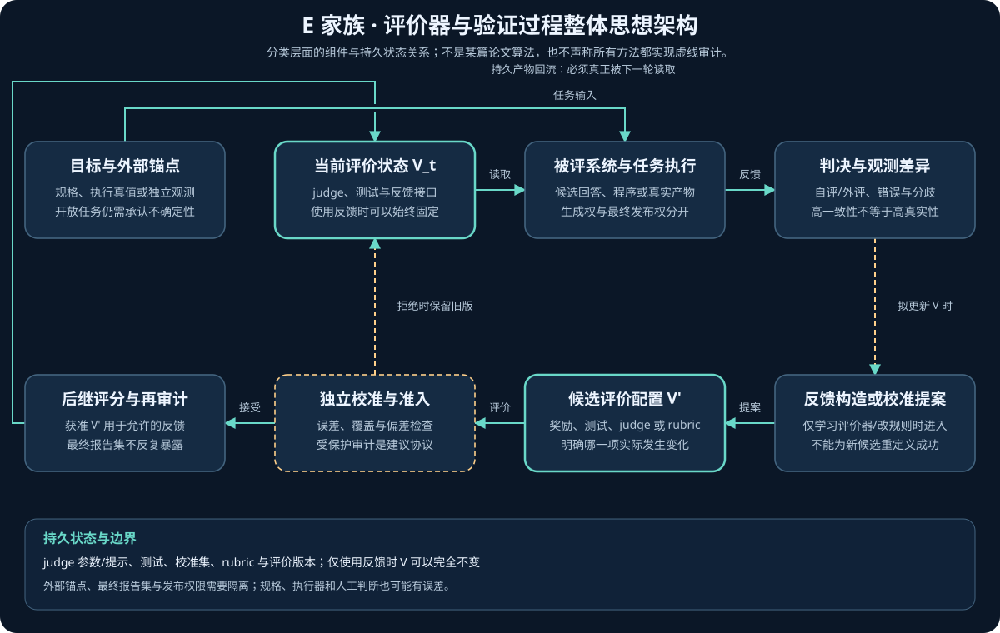
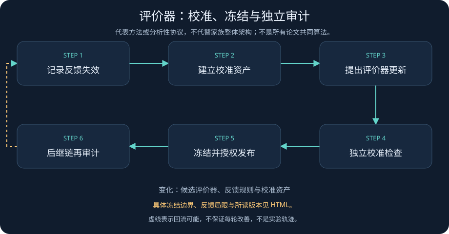
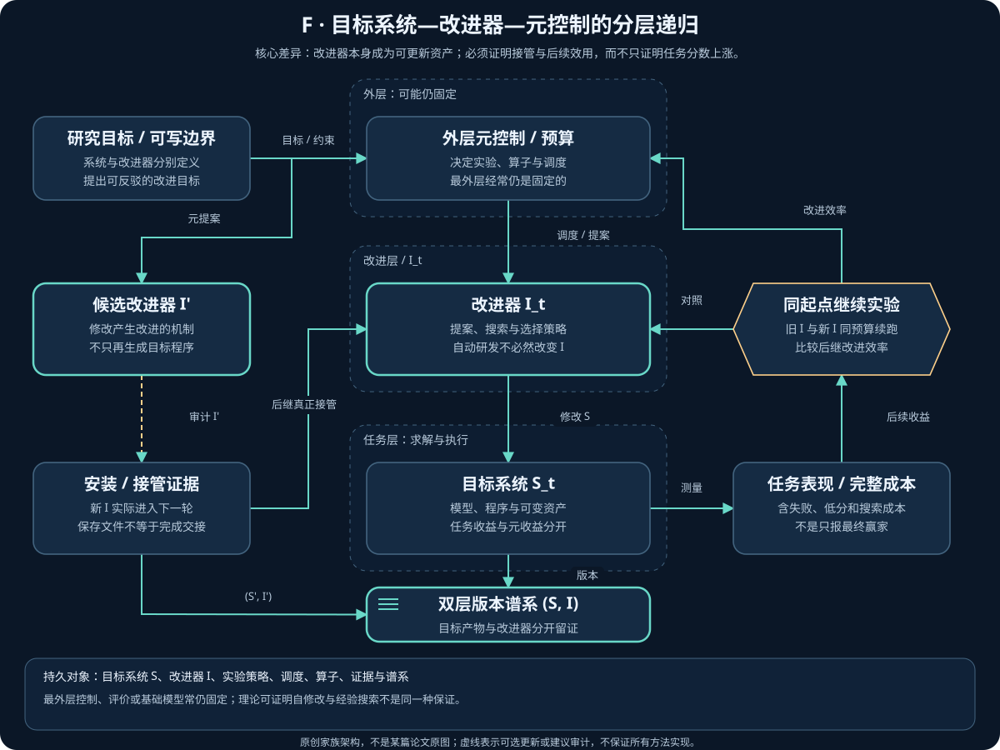
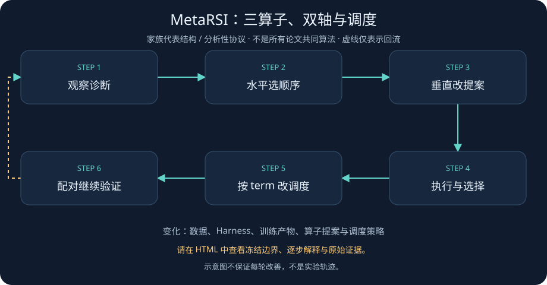
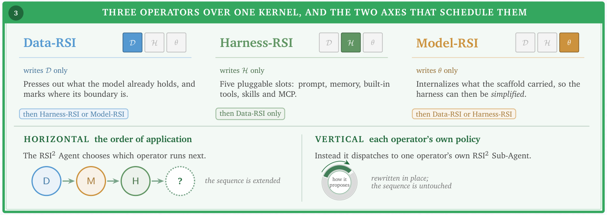
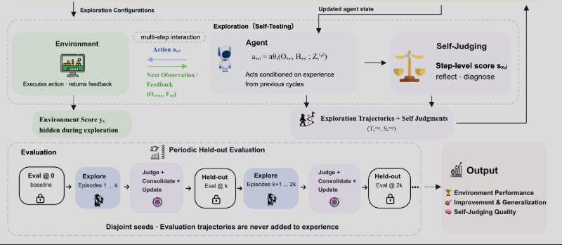

# 第四章 Meta-RSI、科学评测与安全边界

> 阅读范围说明：本章保留专题作者截至 2026-11-05 的版本化阅读与审计记录；正文中的“本次／本轮”指该来源记录，不表示本次公开同步重新精读论文或独立复现。私有笔记原稿不公开，见[来源说明](../Reading_Notes_Provenance.md)；日期、近期入口与未决来源见[近期研究](../06_Latest_Year_Research.md)。

返回 [RSI 技术全景](../01_RSI_Technical_Panorama.md)。
方法定位与首发时间见 [方法地图与时间线](../03_Method_Map_and_Timeline.md)。
交叉阅读：[潜空间推理与 CoT 可监控性](../Reading_Notes_Provenance.md)、[OpenRSI 详解](../Reading_Notes_Provenance.md)。
训练与环境见 [02_Training_Environments_and_AI_Research.md](02_Training_Environments_and_AI_Research.md)，技能与框架见 [03_Agent_Skills_and_Harness.md](03_Agent_Skills_and_Harness.md)。
产业证据与综述范围见 [05_Surveys_Industry_and_Frontiers.md](05_Surveys_Industry_and_Frontiers.md)；本章负责判定这些材料能够支持多强的科学主张。

本章的资料截止日期为 **2026-11-05**；“来源声称”“本文判断”“建议协议”分别表述。
本文关注的问题不是系统能否反复运行，而是改变是否持久、是否进入下一轮改进，以及评测是否仍然可信。
证据文件见 [evaluation-evidence.json](../research/evaluation-evidence.json)；记录阅读层级，不把访问到摘要称为阅读全文。
本章保留既有逐节读书记录；证据条目的 `ef_review` 单独记录本轮 E/F 专项实际回查的来源、版本、章节和主张。
没有 `ef_review` 的旧条目不表示本轮重新读过原文；正文与证据清单中的实验结果均为作者报告，不是本章独立复现。

## 1. 先区分三种递归

### 1.1 推理循环不等于自我改进循环

[Recurrent Depth 原文 §3.1、§3.3、§6.1](https://arxiv.org/html/2502.05171v2) 的循环对象是潜状态，训练目标与推理时增加循环次数是两回事。
写成 $`s_{r+1}=R_{\theta}(e,s_r)`$ 时， $`r`$ 是一次推理内部的步数， $`\theta`$ 在该推理过程中固定。
这里 $`e`$ 为输入表示， $`s_r`$ 为第 $`r`$ 步潜状态， $`R_{\theta}`$ 为参数固定的状态更新算子。
性能随 $`r`$ 增长说明系统能利用测试时算力，不说明它修改了模型、工具库或改进算法。
[TRM 原文 §4.1-§4.8、Figure 3](https://arxiv.org/html/2510.04871v1) 迭代潜变量 $`z`$ 和候选答案 $`y`$；训练伪代码中的 `opt.step()` 不能被移植成“部署期间自行训练”的结论。
TRM 对最后一段完整递归反传，并允许此前若干递归段不保留梯度；不能简化为对所有循环做完整反传。
“不需要专门的语言化推理轨迹”也不等于“不需要监督”：TRM 使用任务标签和深度监督。
这些结果可以进入 RSI 的候选架构库，但其本身不是递归自我改进的实验证据。

### 1.2 本图谱的双轴分类

下表是 **本图谱自定义的工作分类**，不是领域已经达成一致的标准。

| 修改对象 | 本图谱记号 | 需要保留的可审计产物 |
| --- | --- | --- |
| 训练、参数与数据配方 | A | checkpoint、数据版本、训练配置 |
| 环境与课程 | B | 环境版本、任务生成器、难度与分布记录 |
| 技能与持久记忆 | C | 技能内容、来源、检索配置与生效范围 |
| 执行框架与编排 | D | harness 代码、工具接口、预算与调度策略 |
| 验证器与反馈 | E | 评分器版本、校准集、权限和独立审计结果 |
| 研究者或改进器 | F | 提议、实验设计、选择与资源分配算法 |

| 递归层级 | 判断条件 | 不能替代的证据 |
| --- | --- | --- |
| L0 输出修订 | 只修改当前答案、轨迹或潜状态 | 不能用多轮对话证明持久改进 |
| L1 固定改进器 | 固定优化程序产生并保留组件修改 | 不能用运行轮数证明改进机制发生变化 |
| L2 改进反馈 | 更新后的组件实际参与并驱动后续修改 | 需要版本使用记录和禁用反馈的对照 |
| L3 改进器演化 | 产生、测试或选择修改的机制本身被更新并再次使用 | 需要证明新改进器改善后续改进，而不只是一次得分更高 |

L2/L3 是关于反馈路径的判断，不是关于模型大小、自治程度或安全性的评级。
固定权重的 agent 可以通过 D/F 达到更高层级；持续训练的模型也可能始终只是 A/L1。
研究任务成绩、跨代累计收益、改进效率增长分别是不同的待检验命题。

### 1.3 E 家族：使用反馈、学习评价器、修改评价规则

E 家族关心的是反馈如何变得更有用、更可信，而不是把所有带有 reward 的方法都重新归为 E。
下面三种行为是不同的修改对象，不是必然依次升级的路线；这是本文分析口径，不是论文的统一分类。

| 行为 | 实际改变什么 | 最小判别证据 | 不应作出的推断 |
| --- | --- | --- | --- |
| 使用反馈 | 答案、记忆、策略或训练数据；评价器本身可以不变 | 哪种分数或环境观察进入了哪次更新 | 有自评、反思或 reward，不等于评价器被学习 |
| 学习评价器 | judge 的参数、提示、校准或验证程序，在固定目标下提高判别质量 | 冻结的新旧 judge 对独立标注或执行结果的误差、覆盖率和后续效用 | 新 judge 更赞同生成器，不等于更接近真值 |
| 修改评价规则 | 任务定义、rubric、目标权重、通过阈值或测试生成规则 | 规则差异、外部有效性复核、旧新规则交叉评估和重新标定 | 新规则下分数更高，不等于旧目标下能力增长 |

环境可执行 verifier 是相对于明确规则的外部参照；测试覆盖不足、模拟器失真和规范错误仍可能存在。
开放科学问题没有免费真值时，应记录测量、复现、独立专家评审及其分歧，不能把多数模型一致改名为真值。
执行验证问“产物实际做到了什么”；盲测还要说明谁看不到答案、候选身份、测试项目和先前判决。
同一模型开两个会话可以隔离答案输入，但不消除共同知识错误；生成器与 judge 共同优化也可能形成互相迎合的评分闭环。
这里的“自评共谋风险”包括非蓄意的共同偏差和奖励投机，并不意味着已证明每篇系统发生了有意串通。
S3Gym 提供“自评是否对得上外部结果”的诊断；MetaRSI 的最终评分不在可写面内，不能因此把它宣称为已实现评价规则自演化。

<!-- family-e-architecture:start -->


[交互架构](../../../pics/family-e-architecture.html) · [六家族说明](../08_Family_Architectures.md)。研究反馈从哪里来、是否更接近任务目标，以及评价过程能否被改进；不能把自评分上涨当成真值改善。 这是家族级原创架构；下方流程图是代表方法或参考协议，二者不互相替代。
<!-- family-e-architecture:end -->



[打开 E 家族动态流程](../../../pics/family-e-flow.html)。这是**本文家族参考闭环**，不是任一论文的原图。
图中的独立审计、隔离报告集、发布权限与回滚是本文推荐约束，不等于每篇方法已实现或已验证这些控制。

### 1.4 F 家族：自动研发、系统递归、改进器的递归

| 主张 | 必须观察到的交接 | 典型不足 |
| --- | --- | --- |
| 自动研发 | 固定研究者完成实验、搜索或模型改进 | 被改好的目标模型仅接受测试，没有接管后续研发 |
| 系统递归 | 后继系统或其持久产物实际影响下一轮生成、实验或选择 | 只累计输出、重启同一初始状态，或只是反复测分 |
| 改进器的递归 | 提案、实验设计、选择或资源分配机制改变，并以新版本继续改进 | 只有权限、代码差异、较高任务分数，没有实际复用证据 |

以下统一式是**本文分析模型，不是任何论文原式**，用于把“生成后继”与“安装后继”分开：

```math
(\widetilde S_{t+1},\widetilde I_{t+1},\mathcal E_t,\mathbf c_t)
=I_t(S_t,\mathcal E_{\lt t};\mathbf B_t),\qquad \mathbf c_t\preceq\mathbf B_t,
```

```math
(S_{t+1},I_{t+1})=\mathcal A^\star(S_t,I_t,\widetilde S_{t+1},\widetilde I_{t+1},\mathcal E_t;V^\star).
```

$`t`$ 是外层改进轮次； $`S_t`$ 是已安装的任务系统及持久状态； $`I_t`$ 是本轮实际调用的改进机制，包含提案、实验、选择和预算策略。
带波浪号的是候选，不带波浪号的是按验收规则保留的版本；候选可以不改变 $`I_t`$。
$`\mathcal E_t`$ 是本轮可供开发使用的证据， $`\mathcal E_{\lt t}`$ 是之前各轮的证据历史；独立报告集不属于该输入。
$`\mathbf B_t`$ 与 $`\mathbf c_t`$ 分别是资源上限和实际支出向量， $`\preceq`$ 表示逐项不超限，不假设 tokens、GPU 时间和验证查询可以自由折算。
$`V^\star`$ 是受保护的验收参照； $`\mathcal A^\star`$ 是安装或拒绝候选的受保护规则，拒绝时可保留旧版本；星号表示权限边界，不表示参照没有误差。

关键调用是下一轮的 $`I_{t+1}(S_{t+1},\mathcal E_{\le t};\mathbf B_{t+1})`$，其中 $`\mathcal E_{\le t}`$ 包含截至本轮的开发证据。
只有版本标识、装载记录和调用轨迹证明新的 $`I_{t+1}`$ 进入生成、实验或选择路径，才能确认改进器递归的结构事实。
如果始终调用旧 $`I_t`$，即使新程序已保存、甚至单独测分更高，也没有完成这一交接。
反过来， $`I_{t+1}=I_t`$ 不排除系统层的反馈，但不能据此宣称改进器本身演化。
结构事实仍不等于收益事实：第 6 节用同起点、冻结新旧改进器、匹配后续预算的继续实验检验其贡献。
任务得分上升、累计收益扩大和单位资源改进速度增长必须分开报告；发现新改进器的成本也不能从端到端账目删掉。

<!-- family-f-architecture:start -->


[交互架构](../../../pics/family-f-architecture.html) · [六家族说明](../08_Family_Architectures.md)。把研究、搜索、提案、选择或预算机制也当作候选对象；关键证据是新改进器实际接管下一轮，而非只多生成一份程序。 这是家族级原创架构；下方流程图是代表方法或参考协议，二者不互相替代。
<!-- family-f-architecture:end -->



[打开 F 家族动态流程](../../../pics/family-f-flow.html)。这是**本文家族参考闭环**，不是把所有 F 方法画成同一个已实现算法。
独立继续实验、审计、停止和回滚属于本文建议；某篇论文是否实现，须按下文原文证据分别判断。

## 2. MetaRSI：改进对象与改进规则分开建模

<!-- paper-figure-metarsi:start -->


原论文 Figure 2（下方三算子与双轴局部）（v2），[作者原文及图注](https://arxiv.org/pdf/2609.06396v2#page=2)；[CC BY 4.0](https://creativecommons.org/licenses/by/4.0/)。Tan, Zihan；Sun, Leixin；Shi, Zitong；Liu, Yitao；Wu, Jiajun；Brooks, Nathaniel；Qian, Jiaru；Shang, Xiaoran；Huang, Suyuan；Ding, Yi；Liao, Yangxu；Li, Mukai；Sun, Qiushi；Liu, Shudong；Rong, Xuankun；Yu, Xiaohang；Chen, Zhuo；Geng, Hejia；Li, Chenxin；Wang, Aozhou；Tu, Zengji；Tang, Robert；Zhan, Yuxin；Jiang, Eric；Wu, Yuxin；Zhang, Jianqing；Liang, Xiao；Wu, Fang；Zhang, Haochi；Marlow, Alexander；Wan, Guancheng。从 PDF 第2页截取坐标(56,317)-(556,494)点的图2下方架构，3倍渲染；省略摄影背景、页眉与图注，未改写图内内容。此处展示 Data/Harness/Model 三算子及水平顺序、垂直提案策略优化；不是完整 Figure 2，也不等同于 A–F 分类或无限层递归。
<!-- paper-figure-metarsi:end -->

### 2.1 三个算子不是本图谱的三个等级

[MetaRSI 项目页](https://cosmosmind.ai/research/metarsi-v1) 标注 2026-09-03；[arXiv 2609.06396](https://arxiv.org/abs/2609.06396) 的 v1 为 09-06、v2 为 09-09。
本章读取的是 [v2 HTML §3-§6、附录 B-F](https://arxiv.org/html/2609.06396v2)，不能把博客日期写成 arXiv 首发日期。
论文把目标系统写成数据、模型和 harness 的三元组；它的 Data/Harness/Model 三算子与本图谱 A-F 分类不是同一套字母。
Data-RSI 从执行轨迹提炼经验，再生成和复核训练记录，主要对应 A，并可为 C/D 提供经验。
Harness-RSI 修改 system prompt、memory、built-in tools、skills、MCP 五个槽位，对应 C/D，不要求修改权重。
Model-RSI 搜索有界训练配方，包括 adapter 位置、可训练模块、容量与优化配置，对应 A。
特别要注意 §4.2.3：候选训练从固定基座和累计数据重新开始，并非每轮接着上一个 adapter 训练。
递归反馈仍可以发生在数据、经验和调度策略上；“固定基座训练”与“没有递归反馈”不能画等号。

### 2.2 一条执行内核、两个优化方向

§4.1 的内核是 Observe、Diagnose、Propose、Validate、Execute、Select、Export。
模型负责诊断和提案；受保护代码负责边界检查、执行、选择和导出，候选生成权不等于发布权。
水平优化决定算子顺序；垂直优化重写各算子的提案策略，二者分别改变执行计划和改进方式。
§4.3 的“新鲜性”条件要求下游证据描述当前系统，由此在该框架中排除直接 Harness-to-Model 和连续 Model-to-Model 转移。
这是一项设计约束，不是证明其他训练系统不能合法使用历史数据的普遍定理。
§4.5 的 MetaRSI2 根据一整个 term 的结果修改调度策略，涉及路由、预算、停止和垂直优化时机。
最外层 meta policy 的参数保持固定，原文明说层级在这里终止，不能宣传为无限层自我重写。
按本图谱，这使系统具有 F/L3 的设计与实验依据，但等级判断必须落实到实际安装并复用的策略版本。
模型生成的失败原因仍是假设；结构化记录提高可审计性，并不自动把相关性变成因果解释。

### 2.3 哪些实验证据更接近“改进改进器”

§5.1-§5.2 比较单算子、人工固定顺序、随机组合、静态路由与完整系统，包含五个外层随机种子。
作者在 §5.2 Table 3 报告完整系统比最强固定组合平均高 3.6 个百分点；这是四基准平均，不是本章复现实测。
测试包括代码执行与闭式科学问答，不是开放科学发现，也没有覆盖无限任务分布。
§5.4 更有判别力：从同一个 $`S_1`$ 分叉，比较原改进器和 meta 更新后的改进器，在同一轮预算内继续改进。
作者在 §5.4 Figure 11(c) 报告第二轮平均新增 4.9 与 7.2 个百分点；同起点分叉比只画最终系统分数更能隔离改进器贡献。
作者在 Figure 11(a)-(b) 报告五个 term 的累计收益增加，但两条路径的每轮边际收益都下降；“存在累积”不能被改写成“增长不断加速”。
改进预算与 meta 预算分账是有用的会计设计；端到端比较仍要核对是否把两者及失败候选全部计入。
§3 与附录 F 说明每个 term 冻结后打开 sealed split；§5.4 又说明跨 term 使用相同 sealed splits。
因此必须核对后续 meta 更新究竟看到了哪种 gate verdict：若包含 sealed 结果，即使只反馈通过/拒绝，也可能发生适应。
这不是已证实的数据泄漏指控，而是“单轮只打开一次”不能自动证明“跨轮统计独立”的具体审计问题。
§4.2.1 的同模型盲解隔离答案输入，但不能消除同模型共享的知识错误；一致性不是外部真实性。
§6.7 的“五条规律”是作者提出的可反驳主张，不是已建立的领域定律，尤其不能从不可写评分器推出完整可信性。

### 2.4 论文系统与公开仓库的边界

[RSI-Harness README](https://github.com/CosmosMind-ai/RSI-Harness) 展示 Pi 上的 Genome 配置层、历史证据提炼和 `harness-rsi` 生成其他 Genome。
它包含十二类配置组件；这与论文的五槽位分析抽象相关，但不能逐项当作相同实现。
README 的 Development 段明确说仓库不包含 benchmark、data-generation、training 或 evaluation code。
所以公开仓库支持“可版本化的 harness 工程组件已发布”，不支持“完整 MetaRSI 实验已经一键复现”。
Current status 还说明分享前的敏感信息脱敏 gate 尚未实现；从个人历史生成的 Genome 不能直接视为可公开资产。
本章没有运行仓库，也没有独立复现论文数字，结论保留在全文审阅与公开 README 核对的证据等级。

### 2.5 RSI-Master：结构化研究反馈不等于替换研究者

[RSI-Master](https://arxiv.org/abs/2609.35561) 的 v1 提交于 **2026-09-28**；本节深入读取 [v1 §2-§3、附录 A/B/E](https://arxiv.org/html/2609.35561v1)。
提交历史另列 09-30 的 v2，本节不把 v1 方法审阅冒充 v2 的逐项复核。
其核心不是让评分器自行宣布进步，而是把实验权限、产物溯源和研究方向的选择放在不同接口中。
Experiment OS（ExpOS）保存输入 checkpoint、数据、训练配置、输出 checkpoint、评价和审阅记录组成的实验图；研究图则以 Worker 和 Reviewer 为节点。
Worker 执行实验，Reviewer 从原始实验记录核对结论，Main Agent 根据报告继续、复核、分叉或修改研究方向；图按事件异步增长，不是预先固定的单一路线。
§2.3 的 Worker 只看聚合表现，Reviewer 可读取更细诊断，但回传 Main Agent 时去掉受保护的评价实例与参考答案。
这是角色权限和证据通道的分离，不是学习了外部真值；诊断或聚合得分一旦影响后续搜索，仍属于自适应反馈。

**F 边界。** §3.1 与附录 A.2 说明各 agent harness 都由 Kimi-K3 驱动，被训练的是 Qwen Base 模型。
新 checkpoint 可以继续训练，实验与审阅记录进入下一次研究决策；但所读实验没有展示该 checkpoint 替换 Kimi-K3，也没有展示 Main Agent 的改进策略版本被改写后接管下一轮。
因此可以说它实现自动研发与持续研究状态反馈，不能由研究 DAG 动态增长推定 $`I_{t+1}\ne I_t`$，更不能把它直接列作已验证 F/L3。
§3.4 的去 Reviewer、去 ExpOS、串行 Worker 消融针对组件作用，不是冻结新旧改进器的同起点继续实验。

**作者结果与评价边界。** §3.2 Table 2 报告 PostTrainBench 七任务平均 54.49，对最强 agent 基线 46.53；这是各任务模型的宏平均，不是一个通用 checkpoint 同时达到所有成绩。
§3.5 Table 4 报告 0.0% 的记录到的 hacking rate；附录 E.1 的分母是所有实验提交，违规按提交及其 lineage 计数，受影响提交之间并非独立外层运行。
审计用 Codex/GPT-6 并由人类复核已识别违规；定量标注一致性尚未汇总，也未建立漏报率上界，所以“未检出”不能升格为“零风险”或已经实现独立双盲审计。
§2.2 按最高评价分选择合规 checkpoint；要宣称独立泛化，仍需另核最终报告集是否未曾通过评分、诊断或选优影响搜索。
附录 A.1 给每次研究 **12 小时**上限，4B 使用单 H100，35B-A3B 使用八 H20，并允许指定外部模型 API；不能与原始 PostTrainBench 的十小时协议无条件混表，也不能称为没有外部教师资源。
§3.6 Figure 5 的后半程收益是在追加时间后的 best-so-far 观察，不是单位资源改进速度增长，更不是新改进器优于旧改进器的因果证明。
附录 A.3.2 的跨域结果来自各任务分别优化；这测框架适用范围，不是冻结同一产物的零样本跨域迁移。
HorizonMath 的非零评分在这里仅按作者报告视作基准现象；没有逐题证书、复核和评测细节，就不能推成解决了若干此前未解定理。
训练流程和工程环境的主体分析见 [训练与环境专题](02_Training_Environments_and_AI_Research.md)，本节只保留 E/F 证据边界。

## 3. 理论、程序自改写与长期预测

### 3.1 Gödel Machine 的保证有前提

[Gödel Machine](https://arxiv.org/abs/cs/0309048) 首发于 2003-09-25，本章读取 [v5 HTML §2.2-§2.4、§4、§5.1](https://arxiv.org/html/cs/0309048v5)。
系统同时运行问题求解器和证明搜索器；只有证明立即执行某个自改写优于继续等待搜索，才实施该改写。
证明可以涉及证明搜索器自身，因此“改进改进规则”不必无限增加一层外部人工算法。
§4.1 的 global optimality 是相对于形式化效用、公理、环境假设、资源限制及当前搜索策略的条件结论。
它不是“穷举后找到了现实世界所有系统中最强的模型”，也不是无条件保证每个有益修改都能及时证明。
§2.4 明确讨论不可证明性和有限资源；证明搜索的渐近阶最优也不能消除巨大的常数开销。
安全性质只有进入正确规范及证明假设才受保证，效用提升本身不蕴含人类意图或价值对齐。
工程启发是把修改理由、可写范围、验收条件和授权边界显式化，而不是要求 LLM 自述“已经证明安全”。

### 3.2 STOP 的“自我”在 improver 程序中

[STOP 的正确编号是 2310.02304](https://arxiv.org/abs/2310.02304)，v1 为 2023-10-03；COLM 2024 是后续会议发表，不能替代首发时间。
一手摘要确认：种子 improver 多次调用固定 LM 生成候选，以给定 utility 选优，然后把 improver 自身作为改进对象。
优化产物因此可以是后续程序搜索的机制，而不是只把当前答案改得更好；按本图谱属于 F，具备局部 L3 的机制形态。
作者同时明确说 LM 本身未改变，因而不是其定义下的 full RSI；这与本图谱允许非参数化 L3 并不矛盾。
不能把该实验写成 GPT-4 修改了自身权重，也不能把小型下游程序任务写成通用智能持续复利。
既有访问记录中 arXiv v1/v3 HTML 返回 404，ar5iv 转换失败；本轮重核摘要与提交历史，未据二手综述补写 STOP 的表格数字或算法细节。
其 [官方仓库](https://github.com/microsoft/STOP) 与论文身份另行核对，论文全文阅读缺口保留在证据记录中。

### 3.3 DGM 的强证据和必须保留的限定

[DGM v3 §3、§4、附录 C/E](https://arxiv.org/html/2505.22954v3) 把可读写代码的 agent 保存在档案中，选父代、自修改、评测，再保留可工作的子代。
改进后的 agent 会参与后续修改，支持 D/F 上的反馈；但 §3 明确说档案维护和父代选择不在可修改范围内。
主要证据支持 D/F 上的 L2；若进一步声明局部 L3，还须定位改进机制的实际改写及复用，不能只凭编码能力提高。
它用经验验证替代 Gödel Machine 的证明要求，没有继承后者的形式化全局最优或安全保证。
§4.3 的固定初始修改者对照，以及去掉档案的对照，比单条最好成绩曲线更接近机制鉴别。
§4.4 还报告跨模型、跨基准和跨编程语言迁移，这些结果比开发集上反复选优更能支持可复用改进。
然而主 SWE-bench 曲线使用论文指定的子集，不是把全量 SWE-bench Verified 当作独立测试集。
按既有 v3 §4.2-§4.4 原文记录，作者报告的 20% 到 50% 对应 200 题子集；Polyglot 搜索子集的 14% 到 38% 与全量的 14.2% 到 30.7% 不能互换。
附录 C.3 使用额外的 o1 诊断模型，并向诊断阶段提供 private test 信息；“执行时隐藏测试”不等于“整个优化过程从未接触测试”。
论文的跨基准迁移可缓解任务特异性担忧，但不能反过来把开发阶段接触过的数据重新称为独立。
附录 E.1 估算 DGM 单次 SWE-bench 运行约 22,000 美元，而两个主要消融约 10,000 美元；相同迭代数不是等成本。
以上成本是论文报告的历史估算，不是本章给出的当前价格或已归一化效率排名。
论文还指出高性能后继通常推理更贵，因此要同时审计发现成本与部署成本。
附录 H 的工具幻觉研究展示评分和真实行为可能分离；防御要保护外部观测链，而不只保护评分函数源码。

### 3.4 AlphaEvolve：自动算法研发不自动等于改进器自改写

[AlphaEvolve 官方文章](https://deepmind.google/blog/alphaevolve-a-gemini-powered-coding-agent-for-designing-advanced-algorithms/) 发布于 **2025-05-14**；[论文 arXiv v1](https://arxiv.org/abs/2506.13131) 提交于 **2025-06-16**，两种日期分开保留。
本轮读取论文摘要与官方文章的算法设计、训练基础设施应用等段落，没有读取论文全部方法与实验。
官方机制是模型提出代码、自动执行与评价、程序库保存候选，再由演化机制为后续提案提供程序；这是使用可验证反馈的算法搜索。
被发现的产物也可以是搜索算法或训练内核，因此与 F 有交集；但“改进一个 optimizer 程序”不等于 AlphaEvolve 自身的候选生成、选择器和预算分配已被递归替换。
官方关于加速底层模型训练的陈述说明潜在系统级反馈，尚不能仅凭该陈述确认新模型何时装入下一轮 AlphaEvolve、贡献多少等预算增益。
本章不引用其部署收益比例作跨系统效率排名，也不把自动评价、形式正确性检查或公司生产使用合并成完整 RSI 安全保证。

### 3.5 路线图不能当作实验时间线

[The Last AI Built by Humans v3 §1.7、§2.2、§3.6.5](https://arxiv.org/html/2609.11873v3) 区分结构性递归和有效递归，这与本章的证据分层一致。
该文的 B0/L1-L5 是自治责任路线图，本章的 L0-L3 是反馈层级；同名 L3 不表示同一件事。
其 §2.1 的 HCI 用于整理异构能力进展；后 2026 区域明确是示意延伸，不是已经测得的 RSI 增长曲线。
系统被归入某一理论阶段，并不自动证明同预算下的递归加速，更不能由标题推出“人类已完成最后一个 AI”。
[What if automating AI R&D triggers an intelligence explosion?](https://arxiv.org/abs/2609.36054) 首发 2026-09-28，属于证据讨论与政策论证。
其摘要提出“可能压缩研发进展时间”并承认不确定性；既有记录未取得 v2 HTML，本轮仍只回查摘要和提交历史，未核验全文细节或定量预测。
本章只将其作为需监测的风险情景，不把情景分析、作者阵容或研发自动化比例当作已经发生智能爆炸的证据。
证明长期加速至少还需处理算力增长、人工投入、基准饱和、实验并行度和独立验证瓶颈。

### 3.6 最近一年 E/F 覆盖与证据等级

本节窗口为 **2025-11-05 至 2026-11-05**，按原始 v1 提交日期归入窗口；Gödel Machine、STOP、DGM、AlphaEvolve 是前史，DGM 的近期修订不改变其首发归属。
下面日期都回查了一手提交历史，未使用 overview 括号日期或编号月份推断。
“正文节读”只表示阅读了证据清单列出的版本和章节；“摘要”不会被上调为代码审计、完整复现或已验证的递归等级。

| 原始入口与 v1 日期 | 性质与本轮阅读 | E/F 支持范围 | 仍不能推出 |
| --- | --- | --- | --- |
| [S3Gym](https://arxiv.org/abs/2608.31100)，08-31 | 基准；v1 正文节读 | 自评与执行真值分离，诊断经验转化 | 自评器被独立学好、固定整合器自行演化 |
| [MetaRSI](https://arxiv.org/abs/2609.06396)，09-06 | 方法；v2 正文节读 | 改写并复用算子策略及调度器，有同起点继续实验 | 无限层递归、跨 term 测试零适应、持续加速 |
| [The Last AI Built by Humans](https://arxiv.org/abs/2609.11873)，09-10 | 综述与路线图；v3 摘要回查，沿用旧正文笔记 | 区分结构与有效递归，组织自治责任 | 已提出并验证一个“最后 AI”算法 |
| [Recursive self-improvement of AI research agents](https://arxiv.org/abs/2609.26457)，09-22 | AIDE^2 实证系统；v1 摘要 | 摘要声明修改自身研究代码、搜索策略与记忆，接受后继继续研究 | 尚未核对具体交接、等成本对照及效率指标定义 |
| [RSI-Master](https://arxiv.org/abs/2609.35561)，09-28 | 研发框架；v1 正文节读，v2 仅摘要 | 受控实验与跨实验 review，研究状态持久回流 | 目标模型接管研究者，或改进算法自改写 |
| [Intelligence-explosion 讨论](https://arxiv.org/abs/2609.36054)，09-28 | 情景与政策讨论；v2 摘要 | 提出研发自动化的风险情景与治理需求 | 已发生智能爆炸或已实测宏观递归加速 |
| [AReaL-RSI](https://arxiv.org/abs/2610.18083)，10-13 | 研究团队框架；v1 摘要 | 固定 backbone，campaign 后修订研究方向、知识和技能供下一 campaign 使用的声明 | 团队扩容或迁移收益必然来自改进器递归 |
| [SwarmRSI](https://arxiv.org/abs/2610.20431)，10-14 | 科研群体演化方法；v3 摘要，修订 11-02 | 反馈引导假设/实现变异，跨 agent 重组互补程序部件 | 总程序分数即局部组件贡献，或变异器本身已演化 |
| [RSIHub](https://arxiv.org/abs/2610.32253)，10-23 | 组合与比较框架；v1 摘要 | recipe 声明可写资源，固定评测、恢复与 lineage 支持方法比较 | 框架是新的单一 RSI 算法，所有接入方法均达 L3 |
| [Trustworthy RSI](https://arxiv.org/abs/2610.35193)，10-26 | 综述与证据框架；v1 摘要回查，沿用旧正文笔记 | 改进有效性、约束保持、有效监督及纵向证据要求 | 综述自身实现或实验证明了一个安全 RSI 算法 |
| [CogRSI](https://arxiv.org/abs/2611.01113)，10-31 | 策略方法与审计；v1 正文节读 | 行为收益、成对有效性和规则语义分别检验 | 有用策略必为正确规则，或离线审计已接入在线 gate |

**摘要级主张如何使用。** AIDE^2 的摘要是直接指向 F 的机制声明：改写研究 agent 自身代码，并报告未参与选择的任务迁移。
但本轮没有据此补写搜索伪代码、运行级成本表或新旧改进器因果对照，也不转引摘要中的收益与 hacking 比例作为已核验结果。
SwarmRSI 的摘要明确将假设与实现的修订、保留假设与互补程序部件的重组分开；作者还报告 held-out 迁移与生物学家重运行程序。
后者是作者的复现陈述，不是本章独立复现；仍需核查完整实验、部件归因、共享经历是否进入测试选择以及总群体成本。
AReaL-RSI 摘要区分未解决问题与有适用条件的发现，由 leader 组织研究并在 campaign 后审阅方向、知识和技能；其“全系统资源支出”表述值得保留，但未读账目就不能断言对照已经等成本。
RSIHub 摘要明确承认方法排名随设置变化、优化收益未必迁移；可将它列为比较基础设施，而非用框架名字替代每个 recipe 的可写范围和递归交接证据。
这些摘要级条目都保留“下一轮到底调用了哪个版本”的待核验项，不因标题中的 recursive 自动判定 L3。

综述、理论和情景讨论在本章保留各自文献类型，不冒充提出实证方法的算法节点。
OpenRSI、Dream-RSI 的主体机制由 [训练与环境专题](02_Training_Environments_and_AI_Research.md) 负责；可写技能与 harness 的承载方式见 [技能与框架专题](03_Agent_Skills_and_Harness.md)。
E/F 的跨类审计只追加两个问题：外部评价能否反驳系统自评，以及被改变的研究机制是否真正被下一轮调用。

## 4. 基准测量的究竟是哪一种能力

### 4.1 研究任务、持久更新与递归复利不是同一个因变量

“能完成 AI 研究任务”是 RSI 的相关能力；“产生持久改进”还需要版本继承；“改进器变强”又需要后续改进效率的对照。
不能因为一项基准允许训练、搜索或反复试验，就把其排行榜直接命名为递归复利排行榜。
下表的“可支持”限定为该基准协议能够测量的对象，不代表所有参评系统都成功实现了该能力。

| 基准与一手入口 | 测量对象 | 对递归主张的边界 |
| --- | --- | --- |
| [RE-Bench](https://arxiv.org/html/2411.15114v2) | 七个有明确目标的 ML 研发工程环境，与专家比较 | best-of-k 和更长尝试测任务解法，不自动测研究者跨代改进 |
| [MLE-bench](https://arxiv.org/abs/2410.07095) | 75 个 Kaggle 竞赛中的 ML 工程表现 | 本次仅核验摘要；奖牌比例不是 improver 更新或研究创新指标 |
| [PaperBench](https://arxiv.org/html/2504.01848v3) | 从论文重建代码并复现实验，按作者参与制定的 rubric 评分 | 复现能力不等于自主提出新研究方向，更不等于递归加速 |
| [PostTrainBench](https://arxiv.org/html/2603.08640v2) | 固定预算内为指定目标模型完成后训练 | 改善另一个模型不证明该后继接管下一轮研究 |
| [RSIBench-Data](https://arxiv.org/html/2607.25886v1) | 固定训练和评测服务下的数据研究策略与 checkpoint 选择 | 隔离的是数据中心研究决策，不是完整学习算法自演化 |
| [Aspire](https://arxiv.org/html/2608.31111v1) | 从模糊目标构造学习代理目标，再评估权重或 harness 更新 | 支持决策模型交接的接口，不代表已报告实验实际交接 |
| [S3Gym](https://arxiv.org/html/2608.31100v1) | 自测、自评与经验转化对未来行为的作用 | 三条更新路径本身固定，不能仅凭多轮经验积累判 L3 |
| [HarnessDev](https://arxiv.org/html/2609.01437v1) | 创建并演化可执行 harness，冻结后由 executor 运行 | creator 的开发环境固定，生成框架尚未用于接管后续开发 |
| [EvoHarnessBench](https://arxiv.org/html/2609.04280v3) | 外部提供的工具、技能、专家池扩张下的保留与适应 | outer harness 的变化由基准提供，不是 agent 自主创造它的证据 |
| [SelfImprove-Bench](https://arxiv.org/html/2611.02797v1) | 非参数更新后的分层泛化及实际编辑轨迹 | G0-G4 是泛化距离，不是本图谱 L0-L3 递归层级 |

### 4.2 任务得分也需要检查评测语义

RE-Bench §3.2 通常取一次运行中最高已记录分数，§4.2 再比较独立短运行的 best-of-k；这两层选择都会放大幸运结果。
§6.3 明确指出除 Scaling Law Experiment 外会暴露测试得分，并承认过拟合风险；“题目不直接可见”不等于没有测试反馈。
§6.2 的美元比较排除环境 H100 成本，因此该图不能直接支持全成本效率排名；同总尝试时长也不是一次连续工作的时长。
PaperBench §2.2-§2.4 区分代码存在、成功执行、结果匹配三类信用，且在全新环境中运行提交的复现入口。
作者在 PaperBench §5.2 报告的 21.0% 是加权 rubric 完成比例，不是“完整复现了 21% 的论文”；§3 的 8,316 个叶节点也不是 8,316 个独立论文样本。
§2.6 的 Code-Dev 跳过执行复现，只是更便宜的代理；§4.2 的 JudgeEval F1=0.83 不能替代对每个新提交的真实性核验。
PostTrainBench §2 固定为每个目标 10 小时、单 H100；Astra 卡中的 PostTrainBench Lite 是 5 小时版本，不能混表。
其 §3.2 说明窄目标成绩高于官方 instruct 版本不意味着重建通用后训练；官方模型预算和多目标约束也不匹配。
附录 B/E 允许查询 benchmark 并检查污染，故不能把“未用于训练”自动升级为“整个自适应过程未接触”的最终测试。

### 4.3 新式自改进基准暴露了哪些失败

RSIBench-Data §3.1-§3.5 将数据策略、训练产物、选择反馈和最终提交关联，训练候选均从固定基座启动。
但 §6 明说 selection 与 official evaluation 使用同一任务子集；fresh environments 指新执行环境，不指统计独立的新任务。
作者在 RSIBench-Data §5.2 报告的 18/23，即 78.26%，指继续搜索后“最后尝试的候选”低于历史峰值，不能写成最终提交必然回退。
历史最优选择可以保住已发现的候选，却不能消除选优偏差，也不能证明后续搜索越来越有效。
Aspire §3.2 分开 final-only 和有限 aggregate-feedback；后一设置仍是重复反馈下的选择，不是未经适应的测试。
§4.3 明确所有已报告权重实验固定初始 decision model；§4.4 仅生成一步 $`H_1`$，没有从 $`H_1`$ 继续生成 $`H_2`$。
§3.3 的 retained gain 非负来自 score-gated rollback，不能当作所有尝试都单调改善的证据。
S3Gym §4.2 将 agent 自评与环境 verifier 分开，主设置的探索阶段不向 agent 返回 verifier 的步级或最终分数。
§4.4 排除评测轨迹进入记忆与训练；§5.2 每 checkpoint 仅三个 strict episodes，统计精度仍需谨慎。
本文特别提醒：其 $`AUC^+`$ 截断负收益，适合描述正向面积，但必须同时报告最终差值和回退，不能单独代表净收益。
HarnessDev §3.4 使用 Self-Eval 和固定 executor 的 Unified-Eval，说明 harness 与执行模型具有交互作用。
§3.5 的成本只计 executor tokens，排除 creator；§6.1 的 Evolution 每个 creator-runtime 单元仅一条轨迹，不能据此估总体置信区间。
§6.1 还明确把“演化出的 harness 用作下一轮开发环境”留作未来工作，所以此实验不直接建立 F/L3。
EvoHarnessBench §3.2 的外层能力集只增不减，§3.4 分别测无持久状态的 deployment 与携带状态的 inner adaptation。
其附录 D 的阶段-任务矩阵能揭示旧任务遗忘和新能力适应的冲突，但不能外推到工具退役、接口替换等未测迁移。
以上局限不是取消基准价值，而是确定它们在完整 RSI 证据链中的位置。

### 4.4 E 深读一：S3Gym 如何把自评与外部结果拆开

<!-- paper-figure-s3gym:start -->


原论文 Figure 2（自测、自评与评估局部）（v1），[作者原文及图注](https://arxiv.org/html/2608.31100v1#S4.F2)；[CC BY 4.0](https://creativecommons.org/licenses/by/4.0/)。Shi, Jiajun；Tao, Siyuan；Wu, Yuhao；Wang, Zexuan；Zhang, Jingyuan；Liu, Jiaheng；Lei, Xinping；Zhang, Xinrong；Fang, Siyuan；Tan, Zhewen；Cai, Tianle；Fang, Junhao；Huang, Jiameng；Wang, Yueyang；Liu, Jinkai；Zhang, Yuxuan；Yang, Jian；Li, Zhoujun；Yan, Shen；Huang, Wenhao；Zhang, Ge。原图 y=145..494 像素下方局部，省略游戏美术示例；未改写局部图内内容。此处展示自测、自评与周期性独立评价，省略上方游戏示例和经验吸收选项；完整框架见原文。它用于诊断自改进能力，不意味着所有评价器都在自动改变。
<!-- paper-figure-s3gym:end -->

本节依据 [S3Gym v1 §4-§6、附录 A.1](https://arxiv.org/html/2608.31100v1)；[提交历史](https://arxiv.org/abs/2608.31100) 确认 v1 为 **2026-08-31**。
一次交互中，模型同时产生动作和对该动作即时奖励的自评，随后环境执行动作。
必须区分三项：agent 可见的环境观察、自评分，以及 benchmark 保留的执行奖励；隐藏执行奖励不等于 agent 完全看不到环境后果。
§4.2 主设置不向探索中的 agent 返回 verifier 的步级奖励或最终分数，自评分不是置信度，也不是由外部真值纠正后的标签。
§4.3-§4.5 把同一探索经验分别变成原始历史、按自评分整理的策略摘要或 SFT 样本；训练路径可筛去或纠正低分动作。
错误自评因此可能影响留存、压缩和训练，但这不等于论文已单独训练并验证了一个更好的评价器。
更新后的经验或参数参与后续探索，构成经验反馈；History/Memory/Training 的整合机制本身固定，不能仅按循环次数认定 F/L3。

作者在 §5.2 Table 3 规定主 context 实验为 30 个探索 episodes，每三次探索后用三个 strict episodes 评价。
§4.4 使用不相交种子，并禁止评价轨迹进入历史、记忆或训练；同一 checkpoint 的三个 episodes 不等于三个独立完整改进实验。
附录 A.1 中 Summary Memory 还有单独压缩调用，History ICL 则有不断增长的上下文成本；统一交互次数不是端到端等 token、等 GPU 或等费用。
§5.2 Eq. (20) 的 $`AUC^+`$ 是相对初始分数的正向面积，横轴为探索次数；它截断负收益，且不同游戏原始分数量纲不同。
因此应同时看最终差值、整条含负值轨迹和实际成本，不能把正面积或最高 checkpoint 分数当作净收益与最终提交表现。

作者在 §6.2 Table 5 提醒，正奖励事件的一致率可能被大量零奖励抬高；还需看归一化误差和正负事件的误判。
Table 6 的分块自评质量与下一 checkpoint 收益相关性接近零；它支持“局部判断准确并非充分条件”，不证明改善 judge 必然无效，因为此处并非对 judge 质量的随机干预。
作者在 §6.1 Figure 7 报告 Qwen3-8B 的 Plants-vs-Zombies 分数从初始 23 降至更新后的 6；这是特定训练配置的负迁移，不是所有模型的普遍规律。
游戏规则提供了可执行参照，但不能直接外推为开放科研真值；需要额外检查任务分布、独立外层重复与整合机制的变化。

### 4.5 E 深读二：CogRSI 的“有用策略”与“正确规则”

[CogRSI v1](https://arxiv.org/html/2611.01113v1) 的 [原始提交日期](https://arxiv.org/abs/2611.01113) 是 **2026-10-31**，不能从编号 2611 推成十一月首发。
本节已读 §3-§5、Limitations、附录 C/D/E/F/G.7；它的可变对象是推理原则与工具，E 贡献在于评价与语义审计，而不是允许 agent 改写外部评分规则。
§4.1 的 reader 保留故事文本并标注谁感知了哪个事件，在带标注与原始文本的多次阅读冲突时用原则仲裁。
§4.2 的 builder 根据当前原则库和开发失败，提出增加、修订或退休原则；被接受的原则填回同一 reader 槽位，影响下一轮失败和下一次提案。
这证明了持久策略的实际复用，但没有展示 builder、选择算法或审计程序自身演化，不能按“规则改了”就认定改进器递归。

**验收不是语义证明。** 论文比较按准确率校准的晋级门槛、额外的反事实成对 gate，以及把相同反事实样本当普通数据的对照。
“成对 gate”要求检验只改变感知条件的两种故事，而不只是奖励其中一个答案；pairs-as-data 对照帮助区分新增信息与门槛设计的贡献。
作者在 §5.2 Table 1 报告 gated library 的 BigToM-U 成对正确率 96.6%，专家原则为 94.5%；同表的 Test Main 则为 71.8% 对 73.1%。
收益依赖评价分布，不能把前一比较写成学习原则全面超过专家；在 BigToM-U 上 gate 相对 accuracy-only library 没有可辨识优势。
附录 B Proposition 2 的单调性只针对各轮 trial cohorts，既不是总体单调性，也不是跨轮独立留出集保证。

**独立审计及其边界。** §4.3 用没有撰写这些原则的两种模型，将每条原则分别翻译为适用条件与预测函数。
翻译者看不到原则来自哪个分支或是否被接受；两份译码出现同一个违反形式化环境答案的反例，才判该规则 invalid。
外部参照来自规定感知与证言的状态转移模型，不是两个译码模型互相投票认定真值；但两份翻译仍可能共同误读自然语言。
作者在 §5.4、Figure 7、附录 D 的 J105 审计中报告：573 条候选中 286 条 invalid、44 条 valid、84 条 ambiguous、159 条 vacuous。
**86.7% 的分母是 286+44 条可判定规则，不是全部 573 条，更不是最终系统错误率。** `valid` 也只表示在规定有限世界样本和翻译一致性条件下未找到反例，并非逻辑上的全称证明。
附录 D 同时披露因翻译输出长度限制而重新编译的协议偏离；只复述摘要比例会漏掉该不确定性。
最重要的是：§6 把“将语义审计用于实际 registration”列为下一步；Figure 7 的 oracle gate 重放不等于已运行在线语义验收的闭环。

**暴露与成本。** 附录 D 的 J107 明说 BigToM-U 的 800 对来自 200 个场景，场景的另一种条件曾出现在较早 split；新的是条件与配对，不能称为全新场景迁移。
附录 C.2 的开发池耗尽后重排故事、抽取未使用问题；新问题不等于新故事独立性。
附录 C.3/E.1 还披露 reader 的后期设计使用过早期测试失败诊断；confirmatory sample 对最终设计决策独立，但部分 benchmark 并非项目从未见过。
附录 F Table 11 与 G.7 的 token 匹配比较主要测 reader 部署开销，不能代替包含原则搜索、译码和语义审计的总发现成本。
证据范围限于英文、主要为合成的心智推理任务及有限种子；它给 E 家族的是“行为效用与语义有效性应分开检验”的实证警示，不是通用安全证书。

## 5. SelfImprove-Bench：把“允许改”与“真的改了”分开

这是本次自主检索定位的 [2026-11-02 新论文](https://arxiv.org/abs/2611.02797)，不是仅按名称推断存在的条目。
§3.1 使用 held-in 流选择更新，冻结后的状态在 held-out 任务上执行；评测重放本身不再触发 refinement。
G0 重放已见实例，G1 测同游戏同难度的新实例，G2 提高难度，G3 换同能力的新游戏，G4 跨能力类别。
因此 G1 上升而 G0 回退可能同时出现；高 G4 也不证明研究者程序被更新，需另查修改对象和调用路径。
§4.2 报告 18 个方法-环境组合中 16 个改善 G1，8 个回退 G0；这些是组合数，不是独立重复运行数。
作者在 §4.3 报告，主实验保留修改中 87.9% 属于 prompt/memory，12.1% 属于 harness，meta 修改为 0%。
这使“某方法拥有改进器可写权限”与“本次实验观察到改进器演化”的差别变成了可检查的数据。
§4.4.3 另设直接改写执行 harness 的 HyperDSH 探索实验，才观察到 meta 修改及 fixed-improver 对照。
其中 DeepSeek 设置报告 HCI 1.326 对 1.207；这是特定游戏的探索性比较，不应冒充主实验普遍复利证据。
该文的 Headroom-Closed Index（HCI，剩余提升空间的闭合比例）可写为：

```math
\mathrm{HCI}=\frac{s_{\mathrm{after}}-s_{\mathrm{base}}}{s_{\mathrm{reference}}-s_{\mathrm{base}}}.
```

$`s_{\mathrm{after}}`$、 $`s_{\mathrm{base}}`$、 $`s_{\mathrm{reference}}`$ 分别为更新后系统、初始基线和指定参考策略在相同评价协议下的分数。
reference 是选定参考策略，不一定是最优上界；HCI 大于 1 不矛盾，也不意味着能力超出理论上限。
跨任务聚合前必须固定参考与基线，并处理零或近零分母；不能因原始收益很小但剩余分母更小而夸大贡献。
附录 A.1 的任务 descriptor 包含 seed；哈希不同不保证底层游戏局面不同，仍需语义或状态级重叠审计。
附录 A.4 的人工复核能看到机器标签，所以只能报告复核一致性，不能说它是独立盲评准确率。
对研究型 RSI，下一步应把该梯度扩展为新实例、新仓库、新任务家族、新模型和新改进目标，并保留所有负迁移。

## 6. 一套可反驳的实验协议

### 6.1 先固定待检验命题和测量边界

以下是本章建议的实验设计，不是任何来源已经验证的统一标准，也不是一个安全认证算法。
本节统一记号下的增益函数、交叉矩阵、LCB 示例和边际收益率均为**本文分析模型**；引用文献提供设计动机，不表示这些式子是论文原式。
先声明目标分布 $`Q`$、任务单位、评分函数 $`q`$、更新对象、可写路径、继承状态、资源上限和停止规则。
目标可以是“生成更好的训练算法”，但评分器、难度定义和报告口径不能随着候选变好看而悄悄改变。
若研究本来就是发现新目标，应把该探索与外部目标有效性评审分开；旧目标与新目标分数不能直接拼成进步曲线。
把主张分为三级：单次更新有效；多代更新可保留并迁移；更新后的 improver 在同条件下更善于产生后继。
其中结构性递归只要求更新后的机制确实被使用；有效递归要求它产生因果可归属的额外收益。
加速是更强命题：在可比任务难度和真实资源横轴上，改进速度增长；版本更多、累计分数更高都不足以证明。
记录基础模型、API 版本、提示、依赖、数据、课程、记忆、verifier 和改进器的版本，避免把供应商升级当作自身进化。
预算同时记录训练、推理、工具、诊断、评测、监控和人工资源；固定名义上限之外，还要报告实际支出。
完整规范最好在搜索开始前冻结，并留下不可由候选修改的登记记录。

### 6.2 用配对继续实验隔离 improver 贡献

[Trustworthy RSI §7.2](https://arxiv.org/html/2610.35193v1) 给出直接原则：新旧 updater 从相同持久状态出发，各自冻结，匹配后续改进预算。
具体做法是复制同一 $`S`$ 的权重、记忆、数据访问、权限和起始代码，分别安装 $`U_{\mathrm{old}}`$、 $`U_{\mathrm{new}}`$。
两支使用匹配的开发任务流和随机化方案，但隔离彼此的运行结果；不能让旧分支获得新分支额外收集的经验。
这里 $`S`$ 为共同起始系统， $`U_{\mathrm{old}}`$、 $`U_{\mathrm{new}}`$ 是第 1.4 节改进机制 $`I`$ 的两个分别冻结的版本。
$`b`$ 是匹配的资源预算； $`W`$ 是从目标分布 $`Q`$ 抽取的独立报告任务， $`q(S,W)`$ 是系统 $`S`$ 在该任务上的固定协议得分。
令 $`\mathrm{Continue}(U,S;b)`$ 为预算 $`b`$ 内依预注册规则选出的后继，而不是事后挑选的最佳报告得分：

```math
G(U;S,b)=\mathbb E\left[q(\mathrm{Continue}(U,S;b),W)-q(S,W)\right],\quad W\sim Q.
```

$`U`$ 为任一冻结改进器， $`G`$ 为预期后续收益； $`\mathbb E`$ 同时对研究运行的随机性和独立任务抽样取期望。
检验 $`G(U_{\mathrm{new}};S,b)-G(U_{\mathrm{old}};S,b)`$，同时报告约束保持、失败率及部署成本差值。
使用多个独立外层运行和起点；同一分支内的几十个后继彼此相关，不能当作几十次独立验证。
同预算重复采样、随机搜索、固定初始 improver、禁用新增经验的版本是必要的廉价对照，具体选哪些由机制决定。
如果收益来自更强外部模型、教师标注或额外诊断，应记作系统资源，不应归入完全自举。
配对继续实验回答机制是否有效；从最初系统出发并包含发现新 $`U`$ 的费用，才回答端到端是否划算。

### 6.3 交叉矩阵与迁移矩阵

至少对旧新 harness 和旧新权重做 $`H_i\times\theta_j`$ 交叉评估，保持工具权限、上下文和执行预算一致。
$`H_i`$ 为执行框架， $`\theta_j`$ 为权重， $`i,j\in\{0,1\}`$ 分别标记旧版和新版；乘号表示实验组合而非数值乘法。
定义 $`P_{ij}=\mathbb E_{W\sim Q}[q(H_i,\theta_j;W)]`$；以下是实验设计模板，没有填入任何虚构实验数字。

| 执行框架 | 旧权重 $`\theta_0`$ | 新权重 $`\theta_1`$ |
| --- | --- | --- |
| 旧框架 $`H_0`$ | $`P_{00}`$：共同基线 | $`P_{01}`$：权重边际作用 |
| 新框架 $`H_1`$ | $`P_{10}`$：框架边际作用 | $`P_{11}`$：组合结果 |

交互项 $`P_{11}-P_{10}-P_{01}+P_{00}`$ 可揭示共同适配；只有 $`P_{11}`$ 高不能单独证明两个组件都进步。
接口不兼容应记录为不可执行或按预注册失败规则处理，不能静默修复后再声称只是替换了一个变量。
另建 $`T_{ab}`$：在任务家族 $`a`$ 上产生的冻结更新，部署到未参与选择的家族 $`b`$ 后相对匹配基线的收益。
对角线是域内收益，非对角线测迁移；按模型、仓库、语言和难度分层，保留负值及不确定性。
沿时间再记录每代在旧任务和新任务上的表现，分开遗忘、适应和总分，不能让新增容易任务稀释旧任务退化。
源代码出现某个模块并不足够：调用轨迹还须证明新模块实际进入提案、选择或执行路径，而不是死代码。

### 6.4 示例验收假设与 LCB

下面给出一个刻意保守的示例，而非直接搬用某论文的 gate；其条件不满足时不得宣称统计保证。
设 $`A_{t-1}`$ 为当前 incumbent， $`B_{t,k}`$ 为第 $`t`$ 轮预先冻结的第 $`k`$ 个候选， $`\delta\ge0`$ 为预注册最小实际收益。
对固定、预先归一化到 $`[0,1]`$ 的 $`q`$，定义 $`\Delta_{t,k}=\mathbb E_Q[q(B_{t,k},W)-q(A_{t-1},W)]`$。
验收假设为 $`H_0:\Delta_{t,k}\le\delta`$，备择为 $`H_1:\Delta_{t,k}>\delta`$；HCI 不必在 $`[0,1]`$，不能直接代入。
若候选与 incumbent 在取样前冻结，且本轮取得独立于此前历史的新鲜 i.i.d. 样本 $`W_1,\ldots,W_n`$，则：

```math
Z_i=q(B_{t,k},W_i)-q(A_{t-1},W_i)\in[-1,1],\qquad \mathrm{LCB}_{t,k}=\bar Z-\sqrt{\frac{2\log(1/\alpha_{t,k})}{n}}.
```

$`n`$ 为本次独立任务样本数， $`i`$ 为样本索引， $`\bar Z=n^{-1}\sum_{i=1}^{n}Z_i`$ 为配对差均值， $`\log`$ 为自然对数。
$`\mathrm{LCB}_{t,k}`$ 是该比较的下置信界； $`\alpha_{t,k}\in(0,1)`$ 是预先分配的单项错误预算， $`\alpha\in(0,1)`$ 为所有比较的总错误上限。
这是有界差值的单侧 Hoeffding 下界； $`\alpha_{t,k}`$ 必须在查看本轮样本前分配，并满足 $`\sum_{t,k}\alpha_{t,k}\le\alpha`$。
候选之间可相关，关键是覆盖所有被尝试的比较且逐项条件有效；不能只为最终赢家计算未经选择修正的区间。
示例发布条件为 $`\mathrm{LCB}_{t,k}>\delta`$ 且所有强制安全 gate 通过，且资源与产物完整性检查通过。
同一题的多次采样、同一论文的 rubric 节点不能冒充独立 $`W_i`$；应先按独立任务簇聚合，再选择适配该设计的统计方法。
样本量和停止时机若由中途结果决定，就要使用对该采样过程有效的顺序检验，不能反复偷看固定样本区间直到通过。
这里的保证仅针对指定分布与评分的假阳性，不证明未知部署环境、真实价值目标或所有安全性质都改善。

### 6.5 重复留出集需要额外处理适应依赖

[REUSE §2.1-§2.2](https://arxiv.org/html/2609.33180v2) 明确区分同轮选优、跨轮重复检验和复用反馈造成的自适应依赖。
仅按候选总数做 Bonferroni 修正无法修复第三项；只返回通过/拒绝也仍然向搜索者提供信息。
其 Assumption 1 要求初始评测样本与开发数据、初始系统及提案随机性独立；Assumption 2 要求样本只通过 promotion decision 影响搜索。
在固定提案随机性和一个假想决策历史后，候选不再依赖该样本；论文为所有可能历史分配总误差预算，而不是只算实际走过的路径。
Theorem 1 在规定条件、二值成绩和零最小收益下同时控制所有晋级；附录 A.1/A.4 给有界分数扩展。
审计用累计收益证书也不返回 proposer；额外暴露分数、失败详情、证书或隐藏测试内容会超出该反馈契约。
随着查询与晋级历史增长，可检测的最小收益要求变严；不能从此推出一份有限 benchmark 可以无限免费复用。
§3 的实验是 Covertype 二分类管线搜索，真实总体收益仍用另一份有限 held-out 样本估计；style baselines 不是原系统完整复现。
本文建议把数据分成开发、晋级验收、独立报告三层；报告层在整次运行结束前不反馈，预注册最终版本或有限快照分析。
如果第三层结果被用于选择下一轮方向，它也已成为开发反馈；必须刷新数据或对完整信息流重新建立有效推断。

### 6.6 成本、停止和失败记录

固定迭代数不能替代等计算量，等 token 不能替代等 FLOPs，等 API 费用也会受到模型价格与缓存机制影响。
优先提供资源向量和成本-收益曲线；需要一个标量成本时，公开换算系数、时间、硬件和价格版本。
对下一项候选行动 $`a`$，可在开发信息 $`\mathcal D_{\mathrm{dev}}`$ 上预测边际收益率，而不偷看报告集：

```math
\widehat\eta(a)=\frac{\widehat{\mathbb E}[q(S_{\mathrm{next}}(a),W)-q(S_{\mathrm{current}},W)\mid\mathcal D_{\mathrm{dev}}]}{\widehat{\mathbb E}[C(a)\mid\mathcal D_{\mathrm{dev}}]},\qquad W\sim Q.
```

$`\widehat\eta(a)`$ 是行动 $`a`$ 的预测单位成本收益，帽号表示用开发信息估计而非已知真值； $`\mathcal D_{\mathrm{dev}}`$ 为已有开发信息， $`S_{\mathrm{current}}`$ 为当前系统。
$`C(a)`$ 是按事先固定换算系数计量的行动总成本，要求预测分母为正；无法合理折算时只比较资源向量，不硬造一个效率倍数。
$`S_{\mathrm{next}}`$ 是验收规则实际保留的状态；拒绝候选仍消耗成本，不能从分母删去失败、诊断、训练或验收费用。
该预测不是已知真值；报告校准和不确定性，区分短期收益与探索的未来信息价值，不把一轮负收益设为普适停止定理。
预注册停止条件应包括预算耗尽、关键约束失败、评测完整性丢失，以及连续缺乏足够收益证据时的暂停与人工复核。
报告初始、各候选、已部署 incumbent、历史峰值和最终选择，不得只保留一条单调 best-so-far 曲线。
同时保存失败、拒绝、超时、无效产物、人工干预和基础设施中断；主分析与预注册敏感性分析分开，不事后删除难例。

## 7. 安全边界必须覆盖整条后继链

### 7.1 可信性不是单个能力分数

[Trustworthy RSI §3、§7.3](https://arxiv.org/html/2610.35193v1) 将可信性分为改进有效性、约束保持和有效监督，三者不能互相代替。
能力提升但审计失真，不是可信改善；从未违规但没有任何有效更新，也不是已证明有用的 RSI。
关键权限、隐私和完整性约束逐项验收，不能用平均 CPS 或总效用提高抵消一次不可接受的严重违反。
在同一条轨迹的所有规定检查点测量这些条件；不能拼接甲实验的能力、乙实验的安全和丙实验的可停止性。
最低记录包括首次失败时间、累计违规、出现任一关键失败的运行比例、检测与停止延迟、回滚成功率及残留外部影响。
测试通过只是已覆盖场景的证据；低频风险需要不确定性上界，未观察到失败不意味着风险等于零。
训练出的后继、写入的技能、生成的训练数据和更新的 verifier 都要进入版本依赖图，不能只给权重打标签。
每次发布应关联父版本、提案理由、实际差异、开发证据、验收记录、实际调用路径、费用和授权者。

### 7.2 外部强制控制与证据完整性

可演化的开发 verifier 属于 E；最终验收评分、报告集、外部观测和发布权限属于受保护控制面，不由同一候选自证。
DGM 附录 H 的防御性教训是：即使 detector 源码不变，可编辑的记录或观测路径也可能使错误行为从证据中消失。
因此重要动作与环境结果须由外部可信组件记录，候选自报 success、自己的日志或自然语言解释都不能单独决定验收。
PostTrainBench §5 的污染、非法模型替换和越权 API 使用说明，提示里重申规则并不能替代运行时权限约束。
防御包括最小权限、评测服务隔离、受控出网、凭据代理、资源硬限额、产物溯源和可执行的停止机制；这里不提供绕过方法。
发布前检查数据与测试重叠，验证 checkpoint 父子关系，并以独立环境重放关键结果，避免把换了模型当作训练进步。
对外部依赖和生成工具同样做版本固定、权限审计与供应链检查；沙箱的具体隔离能力要测试，不能只写“用了容器”。
回滚应撤销有问题后继以及依赖它生成的记忆、数据和工具；外部已发生的动作另行补救，恢复代码不会自动撤销现实影响。
保留必要审计证据的同时执行访问控制和脱敏；不要把会话历史、路径、域名或凭据随可分享技能包一并公开。

### 7.3 SAHOO 可以借鉴什么，不能证明什么

[SAHOO §3-§6、附录 A-D](https://arxiv.org/html/2603.06333v1) 提出 Goal Drift Index、约束评分和回归监测，可作为漂移告警设计线索。
其附录描述由反馈构成下一轮改进提示；本次阅读没有建立 optimizer 自身修改并复用的证据，不能仅按标题判 L3。
相对初始输出的语义或结构差异不是价值对齐：初始状态可能有缺陷，有益学习也可能导致较大差异。
原文存在六/十八个校准任务的冲突，并把“27.5%”与“173/189”并列；本章不引用这些不自洽比例作为可靠结论。
§5 的 naïve baseline 是概念比较，不是实测消融；附录 D 的高斯独立增量是假设，不能直接覆盖任意自适应后继链。
因此可借鉴“同时测能力、漂移和约束”的问题分解，但不能宣称 SAHOO 已经解决安全 RSI 或给出无限期稳定保证。

## 8. 潜空间推理与监控：对原始材料的逐项校正

本节沿用此前对本地 [latent-reasoning-vs-cot-monitorability.md](../Reading_Notes_Provenance.md) 及其一手来源的完整阅读记录；本轮 E/F 增补未重读该文件或重新核验产业报告，保留原文件不改。
以下修正针对推断强度，而不是否定其指出的监督挑战；架构、可观测行为和产业使用记录分别取证。

| 原始证据 | 可以支持的结论 | 不能推出的结论 |
| --- | --- | --- |
| [Recurrent Depth §2-§3、§7](https://arxiv.org/html/2502.05171v2) | 固定权重可在潜空间使用额外推理计算，监督更困难 | 某个闭源模型采用该架构，或潜循环等于 RSI |
| [TRM §4-§5](https://arxiv.org/html/2510.04871v1) | 监督式小网络在特定解谜任务通过递归前向改善结果 | 通用语言研究者已经形成持续自改进 |
| [Astra 系统卡 §9](https://deploymentsafety.openai.com/gpt-6-astra) | 特定评测中 CoT 信息量、可控性和监控结果改变 | 所有监控渠道同时失效，或已公开确认具体潜循环架构 |
| [Research acceleration](https://openai.com/index/research-acceleration-view-inside-openai/) | 公司内部 agent 使用、实验和资源配置显著变化 | 使用时长就是生产率，或所有研究环节都已闭环自动化 |
| [An Alien Mind](https://openai.com/index/an-alien-mind/) | 作者对非语言能力、监督及研发节奏的解释和治理判断 | 独立实验已经证明某架构导致所有监控下降 |

Recurrent Depth 明确允许与 CoT 互补；能输出 CoT 既不排除潜计算，也不保证文字忠实暴露了全部决策过程。
本地文档提到的 0.42 点变化属于 ARC-E 的具体比较，不能改写成所有任务的统一递归深度饱和界。
TRM 的完整反传限于最后一个 $`n+1`$ 步递归块，前 $`T-1`$ 块可无梯度；训练和推理循环仍须分清。
该句沿用 TRM 记号： $`n`$ 为每块潜变量更新次数，另一步更新答案， $`T`$ 为该次计算的递归块数，不是部署时自我改进代数。
其训练资源按任务不同：Sudoku 使用单 L40S，Maze 用四 L40S，ARC 用四 H100；不能概括为所有结果均单卡完成。
Astra 系统卡 §9 特别表示 CoT controllability 的变化不被架构变化差异性解释；这不是公开模型架构的声明。
§9.1.3 把短而信息更少的轨迹列为主要因素，同时保留匹配长度后部分可读性与忠实度下降的结果。
卡片区分 CoT-only、action-only、full-context；action-only 汇总改善与 full-context 下降可以共存，须标明监控输入与任务域。
§9.3 的无 CoT 能力结果不能直接当作规避监控成功率，且原文保留潜在污染与测试覆盖限制。
§10 对 AI Self-Improvement 的 High 阈值判断属于该准备度框架，不能转换成本图谱 L 等级。
§10.2.3 的特定用途 activation classifiers 已被部署，不等于一般潜空间推理已经可完整解释或可靠监控。
同处说明异步监控的介入时效和部分 API 轨迹连接限制，所以“有监控”还应继续问“能否及时阻止后果”。
Research acceleration 的 3.1 agent-workdays/human-workday 是使用量口径，不是经过对照验证的 3.1 倍研究产出。
其 4-8 小时成功任务中超过一半有人类介入，且排除不确定结果；不得据此估所有任务的无人完成率。
资源限制后其他模型的算力替代说明工作负载转移；它不能单独量化科学进步速度或治理措施的净效果。
An Alien Mind 对监控泛化列出三项解释而非四项；“假设试验成本下降一个数量级”也不是上述使用数据直接测得的结果。
建议在后继链上同时报告固定误报率下的检出率、轨迹覆盖率、跨模型泛化、干预时延及良性任务损失。
CoT 可作为有价值但不完整的信号；外部行为证据、可信观测、独立审计和实际干预测试不能被一段流畅自述替代。

## 9. 可复用时间线事件

日期指已核验的 arXiv v1 或明确标注的官方发布，不宣称是全网最早出现时间；修订版日期与首发分开。

| 日期 | 事件与原始入口 | 合并进总图谱时应保留的限定 |
| --- | --- | --- |
| 2003-09-25 | [Gödel Machine v1](https://arxiv.org/abs/cs/0309048) | 条件形式理论；本章读取 v5，而非现代 LLM 实验 |
| 2023-10-03 | [STOP v1](https://arxiv.org/abs/2310.02304) | 固定 LM 下 improver 程序自改写；全文访问缺口 |
| 2024-10-09 | [MLE-bench v1](https://arxiv.org/abs/2410.07095) | ML 工程任务评测，不是递归复利评测 |
| 2024-11-22 | [RE-Bench v1](https://arxiv.org/abs/2411.15114) | 时间是 arXiv 提交；正文另署 11-20 |
| 2025-02-07 | [Recurrent Depth v1](https://arxiv.org/abs/2502.05171) | 测试时潜循环，不是持久自我修改 |
| 2025-04-02 | [PaperBench v1](https://arxiv.org/abs/2504.01848) | 从头复现论文的评测，不是发现新方法的证明 |
| 2025-05-14 | [AlphaEvolve 官方发布](https://deepmind.google/blog/alphaevolve-a-gemini-powered-coding-agent-for-designing-advanced-algorithms/) | 自动算法研发前史；官方文章而非独立复现 |
| 2025-05-29 | [DGM v1](https://arxiv.org/abs/2505.22954) | 代码后继反馈与经验验证；外层机制部分固定 |
| 2025-06-16 | [AlphaEvolve arXiv v1](https://arxiv.org/abs/2506.13131) | 摘要与提交记录；不等于自身改进器已交接 |
| 2025-10-06 | [TRM v1](https://arxiv.org/abs/2510.04871) | 小型监督解谜网络的递归前向 |
| 2026-03-06 | [SAHOO v1](https://arxiv.org/abs/2603.06333) | 漂移监测提案；统计口径冲突须保留 |
| 2026-03-09 | [PostTrainBench v1](https://arxiv.org/abs/2603.08640) | 有界后训练自动化，非后继研究者替换 |
| 2026-07-28 | [RSIBench-Data v1](https://arxiv.org/abs/2607.25886) | 固定栈的数据研究；同任务子集复评限制 |
| 2026-08-31 | [Aspire v1](https://arxiv.org/abs/2608.31111) | 模糊目标的操作化；已报告 decision model 固定 |
| 2026-08-31 | [S3Gym v1](https://arxiv.org/abs/2608.31100) | 自评与环境结果分离，测经验转化 |
| 2026-09-01 | [HarnessDev v1](https://arxiv.org/abs/2609.01437) | 可执行框架开发；creator 环境固定 |
| 2026-09-03 | [EvoHarnessBench v1](https://arxiv.org/abs/2609.04280) | 按提交历史采用 09-03，不采用搜索页 09-02 |
| 2026-09-03 | [MetaRSI 官方项目页](https://cosmosmind.ai/research/metarsi-v1) | 项目发布日，不是 arXiv v1 日期 |
| 2026-09-03 | [Astra 系统卡发布](https://deploymentsafety.openai.com/gpt-6-astra) | 本次读到 10-30 更新；不据此推断闭源架构 |
| 2026-09-06 | [MetaRSI arXiv v1](https://arxiv.org/abs/2609.06396) | 本章机制与实验按 09-09 的 v2 阅读 |
| 2026-09-06 | [Research acceleration](https://openai.com/index/research-acceleration-view-inside-openai/) 与 [An Alien Mind](https://openai.com/index/an-alien-mind/) | 公司使用数据与署名治理观点分别归类 |
| 2026-09-10 | [The Last AI Built by Humans v1](https://arxiv.org/abs/2609.11873) | 本章读取 09-22 v3；自治等级与本图谱不同 |
| 2026-09-22 | [AI research agents / AIDE^2 v1](https://arxiv.org/abs/2609.26457) | 本轮仅摘要；自身研究代码改写与迁移是作者声明 |
| 2026-09-27 | [REUSE v1](https://arxiv.org/abs/2609.33180) | 09-29 v2 讨论反馈历史与同时错误控制 |
| 2026-09-28 | [RSI-Master v1](https://arxiv.org/abs/2609.35561) | 本轮读 v1；09-30 v2 仅摘要与版本记录 |
| 2026-09-28 | [Intelligence explosion 情景论文 v1](https://arxiv.org/abs/2609.36054) | 10-26 v2 仅核验摘要；不冒充发生事件 |
| 2026-10-13 | [AReaL-RSI v1](https://arxiv.org/abs/2610.18083) | 摘要级；campaign 后角色、知识与技能修订 |
| 2026-10-14 | [SwarmRSI v1](https://arxiv.org/abs/2610.20431) | 本轮读 11-02 v3 摘要，不把修订日作首发日 |
| 2026-10-23 | [RSIHub v1](https://arxiv.org/abs/2610.32253) | 摘要级；比较框架不是单一新演化算法 |
| 2026-10-26 | [Trustworthy RSI v1](https://arxiv.org/abs/2610.35193) | 跨后继的联合证据框架与评测综述 |
| 2026-10-31 | [CogRSI v1](https://arxiv.org/abs/2611.01113) | 编号 2611，但提交历史明确为十月末；策略与语义审计 |
| 2026-11-02 | [SelfImprove-Bench v1](https://arxiv.org/abs/2611.02797) | 截止日前新来源；泛化梯度与实际编辑轨迹 |

## 10. 参考文献与核验范围

以下列出版本、定位章节和阅读层级；完整题名、机制、局限及仓库入口另见 [evaluation-evidence.json](../research/evaluation-evidence.json)。
“正文”指已阅读列出的 HTML 正文章节，不代表逐页审核所有附录、审计代码或独立重现实验。
仓库 URL 若来自论文但未检查实现，只是来源指针；未知发布日和未核验仓库使用 `null`，不补造链接或日期。

1. Geiping 等，2025，[Scaling up Test-Time Compute with Latent Reasoning: A Recurrent Depth Approach](https://arxiv.org/html/2502.05171v2)，v2；正文 §2-§3、§5.3、§6.1 及影响讨论，用于推理递归边界。
2. Jolicoeur-Martineau，2025，[Less is More: Recursive Reasoning with Tiny Networks](https://arxiv.org/html/2510.04871v1)，v1；正文 §2.5、§4-§6、Figure 3 及训练配置，用于监督与计算量限定。
3. CosmosMind，2026，[MetaRSI / RSI2](https://arxiv.org/html/2609.06396v2)，v2；正文 §3-§6、附录 B-F，另核官方项目页日期；用于算子、改进器分叉和 protected boundary。
4. CosmosMind，[RSI-Harness](https://github.com/CosmosMind-ai/RSI-Harness)，公开 README；阅读 Genome、GEE、Current status、Development，未审计源代码，未核定首次发布时间。
5. Schmidhuber，[Goedel Machines: Self-Referential Universal Problem Solvers Making Provably Optimal Self-Improvements](https://arxiv.org/html/cs/0309048v5)，2003 首发、2006 v5；正文 §2、§4-§6，条件理论。
6. Zelikman、Lorch、Mackey、Kalai，[Self-Taught Optimizer (STOP)](https://arxiv.org/abs/2310.02304)，2023 首发、COLM 2024；摘要和官方 README，HTML/ar5iv/OpenReview 均未取得可读论文全文。
7. Zhang 等，[Darwin Godel Machine: Open-Ended Evolution of Self-Improving Agents](https://arxiv.org/html/2505.22954v3)，2025 首发、2026 v3；正文 §3-§6、附录 C/E/H，未复现。
8. [The Last AI Built by Humans: Toward Genuine Recursive Self-Improvement](https://arxiv.org/html/2609.11873v3)，2026 v3；正文 §1.7、§2、§3.6.5、§6，综述与路线图而非未来实测。
9. [Trustworthy Recursive Self-Improvement in the Era of Large Models](https://arxiv.org/html/2610.35193v1)，2026 v1；正文 §3、§5-§7、附录 A.4，重点核验配对继续实验与联合可信性要求。
10. [SAHOO: Safeguarded Alignment for High-Order Optimization Objectives in Recursive Self-Improvement](https://arxiv.org/html/2603.06333v1)，2026 v1；正文 §3-§6、附录 A-D，保留校准与收敛比例冲突。
11. [What if automating AI R&D triggers an intelligence explosion?](https://arxiv.org/abs/2609.36054)，2026；摘要及 v1/v2 提交记录；v2 HTML 返回 404，未核全文预测细节。
12. Wijk 等，[RE-Bench](https://arxiv.org/html/2411.15114v2)，2024 首发、2025 v2；正文 §3-§6、附录 A，核对最高分选择、资源计费和测试反馈。
13. Chan 等，[MLE-bench](https://arxiv.org/abs/2410.07095)，2024 首发；仅摘要、提交历史和代码入口，不作全文方法审计声明。
14. Starace 等，[PaperBench: Evaluating AI's Ability to Replicate AI Research](https://arxiv.org/html/2504.01848v3)，2025 v3；正文 §2-§5、§7，核对 fresh reproduction、rubric 与 JudgeEval。
15. Rank 等，[PostTrainBench: Can LLM Agents Automate LLM Post-Training?](https://arxiv.org/html/2603.08640v2)，2026 v2；正文 §2、§3.2、§5、§7、附录 B/E，核对预算和污染审计边界。
16. Meng 等，[RSIBench-Data](https://arxiv.org/html/2607.25886v1)，2026 v1；正文 §3-§6、附录 A，尤其核对“新环境”不等于“新任务”。
17. [Aspire: Can Models Self-Evolve from Vague Goals?](https://arxiv.org/html/2608.31111v1)，2026 v1；正文 §3、§4.3-§4.4、§6、附录 C，区分支持的接口与实际运行。
18. [S3Gym: Can LLMs Turn Self-Testing and Self-Judging into Self-Improvement?](https://arxiv.org/html/2608.31100v1)，2026 v1；正文 §4-§6、附录 A.1，核对反馈可见性和经验整合路径。
19. [HarnessDev: Can LLMs Create and Evolve Their Own Agent Harness?](https://arxiv.org/html/2609.01437v1)，2026 v1；正文 §3-§4、§6、附录 B.4/D，核对 creator-executor 分离与成本排除项。
20. Ke 等，[EvoHarnessBench](https://arxiv.org/html/2609.04280v3)，2026 v3；正文 §3、§4.4、§5、附录 D，核对外部单调增长和阶段-任务矩阵。
21. [SelfImprove-Bench: Evaluating Generalization in Self-Improving Agents](https://arxiv.org/html/2611.02797v1)，2026 v1；正文 §3-§4、附录 A/B，核对 G0-G4、编辑类型、reference 和去重局限。
22. Sun、Zeng、She、Wang，[Which Self-Improvements Should We Trust?](https://arxiv.org/html/2609.33180v2)，2026 v2；正文 §2-§3、§5、附录 A.1/A.3/A.4/B，核对 REUSE 保证的假设与反馈限制。
23. OpenAI，[GPT-6 Astra System Card](https://deploymentsafety.openai.com/gpt-6-astra)，2026；官方报告 §9-§10，按本次读取的截止日前更新版本，不作架构推断。
24. OpenAI，[Research acceleration: A view from inside OpenAI](https://openai.com/index/research-acceleration-view-inside-openai/)，2026-09-06；原始使用与资源报告，非独立生产率因果实验。
25. Pachocki，[An Alien Mind](https://openai.com/index/an-alien-mind/)，2026-09-06；官方署名文章，监控解释和治理观点，不作实证保证。
26. Novikov 等，[AlphaEvolve](https://arxiv.org/abs/2506.13131)，2025-06-16 v1；摘要及 05-14 官方文章的算法设计与训练基础设施应用段落，未读论文全部方法/实验。
27. Srikanth 等，[Recursive self-improvement of AI research agents](https://arxiv.org/abs/2609.26457)，2026-09-22 v1；本轮只读摘要与提交历史，AIDE^2 的具体预算、对照和实现待核。
28. Du 等，[RSI-Master](https://arxiv.org/html/2609.35561v1)，2026-09-28 v1；正文 §2-§3、附录 A/B/E；v2 仅核对摘要和提交历史，未比较全文修订。
29. Zhou 等，[AReaL-RSI](https://arxiv.org/abs/2610.18083)，2026-10-13 v1；只读摘要与提交历史，campaign 间复用和全资源口径待正文核验。
30. Meng 等，[SwarmRSI](https://arxiv.org/abs/2610.20431)，2026-10-14 首发、11-02 v3 摘要；未读正文实验，不转引 SOTA 数字。
31. Wang 等，[RSIHub](https://arxiv.org/abs/2610.32253)，2026-10-23 v1；只读摘要与提交历史，框架接口、各 recipe 实际权限及比较成本待核。
32. Zheng 等，[CogRSI](https://arxiv.org/html/2611.01113v1)，2026-10-31 v1；正文 §3-§5、Limitations、附录 C/D/E/F/G.7，重点核对审计分母、测试暴露和在线/离线边界。

本章核验覆盖一手身份、已读方法、反馈边界、报告指标和主要限制；未运行任何论文实现，也没有独立验证作者实验结果。
可执行验收仍需由研究项目补齐数据来源、权限测试、统计假设、完整成本及独立外层重复，不能把文献核对替代这些步骤。
结论是：可信 Meta-RSI 的关键不是让所有东西都能改，而是证明哪些修改被继承、为何改善后续改进，以及什么证据和控制始终不被它改写。